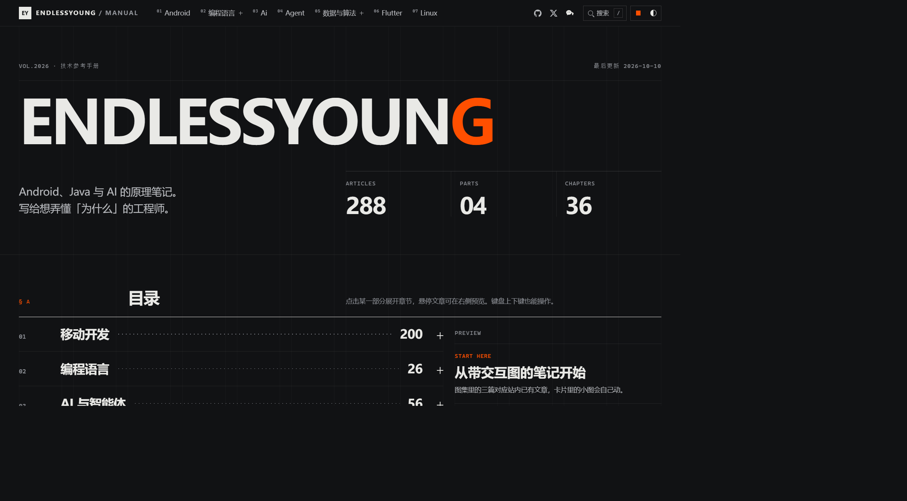
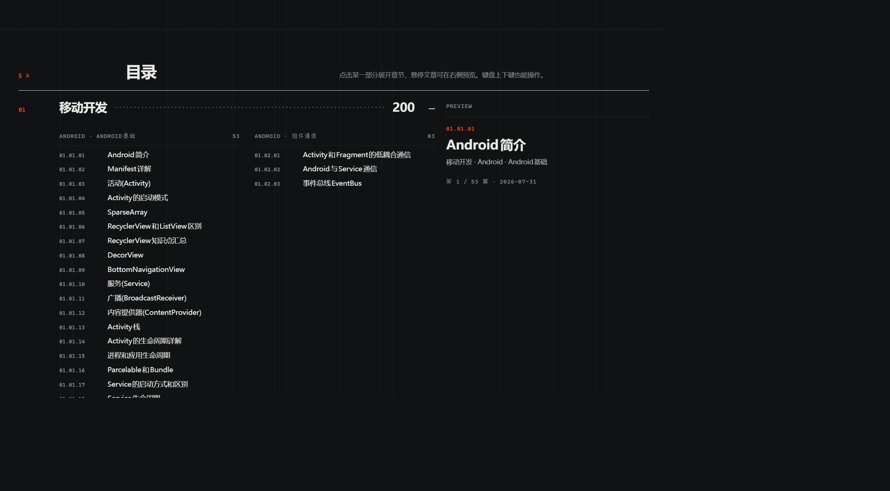
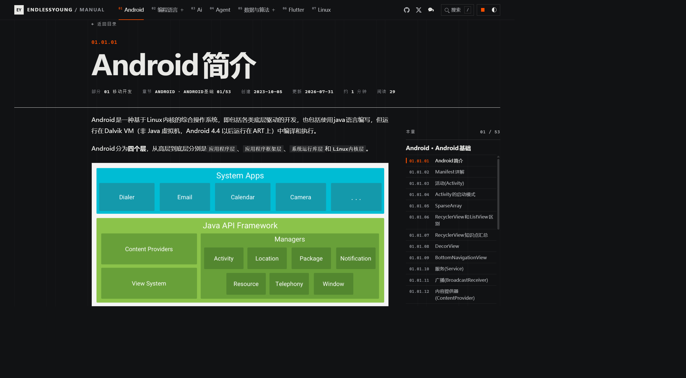

Android · Kotlin · Java · AI

<h1 align="center">ENDLESSYOUNG / MANUAL</h1>

记录源码里的机制，也记录实践中的问题。

<em>这世界太大，勇敢的少年奔赴天涯。</em>

  <a href="https://endlessyoung.top/">进入博客</a> ·
  <a href="https://endlessyoung.top/archives.html">全部文章</a> ·
  <a href="https://endlessyoung.top/tags/">按标签查阅</a> ·
  <a href="https://endlessyoung.top/feed.xml">订阅 RSS</a>

  

这里是我的学习笔记，主要写 Android、Kotlin、Java 和 AI。读源码时没想通的地方、写代码时碰到的问题，会慢慢整理到这里：一条消息怎样被处理，一个对象何时被回收，一次重复请求为什么会发生。

文章里有原理梳理、代码示例，也有能动手操作的图解。可以顺着一个主题往下读，也可以带着问题进来，找到需要的那一篇。

## 这里写些什么

### Android：从组件用法到系统内部

围绕 Activity、Service、进程通信、消息机制和界面绘制，追踪应用与系统之间的调用过程。也记录 Jetpack Compose、列表与图片缓存，以及实际开发中的请求合并、后台任务等问题。

- [Handler](https://endlessyoung.top/Android/Handler.html)：消息如何入队，Looper 又如何取出并分发它。
- [RecyclerView 四级缓存](https://endlessyoung.top/Android/RecyclerView四级缓存.html)：一个 ViewHolder 离开屏幕后，会去哪里，又怎样被复用。
- [Glide 四级缓存](https://endlessyoung.top/Android/Glide四级缓存.html)：一次图片加载如何依次查找活动资源、内存与磁盘缓存。
- [从重复请求到 SingleFlight](https://endlessyoung.top/Android/从重复请求到SingleFlight.html)：相同请求如何合并，数据库订阅与网络请求分别负责什么。

[浏览 Android 文章 →](https://endlessyoung.top/Android/)

### Kotlin 与 Java：理解并发、运行时与语言细节

Kotlin 部分记录协程、Flow、Channel、泛型与常用语法；Java 部分关注线程池、并发同步、类加载与 JVM 内存管理。读这些内容时，我更关心执行过程：任务在哪里运行，状态由谁维护，对象为什么还没有被回收。

- [协程上下文](https://endlessyoung.top/Kotlin/协程上下文.html)：CoroutineContext 里有哪些元素，它们各自影响什么。
- [Flow](https://endlessyoung.top/Kotlin/Flow.html)：用协程组织异步数据流。
- [CAS](https://endlessyoung.top/Java/CAS.html)：两个线程竞争同一个变量时，比较与交换如何决定结果。
- [GC 算法](https://endlessyoung.top/Java/GC算法.html)：在同一段内存上观察标记清除、复制和整理的区别。

[浏览 Kotlin 文章 →](https://endlessyoung.top/Kotlin/) · [浏览 Java 文章 →](https://endlessyoung.top/Java/)

### AI 与智能体：从学习算法到语义表示

从监督学习、回归、聚类和神经网络等基础概念开始，记录算法要解决的问题与背后的思路。向量表示和文档切分则把视角带到具体的数据处理过程：文字怎样变成向量，一篇长文又该如何拆分。

- [监督学习入门](https://endlessyoung.top/Ai/监督学习入门.html)：从回归与分类认识监督学习。
- [Embedding](https://endlessyoung.top/Agent/Embedding.html)：为什么词语和句子可以用向量表示，语义关系如何体现为距离。
- [Chunking](https://endlessyoung.top/Agent/Chunking.html)：长文档如何切成适合检索的片段。

[浏览机器学习笔记 →](https://endlessyoung.top/Ai/) · [浏览 Agent 笔记 →](https://endlessyoung.top/Agent/)

### 算法与基础：把每一步想清楚

整理数组、排序、二分查找等常见问题，关注边界、指针移动和每一步操作的代价。也收录 SQL、Python、NumPy 与 C++ 的学习笔记，方便遇到问题时回来查阅。

- [二分查找](https://endlessyoung.top/数据结构和算法/二分查找.html)：观察搜索区间如何收缩，理解边界的变化。
- [常见的排序方法](https://endlessyoung.top/数据结构和算法/常见的排序方法.html)：用同一段数组比较冒泡、选择、插入、快排和堆排序。

## 有些过程，可以边读边操作

消息在队列中流转、线程争用变量、对象在内存中移动，只看一段文字不容易记住。部分文章把这些过程做成了交互图解，让执行中的状态变化直接出现在正文旁边。读到不确定的地方，可以停下来，对照代码和图里的变化再看一遍。

  
  &nbsp;
  

## 找到想读的那一篇

- **按主题读**：从首页展开章节，或打开[全部文章目录](https://endlessyoung.top/archives.html)，沿着一个方向往下看。
- **带着问题查**：按 `/`、`Ctrl + K` 或 `⌘ + K` 打开搜索；也可以用[标签](https://endlessyoung.top/tags/)找到不同分类下的相关笔记。
- **接着读下去**：文章里的章节导航与相关阅读可以继续查阅相邻内容；希望看到后续更新，可以[订阅 RSS](https://endlessyoung.top/feed.xml)。
