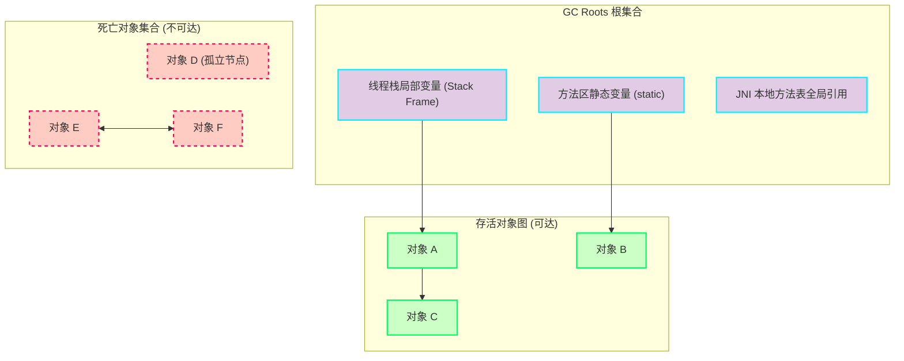
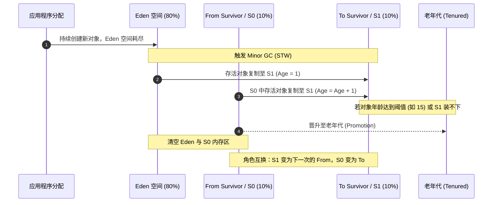
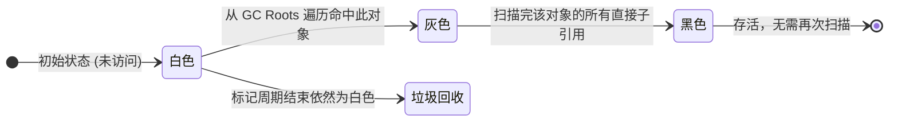

# GC 算法与核心机制全景图解

垃圾收集（Garbage Collection, GC）的核心职责是自动管理运行时的动态内存分配与回收：**哪些内存需要回收、什么时候回收、如何高效回收**。在 JVM 中，垃圾回收主要发生在堆（Heap）和方法区（Method Area / Metaspace）。

理解 GC 算法不仅要记住“标记”、“清除”、“整理”等名词，更要理解**内存碎片、指针碰撞（Bump-the-Pointer）、空闲链表（Free-List）、跨代引用、写屏障与并发标记三色不变性**等底层机制之间的权衡。

---

## 一、 GC 核心算法全景图集 (Visual Gallery)

本节将 GC 核心算法的关键状态流转、内存分布演进及屏障机制整理为**集中式图集**。在博客中，点击任意图表均可唤起全屏灯箱（Lightbox），支持双击缩放与切换。

### 图 1：对象存活性判定与循环引用陷阱



> **说明**：引用计数法无法识别 E 与 F 的循环成环泄漏；可达性分析以 GC Roots 为起点，断链的孤立环直接被划入垃圾集合。

### 图 2：三大经典收集算法内存演变横向对比


### 图 3：Appel 式新生代双 Survivor 滚动复制时序



### 图 4：老年代跨代引用与卡表（Card Table）写屏障拦截

```mermaid
flowchart TD
    subgraph OldGen ["老年代内存 (每 512 字节划分一个卡页)"]
        CP0["Card Page 0"]
        CP1["Card Page 1 (包含老年代对象 X)"]
        CP2["Card Page 2"]
    end

    subgraph CardTable ["卡表字节数组 CARD_TABLE[]"]
        CT0["0 (Clean)"]
        CT1["1 (Dirty)"]
        CT2["0 (Clean)"]
    end

    subgraph YoungGen ["新生代内存"]
        YObj["新生代对象 Y"]
    end

    CP1 -.->|对象 X 引用 Y (写屏障触发)| YObj
    CP1 ===|映射| CT1
    CP0 ===|映射| CT0
    CP2 ===|映射| CT2

    subgraph MinorGC ["Minor GC 扫描"]
        Scanner["GC 线程扫描卡表"]
        Scanner -->|仅检测 Dirty 卡页| CT1
        CT1 -->|快速定位待查对象| CP1
    end

    classDef dirty fill:#ff005533,stroke:#ff0055,stroke-width:2px;
    classDef clean fill:#00ff6622,stroke:#6272a4,stroke-width:1px;
    class CP1,CT1 dirty;
    class CP0,CP2,CT0,CT2 clean;
```

### 图 5：并发三色标记状态推进与漏标事故推导

```mermaid
flowchart TD
    subgraph Step1 ["步骤 1: 正常标记推进"]
        direction LR
        B1["黑色对象 A"] --> G1["灰色对象 B"]
        G1 --> W1["白色对象 C"]
    end

    subgraph Step2 ["步骤 2: 用户线程并发篡改引用 (触发两项充要条件)"]
        direction LR
        B2["黑色对象 A"]
        G2["灰色对象 B"]
        W2["白色对象 C"]

        B2 ==>|条件一: 插入直接引用| W2
        G2 -.->|条件二: 斩断原有引用链 (置为 null)| W2
    end

    subgraph Step3 ["步骤 3: 致命后果 (漏标)"]
        direction LR
        B3["黑色对象 A (已标黑，不再扫描其引用)"]
        G3["灰色对象 B (子引用为空，自身转黑)"]
        W3["白色对象 C (孤立白色，被当做垃圾回收！)"]

        B3 --> W3
    end

    classDef black fill:#1e1e2e,stroke:#00f0ff,stroke-width:2px,color:#fff;
    classDef grey fill:#6272a488,stroke:#bdc3d0,stroke-width:2px,color:#fff;
    classDef white fill:#ffffff22,stroke:#f8f8f2,stroke-width:1.5px,stroke-dasharray: 4 4;
    classDef danger fill:#ff005544,stroke:#ff0055,stroke-width:2.5px;

    class B1,B2,B3 black;
    class G1,G2,G3 grey;
    class W1,W2 white;
    class W3 danger;
```

### 图 6：两类漏标解决方案（增量更新 vs 原始快照 SATB）

```mermaid
flowchart LR
    subgraph Problem ["漏标必须同时满足"]
        C1["条件一: 黑色对象插入指向白色对象的引用"]
        C2["条件二: 灰色对象删除了指向该白色对象的引用"]
    end

    subgraph Solution1 ["方案 1: 增量更新 (CMS 采用)"]
        S1["写后屏障: 记录新插入的引用关系"]
        S1_Action["并发标记结束后，将对应黑色对象退化为灰色重新扫描"]
        C1 --> S1 --> S1_Action
    end

    subgraph Solution2 ["方案 2: 原始快照 SATB (G1 采用)"]
        S2["写前屏障: 记录被删除的旧引用关系"]
        S2_Action["标记时依然按照快照将白色对象标记为存活"]
        C2 --> S2 --> S2_Action
    end

    classDef c fill:#ff005522,stroke:#ff0055,stroke-width:1.5px;
    classDef s fill:#00f0ff22,stroke:#00f0ff,stroke-width:1.5px;
    class C1,C2 c;
    class S1,S2,S1_Action,S2_Action s;
```



---

## 二、 如何判断对象已死？

在回收内存之前，收集器第一步必须精确判定哪些对象已经死亡（不可能再被任何活着的途径访问）。

### 2.1 引用计数算法（Reference Counting）

**机制**：给每个对象分配一个引用计数器。每当有一个地方引用它时，计数器值加 1；当引用失效（超出作用域或被置 `null`）时，计数器值减 1。任何时刻计数器为 0 的对象就不能再被使用。

**致命缺陷：循环引用（Circular Reference）**。当两个对象互相持有对方的引用，但外部变量已不再引用它们时，两者的计数器均维持为 1，无法被回收，造成逻辑内存泄漏。

### 2.2 可达性分析算法（Reachability Analysis）

现代主流虚拟机（HotSpot、ART 等）均采用可达性分析算法。

**机制**：以一系列被称为 **GC Roots** 的根对象集合为起始节点，根据引用关系自顶向下搜索。搜索走过的路径称为“引用链”（Reference Chain）。如果一个对象到 GC Roots 没有任何引用链相连（即从 GC Roots 不可达），则证明此对象不可用。


_图 1：可达性分析原理与循环引用垃圾辨识（对象 E 与 F 虽有双向引用，但脱离 GC Roots 树，判定为死亡）_

#### 哪些对象可以作为 GC Roots？

1. **虚拟机栈（栈帧中的局部变量表）中引用的对象**：如方法正在执行的参数、局部变量。
2. **方法区中类静态属性引用的对象**：如 Java 类的 `public static Object instance`。
3. **方法区中常量引用的对象**：如字符串常量池（String Table）里的引用、`final` 常量。
4. **本地方法栈中 JNI（Native 方法）引用的对象**。
5. **JVM 内部的核心引用**：系统类加载器、基本数据类型的 Class 对象、常驻异常（如 `NullPointerException`）。
6. **被同步锁（`synchronized` 关键字）持有的对象**。

---

## 三、 三大经典垃圾收集算法深度剖析

确认对象存活性后，具体的内存回收执行依赖以下三种经典算法。它们在**空间利用率、执行时间、内存连续性**之间体现了经典的工程权衡。


_三大基础垃圾收集算法的执行路径与内存布局结果对比_

### 3.1 标记-清除算法（Mark-Sweep）

标记-清除算法是最基础的收集算法，分为两个阶段：

1. **标记（Mark）**：遍历 GC Roots，将所有通过引用链可达的对象标记为存活。
2. **清除（Sweep）**：线性遍历整个堆内存，回收未被标记的对象所占用的内存空间。

#### 机制弊端与内存碎片化

- **内存碎片问题（Fragmentation）**：清除未标记对象后，可用空间零碎分布在各处。当应用后续需要分配一个较大的连续对象（如大数组）时，即使总空闲内存充足，也会因找不到足够大的连续内存块而提前触发又一次垃圾收集。
- **分配效率下降**：由于内存不连续，JVM 无法使用高效的“碰撞指针（Bump-the-Pointer）”，而必须退化为**空闲链表（Free-List）**结构，并在分配时进行遍历查找（如 First-Fit 或 Best-Fit），增加了对象分配的时间开销。
- **执行效率随堆大小线性恶化**：标记和清除两个过程的耗时都与堆中对象总数成正比。

---

### 3.2 复制算法（Copying）

为解决标记-清除算法的碎片问题与效率缺陷，Fenichel 和 Yochelson 提出了半区复制（Semi-Space Copying）算法。

**机制**：将可用内存按容量划分为大小相等的两块（From 空间与 To 空间），每次只使用其中一块。当 From 空间用尽，触发 GC：

1. 从 GC Roots 开始扫描，将所有存活对象依次复制到 To 空间；
2. 按照顺序紧凑排列在 To 空间首部，分配指针相应递增；
3. 直接一次性清空整块 From 空间；
4. 交换 From 与 To 的角色，完成一次回收。

#### 优点与代价

- **优**：没有内存碎片；对象分配只需移动堆顶指针（碰撞指针），速度极快；回收时只需关注存活对象，在对象存活率极低的新生代效率极高。
- **劣**：代价是内存空间对半砍，可用内存直接缩水至 50%。

---

### 3.3 Appel 式复制算法：新生代的实战优化

IBM 公司对系统运行的大量统计表明：**新生代中 98% 以上的对象都是“朝生夕灭”的**。因此并不需要按照 1:1 的比例划分半区。

Andrew Appel 在此基础上提出了更实用的内存划分方案，成为 HotSpot 虚拟机新生代的核心设计：

- 将新生代划分为一块较大的 **Eden 空间** 和两块较小的 **Survivor 空间**（分别称为 From Survivor / S0 与 To Survivor / S1）。
- HotSpot 默认的比例是 **Eden : S0 : S1 = 8 : 1 : 1**。
- 每次分配仅使用 Eden 和其中一块 Survivor（S0），总可用空间达到新生代容量的 **90%**（$80\% + 10\%$），仅有 $10\%$ 的内存会被闲置（S1）。


_Appel 式新生代 Survivor 滚动复制流转序列_

#### 分配担保机制（Handle Promotion Failure）

98% 存活率只是一般统计规律，极端情况下（如系统突发大流量），一次 Minor GC 后存活的对象体积可能远超过 $10\%$ 的 Survivor 空间。
此时由**老年代进行分配担保**：凡是 Survivor 空间无法容纳的存活对象，直接通过分配担保机制进入老年代。

---

### 3.4 标记-整理算法（Mark-Compact）

复制算法在对象存活率极高（如老年代）时效率骤降：不仅需要复制大量存活对象，更无法承受 50% 或额外的担保空间损耗。
针对老年代对象的特征，提出了标记-整理算法。

**机制**：

1. **标记**：与标记-清除相同，自 GC Roots 标记出所有存活对象；
2. **整理**：将所有存活对象都向内存空间的一端移动，紧凑排列；
3. **清除与指针更新**：直接清理掉端边界以外的内存，并修正所有指向移动对象的引用地址。

```
整理前内存状态：
+-------+-------+-------+-------+-------+-------+-------+
| 活Obj1| 垃圾A | 活Obj2| 垃圾B | 垃圾C | 活Obj3| 垃圾D |
+-------+-------+-------+-------+-------+-------+-------+
   |               |                       |
   +---------------+-------+               |
                           v               v
整理后内存状态（存活对象向左平移，消除碎片）：
+-------+-------+-------+-------------------------------+
| 活Obj1| 活Obj2| 活Obj3|          连续空闲区域         |
+-------+-------+-------+-------------------------------+
^                       ^
|                       +-- 碰撞指针 (Bump Pointer)
基地址
```

#### 双指针滑动压缩算法（Two-Finger Compaction 简析）

- 一个指针 `free` 从内存头部向后扫描空闲位置；
- 另一个指针 `live` 从内存尾部向前扫描存活对象；
- 将尾部的存活对象复制到头部的空闲空隙中，直到两指针相遇；
- 最后统一修正对象引用。这种方式保持了堆内纯净无碎片，支持碰撞指针分配，代价是移动对象并更新引用必须暂停所有用户线程（STW, Stop-The-World）。

---

<span id="fig-5"></span>

## 四、 分代收集理论与跨代引用技术

现代商业 JVM 垃圾收集器的设计基石是**分代收集假说（Generational Collection Theory）**：

1. **弱分代假说（Weak Generational Hypothesis）**：绝大多数对象都是朝生夕灭的。
2. **强分代假说（Strong Generational Hypothesis）**：熬过越多次垃圾收集过程的对象，越难以消亡。
3. **跨代引用假说（Intergenerational Reference Hypothesis）**：跨代引用相对于同代引用来说仅占极少数。

依据这些假说，JVM 将堆内存切分为**新生代（Young Generation）**和**老年代（Old Generation）**。新生代每次回收只关注少量存活对象，选用**复制算法**；老年代对象存活率高、没有额外空间担保，选用**标记-清除**或**标记-整理算法**。

### 4.1 跨代引用难题

在对新生代进行 Minor GC 时，新生代的对象可能被老年代的对象所引用。如果不做特殊处理，为了判定新生代某个对象是否存活，GC 必须顺着引用链遍历整个老年代，导致 Minor GC 蜕变成实质上的全堆扫描，性能彻底崩塌。

### 4.2 卡表（Card Table）与写屏障（Write Barrier）

JVM 采用**记忆集（Remembered Set）**技术解决跨代遍历问题。在 HotSpot 中，记忆集最常见的实现结构是**卡表（Card Table）**。

#### 卡表机制

- 将老年代内存划分为固定大小（通常是 512 字节）的内存块，每个块称为一个**卡页（Card Page）**。
- 卡表是一个字节数组 `CARD_TABLE[]`，数组的每一个元素对应老年代的一个卡页。
- 只要卡页内存在至少一个对象的字段引用了新生代对象，这个卡页对应的卡表元素的值就标记为 `1`（通常称此卡页为“变脏 / Dirty”）。
- Minor GC 时，不需要遍历整个老年代，只需遍历卡表中标记为 Dirty 的卡页，将其中的对象加入 GC Roots 一并扫描即可。

```mermaid
flowchart TD
    subgraph OldGen ["老年代内存 (每 512 字节划分一个卡页)"]
        CP0["Card Page 0"]
        CP1["Card Page 1 (包含老年代对象 X)"]
        CP2["Card Page 2"]
    end

    subgraph CardTable ["卡表字节数组 CARD_TABLE[]"]
        CT0["0 (Clean)"]
        CT1["1 (Dirty)"]
        CT2["0 (Clean)"]
    end

    subgraph YoungGen ["新生代内存"]
        YObj["新生代对象 Y"]
    end

    CP1 -.->|对象 X 引用 Y (写屏障触发)| YObj
    CP1 ===|映射| CT1
    CP0 ===|映射| CT0
    CP2 ===|映射| CT2

    subgraph MinorGC ["Minor GC 扫描"]
        Scanner["GC 线程扫描卡表"]
        Scanner -->|仅检测 Dirty 卡页| CT1
        CT1 -->|快速定位待查对象| CP1
    end

    classDef dirty fill:#ff005533,stroke:#ff0055,stroke-width:2px;
    classDef clean fill:#00ff6622,stroke:#6272a4,stroke-width:1px;
    class CP1,CT1 dirty;
    class CP0,CP2,CT0,CT2 clean;
```

_卡表索引映射与写屏障（Write Barrier）变脏机制_

#### 写屏障如何更新卡表？

JVM 在字节码层面，当检测到有对引用类型字段的赋值操作时（如 `obj.field = value`），通过 JIT 编译器在赋值前后插入一段切面指令（即**写屏障 / Write Barrier**）：

```c
// 简化伪代码：写后屏障 (Post-Write Barrier) 更新卡表
void post_write_barrier(oop* field_address, oop new_val) {
    // 将对象字段物理地址右移 9 位（除以 512），得到卡表下标并置为 Dirty
    size_t card_index = ((size_t)field_address) >> 9;
    CARD_TABLE[card_index] = 0; // 0 代表 dirty
}
```

---

## 五、 并发标记与三色标记图谱

传统的垃圾收集要求在标记阶段全局 STW。对于数百 GB 乃至数 TB 的大堆，仅仅扫描对象图就要耗费数秒甚至数十秒。为了降低停顿时间，现代垃圾收集器（CMS、G1、Shenandoah、ZGC）引入了**并发标记（Concurrent Marking）**——即允许垃圾收集线程与用户应用线程同时运行。

并发标记的核心理论支撑是**三色标记（Tri-color Marking）**模型。

### 5.1 三色标记的颜色定义

在对象图遍历过程中，我们将对象根据扫描进度打上三种逻辑标记：

- ⚪ **白色（White）**：尚未被垃圾收集器访问过的对象。在分析初期，所有对象都是白色；若在分析结束时依然是白色，表示该对象不可达，即垃圾。
- 🔘 **灰色（Grey）**：该对象本身已经被垃圾收集器访问过，但**它直接引用的其他对象尚未全部被扫描**。灰色是中间推进状态。
- ⚫ **黑色（Black）**：该对象本身及其所有直接引用的对象都已经被垃圾收集器扫描过。黑色对象是存活的，且不会再对其直接引用进行重复扫描。



---

### 5.2 并发标记中的“漏标”事故

当用户线程与 GC 线程并发执行时，用户线程可能在 GC 线程扫描的间隙修改对象引用关系。这可能引发两种问题：

1. **浮动垃圾（Floating Garbage）**：原本存活的对象被置空，但本轮已被标黑。这只会导致本轮 GC 回收不完全，留到下一轮回收即可，不会影响程序正确性。
2. **对象消失 / 漏标（Object Missing）**：存活对象被误当成白色垃圾清理。这是致命的系统级错误。

**Wilson 在 1994 年的研究证明，漏标事故必须同时满足以下两个充要条件**：

1. **条件一（黑色插入白引用）**：赋值器插入了一条或多条从**黑色对象**到**白色对象**的新引用；
2. **条件二（灰色削减白引用）**：赋值器删除了全部从**灰色对象**到该**白色对象**的直接或间接引用。

```mermaid
flowchart TD
    subgraph Step1 ["步骤 1: 正常标记推进"]
        direction LR
        B1["黑色对象 A"] --> G1["灰色对象 B"]
        G1 --> W1["白色对象 C"]
    end

    subgraph Step2 ["步骤 2: 用户线程并发篡改引用 (触发两项充要条件)"]
        direction LR
        B2["黑色对象 A"]
        G2["灰色对象 B"]
        W2["白色对象 C"]

        B2 ==>|条件一: 插入直接引用| W2
        G2 -.->|条件二: 斩断原有引用链 (置为 null)| W2
    end

    subgraph Step3 ["步骤 3: 致命后果 (漏标)"]
        direction LR
        B3["黑色对象 A (已标黑，不再扫描其引用)"]
        G3["灰色对象 B (子引用为空，自身转黑)"]
        W3["白色对象 C (孤立白色，被当做垃圾回收！)"]

        B3 --> W3
    end

    classDef black fill:#1e1e2e,stroke:#00f0ff,stroke-width:2px,color:#fff;
    classDef grey fill:#6272a488,stroke:#bdc3d0,stroke-width:2px,color:#fff;
    classDef white fill:#ffffff22,stroke:#f8f8f2,stroke-width:1.5px,stroke-dasharray: 4 4;
    classDef danger fill:#ff005544,stroke:#ff0055,stroke-width:2.5px;

    class B1,B2,B3 black;
    class G1,G2,G3 grey;
    class W1,W2 white;
    class W3 danger;
```

_并发三色标记中“漏标”发生的因果链路推导_

---

### 5.3 破除漏标的工程解法：增量更新 vs 原始快照

既然漏标必须同时满足上述两个条件，那么只要打破其中任意一个条件，就能保证并发标记的正确性。主流商业收集器分别选择了不同的解法：

| 方案                                                | 破解条件   | 核心思想                                                                                                                                               | 屏障介入时机                       | 代表收集器         |
| :-------------------------------------------------- | :--------- | :----------------------------------------------------------------------------------------------------------------------------------------------------- | :--------------------------------- | :----------------- |
| **增量更新**<br>_(Incremental Update)_              | 打破条件一 | 当黑色对象插入新的白色对象引用时，通过**写屏障**记录该引用。并发标记结束后，将这些黑色对象**退化为灰色**重新扫描一遍。                                 | 写后屏障<br>_(Post-Write Barrier)_ | **CMS**            |
| **原始快照**<br>_(Snapshot-At-The-Beginning, SATB)_ | 打破条件二 | 当灰色对象斩断指向白色对象的引用时，通过**写屏障**将旧的白色引用记录下来。无论引用关系怎么改，标记阶段**依然按照 GC 开始时的对象图快照**进行存活判定。 | 写前屏障<br>_(Pre-Write Barrier)_  | **G1、Shenandoah** |

- **CMS 选择增量更新**：由于重新扫描退化的黑色对象，在重新标记（Remark）阶段依然需要较长时间的 STW 来清理变动。
- **G1 选择 SATB**：配合卡表与 RSet，将变化记录在 SATB 缓冲区队列中，避免了对黑色对象的大规模回溯重扫，大幅压低了 Remark 阶段的 STW 时间。

---

## 六、 垃圾收集算法全维度横向比对矩阵

不同的垃圾回收算法没有绝对的优劣，只有针对具体生命周期场景的最佳适配：

| 评估维度              | 标记-清除 (Mark-Sweep)               | 复制算法 (Copying)                     | 标记-整理 (Mark-Compact)                  |
| :-------------------- | :----------------------------------- | :------------------------------------- | :---------------------------------------- |
| **内存利用率**        | **高**（100% 空间可用，无保留区）    | **低**（传统半区 50%，Appel 式约 90%） | **高**（100% 空间可用，紧凑无浪费）       |
| **内存碎片**          | **产生严重碎片**                     | **无碎片**                             | **无碎片**                                |
| **分配机制**          | 空闲链表（查找较慢，可能局部不命中） | 碰撞指针（仅移动顶指针，极快）         | 碰撞指针（仅移动顶指针，极快）            |
| **移动对象开销**      | **无**（保持原位不动）               | **有**（存活对象全体位移复制）         | **高**（内存滑动移动 + 全局引用指针修正） |
| **GC 耗时与对象特征** | 与**堆总大小 / 垃圾数**正相关        | 与**存活对象数**正相关（存活越少越快） | 与**存活对象数 + 堆总大小**正相关         |
| **典型适用代**        | 老年代（存活率高、对象变动少）       | 新生代（存活率极低，朝生夕灭）         | 老年代（避免碎片、对象生命周期长）        |
| **代表收集器**        | CMS (Concurrent Mark Sweep)          | Serial New, ParNew, Parallel Scavenge  | Serial Old, Parallel Old                  |

---

## 七、 现代低延迟 GC 的演进脉络

经典的垃圾收集算法主要通过**分代空间划分 + STW 期间搬运对象**来维持内存紧凑。随着服务器物理内存从 8GB 飙升到 512GB 乃至数 TB，停顿时间（STW）逐渐成为系统的最大瓶颈。垃圾收集器的演进核心变成了**如何将 STW 的各个阶段一步步挪到与用户线程并发执行**：

1. **CMS 时代**：首次将**标记阶段**并发化（并发标记、并发清除），但整理阶段仍依赖 STW，且浮动垃圾容易导致 Concurrent Mode Failure 退化为 Serial Old。
2. **G1 时代**：打破固定物理分代，改为均匀的 **Region 棋盘化布局**，基于停顿预测模型（Pause-Prediction Model）实现可预测停顿的 Mixed GC，采用 SATB 保证并发标记效率。
3. **ZGC / Shenandoah 时代（全并发）**：
   - 彻底攻克了“并发移动对象（Concurrent Relocate）”难题。
   - **ZGC** 引入**染色指针（Colored Pointers）**（利用 64 位指针的高 4 位存储 Mark0/Mark1/Remapped 状态元数据）与**读屏障（Load Barrier）**（通过 Self-Healing 自愈技术，线程读到旧地址时触发指针修正）。
   - 将对象标记、对象转移、指针重映射全部推向并发化，在 TB 级大内存下将 STW 严格压制在 **1 毫秒以内**，且停顿时间与堆大小完全解耦。

从简单的标记-清除到 ZGC 的全并发染色指针，GC 演进的底层始终围绕着同一个轴心平衡运转：**用适度的吞吐量与 CPU 屏障开销，换取极致的连续内存空间与超低 STW 延迟**。
