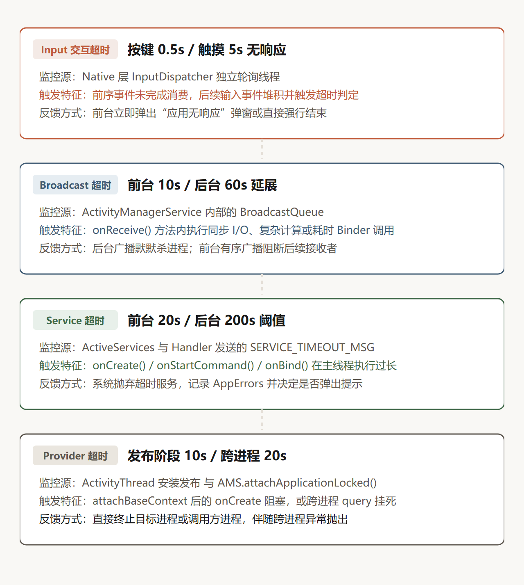
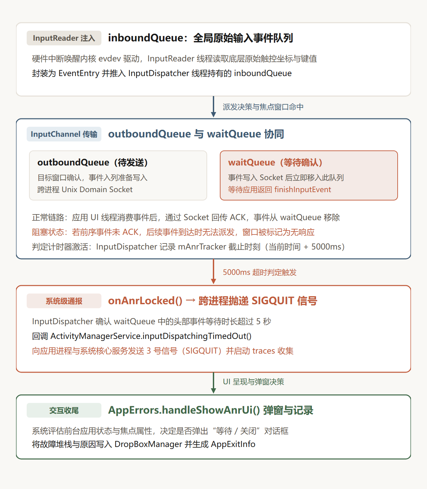
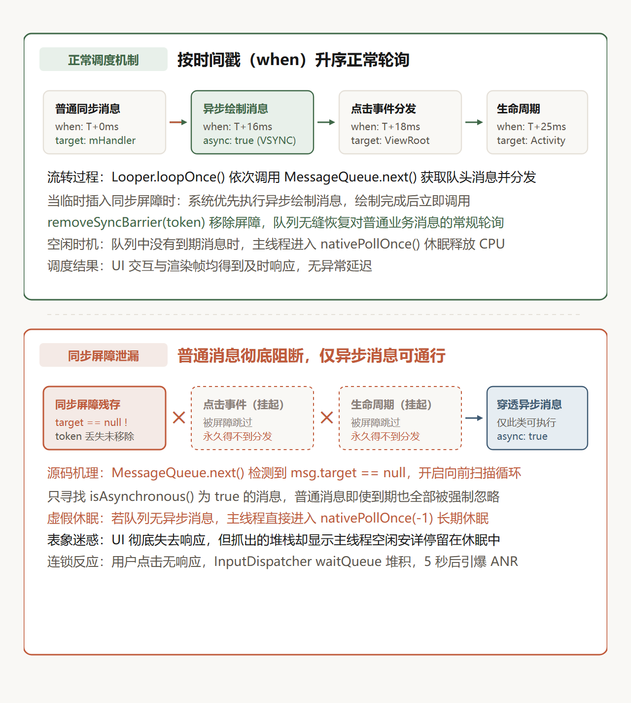
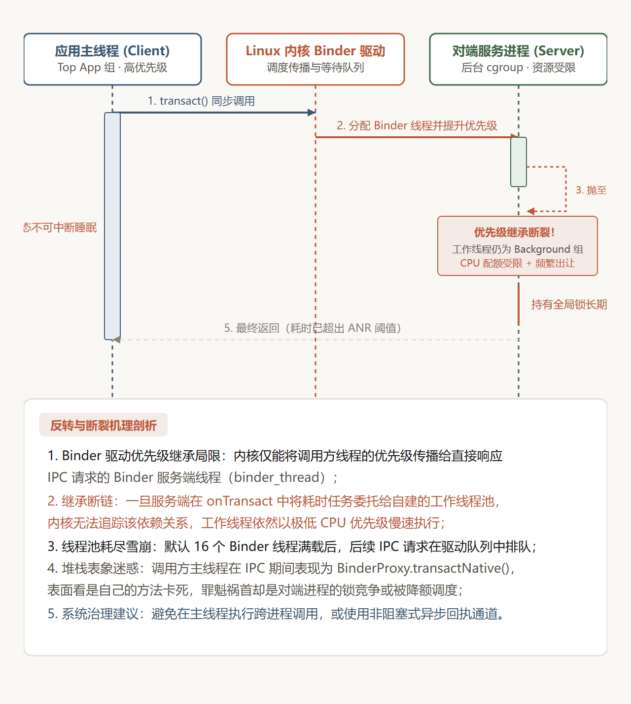

# ANR 底层剖析：Input 超时、同步屏障泄漏与优先级反转

在 Android 移动端稳定性治理中，ANR（Application Not Responding，应用无响应）是仅次于 Crash 的核心指标。它直接关联到 Google Play 的坏账率考核与国内各大应用商店的体验分级评定。

在日常排查中，不少工程团队经常遇到一个极其困惑的现象：

- 监控后台上报了一批严重影响用户的 ANR 告警；
- 点开故障现场的主线程调用栈，堆栈信息却显得格外“无辜”；
- 栈顶既没有死循环，也没有耗时密集的计算操作，甚至常常安详地停留在 `MessageQueue.nativePollOnce()` 或普通的等待方法上。

**许多开发者据此判定：“主线程明明处于空闲休眠状态，怎么可能触发 ANR？一定是系统误报，或者是设备厂商的底层改动引入了偶发缺陷。”**

这种推论忽略了 ANR 机制在操作系统内核、系统服务以及运行时之间的联动逻辑。

ANR 报告记录的堆栈，仅仅是系统服务执行超时判定并抓取现场的“瞬间切片”，而往往并非引发超时的“第一案发现场”。在更复杂的工程场景下，Input 事件分发的特殊计时机制、MessageQueue 内部同步屏障（Sync Barrier）的异常泄漏，以及 Binder 跨进程通信链路上的调度优先级反转，都可能在主线程看似平静的表象下，悄然引爆整个应用的无响应状态。

本文结合 AOSP 现代源码实现、Linux 调度器机制与线上监控实践，深入拆解这些隐藏在休眠表象背后的 ANR 判定盲区。



---

## 1. 现象与误区：为什么抓到的 ANR 堆栈总是在休眠？

要理解为什么休眠中的主线程会招致系统判决，首先需要认清监控堆栈采集的时序差，以及系统对不同组件设置的计时规则。

### 1.1 案发现场与抓捕时刻的时间差

许多开发者把 ANR 的堆栈采集理解为“代码卡在某处时被当场截获”。在真实运行环境中，系统的检测是一条异步流水线：

1. **瞬态时序交错（Timing Misalignment）**：
   以广播接收器为例，前台广播允许的执行上限是 10 秒。假定某个 `BroadcastReceiver.onReceive()` 执行了一段密集的 I/O 操作，耗时整整 9.9 秒。在 9.9 秒时该方法顺利执行完毕，主线程重新回到 `Looper.loopOnce()`，并在空闲等待下一条消息时调用 `nativePollOnce()` 进入休眠。此时，系统服务的超时监测线程若因系统负载波动，稍有延迟地在第 10.05 秒发起超时清算，系统向应用进程投递信号抓取堆栈时，主线程已经回到休眠状态。从上报日志来看，主线程停留在 `nativePollOnce()`，但引发超时的根源是此前耗时 9.9 秒的广播处理。

2. **微小消息积压导致的队列拥塞（Message Queue Stacking）**：
   主线程的执行单位是消息。如果业务代码并没有单次耗时 5 秒的超长方法，而是连续向主线程派发了 500 个短小任务，每个任务耗时 15ms。这 500 个微任务累积消耗了 7.5 秒的主线程计算资源。在第 7.5 秒时，如果系统正在等待某个输入事件被处理，便会认定发生了无响应。此时抓取到的堆栈，可能仅仅是第 500 个微任务中非常不起眼的一行日志打印代码。如果只盯着这行代码排查，往往会得出“代码毫无问题却被判 ANR”的错误结论。

### 1.2 ANR 的四大触发源与判定阈值

Android 系统针对四大不同组件，设定了不同的超时判定标准与驱动机构。我们将其结构化梳理如下：

- **Input 交互事件超时**
  - 触发阈值：按键事件 0.5 秒，屏幕触摸交互 5 秒；
  - 监控驱动：由 Native 层的 `InputManagerService` 与 `InputDispatcher` 独立轮询线程直接驱动；
  - 触发特征：当前事件未完成消费，后续输入事件堆积并超过时限，用户侧表现为屏幕点击完全无反馈；
  - 终端反馈：系统直接向前台用户弹出无响应对话框，或直接将异常计入崩溃指标。

- **BroadcastReceiver 广播超时**
  - 触发阈值：前台有序广播 10 秒，后台有序广播 60 秒；
  - 监控驱动：由 `ActivityManagerService` 内部的 `BroadcastQueue` 通过 Handler 延时消息驱动；
  - 触发特征：主线程在 `onReceive()` 内部执行同步耗时调用、复杂序列化或重度数据库操作；
  - 终端反馈：后台广播超时往往由系统直接杀进程处理，前台广播则可能阻断后续接收者链路。

- **Service 生命周期超时**
  - 触发阈值：前台 Service 20 秒，后台 Service 200 秒；
  - 监控驱动：由 `ActiveServices` 借助 `SERVICE_TIMEOUT_MSG` 机制进行时钟倒数；
  - 触发特征：`onCreate()`、`onStartCommand()` 或 `onBind()` 在主线程长期占有时钟片；
  - 终端反馈：系统记录错误现场，依据前后台状态决定是否提示用户并回收服务。

- **ContentProvider 发布超时**
  - 触发阈值：应用进程启动发布阶段 10 秒，跨进程数据检索 20 秒；
  - 监控驱动：由 `ActivityThread` 安装发布逻辑与 AMS 协同管理；
  - 触发特征：`ContentProvider.onCreate()` 初始化过程繁重，阻塞了进程附着后的首次发布握手；
  - 终端反馈：系统直接终止启动中的应用进程，并在调用方抛出跨进程超时异常。

在这四类触发源中，后三者均由 Java 层的 `system_server` 通过发送延时消息进行相对直观的计时判定；唯独 Input 交互事件超时，隐藏着一套极其特殊的判定时序。

---

## 2. 判定机理：Input 5秒超时到底是如何倒计时的？

很多技术资料中常有一句模糊的概括：“用户点击屏幕后，如果 5 秒内没有处理完就会产生 ANR”。

这种说法在很多场景下与事实相去甚远。在实际排查中，甚至经常出现这样的现象：应用主线程卡死了整整 8 秒，用户点击了一次屏幕，什么都没发生；用户在焦躁中连续快速点击了第二次，系统立刻弹出了 ANR 提示。

为什么点击一次不报，连续点击第二次才立刻判定超时？答案深藏在 AOSP Native 层的 `InputDispatcher` 状态机中。



### 2.1 InputDispatcher 的三级事件流转

在 Android 系统中，触摸事件与按键输入并不走常规的 Binder 通信，而是通过专用的 Unix Domain Socket（即 `InputChannel`）进行高性能跨进程传输。

在 `system_server` 的原生进程内，运行着两个核心线程：

- `InputReader` 线程：通过 Linux 内核的 `evdev` 设备节点持续轮询底层硬件事件，将原始坐标与动作转换封装为 `RawEvent`，并交给派发核心；
- `InputDispatcher` 线程：维护全局窗口层级结构，负责把事件按焦点与层级准确派发给目标应用。

`InputDispatcher` 内部维护了三组核心队列：

1. `inboundQueue`：存放从 `InputReader` 送入的所有原始事件；
2. `outboundQueue`：存放已经确认目标窗口、准备写入 `InputChannel`（Socket）发送给目标应用进程的事件；
3. `waitQueue`：存放已经通过 Socket 写入应用进程、正在等待应用回传完成确认（ACK）的事件。

### 2.2 为什么点击一次不卡，点击第二次才报 ANR？

当用户在界面上产生交互时，`InputDispatcher` 执行事件分发，关键的判定逻辑集中在 `findFocusedWindowTargetsLocked()` 方法中：

```cpp
// 节选自 AOSP frameworks/native/services/inputflinger/dispatcher/InputDispatcher.cpp
int32_t InputDispatcher::findFocusedWindowTargetsLocked(nsecs_t currentTime,
        const EventEntry& entry, std::vector<InputTarget>& inputTargets, nsecs_t* nextWakeupTime) {
    // 1. 检查当前焦点窗口是否存在
    if (mFocusedWindowHandle == nullptr) {
        ALOGI("Waiting for focus window...");
        return handleTargetsNotReadyLocked(currentTime, entry, nullptr, nextWakeupTime);
    }

    // 2. 检查窗口连接状态与 waitQueue 是否发生堆积
    sp<Connection> connection = getConnectionLocked(mFocusedWindowHandle->getToken());
    if (connection != nullptr) {
        if (!connection->waitQueue.empty()) {
            // 关键：若先前的事件在 waitQueue 中尚未收到应用回传，窗口被视为不可接收新事件！
            ALOGD("Waiting for window %s to finish handling previous input events.",
                  mFocusedWindowHandle->getName().c_str());
            return handleTargetsNotReadyLocked(currentTime, entry, mFocusedWindowHandle, nextWakeupTime);
        }
    }
    // 3. 正常状态：派发事件并注入 outboundQueue
    addWindowTargetLocked(mFocusedWindowHandle, InputTarget::FLAG_DISPATCH_AS_IS, inputTargets);
    return INPUT_EVENT_INJECTION_SUCCEEDED;
}
```

这段代码揭示了 Input 超时最核心的运作机理：

1. **第一次点击（Down 事件）**：
   此时目标窗口的 `waitQueue` 是空的。`InputDispatcher` 顺利把事件写入 Socket，移入 `waitQueue`，然后它的派发任务就暂时完成了。应用主线程即便正在执行耗时任务，该事件也会安详地躺在应用端系统的内核 Socket 接收缓冲区中。**此时，`InputDispatcher` 根本没有启动 5 秒倒计时计时器！** 如果用户在主线程卡顿的这 8 秒内只点击了一次，且后续没有任何新输入，系统很可能完全不会触发 Input ANR。

2. **第二次点击或移动事件（Move / Up / 第二次 Tap）**：
   当用户因为界面卡住未响应，产生了第二次点击。此时新的输入事件进入 `InputDispatcher`，调度器唤醒并再次调用 `findFocusedWindowTargetsLocked()`。它发现该窗口的 `waitQueue` 中，上一个事件居然还没有被消费掉！

3. **超时时钟的正式激活**：
   此时窗口被判定为“目标未就绪”（`handleTargetsNotReadyLocked`）。系统从这一刻起，记录 `mAnrTracker` 的超时截止时间（通常设定为当前时间加上 5000ms）。如果在接下来的 5 秒内，应用的主线程依然处于阻塞状态，未能消费完前一个事件并发送 ACK 回执，`InputDispatcher` 在下一次超时轮询中就会执行 `onAnrLocked()`，正式向系统服务通报发生 ANR。

这就是为什么许多线上 Input ANR 的日志中，记录的事件处理时间明明写着 5000ms 甚至更大，但在业务监控中并没有找到任何一个耗时刚好是 5 秒的 `onClick` 方法。

### 2.3 finishInputEvent 与跨进程 Socket 通信

应用端是如何向系统汇报事件消费状态的？

应用进程的 `ViewRootImpl` 内部创建了一个 `WindowInputEventReceiver`，运行在主线程上。当 Socket 中有数据到达时，Linux 的 `epoll` 机制唤醒主线程的 `Looper`，主线程从 Socket 中读取事件，逐层向下分发给 `DecorView`、`ViewGroup` 直至目标 `View` 的 `dispatchTouchEvent()`。

在整个分发流程执行完后，应用必须调用 `finishInputEvent()`：

```java
// 节选自 AOSP frameworks/base/core/java/android/view/ViewRootImpl.java
final class WindowInputEventReceiver extends InputEventReceiver {
    public WindowInputEventReceiver(InputChannel inputChannel, Looper looper) {
        super(inputChannel, looper);
    }

    @Override
    public void onInputEvent(InputEvent event) {
        Trace.traceBegin(Trace.TRACE_TAG_VIEW, "deliverInputEvent");
        try {
            boolean handled = dispatchInputEvent(event);
            // 消费完成后必须显式回传 seq 序列号通知 Native Socket
            finishInputEvent(event, handled);
        } finally {
            Trace.traceEnd(Trace.TRACE_TAG_VIEW);
        }
    }
}
```

底层 Native 代码通过 Socket 发回一个仅有数十字节的确认包。`InputDispatcher` 解析到该序号后，将对应的事件从 `waitQueue` 移除。

一旦应用的主线程在调用 `finishInputEvent()` 之前停顿（例如在 UI 回调中做同步等待，或者消息队列被其他逻辑阻塞），`waitQueue` 就无法释放，为后续的超时判定埋下了诱因。

---

## 3. 隐形陷阱：同步屏障泄漏如何让主线程彻底“失聪”？

在许多排查案例中，主线程既没有复杂的网络 I/O，也没有大循环，堆栈清晰显示为：

```txt
"main" prio=5 tid=1 Native
  | group="main" sCount=1 dsCount=0 flags=1 obj=0x72395638 self=0xb400007b8b408800
  | sysTid=24150 nice=-10 cgrp=top-app sched=0/0 handle=0x7dc28154f8
  | state=S schedstat=( 125345091 18921820 312 ) utm=10 stm=2 core=5 HZ=100
  #00 pc 000000000004e38c  /apex/com.android.runtime/lib64/bionic/libc.so (syscall+28)
  #01 pc 000000000001bc48  /system/lib64/libutils.so (android::Looper::pollOnce+840)
  #02 pc 000000000011a6bc  /system/lib64/libandroid_runtime.so (android::NativeMessageQueue::pollOnce+44)
  at android.os.MessageQueue.nativePollOnce(Native Method)
  at android.os.MessageQueue.next(MessageQueue.java:335)
  at android.os.Looper.loopOnce(Looper.java:187)
  at android.os.Looper.loop(Looper.java:299)
  at android.app.ActivityThread.main(ActivityThread.java:8250)
```

用户反馈应用界面彻底卡死，点击任何按钮均无反应，但系统 CPU 占用率极低。这往往是**同步屏障（Sync Barrier）泄漏**所引发的隐形瘫痪。

### 3.1 同步屏障的设计初衷：VSYNC 优先级保障

为了保证界面刷新的流畅度，在屏幕刷新脉冲到来时，渲染绘制工作必须以极高优先级得到执行，不得落后于排在前面的普通业务 Runnable。

Android 的 `MessageQueue` 设计了同步屏障机制：

- 在 `ViewRootImpl.scheduleTraversals()` 请求重绘时，系统会向主线程的 `MessageQueue` 插入一个特殊的 Message 节点；
- 这个 Message 的显著特征是其成员变量 `target == null`；
- 该节点不对应任何具体的 Handler，它的唯一作用是在单向链表中充当“路障”。

```java
// 节选自 AOSP frameworks/base/core/java/android/os/MessageQueue.java
@UnsupportedAppUsage
public int postSyncBarrier() {
    return postSyncBarrier(SystemClock.uptimeMillis());
}

private int postSyncBarrier(long when) {
    synchronized (this) {
        final int token = mNextBarrierToken++;
        final Message msg = Message.obtain();
        msg.markInUse();
        msg.when = when;
        msg.arg1 = token;
        // target 赋值为 null，作为同步屏障的特征标志
        msg.target = null;

        Message prev = null;
        Message p = mMessages;
        if (when != 0) {
            while (p != null && p.when <= when) {
                prev = p;
                p = p.next;
            }
        }
        if (prev != null) {
            msg.next = p;
            prev.next = msg;
        } else {
            msg.next = p;
            mMessages = msg;
        }
        return token;
    }
}
```

### 3.2 屏障泄漏引发的消息阻塞机理

来看 `MessageQueue.next()` 是如何处理这个特殊节点的：

```java
// 节选自 AOSP frameworks/base/core/java/android/os/MessageQueue.java
Message next() {
    int nextPollTimeoutMillis = 0;
    for (;;) {
        nativePollOnce(ptr, nextPollTimeoutMillis);

        synchronized (this) {
            final long now = SystemClock.uptimeMillis();
            Message prevMsg = null;
            Message msg = mMessages;

            // 核心机制：检查是否命中了同步屏障
            if (msg != null && msg.target == null) {
                // 遇到同步屏障！立即启动跳跃循环，专门寻找异步消息（isAsynchronous == true）
                do {
                    prevMsg = msg;
                    msg = msg.next;
                } while (msg != null && !msg.isAsynchronous());
            }

            if (msg != null) {
                if (now < msg.when) {
                    nextPollTimeoutMillis = (int) Math.min(msg.when - now, Integer.MAX_VALUE);
                } else {
                    // 找到可执行消息，将其从链表中取出并返回
                    mBlocked = false;
                    if (prevMsg != null) {
                        prevMsg.next = msg.next;
                    } else {
                        mMessages = msg.next;
                    }
                    msg.next = null;
                    msg.markInUse();
                    return msg;
                }
            } else {
                // 队列中没有异步消息，或者链表已空
                nextPollTimeoutMillis = -1;
            }
        }
    }
}
```

仔细剖析该循环的分支流转：

1. 一旦遇到 `msg.target == null`，队列**完全跳过所有的普通同步消息**（这涵盖了绝大多数业务代码、UI 点击事件的分发调用以及 Activity 生命周期分发）；
2. 调度器沿着链表一路向后检索，唯有被明确标记为异步（`isAsynchronous() == true`，如 Choreographer 的 VSYNC 回调）的消息才允许穿透屏障获得执行；
3. 如果队列后续没有异步消息，或者异步消息处理完毕，`msg` 最终变为 `null`；
4. `nextPollTimeoutMillis` 被设置为 `-1`，主线程在执行 `nativePollOnce(ptr, -1)` 后直接进入无限期休眠！

正常情况下，`doTraversal()` 执行后会立即通过 `removeSyncBarrier(token)` 将该节点从链表中摘除。但在某些复杂工程场景中：

- 某些第三方框架通过反射操纵 `MessageQueue` 替换了消息；
- `ViewRootImpl` 在执行生命周期与销毁流程时，由于时序竞争或未捕获的运行时异常，导致 `removeSyncBarrier()` 未能成对调用；
- 重绘过程中抛出了局部异常打断了清理逻辑。

一旦 `target == null` 的屏障长期滞留在队列头部，主线程对所有常规用户交互将彻底“失聪”。普通消息即使积压成千上万条也永远无法被调度。用户连续点击屏幕，InputDispatcher 的 `waitQueue` 迅速堆满，5 秒后系统准时判定 ANR。**而此时捕获到的主线程栈，正是那行极具欺骗性的 `nativePollOnce(ptr, -1)`。**



### 3.3 线上屏障泄漏的识别与自动防御

针对这种隐蔽故障，可以在调试阶段或线上 APM 体系中，设计一套主动扫描探针。

通过定时反射检查主线程 `MessageQueue.mMessages` 的状态：如果发现队头节点 `target == null`，且该节点的等待时间 `when` 已经早于系统当前时间若干秒（如 3000ms），即可断定发生了同步屏障泄漏：

```kotlin
class SyncBarrierWatchdog(private val mainHandler: Handler) {
    private val queueField by lazy {
        MessageQueue::class.java.getDeclaredField("mMessages").apply { isAccessible = true }
    }

    fun inspectBarrierStatus(): Boolean {
        val queue = mainHandler.looper.queue
        synchronized(queue) {
            val head = queueField.get(queue) as? Message ?: return false
            val now = SystemClock.uptimeMillis()

            // 队头存在无 target 的屏障节点，且已经滞留超过 3 秒
            if (head.target == null && (now - head.`when`) > 3000L) {
                val token = head.arg1
                Log.e("BarrierWatchdog", "检测到同步屏障泄漏！Token=$token, 滞留时长=${now - head.`when`}ms")
                // 触发故障报警，提取队列当前积压详情
                return true
            }
        }
        return false
    }
}
```

---

## 4. 跨进程泥潭：Binder 优先级反转与线程池耗尽

除了主线程自身逻辑的问题，跨进程通信（IPC）是引发“假死型”ANR 的另一大重灾区。

### 4.1 Binder 调用链上的阻塞与等待

当应用主线程调用系统服务（如 `PackageManager.getPackageInfo()`、`ClipboardManager.hasPrimaryClip()`）或访问自建跨进程 Service 时，底层执行的是同步 Binder 调用：

```txt
"main" prio=5 tid=1 Native
  at android.os.BinderProxy.transactNative(Native Method)
  at android.os.BinderProxy.transact(BinderProxy.java:571)
  at android.content.pm.IPackageManager$Stub$Proxy.getPackageInfo(IPackageManager.java:4120)
```

调用发起后，主线程通过 `ioctl(binderFd, BINDER_WRITE_READ, ...)` 陷入 Linux 内核。内核将当前主线程的状态置为不可中断睡眠（`TASK_UNINTERRUPTIBLE`，即 D 状态），并挂入 Binder 驱动的等待队列。

主线程在这个阶段完全让出 CPU，必须等待远端进程通过 Binder 驱动将执行结果回传，主线程才会被唤醒并恢复运行。

### 4.2 优先级继承机制的运作与断裂

在操作系统调度中，前台交互应用处于极高的调度等级（在 Android 的 cgroup 分组中归属于 `top-app`，拥有优先分配的高 CPU 份额和较优的 CFS nice 值）。

如果目标服务运行在一个低优先级的后台进程中（归属于 `background` cgroup，被内核限制了 CPU 配额），便会发生经典的**优先级反转（Priority Inversion）**：高优先级的前台主线程在等待一个低优先级的后台线程干活。

为了缓解该问题，Linux 内核 Binder 驱动实现了一套**优先级继承（Priority Inheritance, PI）**机制：

```c
// 节选自 Linux 内核 drivers/android/binder.c 核心调度片段
static void binder_set_priority(struct task_struct *task, const struct binder_priority *desired) {
    int min_policy = desired->sched_policy;
    int min_prio = desired->prio;

    // 当调用方的优先级高于接收方当前优先级时，动态提升接收线程的调度属性
    if (task->prio > min_prio) {
        task->prio = min_prio;
        task->normal_prio = min_prio;
        // 同步迁移对应的 cgroup 调度带宽与 nice 权重
        set_user_nice(task, min_prio);
    }
}
```

驱动在派发事务时，会自动把目标进程中负责接收该请求的 `binder_thread` 提升至调用方主线程同等的优先级。

**然而，在现代复杂工程架构中，这套继承机制经常面临“断裂”风险：**

1. **异步分发导致的调度断链**：
   目标服务在收到 Binder 请求后，为了避免占用 Binder 线程，在 `onTransact()` 内部把具体的计算工作抛给了自建的工作线程池（如一个后台 Coroutine 或 Executor）。**内核的 Binder 驱动完全无法感知这种应用层自建的线程流转关系！** 负责实际干活的工作线程依然以极低的后台优先级运行，被 CPU 频繁出让调度。另一端的主线程则必须在此期间全程挂死等待，极易超出 5 秒阈值。

2. **Binder 线程池耗尽雪崩**：
   每个进程默认只由内核开启 16 个 Binder 线程（`BINDER_SET_MAX_THREADS` 设置上限）。如果目标服务端进程由于并发访问过高、或者其内部所有 Binder 线程都在等待一把全局锁，第 17 个 IPC 请求将直接在内核驱动中排队。调用方的主线程甚至无法被服务端接收，只能在内核等待队列中陷入无限期挂起。



### 4.3 跨进程锁竞争与死锁判定

更为致命的是跨进程交互中的锁竞争。

在大型应用中，常见的典型场景包括：

- 进程 A 主线程调用进程 B 的某个 Service 方法，持有本地对象锁 `LockA`，等待跨进程返回；
- 进程 B 在响应请求时，反向调用了进程 A 注册的一个跨进程回调接口；
- 该回调接口在处理时，需要获取进程 A 本地的一把内部锁（或试图切换到进程 A 的主线程执行，从而等待 `LockA` 释放）；
- 跨进程环路依赖形成，两端陷入永久等待。

在排查这类 ANR 时，不能只盯着本进程的堆栈，必须提取 `/data/anr/traces.txt` 中对端目标进程的并发线程状态与锁持有记录进行联合印证。

---

## 5. 信号与现场：从 SIGQUIT 投递到现代化全景监控

当系统确认应用超出响应时限后，系统服务究竟是如何让应用进程打印出堆栈并最终做出处置决定的？

### 5.1 SIGQUIT 信号的投递与 SignalCatcher 工作机制

当 `system_server` 中的 `AppErrors.appNotResponding()` 判定超时发生后，系统启动故障采集链路：

1. 系统服务调用内核原语 `kill(pid, SIGQUIT)`，向目标应用进程投递 Linux 3 号信号（`SIGQUIT`）；
2. Android 的 ART 运行时在初始化过程中，由 `Runtime::StartDaemonThreads()` 创建了一个专职的守护线程：`SignalCatcher`；
3. `SignalCatcher` 在其内部执行 `sigwait()`，平时处于阻塞睡眠状态，专门守候 `SIGQUIT`；
4. 收到信号后，`SignalCatcher` 触发 ART 运行时的挂起检查，调用 `ThreadList::SuspendAll()`，要求当前进程内的所有线程在到达“安全点（Safe Point）”时暂停执行；
5. `SignalCatcher` 遍历所有线程的运行时调用栈、锁状态与 CPU 耗时统计，将结构化数据写入 `/data/anr/traces.txt` 文件；
6. 写入完成后，系统服务通过 Binder 回收该报告，将关键日志同步归档至 `DropBoxManager`，并依据进程所处状态决定是否弹出应用无响应对话框。

如果在发生卡顿的极端时刻，某个线程恰好持有着全局的类链接锁或运行时的关键同步对象，导致其他线程无法顺利进入安全点，`SuspendAll()` 过程本身甚至会产生长达数秒的挂起超时，导致抓取出的 trace 缺失甚至直接引发系统抛弃采集并执行 `SIGKILL` 强杀。

### 5.2 消息调度历史追踪：还原前序耗时流水

面对这些脱离单次调用堆栈的复杂卡顿与无响应场景，仅依赖崩溃平台事后上报的静态 `traces.txt` 往往不足以定位真正根因。

在现代 Android 架构设计中，我们需要从“瞬态切片”转向“时间线追踪”。通过替换主线程的 `Looper.setMessageLogging(Printer)`，我们可以记录主线程在过去 10 秒内执行过的所有消息流水。借助高精度的循环队列（Ring Buffer），实时存储近期的消息分发元数据：

```kotlin
class LooperMessageTracker : Printer {
    private val historyBuffer = Array(128) { "" }
    private var headIndex = 0
    private var lastDispatchTime = 0L

    override fun println(x: String) {
        val now = SystemClock.uptimeMillis()
        if (x.startsWith(">>>>> Dispatching to")) {
            lastDispatchTime = now
        } else if (x.startsWith("<<<<< Finished to")) {
            val duration = now - lastDispatchTime
            // 记录耗时超过 50ms 的长消息，或保留全量轮转历史
            val record = "[T+${now}ms] 耗时:${duration}ms | $x"
            synchronized(historyBuffer) {
                historyBuffer[headIndex] = record
                headIndex = (headIndex + 1) % historyBuffer.size
            }
        }
    }

    fun dumpRecentMessages(): List<String> {
        synchronized(historyBuffer) {
            val result = mutableListOf<String>()
            for (i in 0 until historyBuffer.size) {
                val idx = (headIndex + i) % historyBuffer.size
                if (historyBuffer[idx].isNotEmpty()) {
                    result.add(historyBuffer[idx])
                }
            }
            return result
        }
    }
}
```

当后台看门狗线程检测到主线程超过阈值未响应时，立即将该循环缓冲区内记录的历史长消息与排队明细完整导出。如此一来，即使 ANR 发生时主线程恰好进入了 `nativePollOnce()`，我们也能顺藤摸瓜找到前面究竟是哪一条耗时消息耗尽了窗口时间。

### 5.3 线上诊断进阶：利用 ApplicationExitInfo 提取系统现场

在 Android 11（API 30）及以上版本中，系统引入了 `ActivityManager.getHistoricalProcessExitReasons()` 原生接口。

当应用在次启动时，客户端可以主动拉取上一次进程退出的真实原因，并直接读取系统留存的 ANR Trace 流，避免了传统方案中对 `/data/anr/` 文件访问权限的依赖：

```kotlin
fun inspectLastExitReason(context: Context) {
    if (Build.VERSION.SDK_INT < Build.VERSION_CODES.R) return

    val am = context.getSystemService(Context.ACTIVITY_SERVICE) as ActivityManager
    val exitList = am.getHistoricalProcessExitReasons(context.packageName, 0, 5)

    for (record in exitList) {
        if (record.reason == ApplicationExitInfo.REASON_ANR) {
            Log.e("ANR_Monitor", "发现上次异常退出为 ANR！时间戳=${record.timestamp}, 状态码=${record.status}")
            Log.e("ANR_Monitor", "进程退出时内存 Pss=${record.pss / 1024}MB, Rss=${record.rss / 1024}MB")

            // 提取系统生成的完整 ANR Trace
            record.traceInputStream?.use { stream ->
                val traceContent = stream.bufferedReader().use { it.readText() }
                Log.d("ANR_Monitor", "Trace 片段:\n${traceContent.take(1500)}")
                // 将结构化诊断数据与内存水位同步上传至质量平台
            }
            break
        }
    }
}
```

结合消息历史回溯、系统级 `ApplicationExitInfo` 以及 Perfetto 中对 `InputDispatcher` 和 `binder_transaction` 轨道的深度审视，我们才能剥除主线程看似空闲的伪装，彻底洞察 ANR 发生的深层链路，构筑起确定、稳固且可核对的移动端体验治理体系。
