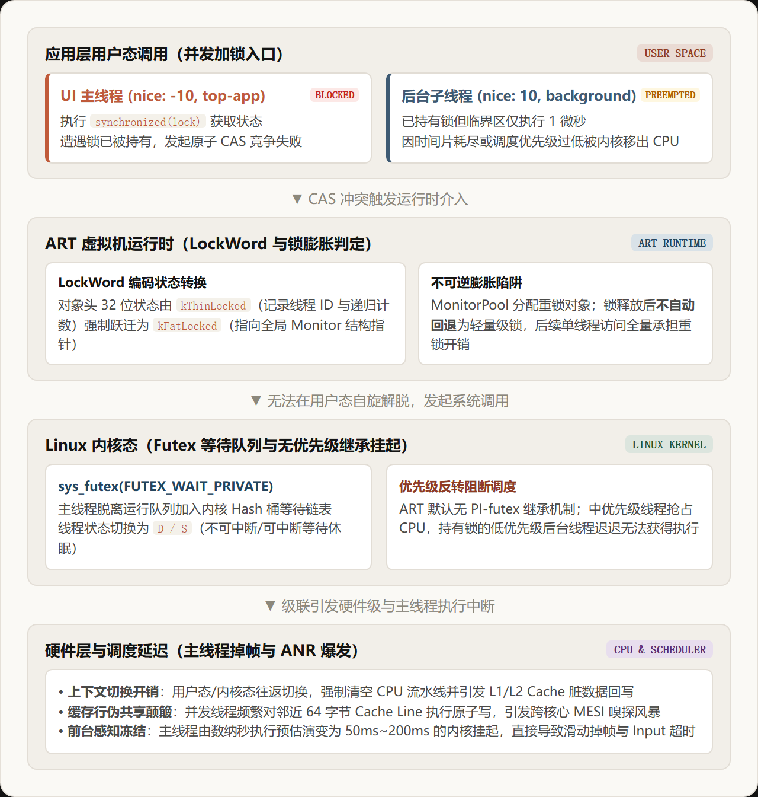
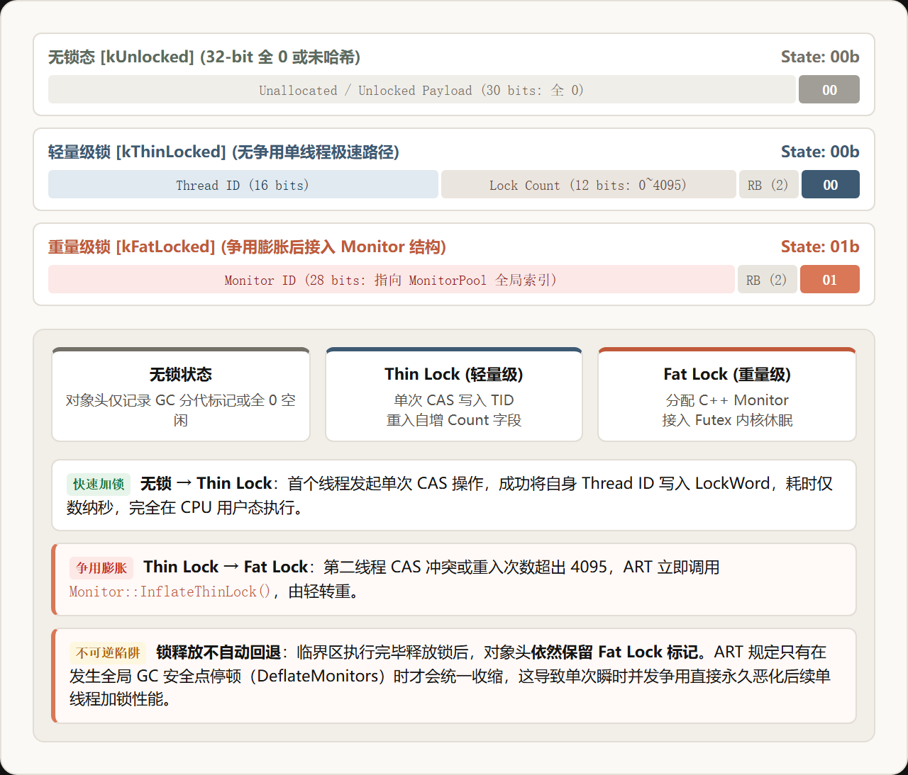
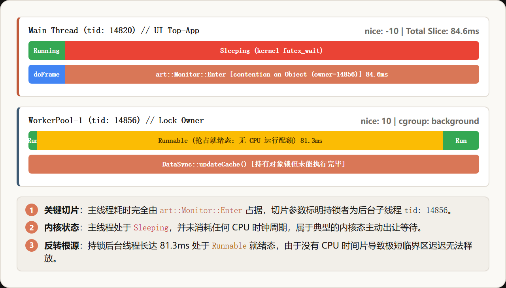

# ART Monitor 锁膨胀、Linux Futex 挂起与优先级反转

在 Android 移动端性能工程与流畅度治理的实践中，多线程并发安全与界面响应性能常常处于微妙的博弈之中。为了防止共享状态在并发读写时出现数据错乱，工程师最直接、最熟悉的防护手段就是使用互斥锁——无论是在 Java 中给方法或代码块加上 `synchronized`，还是在 Kotlin 中调用并发工具类的互斥锁。

在很多开发者的朴素直觉中，一个锁是否会引发性能卡顿，完全取决于“临界区内代码执行了多久”：

“我的加锁代码块里只有一行状态赋值：`mCurrentState = State.READY`，或者仅仅对一个整型计数器执行 `count++`。在现代 ARM 架构 CPU 上，这样一行内存写指令的耗时通常只有 5 到 10 纳秒。既然持有锁的时间如此短暂，多线程并发时怎么可能对界面流畅度产生任何肉眼可见的影响？”

然而，翻开大型商业应用的线上 APM 监控平台与 ANR 堆栈，常能捕捉到一系列令人费解的卡顿现场：

在应用冷启动、信息流快速滑动或后台数据密集拉取的关键节点，UI 主线程在执行常规的组件布局与界面绘制时，突然遭遇长达 50 毫秒乃至 150 毫秒的严重停顿，导致画面剧烈掉帧，甚至触发系统的 Input 派遣超时。当排查人员抓取主线程的调用堆栈时，赫然发现主线程并未执行任何繁重计算，代码行仅仅停留在普通的单例访问、数据缓存读取或事件总线分发入口处；更诡异的是，该方法内部保护的临界区代码确实仅有寥寥数行赋值。

主线程的内核调度状态被系统打上了 `S`（Interruptible Sleep，可中断休眠）或 `D`（Uninterruptible Sleep，不可中断休眠）标记，而 CPU 利用率监控曲线却平缓低迷，整机硬件算力并未饱和。

面对这种反差，不少技术团队会陷入困惑：“临界区明明只耗时几微秒，为什么多线程并发时主线程依然频频被强行卡死？”

这种认知偏差的核心，在于将“临界区自身的执行开销”与“操作系统处理锁争用所付出的全链路系统代价”严重混淆。

在 Android 运行时（ART）与 Linux 内核的底层架构中，无争用状态下的加锁确实只需一条极速的原子 CAS 指令。然而，一旦多个线程在同一微秒级时间窗口内发生访问碰撞，加锁行为就会瞬间触发一系列级联的底层机制裂变：从 32 位对象头的锁膨胀，到 C++ Monitor 内存池分配；从用户态自旋失效，到发起 `futex` 系统调用沉入内核等待队列；从 CPU 调度器的强行上下文切换与 L1/L2 缓存行颠簸，再到缺乏优先级继承引发的严重调度反转。

更致命的是，ART 虚拟机的轻量级锁存在不可逆的膨胀机制——即便争用仅发生在启动时的一瞬间，后续的每一次单线程加锁依然要背负沉重的重量级锁开销。

本文结合 AOSP 现代源码实现、Linux Futex 内核调度模型、ARM 硬件缓存一致性协议与一线性能优化实战，全面拆解这套隐藏在纳秒临界区背后的全链路性能损耗。



---

## 1. 认知重构：加锁耗时绝不等于临界区执行时间

要弄清极短临界区如何拖垮前台界面，首先需要重构对“锁开销”的评估模型。

### 1.1 纳秒级临界区与毫秒级卡顿的技术悖论

在没有并发争用的理想状态下，加锁的理论耗时可以用临界区耗时近似衡量：

$$T_{ideal} \approx T_{acquire\_fast} + T_{critical\_section} + T_{release\_fast}$$

其中，$T_{acquire\_fast}$ 与 $T_{release\_fast}$ 在 modern 处理器上仅仅是单条原子比较并交换（Compare-And-Swap，CAS）指令或内存屏障指令，消耗 5 到 15 个 CPU 时钟周期（耗时约 2~5 纳秒）。如果临界区内仅包含普通的内存读写，整体耗时确实微乎其微。

然而，一旦有两个或多个线程在极窄的时间窗口内同时请求同一把锁，加锁的真实耗时模型就会发生根本性质变：

$$T_{total} = T_{contention\_wait} + T_{context\_switch} + T_{kernel\_sleep} + T_{critical\_section} + T_{wake\_latency}$$

在争用场景下，临界区自身的执行耗时（$T_{critical\_section}$）在总耗时中的占比往往不到万分之一。真正主导界面掉帧与线程停顿的，是争用爆发后引发的连锁反应：

- **自旋与冲突重试损耗**：多个 CPU 核心同时争抢修改同一内存地址，引发硬件总线锁定与重试；
- **虚拟机锁膨胀开销**：虚拟机必须脱离快速指令执行路径，转入运行时底层分配重量级锁同步原语；
- **内核态陷阱与线程休眠**：应用线程无法继续执行，必须通过软中断陷入 Linux 内核，将线程控制块从就绪队列移出；
- **调度延迟与优先级滞后**：持有锁的线程可能被操作系统调度器推迟执行，导致等待方在内核队列中长期停摆。

原本期望中的 10 纳秒操作，在争用状态下迅速演化为长达数毫秒乃至数百毫秒的系统级阻塞。

### 1.2 用户态无感并发与内核态上下文切换的鸿沟

在现代操作系统中，用户态执行与内核态执行存在巨大的成本鸿沟。

在用户态下，线程的指令流平滑流转在 CPU 流水线中，指令缓存（I-Cache）与数据缓存（D-Cache）命中率维持在较高水平。然而，当线程因获取互斥锁失败而必须进入内核休眠时，操作系统必须执行一次沉重的**主动上下文切换**（Voluntary Context Switch）：

1. 保存当前线程的用户态通用寄存器、浮点寄存器、程序计数器（PC）与栈指针（SP）至内核栈；
2. 切换内存映射页表，更新内核中的任务描述符（`task_struct`）状态为阻塞休眠状态；
3. 将当前 CPU 核心的调度权力移交给调度器，由调度器遍历就绪红黑树或队列选择下一个可运行线程；
4. 恢复下一个线程的上下文并执行上下文切入。

一次完整的内核上下文切换不仅带来约 1 到 5 微秒的硬性 CPU 时钟损耗，更具破坏性的是它对硬件缓存系统的冲刷：新线程运行会无情地将原线程缓存在 L1/L2 Cache 中的热点代码与业务数据驱逐出去，造成 Translation Lookaside Buffer（TLB）大面积失效。当原线程随后被唤醒重新运行时，将不可避免地遭遇密集的 Cache Miss 与流水线气泡，其随后的指令执行速度将遭遇断崖式下跌。

---

## 2. 核心机制之一：ART LockWord 编码与 Thin Lock 极速路径

要理解争用在哪个环节失控，必须深入 Android 运行时的内部实现。在 Android ART 虚拟机中，每一个 Java 对象的对象头都包含一个关键的 32 位整型字段：`lockword_`。

### 2.1 32 位 LockWord 紧凑布局与三种形态

为了在极为严苛的移动端内存限制下支持高效同步，Google 工程师在 `art/runtime/lock_word.h` 中为这 32 位设计了精妙的压缩状态机。一个对象在其生命周期中，`lockword_` 主要呈现三种截然不同的状态：



```cpp
class LockWord {
 public:
  enum LockState {
    kUnlocked = 0,    // 00b: 无锁状态
    kThinLocked = 1,   // 00b: 轻量级锁（结合标记区分）
    kFatLocked = 2,    // 01b: 重量级锁（指向 MonitorPool 索引）
    kHashCode = 3,     // 10b: 存储对象的 Identity HashCode
    kForwardingAddress = 4, // 11b: GC 搬迁阶段转发指针
  };

  static constexpr uint32_t kStateSize = 2;
  static constexpr uint32_t kReadBarrierStateSize = 2;
  static constexpr uint32_t kThinLockOwnerSize = 16;
  static constexpr uint32_t kThinLockCountSize = 12;
  // ...
};
```

我们可以将这三种形态的内存布局进行逐位拆解：

- **无锁状态（kUnlocked）**
  - 对象刚创建未生成哈希码、亦未加锁时，低 2 位状态位为 `00b`，高 30 位全部置 0（或仅包含 GC 标记）。此时对象极其轻盈，没有任何附加的同步数据结构。

- **轻量级锁状态（kThinLocked，简称 Thin Lock）**
  - **Thread ID 字段（16 bits）**：占用 31 到 16 位，记录当前持有该对象锁的 ART 线程唯一标识符（Thin Lock Thread ID，取值范围 1~65535）；
  - **Lock Count 字段（12 bits）**：占用 15 到 4 位，记录同一线程对该锁的**可重入次数**（取值范围 0~4095）；
  - **Read Barrier 标记位（2 bits）**：用于支持并发复制 GC（Concurrent Copying GC）的读屏障标记；
  - **状态标记位（2 bits）**：低 2 位保持 `00b`。

- **重量级锁状态（kFatLocked，简称 Fat Lock）**
  - **Monitor ID 字段（28 bits）**：高 28 位不再记录线程 ID，而是直接存储一个全局监视器池（`MonitorPool`）的数组索引下标；
  - **Read Barrier 标记位（2 bits）**：保留 GC 屏障位；
  - **状态标记位（2 bits）**：低 2 位被赋予固定值 `01b`，明确向虚拟机声明当前对象已接入重量级监视器。

### 2.2 无争用快速路径：单次 CAS 与重入计数上限

当线程 A 首次通过 `MonitorEnter`（即执行 Java 的 `synchronized(obj)`）尝试锁定一个处于无锁状态的对象时，ART 编译器生成的机器指令会进入极端优化的快速路径（Fast-Path）：

```cpp
bool Monitor::FastPathLock(Thread* self, mirror::Object* obj) {
  LockWord lock_word = obj->GetLockWord(false);
  if (lock_word.GetState() == LockWord::kUnlocked) {
    LockWord thin_locked = LockWord::FromThinLockId(self->GetThreadId(), 0, lock_word.ReadBarrierState());
    // 单次原子 CAS 指令尝试抢占锁
    if (obj->CasLockWord(lock_word, thin_locked, CASMode::kWeak)) {
      return true; // 成功加锁，完全无需进入 C++ 运行时函数
    }
  }
  return false;
}
```

在 ARM64 汇编层面上，这仅仅对应一条排他性加载指令（`LDAXR`）与一条排他性存储指令（`STXR`）。如果 CAS 成功，当前线程的 ID 直接写入对象头，整个过程消耗不到 5 纳秒，不发生任何系统调用，不产生堆内存分配。

当线程 A 再次进入嵌套的同步块时，系统只需检查 `lock_word.GetThinLockThreadId() == self->GetThreadId()`，随后将 `Lock Count` 自增 1 即可。

然而，Thin Lock 的设计存在一个硬性的物理边界：`kThinLockCountSize` 仅有 12 位。这意味着，同一线程的最大重入深度为 $2^{12} - 1 = 4095$ 次。一旦代码中递归调用超过 4095 次，即便自始至终没有任何其他线程参与竞争，Thin Lock 也将被迫强行升级为重量级锁。

---

## 3. 核心机制之二：Thin Lock 锁膨胀与不可逆降级陷阱

轻量级锁的极速神话，在第二条线程介入竞争的瞬间戛然而止。

### 3.1 争用爆发：为什么移动端 ART 几乎不自旋就直接膨胀

在经典的桌面端 HotSpot JVM 中，当线程 B 遇到线程 A 持有锁时，通常会采用**自适应自旋**（Adaptive Spinning）策略：线程 B 不立即休眠，而是在 CPU 上执行几十到上百次短暂的无意义空循环，期待线程 A 能在几微秒内释放锁，从而规避昂贵的内核上下文切换。

但在 Android 移动终端上，硬件环境完全不同：

- 移动设备高度依赖电池供电，CPU 自旋空转会造成严重的无效电量消耗与发热；
- 移动端广泛采用 ARM 架构的异构大小核设计（DynamIQ / big.LITTLE），受能效调度器（EAS）与温控降频策略约束。如果允许线程在 CPU 大核上盲目自旋，会迅速拉高 CPU 负载预估，触发操作系统激进的升频决策，加剧芯片过热节流。

因此，在 Android ART 运行时中，自旋锁的容忍度被极度压缩。当线程 B 执行 CAS 试图获取锁，却发现 `lockword_` 中的 Thread ID 属于线程 A 且正在被持有时，ART 会直接放弃快速路径，迅速调用 `art/runtime/monitor.cc` 中的 `Monitor::InflateThinLock`：

```cpp
void Monitor::InflateThinLock(Thread* self, Handle<mirror::Object> obj) {
  // 1. 从 ART 全局 MonitorPool 中申请分配一个重量级 Monitor C++ 实例
  Monitor* m = MonitorPool::CreateMonitor(self, self, obj.Get(), hash_code);

  // 2. 拷贝原先 Thin Lock 中持锁线程的状态与重入计数
  m->SetOwner(thin_owner);
  m->SetLockCount(thin_count);

  // 3. 构建 FatLock 状态的 LockWord
  LockWord fat_lock = LockWord::FromMonitorId(m->GetMonitorId(), obj->GetLockWord(false).ReadBarrierState());

  // 4. 原子 CAS 替换对象头，将锁状态由 Thin 改为 Fat
  while (!obj->CasLockWord(current_lock_word, fat_lock, CASMode::kStrong)) {
    // 循环重试直至替换成功
  }
}
```

在执行 `InflateThinLock` 期间，不仅需要从 C++ 堆池中检索空闲的 `Monitor` 结构体、初始化内部的互斥信号量，还需要处理并发竞争中原持锁线程突然释放锁等极其复杂的边界状态。这一套运行时的 C++ 逻辑执行下来，耗时瞬间从数纳秒飙升至数微秒。

### 3.2 致命的不可逆膨胀陷阱：为什么对象一旦膨胀就无法回头

许多开发者直觉地以为：“锁膨胀只是应对突发并发争用的一种临时升级措施。当并发高峰过去，多线程争用平息后，重量级锁难道不会自动退化回轻量级锁吗？”

**答案是：绝不会自动退化。**

在 Android ART 的设计中，`MonitorExit`（释放锁操作）的底层实现只负责递减 `Monitor` 结构中的计数器，并在归零时唤醒正在内核等待队列中的等待者。**释放锁的操作绝对不会主动将对象头的 `LockWord` 还原为 `kThinLocked` 或 `kUnlocked`。**

ART 之所以如此设计，有着深刻的技术权衡：

- 如果每次释放锁时都尝试执行“锁收缩”（Deflation），虚拟机必须再次介入重量级 Monitor 的销毁、内存回收以及对象头的原子重写。如果该对象稍后立刻又被其他线程访问，系统就会陷入“轻量锁 → 膨胀为重量锁 → 释放收缩为轻量锁 → 再次膨胀”的病态震荡（Thrashing），带来更大的性能损耗；
- 因此，ART 将 Monitor 的收缩操作完全剥离出了正常的业务代码执行路径，**严格绑定在垃圾收集（GC）的安全点（Safepoint）停顿流程中**。

在 ART 的 GC 流程（如并发复制 GC 的 `SweepSystemWeaks` 阶段）中，运行时会遍历全局 `MonitorPool`，检查是否有 Monitor 当前处于完全空闲状态（没有被任何线程持有，且等待队列为空），只有满足条件的对象才会被批量执行 `DeflateMonitor` 操作。

这种机制给高并发场景埋下了一个巨大的隐形陷阱：
在应用冷启动或主功能加载阶段，往往存在密集的并发初始化逻辑。如果某个全局单例、事件总线、数据缓存对象在启动瞬间发生了仅仅数微秒的偶发多线程锁竞争，导致该对象膨胀为 Fat Lock，那么在下一次系统触发全局 GC 之前，**该对象将永久处于重量级锁状态**。

在此之后，哪怕该模块的代码完全运行在单线程环境（例如主线程独立访问缓存），每一次看似无害的 `synchronized` 获取与释放，都必须强行穿透完整的 `Monitor::Enter` 与 `Monitor::Exit` C++ 分发逻辑，不得不调用底层 `pthread_mutex` 相关的系统原语，原本纳秒级的快速路径被永久阻断。

---

## 4. 核心机制之三：Linux Futex 内核挂起与唤醒风暴

当对象膨胀为重量级锁后，等待锁的线程若依然无法获取访问权，就必须面临操作系统的终极惩罚：Linux Futex 内核挂起。

### 4.1 用户空间与内核空间的 Futex 协同模型

重量级锁（`art::Monitor`）的核心依托于底层操作系统提供的互斥机制。在 Linux 与 Android 平台上，这一机制的基石是 **Futex**（Fast Userspace Mutex，快速用户空间互斥体）。

Futex 的精妙之处在于它将加锁流程拆分为两层：

- **用户态快速检测**：在无争用时，通过用户态的原子变量修改直接完成加锁与解锁，完全避开系统调用；
- **内核态仲裁挂起**：当发现原子变量已被占用时，才通过 `syscall(__NR_futex, ...)` 陷入 Linux 内核。

在 `Monitor::Enter` 的慢速路径中，线程最终会触发类似如下的系统调用：

```cpp
// 传入需要等待的用户态内存地址 uaddr，期望的值 val
syscall(__NR_futex, uaddr, FUTEX_WAIT_PRIVATE, val, nullptr, nullptr, 0);
```

当这一系统调用穿透至内核源码 `kernel/futex.c` 后，内核会执行以下严格的仲裁操作：

1. **原子性校验**：内核首先在关中断或加自旋锁保护下，读取用户态指针 `uaddr` 处当前的值。如果该值已经不等于传入的 `val`（说明持锁线程刚刚在用户态释放了锁），内核立即返回 `EWOULDBLOCK`，拒绝休眠，让线程回到用户态重新尝试；
2. **入队挂起**：若值依然匹配，说明持锁线程仍在占用。内核根据 `uaddr` 的物理内存地址计算 Hash 值，找到全局 Futex Hash 桶（`futex_queues`），并在该哈希链表末尾插入一个代表当前线程的等待节点 `futex_q`；
3. **出让调度**：将当前线程的 `task_struct->state` 标记为 `TASK_INTERRUPTIBLE` 或 `TASK_UNINTERRUPTIBLE`，随即调用 `schedule()` 函数，正式让出当前 CPU 核心的执行权。

至此，等待锁的线程彻底从操作系统的可运行队列（Runqueue）中被摘除，主线程在此期间不会分配到任何 CPU 时钟。

### 4.2 惊群唤醒抖动与 CPU 调度延迟

当持锁线程终于执行完毕退出临界区时，它在释放用户态标记后，必须向内核发起唤醒调用：

```cpp
syscall(__NR_futex, uaddr, FUTEX_WAKE_PRIVATE, 1, nullptr, nullptr, 0);
```

内核接收到指令后，会从对应的 Hash 桶等待链表中检索出挂起的线程，将其状态重新刷新为 `TASK_RUNNING`，并将其重新推入 CPU 调度器的就绪队列中。

然而，“被标记为就绪”绝不等于“立即在 CPU 上执行”。

在多核高负载环境中，主线程从被 Futex 唤醒，到真正被操作系统调度器选中并在 CPU 核心上恢复寄存器执行，中间存在不可忽视的**唤醒调度延迟**（Wakeup Latency）：

- 如果当前 CPU 大核正被其他中高优先级线程占满，调度器必须等待下一个时钟中断（Tick）或当前任务主动让出；
- 如果多条线程同时在同一个 Futex 地址上等待（例如多个后台任务同时争抢数据写入权），持锁方释放时若触发了批量唤醒，会导致多条线程在瞬时同时苏醒；但由于锁只有一个，其中一条线程夺得锁后，其余线程将遭遇残酷的二次失败，被迫再次陷入内核休眠。

这种在内核队列中反复横跳的惊群与调度抖动，会带来数毫秒的无谓 CPU 开销，并将前台界面的卡顿时间进一步成倍拉长。

---

## 5. 隐形杀手：无优先级继承机制下的优先级反转

如果说锁膨胀与 Futex 挂起只是拉长了操作链路，那么**优先级反转**（Priority Inversion），则是足以在真实生产环境中直接置前台界面于死地的系统级杀手。

### 5.1 为什么 UI 主线程会被低优先级后台线程拖死

在 Android 系统的调度体系中，不同线程有着极为严格的优先级阶梯：

- **UI 主线程 / RenderThread**：归属于 `top-app` 调度控制组（Cgroup），通常被赋予极高的调度优先级（nice 值为 -10 甚至更低），运行在性能最强劲的超大核或大核上；
- **后台异步任务（IO/数据同步）**：归属于 `background` 控制组，通常被赋予极低的优先级（nice 值为 10 或 19），被严格限制在功耗较低的小核心上运行，分配到的 CPU 配额极少。

现在，我们来看一个在大型 Android 项目中极为典型的架构设计：一个负责维护用户全局登录态或配置缓存的单例管理器，内部使用一把公共锁来保护状态字段。


让我们还原这场悲剧的真实时序演进：

1. **后台线程轻巧持锁**：系统后台的一个数据同步线程（nice: 10）在执行心跳维护时，调用了 `synchronized(lock)`。临界区内仅仅是更新一个本地变量，原本预计耗时仅 1 微秒；
2. **调度器残酷剥夺**：就在后台线程刚刚拿到锁、还未来得及执行下一条指令的瞬间，系统触发了调度裁决。或者恰好有几个中等优先级的业务线程（如音视频解码、网络传输、nice: 0）被唤醒进入就绪队列。Linux CFS（完全公平调度器）判定低优先级的后台线程时间片耗尽或配额不足，**强行将其移出 CPU 运行队列**。后台线程被迫挂起，但它手中的锁并未释放；
3. **主线程迎头撞锁**：此时，用户正在滑动屏幕，UI 主线程（nice: -10）需要读取当前状态以渲染界面组件，同样调用了 `synchronized(lock)`。由于锁已被后台线程占有，主线程 CAS 失败，触发锁膨胀，随即发起 `futex(FUTEX_WAIT)` 沉入内核休眠；
4. **反转死滞形成**：致命的断层在此刻形成。在 Linux 内核层面，普通的 Java `synchronized` 底层并未启用带**优先级继承**（Priority Inheritance）特性的 PI-futex。因此，内核完全不知道“尊贵的 top-app 主线程正在苦苦等待一个卑微的 background 线程”！
5. **主线程无辜陪葬**：在操作系统的调度视角中，主线程已经在休眠队列中躺平，无需给它分配 CPU；而后台线程虽然想要运行，但由于系统中源源不断地有中等优先级的任务在抢占 CPU，后台线程根本抢不到任何时间片。整个系统在长达几十毫秒甚至上百毫秒的时间里，一直在调度执行那些中等优先级的无关任务；
6. **灾难爆发**：UI 主线程在内核休眠中眼睁睁看着数个 120Hz VSYNC 周期悄然溜走，屏幕画面彻底冻结。如果这种死滞持续超过 5 秒，系统 ActivityManagerService 便会毫不留情地弹出 ANR 弹窗。

临界区原本仅仅需要 1 微秒的 CPU 周期，却因为跨越了不同优先级的线程调度鸿沟，演变成了毁灭性的界面停摆。

### 5.2 硬件层面的隐形损耗：缓存行颠簸与伪共享

即便工程师意识到锁的危害，尝试使用无锁化机制（如 `AtomicInteger`、`AtomicReference` 或直接声明 `volatile` 变量）来替代 `synchronized`，若缺乏对硬件底层结构的深刻认知，依然会跌入另一个隐形陷阱：**缓存行颠簸与伪共享（False Sharing）**。

在现代 ARMv8 / ARMv9 处理器中，CPU 缓存是以**缓存行**（Cache Line，通常固定为 64 字节）为基本单位进行数据加载与一致性维护的：

```kotlin
// 常见的多线程组件状态封装反模式
class ComponentStateManager {
    @Volatile var isUiRenderReady: Boolean = false // 主线程频繁读取
    @Volatile var backgroundJobCounter: Long = 0L // 后台多线程极高频原子递增
}
```

在 64 位架构下，一个对象的内存字段是紧凑排列的。`isUiRenderReady`（1 字节）与 `backgroundJobCounter`（8 字节）在内存空间中距离极近，几乎必定落在**同一条 64 字节的 Cache Line** 之内。

当后台子线程在小核上并发执行 `backgroundJobCounter++` 时，底层通过 CAS 或原子写指令更新该字段。根据硬件层面的 MESI（或 MOESI）缓存一致性协议：

1. 后台核心在写入前，必须向 CPU 互联总线广播一条“使该缓存行无效”（Invalidate）的消息；
2. 此时，哪怕大核上的 UI 主线程仅仅是在只读式地访问 `isUiRenderReady`，其所在核心对应的 L1/L2 Cache 里的整条 64 字节 Cache Line 也会被强行标记为过期；
3. 主线程下一次读取时，原本微秒级的 L1 命中瞬间退化为必须重新向 L3 Cache 乃至底层 LPDDR 物理内存发起昂贵的数据重新拉取。

两个逻辑上完全无关的业务状态，仅仅因为在内存物理地址上的不当相邻，引发了跨 CPU 核心的高频缓存行争夺与总线颠簸，使主线程的只读访问变得异常迟滞。

---

## 6. 工程定位与治理：从 Perfetto 证据链到无锁架构演进

搞清了锁膨胀、内核 Futex 挂起与优先级反转的底层机理，我们在排查复杂线上卡顿与 ANR 时，就能建立清晰准确的技术证据链，并针对性地开展架构重构。

### 6.1 在 Perfetto 时间线上识别锁争用与内核挂起

当遇到怀疑由锁争用引起的界面掉帧或卡顿时，传统的 Java 方法插桩往往很难看清全貌，因为常规插桩工具本身引入的测量开销会显著改变多线程并发的时序。最权威、最精准的分析手段是借助系统级跟踪工具 **Perfetto**。

抓取应用交互期间的系统 Trace 后，在 Perfetto 仪表盘中，我们可以通过以下关键特征完成闭环取证：



1. **识别锁争用切片**：在主线程（UI Thread）轨道上，如果发现耗时较长的切片，其名称形如：
   `art::Monitor::Enter` 或 `Monitor contention on <class_name> (owner tid=<tid>)`；
   切片详情中会明确给出发生竞争的 Java 对象类型，以及**当前持有锁的线程 ID（tid）**。
2. **核对主线程内核状态**：观察主线程在争用期间的线程状态轨道（Thread State）。正常的繁重计算会显示为绿色的 `Running`，而锁争用会赫然显示为深红色的 `Sleeping`，底层驱动切片清晰对应 `futex_wait`；
3. **定位持锁者的调度饥饿**：顺着切片中暴露的持锁方 `tid`，跳转至对应的子线程轨道。如果发现持锁线程的状态呈现漫长的蓝色 `Runnable`（就绪态），而非 `Running`，这便是铁证如山的**优先级反转**现象——持锁方已就绪但由于优先级过低分不到 CPU，直接将处于 `top-app` 的前台主线程拖入了深渊。

### 6.2 治理策略：分段锁、线程封闭与无锁结构演进

彻底根除锁卡顿，需要根据不同的业务场景，推行针对性的并发架构改造。我们可以将其划分为四个层级递进的处理路径：

**治理路径一：消除跨优先级锁共享（核心原则）**

严禁在 UI 主线程与低优先级后台线程之间直接共享互斥锁。如果某个数据管理器必须同时供前台与后台访问，应优先采用**线程封闭**（Thread Confinement）模型，即“谁持有，谁负责修改”：

- 将所有涉及内部状态更新的写操作，全部通过 `Handler`、协程 Channel 或专用执行器分发到同一条专职的工作线程中串行执行；
- 主线程仅通过只读快照获取结果，完全解除主线程参与加锁竞争的可能性。

**治理路径二：读写分离与不可变快照（RCU 思想）**

在绝大多数移动端业务中，状态的读取频度远远高于写入频度。针对此类场景，应引入类似 Linux 内核的 RCU（Read-Copy-Update）设计模式：

```kotlin
// 改进方案：使用不可变状态与原子引用实现完全无锁的极速读取
class UserProfileManager {
    // 聚合不可变状态数据类
    data class State(
        val isLogin: Boolean = false,
        val userId: String = "",
        val token: String = "",
        val permissionMask: Int = 0
    )

    private val stateRef = AtomicReference(State())

    // 读操作完全无锁，永远只读当前内存快照，耗时维持在恒定的数纳秒
    fun getState(): State = stateRef.get()

    // 写操作采用原子 CAS 循环，并发写入冲突由后台线程自行吸收，绝不阻塞读方
    fun updateLogin(userId: String, token: String) {
        while (true) {
            val current = stateRef.get()
            val next = current.copy(isLogin = true, userId = userId, token = token)
            if (stateRef.compareAndSet(current, next)) {
                break
            }
        }
    }
}
```

通过将可变状态收敛为不可变的数据类（Immutable Data Class），主线程在调用 `getState()` 时完全不需要加锁，不仅没有锁膨胀与 Futex 挂起的风险，更能彻底免疫跨线程内存可见性与优先级反转问题。

**治理路径三：分段锁化与并发容器替换**

如果无法完全避免多线程并发修改集合类，必须彻底弃用粗粒度的全局 `synchronized` 或遗留的 `Hashtable` / `Vector` 容器，替换为现代的分段锁或并发无锁容器：

- 使用 `ConcurrentHashMap` 替代 `Collections.synchronizedMap`：`ConcurrentHashMap` 内部基于细粒度的 Node 节点锁与无锁 CAS 读，极大地分散了竞争概率；
- 避免在静态单例的双重检查锁定（DCL）中滥用重量级对象锁，使用 Kotlin 标准的 `lazy(LazyThreadSafetyMode.SYNCHRONIZED)` 或 `lazy(LazyThreadSafetyMode.PUBLICATION)` 根据安全性诉求精细控制开销。

**治理路径四：内存对齐与填充消除伪共享**

在极少数对极限吞吐与低延迟有极高要求的底层性能模块（如音视频帧缓冲区管理、环形队列 Disruptor 等）中，为了防止高速变量由于内存临近引发缓存行颠簸，应显式利用字段填充或对齐注解将热点变量隔离在独立的 Cache Line 中：

```kotlin
// 在高并发无锁环形队列中，利用长整型填充强制隔离 64 字节 Cache Line
class CacheLinePaddedCounter {
    // 填充头部：规避与对象头或前序字段落入同一缓存行
    @Volatile var p1: Long = 0L
    @Volatile var p2: Long = 0L
    @Volatile var p3: Long = 0L
    @Volatile var p4: Long = 0L
    @Volatile var p5: Long = 0L
    @Volatile var p6: Long = 0L
    @Volatile var p7: Long = 0L

    // 核心并发计数器（独占独立的 64 字节缓存行）
    val counter = AtomicLong(0L)

    // 填充尾部：规避后续字段落入同一缓存行
    @Volatile var q1: Long = 0L
    @Volatile var q2: Long = 0L
    @Volatile var q3: Long = 0L
    @Volatile var q4: Long = 0L
    @Volatile var q5: Long = 0L
    @Volatile var q6: Long = 0L
    @Volatile var q7: Long = 0L
}
```

通过在热点字段前后填充足够的字节，确保高频变动的变量独占一条完整的 64 字节物理缓存行，从硬件层面彻底阻断多核之间的 MESI 缓存失效风暴。

搞清了锁在 Android 运行时与内核层面的全生命周期演变，我们在面对复杂的多线程性能治理时，就不再只是孤立地关注一行代码的指令耗时，而是能够从对象头位编码、虚拟机锁膨胀、Futex 调度状态转移与硬件缓存拓扑的宏观全局出发，写出真正高并发、低延迟的高品质移动端架构。
