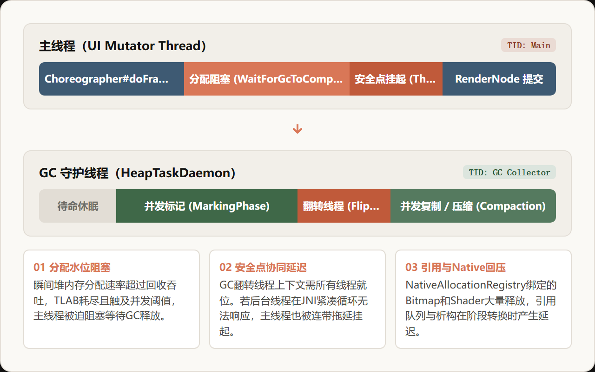
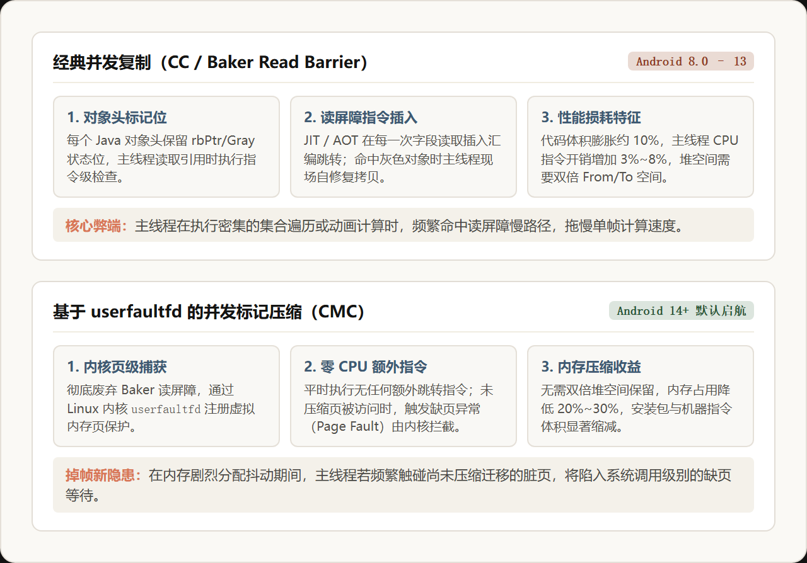
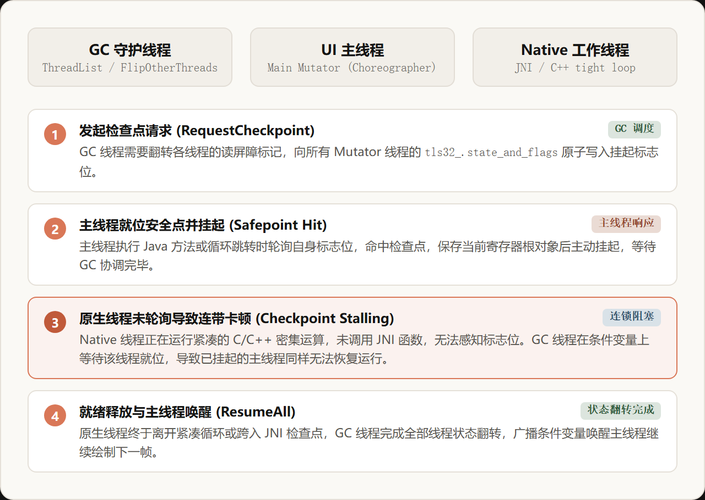
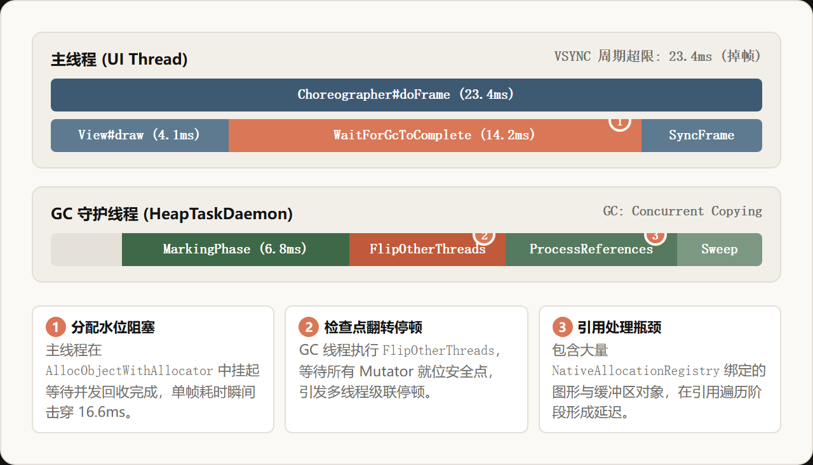

# ART 并发复制 GC、CMC 机制与线程安全点停顿

在 Android 现代移动端应用的高性能演进过程中，流畅度治理始终是各工程团队的核心关注点。当我们翻开系统监控日志或在线 APM 告警，常能看到类似这样的反常现象：

界面在列表滑动或动画展开时出现了肉眼可见的顿挫与跳帧，系统丢帧指标亮起红灯。然而开发者检索日志，并没有发现诸如 `Explicit concurrent mark sweep GC` 或者耗时长达几十毫秒的 `Full GC` 日志；内存总水位也健康地运行在警戒线之下，并未触发低内存杀进程（Low Memory Killer）。

面对这种现象，许多工程团队会产生误判：“既然没有发生长时间 Stop-The-World 的整堆回收，当前卡顿肯定和垃圾回收无关，八成是视图层级太深或者着色器编译导致的。”

这种认知忽略了现代 ART 运行时（Android Runtime）内存回收架构的复杂细节。

自 Android 8.0 确立并发复制（Concurrent Copying, CC）收集器以来，系统虽然消除了早期 Dalvik 时代长达数十毫秒的全局停顿，但引入了指令级读屏障、线程安全点协同挂起机制。而在 Android 14 及后续版本中，基于 Linux 内核 `userfaultfd` 的并发标记压缩（Concurrent Mark-Compact, CMC）收集器进一步重构了内存流动链路。

即便没有发生全局全堆回收，瞬时高频的临时对象创建、线程在安全点（Safepoint）上的协同等待、跨 JNI 调用时的检查点同步，以及底层虚拟内存脏页的换入，依然能在主线程单帧执行期间引发毫秒级的微小阻塞，直接击穿 60Hz（16.6ms）或 120Hz（8.33ms）的帧周期预算。

本文结合 AOSP 运行时核心实现、Linux 内核虚拟内存调度逻辑与大型商业应用的治理经验，深入拆解这些隐藏在并发垃圾回收背后的掉帧盲区。



---

## 1. 认知重构：现代 ART 垃圾回收机制的演进

要找准垃圾回收引发掉帧的具体环节，首先需要理清 ART 在不同 Android 版本中采用的核心回收模型。

### 1.1 从 CMS 到并发复制（CC）

在 Android 5.0 到 7.0 阶段，系统默认采用并发标记清除（Concurrent Mark-Sweep, CMS）算法。CMS 收集器在回收过程中不移动存活对象，因而不需要在应用线程访问对象时修正指针。但这种机制存在致命弱点：长期运行后堆内存碎片极其严重，当应用尝试申请一块较大的连续内存（如创建大型位图或数组）时，即使总空闲内存充裕，也会因缺少连续地址块而被迫发起整堆压缩回收（Homogeneous Space Compaction）乃至全局暂停，引发严重的掉帧甚至无响应告警。

为了从根源解决内存碎片问题，Google 自 Android 8.0 起将默认收集器升级为并发复制（Concurrent Copying, CC）收集器。

CC 收集器的核心特性在于“边运行边整理”：

- 内存空间被划分为活动区（From-space）与目标压缩区（To-space）；
- GC 守护线程在后台遍历引用链，将存活对象依次拷贝到紧凑的目标空间，并更新内部指针；
- 绝大多数回收工作与应用线程（Mutator 线程）并发执行，不再需要数以十毫秒计的全局冻结。

然而，为了保证应用线程在后台拷贝进行时读到的数据始终正确，CC 收集器采用了 Baker 读屏障（Baker Read Barrier）机制。JIT 与 AOT 编译器在生成机器码时，会在每一次读取对象引用的汇编指令前注入一段微小的检查逻辑：检查对象头的锁字标记（Lock Word）中是否包含未修复状态。如果应用线程尝试读取一个尚未搬迁到目标空间的对象，当前线程就必须就地承担自修复开销，将该对象移动到 To-space 并刷新指针后才能继续向下执行。

### 1.2 Android 14 引入的 CMC 收集器

随着设备多核架构与高刷屏幕普及，Baker 读屏障在 CPU 指令侧带来的持续开销逐渐成为瓶颈。统计数据显示，读屏障的指令注入让编译后的机器码体积膨胀了约 10%，并使应用线程的 CPU 执行耗时持续增加 3% 到 8%。此外，为了支持并发复制，堆内存需要额外预留空间应对 From-space 与 To-space 的腾挪。

在 Android 14 中，Google 为 ART 引入了全新的并发标记压缩（Concurrent Mark-Compact, CMC）收集器：



CMC 收集器直接摒弃了编译器注入的汇编读屏障，改由 Linux 内核的 `userfaultfd` 系统调用接管并发压缩期的数据一致性：

- 运行时通过 `userfaultfd` 将处于整理阶段的虚拟内存页注册给内核保护；
- 应用线程在 Java 字节码层面执行时无需任何额外的指针比对跳转，执行效率恢复到原生水准，机器码体积明显缩水；
- 当应用线程试图访问一个尚未完成压缩覆盖的物理内存页时，CPU 会抛出缺页异常（Page Fault），内核挂起当前线程并将故障地址通知 GC 线程，由 GC 线程优先压缩该页后唤醒应用线程。

CMC 大幅降低了常态下的内存驻留（约节省 20% 到 30% 的私有脏内存），但在特定分配波峰下，它对单帧流畅度的影响形式也发生了转变。

---

## 2. 隐形停顿源之一：分配水位触发的 WaitForGcToComplete

许多开发者认为，只要堆内存未达到最大上限（`dalvik.vm.heapgrowthlimit`），调用 `new` 指令就会立即完成。事实上，ART 内部为维持内存稳定设计了一套精密的并发触发水位与惩罚反压逻辑。

### 2.1 堆内存分配慢路径的拦截逻辑

在 ART 运行时源码 `art/runtime/gc/heap.cc` 中，对象的分配逻辑由 `Heap::AllocObjectWithAllocator` 驱动：

```cpp
mirror::Object* Heap::AllocObjectWithAllocator(Thread* self,
                                               ObjPtr<mirror::Class> klass,
                                               size_t byte_count,
                                               AllocatorType allocator,
                                               size_t* bytes_allocated,
                                               size_t* usable_size,
                                               size_t* bytes_tl_bulk_allocated) {
  // 快速路径：优先从线程本地分配缓冲区 (TLAB) 获取空闲地址
  mirror::Object* obj = TryToAllocate<kInstrumented, false>(self, allocator, byte_count, ...);
  if (UNLIKELY(obj == nullptr)) {
    // 慢路径：TLAB 耗尽或请求体积过大，转入内部回收仲裁流程
    obj = AllocateInternalWithGc(self, allocator, kInstrumented, byte_count, ...);
  }
  return obj;
}
```

在快速路径下，线程直接通过原子指针自增（Bump Pointer）在线程本地分配缓冲区（TLAB）内划分内存，耗时通常只有几个 CPU 纳秒。

然而，一旦进入 `AllocateInternalWithGc` 慢路径，情况便截然不同。系统不仅需要向全局堆空间申请新的 TLAB 块，更关键的是会评估当前堆中已分配字节数是否逼近了并发回收阈值（`concurrent_start_bytes_`）：

```cpp
// art/runtime/gc/heap-inl.h
if (UNLIKELY(total_bytes_allocated >= concurrent_start_bytes_)) {
  // 触发后台并发 GC 请求
  RequestConcurrentGCAndSaveObject(self, false, &obj);
}
// 若瞬时分配速度过快，已达到目标足迹上限 (target_footprint_)
if (UNLIKELY(total_bytes_allocated >= target_footprint_)) {
  // 挂起当前分配线程，直到并发 GC 释放出充裕空间
  collector::GcType gc_type = WaitForGcToComplete(kGcCauseForAlloc, self);
}
```

### 2.2 瞬时高频创建引发的主线程反压

这就解释了为什么界面在复杂自定义组件绘制或滑动列表中会发生掉帧。

如果在 `View#onDraw()`、RecyclerView 的 `onBindViewHolder()` 或动画回调中，代码频繁实例化短期对象（例如循环拼接字符串、创建集合临时迭代器、频繁新建 `Paint`、`Rect` 或数值包装类型），主线程单位时间内的内存申请速率将呈几何级数跃升。

当后台 GC 守护线程的处理吞吐赶不上主线程的生产速度时，堆已用内存会迅速冲过 `target_footprint_`。为了防止 Java 堆被瞬间撑爆导致 OOM，ART 运行时通过条件变量直接把主线程挂起在 `WaitForGcToComplete` 切片上。

在 Perfetto 时间线中，开发者会清晰看到主线程的单帧时长从原本流畅的 4ms 骤然拉长到 20ms 以上，而其中耗时最长的切片正是 `WaitForGcToComplete`。虽然日志里打印的只是普通的并发 GC，但主线程却切切实实被强行刹停了十余毫秒。

---

## 3. 隐形停顿源之二：线程安全点协同与原生阻塞连锁

并发回收虽然不执行全局 Stop-The-World，但为了修正全局根对象与各线程栈帧，在回收周期的关键节点依然需要所有线程在安全点（Safepoint）协同停顿。

### 3.1 检查点翻转（FlipOtherThreads）流程

在并发复制收集器的执行流水线中，标记与复制阶段切换时需要执行一次名为“线程翻转”（Thread Flip）的操作。翻转的目的在于让每一个运行中的 Mutator 线程切换自己的弱引用读屏障开关，并更新线程局部状态。

翻转过程由 GC 线程通过 `ThreadList::FlipOtherThreads` 调度：

```cpp
// art/runtime/thread_list.cc
size_t ThreadList::FlipOtherThreads(Thread* self,
                                    Closure* checkpoint_function) {
  // 第一阶段：向所有工作中的 Mutator 线程发出检查点请求
  for (const auto& thread : list_) {
    if (thread != self) {
      thread->RequestCheckpoint(checkpoint_function);
    }
  }
  // 第二阶段：休眠等待所有目标线程就位安全点并执行回调
  while (unrun_checkpoints > 0) {
    checkpoint_cond_.Wait(self);
  }
  return count;
}
```

安全点的协同机制要求极其严苛：

- 每一个正在执行 Java 字节码的线程，在遇到方法调用、循环回跳或 JNI 退出点时，会轮询自身线程局部存储中的 `tls32_.state_and_flags` 标志位；
- 一旦检测到挂起请求，该线程必须立刻停下当前的业务计算，保存寄存器现场并进入挂起状态；
- GC 线程必须等待进程内**所有**目标线程全部进入安全点后，才能继续推进下一步操作并广播唤醒所有线程。



### 3.2 JNI 与密集 Native 循环带来的木桶短板

此时，一个隐蔽而致命的跨线程连锁问题就浮出水面了。

如果应用中某个后台工作线程（例如音频处理、图像编解码、算法推理或加密计算线程）正在执行纯 C/C++ 编写的底层计算，且在该段逻辑中没有频繁调用 JNI 回调 Java 层：

- 该原生线程在底层运行期间，并不主动轮询 ART 的 Java 安全点标志位；
- GC 守护线程发出 `RequestCheckpoint` 后，主线程在执行完一个 View 测量方法后便敏捷地命中了安全点并主动挂起；
- 然而，由于后台原生线程仍在紧凑的 C/C++ 循环中持续运行，迟迟没有触碰 JNI 边界，GC 守护线程在 `checkpoint_cond_.Wait()` 上苦苦等待；
- 最终结果是：**无辜的主线程必须一直保持挂起状态，直到最慢的那个后台原生线程退出计算或切回 Java 状态为止。**

这种现象在系统级诊断中被称为“安全点就位延迟”（Time-To-Safepoint, TTSP）。在代码层面上，主线程没有任何耗时调用，甚至早已休眠就绪，但由于整个运行时的协同约束，它被其他无关线程硬生生拖成了掉帧受害者。

---

## 4. 隐形停顿源之三：Native 内存回压与引用析构队列

随着移动图形渲染的发展，Android 很多核心组件的实际内存负荷都由 Native 堆承担。Java 对象往往只是一个轻量级的壳，通过 `NativeAllocationRegistry` 将 Java 对象的生命周期与底层的 C++ 内存块绑定在一起。

### 4.1 NativeAllocationRegistry 的联动记账机制

从 Android 8.0 开始，Bitmap 的像素数据（Pixel Storage）被彻底从 Java 堆移出，放置在 Native 堆内存中。为了防止应用快速创建大量大图导致 Native 内存被吃光而 Java 堆却未察觉，系统在 `NativeAllocationRegistry` 中实现了严格的双向记账机制：

```cpp
// frameworks/base/core/jni/android_util_NativeAllocationRegistry.cpp
void NativeAllocationRegistry_registerNativeAllocation(JNIEnv* env, ... jlong size) {
  // 将 Native 申请的体积直接通知 ART Heap 记账系统
  VMRuntime::getRuntime()->registerNativeAllocation(size);
}
```

当应用在界面中连续加载或变换大型图片时，每一次 Native 内存的申请都会同步增加 ART 内部维护的 `native_bytes_allocated_` 计数器。

即使 Java 堆自身分配的对象并不大，一旦登记的 Native 字节数超过阈值，系统依然会像 Java 堆耗尽一样强行发起并发垃圾回收。

### 4.2 引用入队与清扫阶段的锁竞争

更关键的是对象的回收时机。当装载有 Native 资源的 Java 对象变成不可达状态后，它的释放并不是一瞬间完成的，而是依赖引用队列（ReferenceQueue）与守护线程（`FinalizerDaemon` 及 `ReferenceQueueDaemon`）：

- GC 线程在完成标记阶段后，需要处理庞大的虚引用（PhantomReference）与清理动作；
- 在回收密集型列表快速滑动时，若前一批列表项中的位图尚未被终结守护线程从引用队列中取下并调用 Native 析构，这部分虚拟内存就不会被内核释放；
- 当下一帧主线程继续申请新的图片资源时，`registerNativeAllocation` 发现累积的未决 Native 内存已经突破临界线，便会直接在 JNI 边界阻塞当前线程，等待后台队列消化完毕。

这种阻塞在 Trace 堆栈中往往并不表现为 Java 代码卡顿，而是记录在 `libandroid_runtime.so` 或 `libart.so` 的底层系统调用上，让排查者难以第一时间关联到业务侧的对象管理缺陷。

---

## 5. 现象定位：用 Perfetto 捕捉 GC 隐形掉帧

掌握了机理之后，在面临真实的掉帧现场时，我们应当如何通过性能分析工具精准捕获这些停顿证据？

利用 Perfetto 打开包含掉帧现场的系统跟踪切片，我们可以重点审视两个关键轨道的交互。



### 5.1 关键切片特征与诊断路径

在排查界面掉帧与垃圾回收的关联时，我们可以将其梳理为三级递进的排查链路：

- **第一阶段：主线程分配等待切片核验**
  - 核心观察目标：主线程轨道中的 `Choreographer#doFrame` 执行切片；
  - 典型特征切片：`WaitForGcToComplete`、`AllocObjectWithAllocator`；
  - 现象含义：主线程在生成视图数据或进行绘制时，触发了堆内存慢路径分配，因内存消耗逼近安全水位而挂起等待后台回收完成。

- **第二阶段：GC 守护线程状态与翻转耗时核验**
  - 核心观察目标：`HeapTaskDaemon` 线程与系统 `ThreadList` 调度轨道；
  - 典型特征切片：`FlipOtherThreads`、`MarkingPhase`、`ProcessReferences`；
  - 现象含义：若 `FlipOtherThreads` 耗时显著超过常规均值（> 2ms），说明存在后台线程迟迟未响应安全点挂起请求，引发主线程连带停顿。

- **第三阶段：缺页异常与系统调用耗时核验**
  - 核心观察目标：线程内核状态中的 `Running` 与 `D (Uninterruptible Sleep)` 状态标记；
  - 典型特征切片：在 Android 14+ CMC 场景下观察系统缺页事件与 `userfaultfd` 处理耗时；
  - 现象含义：主线程在未注入读屏障的情况下遭遇瞬时停顿，若伴随内核页换入等待，表明当前发生未压缩内存页的访问回流。

### 5.2 运用 SQL 快速统计 GC 拖慢界面的次数与耗时

在 Perfetto 的 Query 终端中，我们可以运行以下 SQL 语句，快速提取跟踪区间内拖慢主线程的所有垃圾回收等待切片，而无需人工在庞大的时间线上逐帧翻找：

```sql
SELECT
  ts,
  dur / 1e6 AS dur_ms,
  name
FROM slice
WHERE name LIKE '%WaitForGcToComplete%'
   OR name LIKE '%FlipOtherThreads%'
ORDER BY dur DESC
LIMIT 10;
```

如果查询结果中出现了单次耗时达到 8ms 到 15ms 的切片，并且该切片的时间戳正好落在主线程掉帧区间内部，便可以断定该帧的停顿正是由并发 GC 相关的分配反压或线程协同所引发的。

---

## 6. 治理策略：让主线程彻底远离 GC 停顿线

理解了并发垃圾回收引发掉帧的这三条暗流，我们在工程落地中的优化思路就变得非常清晰。核心原则只有一个：**在关键渲染路径上，将单位时间内的内存分配率降至最低，避免触碰运行时的任何分配与协同慢路径。**

### 6.1 杜绝在热点绘制循环中创建临时对象

在界面交互的核心路径（如 `onDraw`、自定义 View 布局排版、列表滑动处理）中，代码执行频率与屏幕刷新率完全对齐。每一行看似不起眼的对象实例化，都会在每秒 60 次乃至 120 次的循环中演变成巨大的内存分配波峰。

- **复用全局绘图状态**：严禁在 `onDraw()` 内部执行 `new Paint()`、`new Path()`、`new RectF()` 或 `new Matrix()`。所有图形参数、画笔属性必须在组件初始化阶段一次性分配完毕，后续每帧仅通过 `set()` 或 `reset()` 复用已有实例。
- **避免隐式装箱与迭代器开销**：遍历列表或字典集合时，避免使用标准的 Java `foreach` 循环或 Kotlin 函数式操作符（如 `.map { }`、`.filter { }`）。这些操作在底层会为每次遍历创建新的 `Iterator` 实例和中间集合。改用下标索引直接遍历，或者选用 Android 特有的轻量级容器（如 `SparseArray`、`ArrayMap`），从根源杜绝基元类型的装箱拆箱。
- **控制字符串格式化与日志输出**：避免在滑动事件监听器中拼接带有动态变量的字符串，或直接输出调试日志。字符串拼接会瞬间产生大量的临时 `StringBuilder` 与 `char[]` 缓冲区，极易在几百毫秒内填满当前线程的 TLAB 空间。

### 6.2 引入高频对象对象池与显式生命周期控制

针对无法彻底避免的高频业务实体（如聊天气泡消息包装、复杂的动画计算参数）：

- **建立轻量对象池（Pools.SimplePool）**：对于频繁生灭的数据封装，采用对象池机制进行循环再利用。当事件消费完毕后，显式将实例归还对象池清空状态，阻断其向 ART 垃圾回收器提交申请。
- **注意池化边界与锁竞争**：需要注意的是，对象池必须轻量且分线程管理，避免为了复用对象而引入重量级的跨线程同步锁，导致主线程因竞争对象池内部锁而引发新的阻塞。

### 6.3 规避后台原生线程长周期阻断安全点

为了防止后台线程将主线程拉入漫长的安全点等待深渊：

- **在长周期 Native 计算中主动注入轮询**：若应用包含自研的 C/C++ 音视频处理、3D 渲染或图像滤镜核心，当处于大型循环时，应在循环体内阶段性调用 JNIEnv 提供的轻量检查点方法，或通过条件判断适时让渡 CPU，确保当前线程能够及时感知运行时的挂起标记。
- **合理隔离计算型线程与 UI 交互的优先级**：为执行重度计算的后台线程分配合理的 Linux 线程优先级（如 `THREAD_PRIORITY_BACKGROUND`），避免后台线程因争抢 CPU 调度配额而拖慢自身退出计算循环的速度。

通过这些针对性的架构设计与工程约束，我们能够使主线程在整个界面交互期间始终保持极低的内存分配速率，从容跨过并发垃圾回收的各种反压门槛，在移动设备上呈现出真正如丝般顺滑的交互体验。

## 参考资料

- [Android 运行时 (ART) 与 Dalvik](https://source.android.com/devices/tech/dalvik?hl=zh-cn)（Android Open Source Project · 查阅于 2026-10-30）
- [Concurrent Copying Collector Architecture](https://source.android.com/docs/core/runtime/configure?hl=zh-cn)（Android Open Source Project · 查阅于 2026-10-30）
- [Userfaultfd Linux Kernel Specification](https://www.kernel.org/doc/html/latest/admin-guide/mm/userfaultfd.html)（The Linux Kernel documentation · 查阅于 2026-10-30）
- [Perfetto Trace Analysis Guide](https://developer.android.com/tools/perfetto?hl=zh-cn)（Android Developers · 查阅于 2026-10-30）
