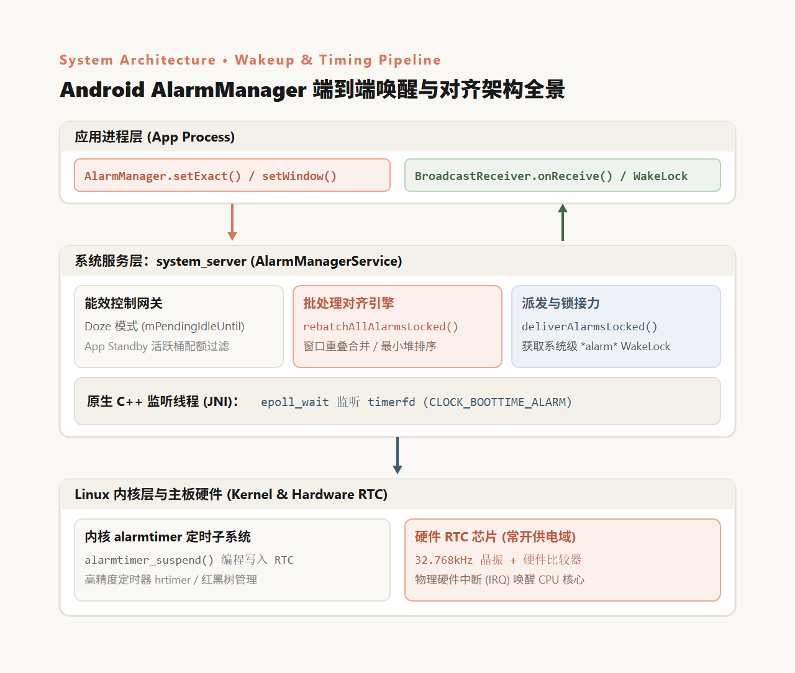
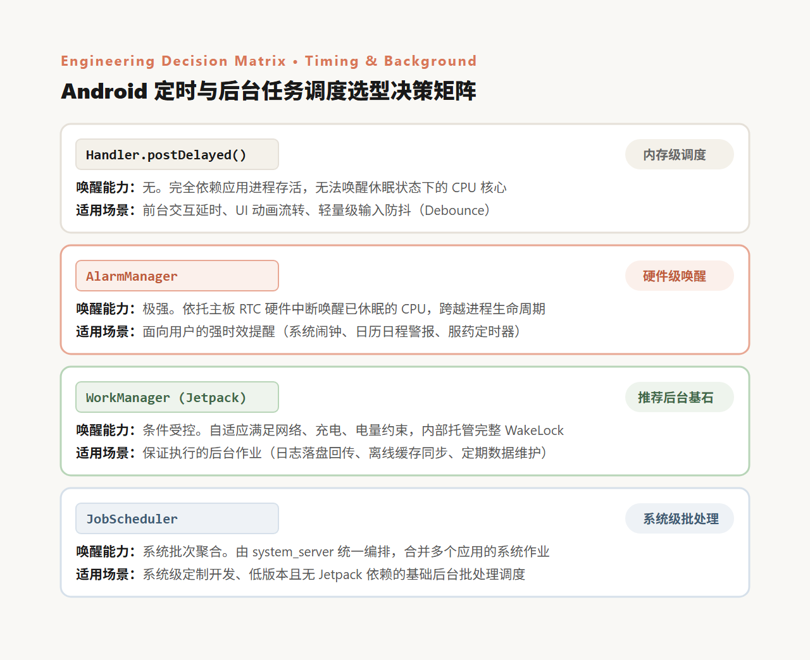

# AlarmManager 底层机制与省电约束

在 Android 应用开发的日常实践中，当开发者需要让应用在未来的某个时间点准时执行特定任务，或者需要在后台保持稳定的周期性动作时，`AlarmManager` 往往是第一个进入技术选型视野的系统服务。

从 API 声明的表面语义来看，这套机制似乎赋予了开发者对系统时间极高的掌控权：无论是设定单次触发的 `setExact()`、指定宽松时间窗口的 `setWindow()`，还是带有设备唤醒标志的 `ELAPSED_REALTIME_WAKEUP`，接口方法均以毫秒（ms）为精度单位。

很多开发者据此建立起了一套符合直觉的心理模型：

“只要我将闹钟设定在未来的某一毫秒，并将类型声明为唤醒类型（WAKEUP），Android 系统与底层硬件就会在这个精确的时间点准时唤醒 CPU，通过我注册的 `PendingIntent` 调起目标组件。无论手机是装在口袋里锁屏休眠，还是系统当前处于低内存状态，闹钟都能像硬件物理秒表一样准时敲响。”

然而，当应用发布到真实的用户设备，面对当今严苛的系统能效管控与持续收紧的权限壁垒时，这套直觉模型往往会被现实击得粉碎：

业务后台的心跳数据时常发生长达数十分钟甚至数小时的严重漂移；设定好的定时任务在熄屏后杳无音信，却在用户点亮屏幕解锁的一瞬间集中爆发、扎堆执行；在较新版本的 Android 系统上，调用 `setExact()` 甚至会突发性地抛出崩溃异常 `SecurityException`；即便闹钟成功唤醒了应用，应用若试图在后台拉起界面，会被系统的后台启动规则（BAL）直接拦截；更有甚者，部分开发者为了防范设备再次休眠，在接收闹钟的 `BroadcastReceiver` 中随手提交了一个后台异步子线程，结果任务运行到一半便神秘中止，直到下次亮屏才继续执行。

从表面上看，这是各版本 Android 针对后台功耗持续收紧的“规则限制”；但从深层技术机理来看，这背后隐藏着跨越物理芯片、Linux 内核调度器、cgroup 进程控制，以及现代 Android 框架层（在最新的 Android 17 与 Mainline APEX 架构中，系统服务已被独立解耦至 `com.android.scheduling` 调度模块）的完整系统工程。

`AlarmManager` 从来就不是一个运行在应用进程内的软件计时器（Timer）。它是一套贯穿了主板硬件 RTC（实时时钟芯片）、32.768kHz 硬件晶振、Linux 内核 `alarmtimer` 与 `timerfd` 子系统、系统服务批处理对齐引擎，以及现代 Doze、应用待机配额与内核进程冷冻（Freezer）的庞大协作系统。

本文将以最新的 Android 17 framework 架构为主线，自顶向下穿透至芯片与内核源码，全面拆解 `AlarmManager` 的底层运作机理。



---

## 1. 认知重构：从“精准定时器”到“能效对齐调度器”

要理解 `AlarmManager` 的底层行为，首先必须厘清它在操作系统中所处的抽象层级。它并不是 Java 原生 `Timer` 或 Android 消息循环 `Handler.postDelayed()` 的替代品，而是系统级能效博弈的产物。

### 1.1 理想与现实的落差：开发者直觉中的 AlarmManager

在应用开发者的传统认知中，定时调度机制通常遵循“请求即满足”的契约。开发者传递一个明确的纳秒或毫秒时间戳，底层调度器按时间先后排序，并在时间点到达时准时派发。

然而，智能手机与桌面 PC 或云服务器存在本质区别：**智能手机的首要生存法则是控制电池功耗**。

手机 SoC（系统级芯片）中的应用处理器（Application Processor，简称 AP）是整机耗电最大的元器件之一。在用户关闭屏幕、不再操作手机的静置状态下，操作系统会全力促使 AP 进入深度的低功耗休眠模式（Suspend-to-RAM 或 Power Collapse）。在这种状态下，CPU 核心的时钟信号关闭，主要供电轨电压降至最低甚至完全断电。

如果系统允许任意安装的应用随意注册毫无规律的高精度定时器，不同应用设定的触发时间交错分布（例如 App A 设定在第 1.2 秒，App B 设定在第 1.5 秒，App C 设定在第 1.9 秒），整个系统的 AP 核心将刚进入休眠便立即被唤醒，频率高达每秒数次。这种高频唤醒不仅会使芯片持续处于高功耗转换状态，更会让整机电量在短时间内迅速耗尽。

因此，Android 系统层面的 `AlarmManager`，其核心设计理念自诞生起便经历了剧烈的范式转移：**它并不是为了满足应用的高精度时间诉求而存在，而是在最大程度保障设备深睡的前提下，提供一种受控的、按批次合并对齐的延迟触发机制**。

### 1.2 时钟维度的分水岭：RTC 与 ELAPSED_REALTIME

在向 `AlarmManager` 注册闹钟时，开发者面临的第一个核心参数便是时钟类型（Clock Type）。系统将其划分为两个完全不同的时间基准体系：

- **RTC（Real Time Clock）/ RTC_WAKEUP**：基于 Unix Epoch（1970 年 1 月 1 日 00:00:00 UTC）的绝对挂钟时间（Wall-clock Time）。它的数值与用户手机界面上显示的系统时钟一致；
- **ELAPSED_REALTIME / ELAPSED_REALTIME_WAKEUP**：从当前设备启动引导（Boot）开始单调递增的物理流逝时间。该时间**严格包含**设备处于休眠挂起（Deep Sleep / Suspend）阶段所经历的时长，但不包含关机状态的时间。

选择哪种时钟基准，直接决定了调度逻辑的可靠性。

在基于 `RTC` 的体系中，系统时间容易受到外部环境的突发性干扰。例如，用户手动在系统设置中调整了日期和时间、移动蜂窝网络通过 NITZ 协议向手机下发了基站校时、或者系统的 NTP 客户端通过网络完成了时间同步修正。一旦发生这些事件，系统挂钟时间就会发生瞬间向前“跳跃”或向后“回退”。

如果开发者依据 `RTC` 设定了一个 30 分钟后的闹钟，而此时网络对时使系统时钟向前调整了 1 小时，该闹钟就会由于当前时间已超过触发时间而立即触发；反之，若时钟向后回拨 1 小时，原本 30 分钟的任务将被迫延迟 1 小时 30 分钟。

与之相对，`ELAPSED_REALTIME` 依托硬件晶振与内核定时器维持恒定的单调流逝，不受任何人为改动与网络校时的影响。在 Android 源码实现中，即使应用注册了 `RTC` 类型的闹钟，系统服务在入队存储时，也会将其根据当前的挂钟偏移量换算为基于 `ELAPSED_REALTIME` 的时间点进行统一管理。

### 1.3 演进脉络：Android 系统十年能效约束的收紧史

回顾 Android 操作系统的版本更迭史，`AlarmManager` 的演变史就是一部系统对后台行为持续施加约束的演进史：

- **Android 4.4（KitKat）以前**：`set()` 方法默认为精准定时，系统尽可能在指定的时间触发闹钟；
- **Android 4.4（KitKat）**：系统对所有通过 `set()` 发起的闹钟实施默认非精准化（Inexact by default）。系统服务开始主动将多个相邻的闹钟聚合为同一个批次（Batch）执行。如果应用确实需要准时唤醒，必须显式调用新增的 `setExact()` 或 `setWindow()`；
- **Android 6.0（Marshmallow）**：引入低电耗模式（Doze Mode）与应用待机模式（App Standby）。在设备未充电且处于静止熄屏时，常规的 `set()` 与 `setExact()` 全部失效，推迟至系统维护窗口统一派发。为了应对紧急日程，系统新增了 `setAndAllowWhileIdle()` 与 `setExactAndAllowWhileIdle()`，但对唤醒频次设置了严格的熔断阈值；
- **Android 9.0（Pie）**：引入应用待机分组（App Standby Buckets）。系统根据用户的实际使用习惯将应用划分为不同等级（活跃、工作集、常用、极少、受限），非活跃等级应用的闹钟被强制施加不同程度的时间延迟；
- **Android 12（S）至 Android 13**：精准闹钟权限（`SCHEDULE_EXACT_ALARM` 与 `USE_EXACT_ALARM`）正式收拢，框架层将 `AlarmManagerService` 模块化抽离至 JobScheduler APEX；
- **Android 14 至 Android 17（最新 Framework 规范）**：
  - **精准闹钟默认拒绝（Default Denied）**：面向新版本开发的应用，`SCHEDULE_EXACT_ALARM` 权限默认处于拒绝状态，普通应用必须引导用户手动前往系统设置开启；Google Play 针对 `USE_EXACT_ALARM` 设立严格白名单（仅限闹钟、日历等核心时效类应用）；
  - **APEX 主线化与 aconfig 动态特性**：`AlarmManagerService` 全面通过 `com.android.scheduling` APEX 独立升级，通过声明式 `alarm.aconfig` 特性标志实现系统特性的无缝迭代；
  - **全面联动 cgroup v2 进程冷冻（Cached Apps Freezer）与现代广播队列（Modern BroadcastQueue）**：后台缓存进程被内核级挂起，闹钟触发时由系统实时解冻并受控提升优先级；同时严格限制通过闹钟在后台拉起 Activity（BAL 拦截）与前台服务类型（FGS Type）。

---

## 2. 硬件与内核层：CPU 休眠时，谁在真正唤醒设备

在许多开发者的认知盲区中，最大的一个技术谜团是：**当手机处于完全静置、屏幕关闭、主 CPU 核心已经彻底切断供电挂起时，系统依靠什么力量在未来设定的时间点将硬件重新唤醒？**

这就必须深入到手机主板的物理芯片与 Linux 内核的硬件驱动层。

### 2.1 硬件 RTC 芯片与 32.768kHz 晶振：主 SoC 断电下的守候者

现代智能手机的电源管理架构是一套高度精细化的分层系统。整机并不仅仅由一块主处理器构成，还包含了电源管理集成电路（Power Management IC，简称 PMIC）以及各类外围协处理器。

在主板上，存在一个至关重要的低功耗元器件——**硬件实时时钟单元（Hardware RTC）**。

与主 SoC 内部高达数千兆赫兹（GHz）的高频主时钟不同，硬件 RTC 单元通常连接着一个标称频率为 **32.768 kHz** 的极低功耗石英晶振（32768 正好是 $2^{15}$，通过 15 级简单的二进制分频器即可极其精确地产生标准的 1 秒脉冲）。硬件 RTC 运行在一个常开的供电域（Always-on Power Domain）中，由 PMIC 的专用稳压电路供电，即便主处理器完全进入深睡，该硬件单元依然在持续计数。

硬件 RTC 芯片内部包含两组核心寄存器：

1. **当前时间计数器寄存器**：随 32.768kHz 晶振分频脉冲单调递增；
2. **闹钟比较寄存器（Alarm Comparator Registers）**：允许软件写入一个目标计数值。

当硬件 RTC 内部的时间计数值递增到与闹钟比较寄存器的值完全一致时，芯片内部的硬件比较器触发，向外输出电平跳变。该信号通过主板上的专用硬件中断引脚（IRQ Line）连接到 PMIC 或 SoC 的全局中断控制器（如 ARM GIC）。

中断控制器接收到底层电平跳变后，触发电源管理状态机流转：重新开启主供电轨、拉高 CPU 核心电压、恢复高频晶振，从而将应用处理器（AP）从深度的休眠状态中强行拉起。

### 2.2 Linux 内核定时子系统：从 /dev/alarm 到 alarmtimer 与 timerfd

在硬件 RTC 之上，Linux 内核需要提供统一的软件抽象来承载闹钟逻辑。

在早期 Android 版本中（Android 2.x 至 4.x），Google 并没有直接采用 Linux 主线内核的定时器，而是在内核驱动源码中维护了一套 Android 专有的字符设备驱动——`/dev/alarm`（定义在 `drivers/staging/android/alarm-dev.c`）。用户空间的系统服务通过对该设备执行 `ioctl` 系统调用（如 `ANDROID_ALARM_SET`、`ANDROID_ALARM_WAIT`），完成闹钟的下发与等待。

然而，随着 Android 内核逐步向 Linux 上游主线合并，私有的 `/dev/alarm` 机制被彻底废弃，取而代之的是 Linux 主线内核标准基础设施：**`alarmtimer` 子系统**（`kernel/time/alarmtimer.c`）配合 **`timerfd`**。

在 Linux 内核层，定时任务通常由高精度定时器（`hrtimer`）管理。然而，普通的 `hrtimer` 存在一个致命限制：它只能在 CPU 处于运行状态时触发。如果整个系统进入挂起休眠（Suspend），普通的 `hrtimer` 无法将 CPU 唤醒，其回调会被推迟到系统因其他外部事件被唤醒后才执行。

为了打破这一限制，Linux 内核设计了 `alarmtimer`。它的数据结构内部包装了常规的 `hrtimer`，但在系统进入休眠时拥有介入能力：

```c
struct alarm {
    struct timerqueue_node  node;
    struct hrtimer          timer;
    enum alarmtimer_restart (*function)(struct alarm *, ktime_t);
    enum alarmtimer_type    type;
    int                     state;
    void                    *data;
};
```

当系统正常运行时，`alarmtimer` 与普通的高精度定时器一样，挂载在内核的红黑树（`rbtree`）调度队列中，由高精度的时钟中断高效触发。

真正展现其特殊机制的时刻，发生在系统即将进入休眠挂起（Suspend）的瞬间。当电源管理子系统准备让 CPU 挂起时，会调用内核通知链中的 `alarmtimer_suspend()` 方法：

```c
static int alarmtimer_suspend(struct device *dev)
{
    struct rtc_time tm;
    ktime_t min, now;
    unsigned long flags;
    struct rtc_device *rtc;
    int i;
    int ret = 0;

    spin_lock_irqsave(&freezer_delta_lock, flags);
    min = ktime_set(KTIME_SEC_MAX, 0);
    now = alarmtimer_get_rtc();

    /* 遍历内核中所有已注册的 alarmtimer，寻找距离当前最近的到期时间点 */
    for (i = 0; i < ALARM_NUMTYPE; i++) {
        struct timerqueue_node *next;
        next = timerqueue_getnext(&alarm_bases[i].timerqueue);
        if (next) {
            struct alarm *alarm = container_of(next, struct alarm, node);
            if (alarm->node.expires < min)
                min = alarm->node.expires;
        }
    }

    if (min == ktime_set(KTIME_SEC_MAX, 0))
        goto unlock;

    /* 获取底层主板的硬件 RTC 设备句柄 */
    rtc = alarmtimer_get_rtcdev();
    if (!rtc)
        goto unlock;

    /* 将最近的到期时间转换为 RTC 格式，并写入硬件 RTC 比较寄存器 */
    tm = rtc_ktime_to_tm(min);
    ret = rtc_set_alarm(rtc, &tm);

unlock:
    spin_unlock_irqrestore(&freezer_delta_lock, flags);
    return ret;
}
```

从上述内核代码可以清晰地看到：
在 CPU 即将断电休眠的最后关头，`alarmtimer` 会检索全系统中即将到期的最早闹钟时间，调用底层的 `rtc_set_alarm()`，将这一毫秒级目标时间刻入硬件 RTC 芯片的物理寄存器中。随后，CPU 放心地断电挂起。

### 2.3 唤醒全链路：硬件中断到内核唤醒

一旦设定的物理时间到达，整套硬件与内核的唤醒流水线便开始按既定步骤运转：

1. **硬件触发**：RTC 芯片的时钟计数器与目标寄存器匹配，产生电平跳变；
2. **供电恢复**：专用引脚触发 PMIC / GIC 中断，主 SoC 电源域上电，CPU 核心从低功耗状态恢复执行；
3. **驱动恢复**：Linux 内核执行电源唤醒流程（Resume Pipeline），RTC 驱动的中断处理函数（ISR）响应硬件中断；
4. **内核定时器重播**：内核调用 `alarmtimer_resume()`，读取当前硬件时钟，将唤醒事件同步给 `alarmtimer` 子系统，触发对应 `alarm` 的回调函数；
5. **事件暴露至用户态**：内核通过标准的 `timerfd` 文件描述符，将可读事件通知给正在阻塞监听的用户空间进程。

---

## 3. 系统服务层：AlarmManagerService 的核心调度与对齐机理

内核完成了从休眠到唤醒的硬件接力，而承接这一事件并负责全系统调度编排的枢纽，则是运行在 `system_server` 进程中的核心系统服务——**`AlarmManagerService`**。

### 3.1 架构主线化：APEX 模块与 timerfd / epoll_wait 监听

在最新的 Android 17 framework 架构中，`AlarmManagerService` 的宿主工程经历了重大演进：
它不再归属于传统的 `frameworks/base/services/core` 单体服务源码中，而是作为 Google 模块化系统更新（Project Mainline）的核心组成部分，常驻于 **JobScheduler APEX** 模块内：
`apex/jobscheduler/service/java/com/android/server/alarm/AlarmManagerService.java`。

这种架构解耦使得 Google 能够通过 Google Play 系统更新独立分发调度器补丁与能效算法演进，而无需等待手机厂商的全量系统升级。同时，子系统通过声明式的 `alarm.aconfig` 特性标志（如 `start_user_before_scheduled_alarms`）进行特性的动态灰度管控。

在系统服务底层，`AlarmManagerService` 依然依赖高性能的原生 C++ 支持库（`com_android_server_alarm_AlarmManagerService.cpp`）。原生层通过 Linux 系统调用 `timerfd_create` 创建了多个分别对应不同时钟源的定时文件描述符：

- `CLOCK_REALTIME_ALARM`：支持唤醒 CPU 的挂钟时间定时器；
- `CLOCK_BOOTTIME_ALARM`：支持唤醒 CPU 的开机单调时间定时器；
- `CLOCK_REALTIME`：不支持唤醒的挂钟定时器；
- `CLOCK_BOOTTIME`：不支持唤醒的单调定时器。

随后，原生层创建一个专用的本地线程，并通过 Linux 经典的 I/O 多路复用机制 `epoll` 进行统一监听：

```cpp
int AndroidAlignAlarmManager::waitForAlarm() {
    struct epoll_event events[N_ALARM_TYPES];

    // epoll_wait 陷入内核阻塞，直至 timerfd 到期变得可读
    int result = epoll_wait(mEpollFd, events, N_ALARM_TYPES, -1);
    if (result <= 0) {
        return 0;
    }

    uint32_t resultFlags = 0;
    for (int i = 0; i < result; i++) {
        uint32_t alarmType = events[i].data.u32;
        uint64_t expirations = 0;
        // 读取 timerfd，消耗到期事件
        read(mAlarmFds[alarmType], &expirations, sizeof(expirations));
        resultFlags |= (1 << alarmType);
    }
    return resultFlags;
}
```

当 Linux 内核的 `alarmtimer` 唤醒系统后，对应的 `timerfd` 变为可读，阻塞在 `epoll_wait` 上的原生线程瞬间被唤醒。该线程通过 JNI 调用返回到 Java 层的 `AlarmManagerService`，推动整个 Java 状态机进行闹钟派发。

### 3.2 闹钟组织架构：AlarmStore、最小堆与 Batch 对齐算法

在 Java 层，`AlarmManagerService` 维护着全系统中所有应用程序设定的数以千计的闹钟。系统如何存储这些数据，并以最低的功耗开销进行调度？

在现代 Android 架构中，闹钟的组织职责被解耦为专门的存储抽象——`AlarmStore` 接口，其默认核心实现是 **`BatchingAlarmStore`**（`com.android.server.alarm.BatchingAlarmStore`）。

每个闹钟对象（`Alarm`）被包装后，核心包含三个时间维度与关键执行标记：

- `origWhen`：应用最初期望触发的理想时间点；
- `whenElapsed`：根据系统对齐规则计算出的**最早允许触发时间**（基于 `ELAPSED_REALTIME`）；
- `maxWhenElapsed`：根据应用设定的窗口长度计算出的**最迟必须触发时间**；
- 行为标记（Flags）：包括 `FLAG_WAKE_FROM_IDLE`、`FLAG_ALLOW_WHILE_IDLE` 与 `FLAG_STANDALONE` 等，指引存储引擎是否允许将其进行激进合并。

为了避免每个闹钟单独唤醒一次 CPU，系统服务引入了核心概念——**批次（`Batch`）**。每个 `Batch` 拥有一个起始时间 `start` 与结束时间 `end`：

```java
final class Batch {
    long start;
    long end;
    int flags;
    final ArrayList<Alarm> alarms = new ArrayList<>();

    boolean canHold(long whenElapsed, long maxWhen) {
        return (end >= whenElapsed) && (start <= maxWhen);
    }

    boolean add(Alarm alarm) {
        // 如果新闹钟的时间窗口与当前批次存在交集，则将其并入该批次
        boolean newStart = false;
        if (alarm.whenElapsed > start) {
            start = alarm.whenElapsed;
            newStart = true;
        }
        if (alarm.maxWhenElapsed < end) {
            end = alarm.maxWhenElapsed;
        }
        alarms.add(alarm);
        return newStart;
    }
}
```

每当一个新闹钟通过 `set()` 或 `setWindow()` 下发时，`BatchingAlarmStore` 会调用内部的 `rebatchAllAlarmsLocked()` 方法：

1. 遍历当前所有的批次，调用 `canHold()` 判断该闹钟的时间窗口是否能够与某个既有批次重叠；
2. 如果存在时间重叠，将该闹钟追加到该 `Batch` 中，并收紧该批次的有效窗口；
3. 如果无法并入任何既有批次，则为该闹钟创建全新的 `Batch`；
4. 所有的 `Batch` 对象按照到期时间组织为一个**最小堆（Min-Heap）**结构。

堆顶的批次即为全系统最早需要触发的任务。系统服务将堆顶批次的触发时间作为参数，通过 JNI 写入底层的 `timerfd`。这正是为什么开发者注册的普通闹钟经常会出现数分钟“偏差”的根本原因：**系统服务主动将你的任务并入了相近的其他任务批次中，以便让设备在单次唤醒周期内一次性处理所有积压任务**。

此外，针对声明为非唤醒类型（如 `ELAPSED_REALTIME` 或 `RTC`，不含 `_WAKEUP`）的闹钟，`AlarmManagerService` 采用**延迟滞留策略**：
即便非唤醒闹钟的到期时间已到，如果当前手机正处于灭屏休眠状态，系统服务绝不会向底层硬件 RTC 写入唤醒指令。这些非唤醒闹钟会静静地停留在内部队列中，直到用户因为查看消息点亮屏幕，或者其他带有 `_WAKEUP` 标记的闹钟唤醒了 CPU，系统才会顺水推舟地将积压的非唤醒闹钟一并派发。

### 3.3 时钟跳变与时区校准：TIME_TICK 与时间重同步

前面提到，`AlarmManagerService` 内部完全依赖单调递增的 `ELAPSED_REALTIME` 维护优先级队列。那么，当用户修改了系统日期，或者发生了时区变更时，系统是如何保证以绝对挂钟时间注册的 `RTC` 闹钟不会失效的？

在 `AlarmManagerService` 初始化时，系统注册了针对系统广播的内部监听器，重点监控：

- `Intent.ACTION_TIME_SET`（用户手动更改时间或网络对时）；
- `Intent.ACTION_TIMEZONE_CHANGED`（时区变更）。

```java
// 核心逻辑简析：系统时间跳变时的处理
void onSystemTimeChanged() {
    synchronized (mLock) {
        // 重新计算挂钟时间与单调流逝时间的差值
        long oldConversion = mTimeToElapsedClockOffset;
        mTimeToElapsedClockOffset = System.currentTimeMillis() - SystemClock.elapsedRealtime();

        // 重新遍历所有存储的 RTC 闹钟，修正其在最小堆中的 whenElapsed 投影
        mAlarmStore.updateRtcAlarms(mTimeToElapsedClockOffset);

        // 重新对齐与排序所有批次
        rebatchAllAlarmsLocked(true);
        rescheduleKernelAlarmsLocked();
    }
}
```

当检测到挂钟时间发生跳变时，系统首先刷新 `mTimeToElapsedClockOffset`（挂钟与单调时间的偏移量）。随后，系统遍历所有现存的 `RTC` 闹钟，依据新的偏移量重新映射它们的 `whenElapsed`，并对最小堆中的所有 `Batch` 执行完整的重新对齐（Rebatch）。

这种解耦设计确保了系统底层硬件时钟永远只听命于不受干扰的单调时间，将时钟跳变的冲击限制在服务层的数据结构重排中。

---

## 4. 现代治理架构：Doze、Standby Buckets 与进程冷冻协同

伴随 Android 系统的演进，仅靠批处理对齐已经无法满足移动设备对电池续航的极端追求。Android 在系统框架层构建了一整套阶梯式的后台治理体系。

### 4.1 低电耗模式（Doze）下的闹钟冷冻与维护窗口

从 Android 6.0 延续至今并在新版本持续强化的低电耗模式（Doze Mode），由 `DeviceIdleController` 系统服务统一主导。当手机未连接充电器、屏幕关闭、且传感器检测到设备处于静止状态超过一定阈值后，设备进入深度低电耗模式（Deep Doze）。

在 Deep Doze 期间，系统的常规运行逻辑被彻底打破：

- 常规的 `set()`、`setRepeating()`、甚至是声明为精准的 `setExact()` 闹钟，**全部被系统服务直接冻结**；
- 这些被冻结的闹钟并不会丢失，而是被转移并扣留在 `mPendingIdleUntil` 暂存队列中；
- 只有当设备周期性进入极短暂的“维护窗口”（Maintenance Window），或者用户点亮屏幕退出 Doze 时，系统才会一次性清空并派发这些积压的常规闹钟。

为了让日历提醒、即时通讯等关键任务在 Doze 期间依然能够工作，Android 提供了特殊 API：`setAndAllowWhileIdle()` 与 `setExactAndAllowWhileIdle()`。

然而，许多开发者试图滥用这些方法来实现后台高频保活，这引发了 Google 在框架层实施严厉的**调用频次熔断机制**。

在 `AlarmManagerService` 源码中，针对每一个调用者的 UID，维护着专门的唤醒时间戳：

```java
// 系统施加的空闲唤醒熔断检查机制
long checkAllowWhileIdleQuotaLocked(int uid) {
    long nowElapsed = SystemClock.elapsedRealtime();
    long lastTime = mLastAllowWhileIdleDispatch.get(uid);
    long minInterval = mConstants.ALLOW_WHILE_IDLE_MIN_INTERVAL;

    // 如果距离上次触发的时间小于系统设定的硬性阈值（通常为 9 到 15 分钟）
    if (nowElapsed < lastTime + minInterval) {
        // 系统直接将该闹钟推迟至最小安全间隔之后
        return (lastTime + minInterval);
    }
    return nowElapsed;
}
```

在真实的系统运行环境下，系统通常将 `ALLOW_WHILE_IDLE_MIN_INTERVAL` 设定为 9 到 15 分钟。如果应用试图每隔 1 分钟通过 `setExactAndAllowWhileIdle()` 唤醒自身，系统服务不仅不会准时执行，反而会在底层直接修改其到期时间，强行将其推迟至下一次配额窗口开启，彻底粉碎了高频唤醒的企图。

### 4.2 应用待机分组（App Standby Buckets）的配额管控

从 Android 9.0 引入并在最新系统中深度集成的**应用待机分组**，由 `AppStandbyController` 与 `UsageStatsService` 协同管理。

系统服务根据用户近期与应用的交互深度与频度，动态将应用划分进不同的控制桶：

- **活跃（Active）**：用户当前正在使用或刚刚使用过的应用，闹钟调度完全不受限；
- **工作集（Working Set）**：用户高频使用的应用，闹钟延迟被限制在数分钟内；
- **常用（Frequent）**：定期使用的应用，允许的闹钟频次被进一步压缩；
- **极少（Rare）**：极少打开的应用，每天允许触发闹钟的次数被严格限制，且可能被施加数小时的合并延迟；
- **受限（Restricted）**：被系统判定为高耗电或异常后台活跃的应用，受到最为严苛的管控，基本失去后台自主唤醒的能力。

处于非活跃桶中的应用，即使调用普通的 `setExact()`，其闹钟在进入 `AlarmManagerService` 后，也会受到配额控制器的拦截，直到对应等级的时间窗开启才允许被下发到底层内核。

### 4.3 精准闹钟授权严管：从 Android 12 到 Android 17 的默认拒绝

在 Android 12 之前，任何应用只需要在清单文件中声明使用闹钟，便可随意调用 `setExact()`。由于大量第三方应用通篇滥用 `setExact()` 破坏系统的批处理合并，导致系统的能效优化机制形同虚设。

从 Android 12 开始引入权限拦截，并在 **Android 14 至 Android 17** 进一步实施了“默认拒绝（Default-denied）”机制：

- 应用在 `AndroidManifest.xml` 中即便声明了 `android.permission.SCHEDULE_EXACT_ALARM`，面向新版本开发安装时，该权限也**默认处于未授权状态**，必须引导用户前往系统设置“闹钟和提醒”子页面手动授权；
- 专门面向闹钟、时钟、日历应用的 `android.permission.USE_EXACT_ALARM` 无需用户手动授权，但受到 Google Play 开发者政策的严苛机器审查，非核心类应用提交即遭下架；
- 如果应用在未持有合法授权的前提下强行调用 `setExact()` 或 `setAlarmClock()`，`AlarmManagerService` 内部校验会直接阻断并抛出异常：

```java
// AlarmManagerService 在处理精确闹钟请求时的校验入口
if (exact) {
    if (!hasScheduleExactAlarmPermissions(callingUid, callingPackage)) {
        throw new SecurityException("Caller " + callingPackage +
            " needs SCHEDULE_EXACT_ALARM or USE_EXACT_ALARM to set exact alarms.");
    }
}
```

应用在调用前必须主动通过 `alarmManager.canScheduleExactAlarms()` 执行状态探测。若未授权，必须优雅降级为非精确闹钟，否则将直接诱发应用前台崩溃。

### 4.4 现代运行基石：与 Linux cgroup v2 进程冷冻器（Freezer）的协同调度

在现代 Android 架构中，`AlarmManager` 与底层操作系统的另一个核心交汇点，是 **Linux 内核进程冷冻器（Cached Apps Freezer）**。

为了极限压降后台能耗，Android 引入了基于 Linux `cgroup v2` 的冷冻控制器（位于 `/sys/fs/cgroup/freezer`，由系统服务组件 `CachedAppOptimizer` 驱动）。当应用退至后台且进入缓存状态（Cached State）数秒至数十秒后，系统内核会将该进程下的所有线程直接“冷冻（Freeze）”。处于冷冻状态的进程，其所有 CPU 指令执行、线程锁竞争甚至包括普通 Binder 跨进程事务都会被完全挂起，消耗的 CPU 算力直接降为绝对的零。

当针对该应用的 `AlarmManager` 触发时，系统上演了一场极其精密的解冻与提级接力：

```java
// CachedAppOptimizer 与调度子系统的解冻时序
void unfreezeAppForAlarmDelivery(int uid, int pid) {
    // 1. 通知 Linux cgroup v2 freezer 将进程状态切换为 THAWED (解冻)
    writeCgroupFreezerState(pid, "0");

    // 2. 临时将应用进程的调度组调整为提升状态 (Elevated ProcState)
    // 防止进程在刚开始接收闹钟时因处于最低优先级而被 lmkd 瞬间清理
    mAtmService.setProcessState(pid, ActivityManager.PROCESS_STATE_RECEIVER);

    // 3. 在 WakeLock 护送下，向进程派发目标 PendingIntent
}
```

如果系统缺少这套与内核冷冻器的强协同机制，即便硬件 RTC 成功唤醒了主 SoC，运行在缓存状态的应用也会因处于内核冷冻状态而无法响应任何事件。`AlarmManagerService` 在派发事件的前置链路中，率先向内核发出解冻信号，提升进程状态（ProcState），确保应用能够正常执行事件消费。

---

## 5. 派发机制与 WakeLock 生命周期：为什么异步代码会神秘失效

搞清了内核唤醒与系统服务的对齐排序，我们来看事件抵达应用进程的最后“一公里”：**从系统服务到应用的组件派发，以及至关重要的 WakeLock 传递链条**。

很多开发者在这里踩下了致命的异步陷阱。

### 5.1 派发链路：从 AlarmManagerService 到 PendingIntent

当原生层的 `epoll_wait` 唤醒并触发 Java 层逻辑后，`AlarmManagerService` 从最小堆中弹出所有到期的 `Alarm` 实体。

根据应用注册时提供的载体不同，派发走向两个不同的分支：

1. **PendingIntent 派发**：绝大多数应用通过 `PendingIntent.getBroadcast()` 注册。系统服务通过 AMS / ActivityTaskManager 的跨进程 Binder 调用，向应用进程投递目标广播或启动服务；
2. **OnAlarmListener 派发**：直接通过跨进程的 AIDL 接口回调客户端在内存中绑定的接口，适用于应用进程已经在前台运行时的精准计时。

### 5.2 系统的 WakeLock 传递链条与 Modern BroadcastQueue

这里引出一个核心的工程问题：
**当底层硬件 RTC 刚刚把 CPU 唤醒，系统服务将广播发送出去的这短短几十毫秒内，是什么力量阻止了 CPU 重新倒头睡去？**

答案是：**跨进程传递的系统唤醒锁（WakeLock）**。

在 `AlarmManagerService` 准备派发闹钟的瞬间，它首先在 `system_server` 进程内部显式申请了一把内核唤醒锁（通常命名为 `*alarm*`）：

```java
// AlarmManagerService 内部的派发唤醒锁管控
void deliverAlarmsLocked(ArrayList<Alarm> triggerList, long nowELAPSED) {
    // 立即获取专用的唤醒锁，防止底层电源管理在派发期间使系统休眠
    mWakeLock.acquire();
    try {
        for (Alarm alarm : triggerList) {
            // 通过 Binder 将事件下发给应用进程
            alarm.operation.send(getContext(), 0, null,
                mDeliveryTracker, mHandler, null, null);
        }
    } finally {
        // 当派发回调追踪器确认收到回应后，释放该唤醒锁
    }
}
```

在现代 Android 系统中，广播派发引擎已升级为支持高并发与细颗粒度调度的**现代广播队列（Modern BroadcastQueue）**。

系统服务在投递广播时，会将这把系统级 WakeLock 严密地转移并绑定至应用进程的专属调度事务中。`BroadcastQueue` 在向应用主线程派发广播时，确保底层内核的休眠控制器始终处于被压制状态，**直到应用层 `BroadcastReceiver.onReceive()` 方法返回的那一瞬间**。

### 5.3 异步陷阱：为什么在 onReceive 中启动子线程会导致任务中断

许多开发者在处理耗时的闹钟业务时，习惯写出类似如下的代码：

```java
public class MyAlarmReceiver extends BroadcastReceiver {
    @Override
    public void onReceive(Context context, Intent intent) {
        // 错误范式：在 onReceive 中启动后台线程执行耗时逻辑
        new Thread(() -> {
            doNetworkSync(); // 执行长达 15 秒的网络同步或数据落库
        }).start();
    }
}
```

这段代码在开发阶段、连接着 USB 数据线调试时，往往运行得毫无破绽。因为在连接 USB 或处于充电状态时，系统默认不会让 AP 核心进入真正的 Suspend 挂起。

然而，一旦拔掉数据线，在锁屏断电的极端真实环境下，这段代码会引发极其诡异的 Bug：
`doNetworkSync()` 执行到第 2 秒时突然毫无征兆地停滞，网络连接中断；直到数十分钟甚至数小时后，用户拿起手机按电源键点亮屏幕，这段未完成的逻辑才突然“死灰复燃”，继续运行完毕。

**导致该现象的根本原因，正是 WakeLock 的提前脱手**：

1. 当闹钟触发时，系统服务的 WakeLock 护送逻辑进入了应用的 `onReceive()`；
2. 应用在主线程执行 `new Thread().start()`，创建并启动了一个子线程；
3. 子线程开始运行，而主线程的 `onReceive()` 方法在几毫秒内便迅速执行完毕并退出了；
4. `BroadcastQueue` 检测到应用主线程的 `onReceive()` 已经返回，系统判定本次闹钟广播的处理已经彻底完成，**随即毫不犹豫地释放了系统级唤醒锁**；
5. 此时，操作系统检查到整机没有其他任何应用或驱动持有唤醒锁，且屏幕处于熄灭状态，Linux 电源管理框架（Autosleep）立即启动挂起流程，切断 CPU 核心供电；
6. 刚刚被创建并开始运行的子线程，其指令执行流在 CPU 断电的瞬间被**直接物理冻结在内存中**。

解决这一工程陷阱的根本出路在于：**严禁在没有唤醒锁保护的生命周期外执行异步逻辑**。

现代 Android 开发应遵循标准架构：收到闹钟后，如果需要执行复杂的后台网络或磁盘任务，必须将任务委派给持有完备生命周期约束的组件（例如通过 `WorkManager` 提交任务，或在必要时通过 `goAsync()` 暂缓唤醒锁释放，并在完成后显式调用 `finish()`）。

---

## 6. 工程选型与性能排查实战

搞清了 `AlarmManager` 的底层机理，我们便能跳出盲目的经验主义，建立起一套严谨的架构选型与线上排查方法论。

### 6.1 场景化选型对比：什么时候该用什么

在实际工程架构中，Android 提供了四种常见的延时与调度工具，它们各自承担着截然不同的技术使命：



- **Handler.postDelayed()**
  - **调度层级**：应用主线程或特定 HandlerThread 的内存级消息队列（`MessageQueue`）；
  - **核心边界**：依赖当前应用进程保持存活；**完全无法唤醒已经休眠的 CPU**；
  - **适用场景**：用户正在与前台界面交互时的轻量级延时、UI 动画驱动、防抖动（Debounce）处理。

- **AlarmManager**
  - **调度层级**：系统服务（`AlarmManagerService`）结合底层硬件 RTC 芯片；
  - **核心边界**：跨越进程生命周期，能将处于深睡断电状态的设备唤醒；但受到 Doze 模式、待机分组与精准权限的严密限制；
  - **适用场景**：**唯一合理的场景是面向用户的强时效提醒**（如闹钟、日历日程提醒、健康服药警报）。绝不应该用于后台周期的网络轮询或业务数据同步。

- **WorkManager**
  - **调度层级**：Google 官方 Jetpack 体系的核心组件，底层自适应调用 `JobScheduler` 或系统底层代理；
  - **核心边界**：专为非即时、但最终必须保证执行（Guaranteed Execution）的后台任务设计；深度感知系统电量、网络可用性、充电状态及 Doze 状态；内部托管了完整的 WakeLock 生命周期；
  - **适用场景**：日志上传、离线数据库同步、后台资源预加载、定期的应用业务维护。

- **JobScheduler**
  - **调度层级**：Android 框架原生作业调度中心；
  - **核心边界**：系统统一批处理后台作业的发动机；
  - **适用场景**：系统级应用定制，或在没有引入 Jetpack 基础库时的原生系统调度。

### 6.2 Android 17 最新规范下的后台启动约束（BAL 与 FGS）

在最新的 Android 系统中，即使通过 `AlarmManager` 准时唤醒了应用，应用若要在响应闹钟时触发前台交互或启动后台服务，还必须遵守两项严苛的框架层铁律：

**1. 后台 Activity 启动限制（BAL 拦截与显式声明）**

许多开发者过去习惯在闹钟的 `PendingIntent` 中直接指定启动一个 Activity，期望屏幕点亮并弹出提示框。
而在现代 Android 中，系统默认全面封锁后台 Activity 启动（Background Activity Launch，BAL）。如果应用需要通过闹钟拉起界面，必须在构建 `PendingIntent` 时通过 `ActivityOptions` 显式声明授予特权：

```java
ActivityOptions options = ActivityOptions.makeBasic();
// 必须显式声明允许通过该 PendingIntent 在后台启动 Activity
options.setPendingIntentBackgroundActivityStartMode(
    ActivityOptions.MODE_BACKGROUND_ACTIVITY_START_ALLOWED
);
PendingIntent pi = PendingIntent.getActivity(
    context, requestCode, intent,
    PendingIntent.FLAG_IMMUTABLE | PendingIntent.FLAG_UPDATE_CURRENT,
    options.toBundle()
);
```

若未显式附加该 Option，系统直接阻断 Activity 弹出，控制台将输出 `Background activity start [blocked]` 警告。

**2. 前台服务类型（FGS Types）与 shortService 超时约束**

如果应用在接收到闹钟广播后需要启动一个前台服务，现代 Android 强制要求开发者必须为该服务声明明确的 `foregroundServiceType`。例如，针对仅需执行短暂收尾工作的场景，必须声明为 `shortService` 类型，且系统对其施加了**最多 3 分钟的硬性超时惩罚**。超过 3 分钟未调用 `stopSelf()`，系统将无情抛出 `ForegroundServiceDidNotStopInTimeException` 并强行终止进程。

### 6.3 诊断利器：dumpsys alarm 的深度解析

在排查线上功耗问题、闹钟漏触发或延迟问题时，最强有力的系统诊断工具莫助于 `dumpsys` 命令。

通过执行以下调试命令，可以获取当前设备 `AlarmManagerService` 内部最详尽的运行时状态快照：

```bash
adb shell dumpsys alarm
```

在导出的分析报告中，有三个核心板块需要重点排查：

**1. 检查待处理的批次队列（Pending alarm batches）**

在报告的开头，系统会列出当前正在等待触发的所有批次：

```text
Pending alarm batches: 12
Batch{3a12bc0 num=4 start=1452390 end=1455200 flgs=0x0}:
  ELAPSED #0: Alarm{89fa211 type=3 origWhen=1452400 whenElapsed=1452400 ... com.example.app}
  ELAPSED #1: Alarm{54bc322 type=3 origWhen=1453100 whenElapsed=1452400 ... com.example.other}
```

在此处可以清晰地观察到：多个不同应用注册的闹钟是如何被系统强制归纳在同一个 `Batch` 中、共享相同的 `start` 与 `end` 窗口的。

**2. 统计应用唤醒次数（Top Alarms / Wakeups）**

翻阅到统计数据段，系统会按照 UID 升序统计历史唤醒总次数与频度：

```text
Top Alarms:
  +34m21s045ms running, 240 wakeups: u0a142:com.example.badapp
  +12m10s120ms running, 12 wakeups: u0a88:com.google.android.gms
```

如果某个应用在静置状态下累积了数百次 `wakeups`，说明该应用正在肆意践踏系统的能效优化策略，是导致整机电池发热耗电的直接元凶。

**3. 查看当前系统的空闲模式状态（Idle mode status）**

```text
Idle mode status:
  mDeviceIdleUserWhitelist=[...]
  mPendingIdleUntil=Batch{...}
```

此处记录了当前设备是否正处于 Doze 状态，以及当前被压制在 `mPendingIdleUntil` 队列中无法派发的闹钟列表。如果你的闹钟没有触发，在此处往往能一眼看到它是否正被 Doze 模式无情冻结。

---

从主板微小的 32.768kHz 石英晶振，到 Linux 内核休眠前夕将时间写入硬件 RTC 比较寄存器的 `alarmtimer_suspend()`；从 `timerfd` 在 `epoll_wait` 中的毫秒解封，到 `BatchingAlarmStore` 在最小堆中计算重叠窗口的 `canHold()`；再到 Doze 模式、应用待机分组、Linux cgroup v2 进程冷冻器，以及最新 Android 17 APEX 模块化架构施加的层层能效治理，`AlarmManager` 从来不是一个孤立的 API。

理解这些深埋于硬件与系统底层的工程机理，不仅能让我们在面对定时任务失效时做到快速定位与治本解决，更能让我们在设计移动端架构时，对系统的电池与能耗心存敬畏，写出既稳定可靠又兼顾设备续航的高质量代码。
