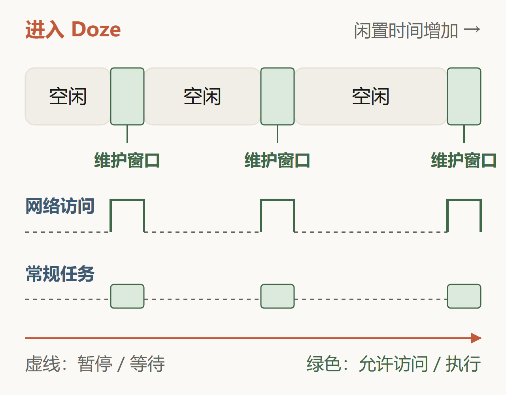
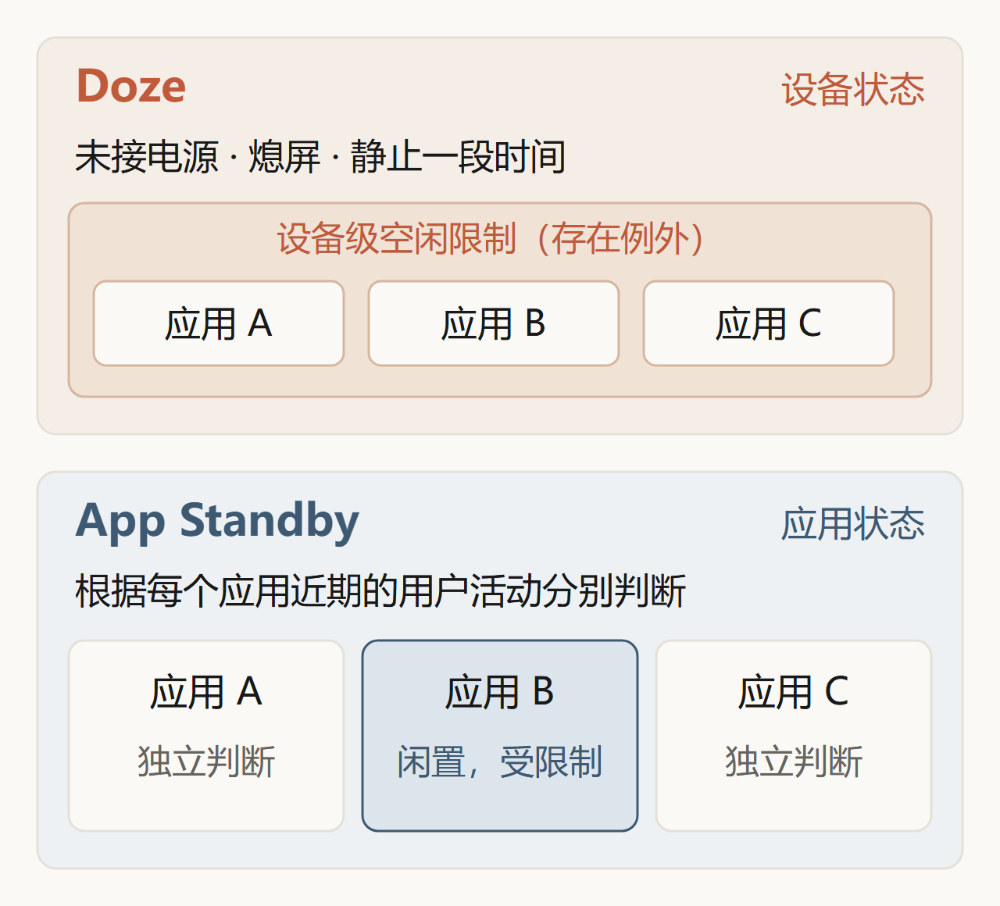
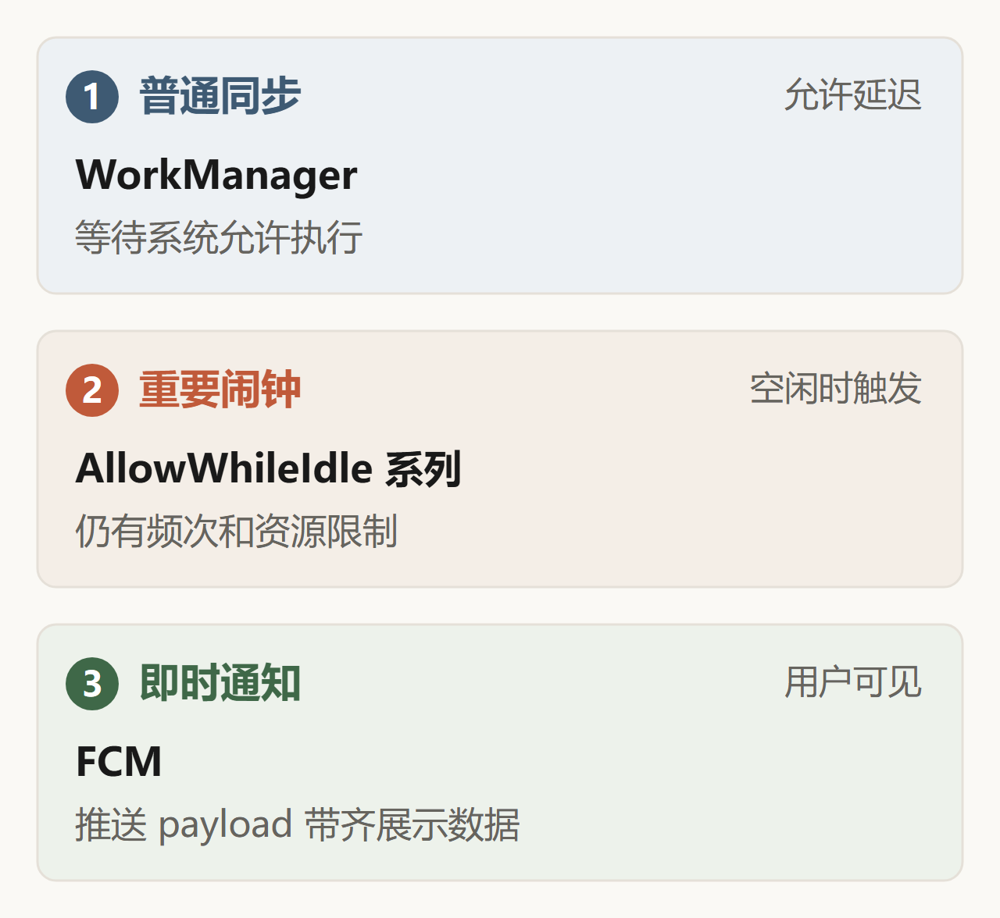

# Android Doze 与应用待机机制

真机连着 USB 调试时，网络请求通畅，Alarm 定时器准点触发，WorkManager 也能按计划调度。但一旦拔掉数据线、熄屏放上大半个小时，后台的数据同步往往就会停掉，长连接断开，即时通知也收不到了。直到再次按电源键点亮屏幕，刚才堆积的任务和消息才会在短时间内扎堆弹出来。

查进程状态通常会发现，应用既没有被系统杀掉，也没有发生崩溃。导致这种现象的原因，通常是设备触发了 Android 6.0 引入的低电耗模式（Doze Mode）或应用待机模式（App Standby）。

这两项机制属于系统级的硬性规则，哪怕把应用的 `targetSdkVersion` 降到 23 以下也绕不过去[1]。要想避免任务延误，得先弄清楚这两套机制分别在什么条件下触发，受限时系统到底卡了哪些操作。

## 1. Doze 的状态流转与维护窗口

手机熄屏并不意味着立刻切断后台网络和调度。Doze 针对的是整台设备的物理闲置状态，进入深度 Doze 必须同时满足三个前提：未接通电源、屏幕关闭、且传感器确认设备完全处于静止状态。

只要手机完全静止、没人动它，过一段时间系统就会进入 Doze。这时会有三处核心限制生效：

一是断网：系统直接在底层下发防火墙规则，除了白名单里的应用，其他 App 没法访问网络，发网络请求会直接被拦截；

二是忽略 WakeLock：哪怕代码里申请了 `PARTIAL_WAKE_LOCK`，系统也不理会，照样让 CPU 进入休眠；

三是挂起任务和闹钟：`JobScheduler` 任务、`SyncManager` 数据同步以及 `AlarmManager` 的普通闹钟全都进排队队列，暂时停止执行[1]。

当然，系统也不会一直封死。为了让后台积压的数据有机会发出去，Doze 隔一段时间会短暂打开一个维护窗口（Maintenance Window）。



窗口开启的这几十秒里，网络临时通了，积压的任务和闹钟也能集中跑一下。时间一到，系统立刻重新关上窗口，继续进入限制状态。

维护窗口并不是固定隔多久就开一次。手机放着不动的时间越长，窗口开得越少、间隔也越久——从最开始的十几分钟开一次，逐渐拉长到半小时、一小时，最后甚至要隔好几个小时才给一次执行机会。因此，刚熄屏时还能正常执行的任务，在手机放了一宿之后可能会经历极长的等待期，直到下一个维护窗口到来或者用户点亮屏幕退出 Doze。

### 1.1 常见后台组件在 Doze 期间的真实表现

在 Doze 生效期间，常见的后台保活和定时方案都有明确的限制边界：

Doze 状态下系统会直接忽略应用持有的 `PARTIAL_WAKE_LOCK`。此时网络通路已经被底层切断，后台任务就算持锁也无法发起网络请求，只会一直阻塞到 Socket 超时，白白消耗电量并触发系统的异常持锁告警。

`AlarmManager.setExact()` 和 `setWindow()` 只能保证平时不被系统合并批处理。进入 Doze 后，这些普通闹钟同样会被推迟到维护窗口。如果必须在熄屏休眠时触发闹钟，必须改用带 `AllowWhileIdle` 后缀的专属 API。

WorkManager 在 Android 6.0 及以上版本底层完全基于 `JobScheduler` 实现。即便把 `PeriodicWorkRequest` 设成 15 分钟执行一次，一旦手机进入 Doze，任务同样会延期到维护窗口才执行，不能指望换成 WorkManager 就能绕过系统调度[1]。

所以排查日志时要分清：定时任务到点没执行，很可能只是系统还没开维护窗口，并不是进程死了或者代码抛异常崩溃了。

## 2. App Standby 对单应用施加的闲置限制

Doze 管的是整台手机的闲置状态，而 App Standby 管的是单个 App 的活跃度。

即使手机正在使用、屏幕亮着且网络正常，如果某个应用连续几天没被用户点开过，系统就会把它判定为闲置（Idle），单独暂停它的后台网络访问，并推迟它的 JobScheduler 任务和同步[1]。

只要有明确的用户操作，应用就会立刻退出 Standby：比如用户点开了 App、App 正在前台展示或运行前台服务、发了用户能看到的通知栏消息，或者插上了充电器。只要一接通电源，系统就会解除所有应用的待机限制[1]。



所以排查时很容易区分：手机熄屏放了半天，多个 App 的任务都延迟了，亮屏后又扎堆跑完，这是进了 Doze；手机一直有人在用，偏偏只有某个很久没打开过的 App 后台断网延时，那大概率是它单独进了 App Standby。

从 Android 9 开始，系统把 App Standby 细化成了应用待机分桶（App Standby Buckets），按使用频率把应用分到 Active（活跃）、Working Set（工作集）、Frequent（常用）、Rare（极少使用）和 Restricted（受限）五个档位，层级越靠后，给的网络和 Job 执行配额就越少[2]。

### 2.1 前台服务的适用范围与系统限制

前台服务（Foreground Service）的设计初衷是承载音乐播放、实时定位导航、大文件下载等用户能明确感知的持续操作。系统规范明确禁止仅仅为了防止应用被判为空闲而偷开前台服务[1]。

系统层面的管控也越来越严：Android 8.0 起后台直接调 `startService()` 会抛 `IllegalStateException`；Android 14 更是要求在清单里必须声明具体的 `foregroundServiceType`（比如 `dataSync`、`location`），代码里还要有对应权限。类型和实际行为对不上，系统直接抛崩；而且滥用常驻通知去保活，应用商店审核也很难通过。

## 3. 按任务时效性选择调度方案

想把后台任务理顺，最关键的是分清哪些业务能等、哪些不能等，不要把可以延期的普通同步当成实时任务，也不要把必须即时响应的通知当成普通后台任务。



### 3.1 允许延期的普通同步：做好本地落盘与接口防重

埋点上报、离线拉取、缓存更新这类工作，晚几分钟甚至半小时做，业务基本不受影响。这种任务直接跟着系统的维护窗口走就行，不要想着去跟系统省电机制对着干。

这种场景要做好三件事：

第一，数据一定要写进数据库（如 Room）或文件持久化，别只留在内存队列里。只要数据落了盘，手机睡多久、进程中途退没退出都没关系，等到开维护窗口或者亮屏时，WorkManager 自然能捞出来重试。

第二，维护窗口一开，系统会一股脑把积攒的任务全放出来，重试时可能会重复发同一批数据，服务端的接口必须支持幂等防重。

第三，用户一点亮屏幕切回 App，前台界面就该主动去拉最新数据，别傻等着后台 Worker 慢慢跑完回调。

### 3.2 准时提醒类需求：用好空闲唤醒 API 并注意配额

日程提醒、吃药打卡这类必须准点提示的功能，可以使用支持空闲唤醒的 API：`setExactAndAllowWhileIdle()` 或 `setAndAllowWhileIdle()`。

但使用这类 API 时要注意两项系统约束：

一是调用次数有限制。原生 Android 规定同一个 App 大约 9 分钟内最多触发一次空闲闹钟[1][2]，短时间内调多了会被系统强行推迟，根本做不了高频心跳；

此外，空闲闹钟只负责把 CPU 唤醒并回调广播接收器，系统并没有解开网络封锁，在回调里直接发起网络请求依然会超时失败。

如果是真正的起床闹钟，应该使用 `AlarmManager.setAlarmClock()`。系统会在到点前提前退出 Doze 状态并准备亮屏唤醒，这是系统专为闹钟留出的特权 API，普通后台业务不要滥用。

### 3.3 即时消息与重要告警：推送 payload 必须带全数据

针对即时通讯、交易告警这类时效性极高的通知，应用自建的长连接在熄屏进入 Doze 后通常会断开，常规做法是接入系统级下行推送通道（如海外的 FCM 或国内厂商系统推送）[1]。

实现即时触达有两个核心细节：

一是推送的优先级。面向用户可见的即时通知，必须设置为高优先级（High Priority），这样系统收到推送后才会立刻唤醒应用处理并弹出通知栏；非紧急的静默数据更新应设为普通优先级（Normal Priority / BackgroundSync），由系统在维护窗口合并处理[3]。如果长期发高优先级推送却不向用户展示任何可见通知，推送通道往往会判定违规并对其执行降级。

二是推送的 payload 必须直接带齐展示内容，不要在推送里只发一个消息 ID，指望客户端被唤醒后再调 HTTP 接口去查标题和正文。在 Doze 状态下，即便推送把进程唤醒了，底层的网络限制很可能还没解除，客户端再去发网络请求极容易直接超时，导致通知迟迟弹不出来。直接把标题、正文和跳转参数塞进推送 payload，客户端收到后不需要做任何额外网络请求就能立即把通知弹出来。

## 4. 电池优化白名单能解决什么、不能解决什么

代码里可以通过 `PowerManager.isIgnoringBatteryOptimizations()` 查一下自己有没有进白名单。

不少人以为进了白名单后台就能为所欲为，其实根本不是这样。白名单豁免的权限非常有限：处于白名单的应用在 Doze 期间能访问网络，持有的 `PARTIAL_WAKE_LOCK` 也不会被系统忽略；但它的 JobScheduler 任务、数据同步和普通闹钟照样受限制，一样得老老实实等维护窗口[1]。

如果业务确实强依赖后台常驻持锁和网络（比如 VoIP 语音通话或实时导航），引导用户加白名单有两个入口：通过 `Settings.ACTION_IGNORE_BATTERY_OPTIMIZATION_SETTINGS` 跳转到系统设置列表让用户手动勾选，或者用 `Settings.ACTION_REQUEST_IGNORE_BATTERY_OPTIMIZATIONS` 在应用内直接调起系统授权弹窗。

需要说明的是，Google Play 和国内各大应用商店对直接在应用内弹窗申请白名单管得极严，只有符合官方用例清单（如 VoIP 通话、健康监护、运动追踪）的应用才可能审核通过[1]。普通应用还是应该把重点放在数据落盘重试和推送 payload 优化上，不要强求白名单。

## 5. 用 ADB 模拟 Doze 与 App Standby

日常插着 USB 调试时，设备一直在充电，系统不会自然进入 Doze 或 App Standby。可以通过 ADB 命令手动模拟这两种状态，快速验证后台任务的表现[1]。进行调试前，准备一台运行 Android 6.0 及以上系统的设备；若连接了多台设备，可通过 `adb -s <serial>` 指定目标。

### 5.1 强制进入与退出 Doze

启动目标应用并调度好待测后台任务后，运行以下命令将设备强制切入 Doze 空闲状态：

```bash
adb shell dumpsys deviceidle force-idle
```

这条命令会跳过静止检测和漫长的倒计时，让手机直接进入 Doze。这时就能直观看到：网络请求是不是被掐断了、排队的任务有没有停下来。

测试完成后，运行以下两条命令退出强制空闲状态，并重置模拟的电池状态：

```bash
adb shell dumpsys deviceidle unforce
adb shell dumpsys battery reset
```

调试时可以在日志里打三个时间戳：预计执行时间、实际开始时间、结束时间。对比这两个时间的差值，一眼就能看出任务到底卡了多久、是不是掉进了 Doze 挂起期。

### 5.2 模拟与恢复应用待机状态

模拟 App Standby 时，先模拟拔出电源，再将指定应用置为闲置状态（将 `com.example.app` 替换为目标包名）：

```bash
adb shell dumpsys battery unplug
adb shell am set-inactive com.example.app true
adb shell am get-inactive com.example.app
```

此时该 App 的后台网络会被切断，任务也会推迟。

测试完成后，解除应用的闲置标记并复原电池状态：

```bash
adb shell am set-inactive com.example.app false
adb shell am get-inactive com.example.app
adb shell dumpsys battery reset
```

恢复后继续看：积压的任务有没有重新执行？重试会不会导致服务端生成重复数据？

测完一定要记得执行 `dumpsys battery reset`。不然手机会一直卡在模拟断电的状态里，哪怕插着线也充不进电，电量百分比都不会动。

## 参考资料

- [针对低电耗模式和应用待机模式进行优化](https://developer.android.com/training/monitoring-device-state/doze-standby?hl=zh-cn)（Android Developers · 查阅于 2026-10-31）
- [电源管理资源限制](https://developer.android.com/topic/performance/power/power-details?hl=zh-cn)（Android Developers · 查阅于 2026-10-31）
- [Set and manage Android message priority](https://firebase.google.com/docs/cloud-messaging/android-message-priority)（Firebase · 查阅于 2026-10-31）
