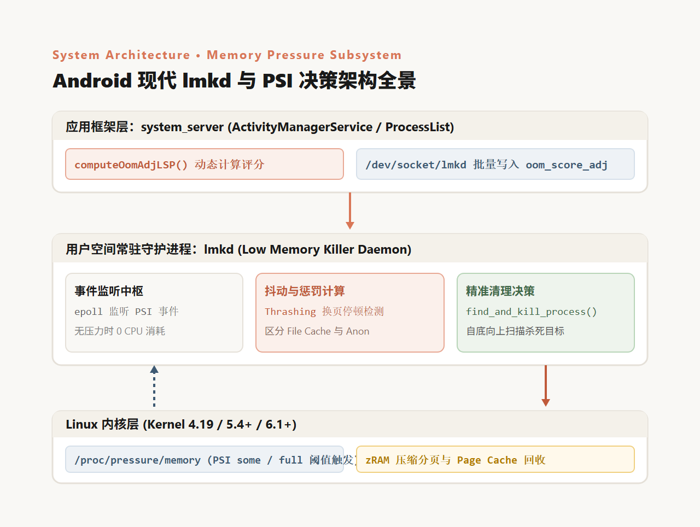
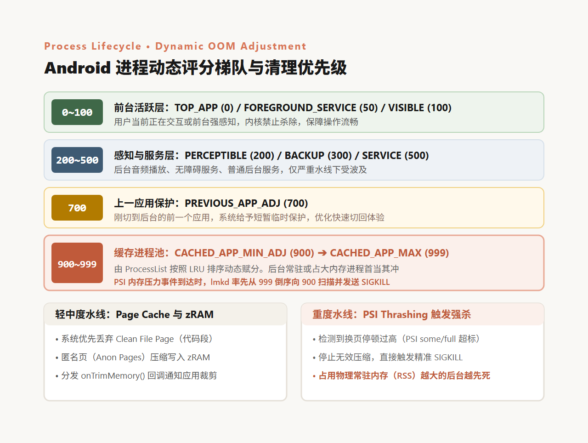
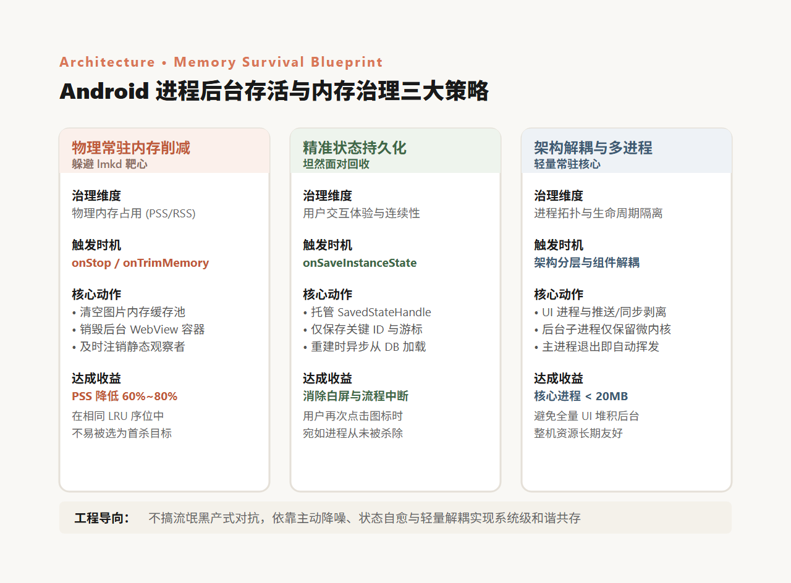

# Android lmkd 与 PSI 水位决策机制

在日常使用 Android 手机或开发大型 App 时，几乎所有人都遭遇过这种令人匪夷所思的体验：

**“手机明明配备了 8GB 甚至 12GB 的超大运存，前台只开了一个相机或大型游戏，切回微信或后台应用仅仅过了两分钟，应用居然直接被系统杀掉重新冷启动了。”**

面对这一现象，许多开发者在面试与技术讨论中常常脱口而出那套早期的“标准答案”：
_“这是 Linux 内核中的 Low Memory Killer（LMK）驱动干的，根据 `/sys/module/lowmemorykiller/parameters/minfree` 预设的六级固定内存水位线，哪个进程的 `oom_adj` 高就杀哪个。”_

然而只要深入近几个主流版本的 AOSP 源码就会发现一个令人震惊的现实：

**早自 Android 10 起，Google 就已经在内核中全面废弃了原生的内核态 Low Memory Killer 驱动；现代 Android 的整机内存治理，早已全面移交至用户空间常驻的 `lmkd` 守护进程，并基于 Linux 内核的 PSI（Pressure Stall Information）机制进行动态决策。**

从过去的“按剩余物理内存静态匹配”，到如今的“基于换页停顿时间动态感知”，Android 的内存治理逻辑发生了一场深刻的技术迭代。

本文将深入 Linux 内核驱动与 Android 运行时，彻底拆解这套由 `lmkd` 执掌的现代内存杀除决策体系，看清大内存手机依然频频杀后台的底层机械真相。



---

## 1. 认知颠覆：内核 LMK 已死，现代 Android 的内存治理基座

要弄懂现代手机为什么杀后台，首先需要厘清系统内存架构的演进脉络。

### 1.1 为什么内核态 LMK 退出历史舞台

在早期的 Android 系统中（Android 9 及更早版本），内存回收主要依赖 Linux 内核驱动中的 `lowmemorykiller.c`。内核驱动会定期轮询系统的空闲物理页框（`free pages`）与文件缓存页（`file cache`），一旦空闲物理内存跌破某个固定阈值，内核就会遍历进程列表，向 `oom_score_adj` 最高的进程直接发送 `SIGKILL` 信号。

然而，这套纯内核态机制在现代复杂硬件与重载应用面前暴露出了严重的工程缺陷：

1. **纯数值水位的滞后性**：内核只看空闲物理页的数量，无法感知系统的真实卡顿感。很多时候，物理剩余内存看起来还很充裕，但 CPU 正在疯狂把内存页压缩写入交换分区，导致用户界面出现严重掉帧甚至假死；而内核驱动对此毫无察觉；
2. **缺乏应用层生命周期协同**：内核无法深度感知复杂的多媒体、前台通知、后台数据绑定等灵活状态，容易误杀处于过渡期的关键进程；
3. **内核代码维护成本过高**：每次升级内核版本，厂商都要维护这套非上游主线的 Out-of-tree 驱动补丁，阻碍了通用 Linux 内核（GKI）的标准化推进。

因此，Google 彻底砍掉了内核驱动中的 LMK，将这套逻辑全量迁移至用户空间守护进程：**`lmkd`（Low Memory Killer Daemon）**。

### 1.2 现代架构：userspace lmkd 与 Linux PSI 机制

在用户空间运行，如果依然靠死循环轮询 `/proc/meminfo`，守护进程自身就会消耗大量的 CPU 算力与电池功耗。

现代 `lmkd` 之所以能够兼顾极低延迟与极低开销，关键在于底层引入了 Linux 4.20+ 正式合并的重量级系统监控利器：**PSI（Pressure Stall Information，压力停顿信息）**。

PSI 改变了以往“只量度剩余空间大小”的思路，转而**量度硬件资源的停顿瓶颈时间**。在 `/proc/pressure/memory` 文件中，内核暴露了两个极其核心的维度：

- **`some`**：表示在统计时间窗口内，**至少有一个活跃线程**因为等待内存分配（如直接内存回收、缺页中断、zRAM 解压缩）而陷入阻塞暂停的时间占比；
- **`full`**：表示**系统内所有正在运行的非空闲线程**，全部因为等待内存而停摆的时间占比。此时 CPU 算力完全浪费在换页等待上，用户肉眼即可看到严重的掉帧与无响应。

```cpp
// system/memory/lmkd/lmkd.cpp
// 现代 lmkd 通过 epoll 注册内核 PSI 阈值事件触发机制
static int init_psi_monitors() {
    // 监听内核 /proc/pressure/memory
    // 设定 1 秒内换页停顿达到指定毫秒阈值时，由内核中断主动唤醒 lmkd
    int fd = open("/proc/pressure/memory", O_RDWR | O_NONBLOCK | O_CLOEXEC);
    if (fd < 0) return -1;

    // 配置监听条件：触发窗口 1000ms，some 停顿超过 70ms 触发告警
    dprintf(fd, "some 70 1000");

    struct epoll_event ev;
    ev.events = EPOLLPRI;
    ev.data.fd = fd;
    epoll_ctl(epollfd, EPOLL_CTL_ADD, fd, &ev);
    return 0;
}
```

在日常状态下，`lmkd` 完全挂起在 `epoll_wait` 系统调用上，消耗的 CPU 算力几乎为零。

一旦用户启动大型游戏或密集加载高清大图，内存分配出现瓶颈，内核在毫秒级时间内检测到 PSI 停顿比例超出预警线，立刻通过 `epoll` 唤醒 `lmkd` 触发精准的清理逻辑。

---

## 2. 内存形态解构：你的 8G 内存到底去哪了？

许多用户和工程师常产生困惑：“我手机有 8GB 内存，为什么后台只留了几个应用，内存就报警了？”

这是因为在操作系统层面，**并非所有内存都能在危机时刻被随意回收**。

### 2.1 Clean Page 与 Dirty Page 的天壤之别

在 Linux 虚拟内存体系中，内存页主要分为两大流派：

1. **干净文件页（Clean File-backed Pages）**：
   - 包含系统的代码段、DEX/ODEX 指令、只读资源文件、APK 包内数据映射；
   - 这些页面的数据在持久化磁盘（UFS / Flash 闪存）上有完整的原始文件备份；
   - **回收代价极低**：当系统内存紧张时，内核可以直接丢弃（Drop）这部分干净物理页，完全不需要写盘。下次需要执行这段代码时，再通过缺页中断重新从磁盘读入即可。
2. **脏页与匿名页（Dirty / Anonymous Pages）**：
   - 包含 Java 堆内存对象、Native 堆分配（`malloc` / `mmap`）、线程栈、已修改的文件数据缓存；
   - 这些数据在磁盘上没有任何现成副本，全靠内存实时维持；
   - **系统绝对不能直接丢弃它们**，否则会导致应用瞬间崩溃或数据丢失。

### 2.2 zRAM 压缩机制与内存抖动（Thrashing）

在没有物理 Swap 硬盘交换分区的移动设备上，系统如何处理庞大的匿名页？

Android 引入了 **zRAM 虚拟内存压缩交换机制**：

- 系统在 RAM 中单独划分出一块区域（通常为 3GB~6GB）作为虚拟压缩盘；
- 当系统需要腾挪内存时，内核的 `kswapd` 守护线程会将后台进程的匿名页通过 LZ4 或 ZSTD 算法进行高倍率压缩，存入这块 zRAM 中，从而将原本占用 4KB 的物理页压缩到 1KB~1.5KB；
- 当后台进程被用户切回前台时，系统再动态解压缩还原物理页。

**这就是导致 8GB 手机依然频频杀后台的致命瓶颈所在：内存抖动（Thrashing）。**

当后台运行的应用过多、或者前台应用吃掉巨量内存时，物理内存捉襟见肘，内核不得不高频触发压缩与换页。此时系统的吞吐量会急剧恶化：

1. CPU 核心几乎全部被 `kswapd` 压缩解压线程占满，导致主线程渲染掉帧；
2. 干净文件页被过度丢弃，导致前台界面连执行基础的代码段都需要频繁等待磁盘 IO 读取；
3. PSI 的 `some` 和 `full` 指标呈现断崖式暴增。

此时如果 `lmkd` 再不果断杀掉几个占用大量物理内存的后台进程，整台手机就会彻底陷入无响应（ANR）乃至硬死机的灾难状态。

---

## 3. 杀戮决策矩阵：lmkd 如何挑选目标

当 PSI 压力事件唤醒 `lmkd` 后，守护进程究竟按照什么规则挑选“牺牲者”？



### 3.1 动态 oom_score_adj 的分层打分机制

Android 框架层的 `system_server` 内部，`ActivityManagerService` 与 `ProcessList` 维护了一套高度动态的评分系统：**`oom_score_adj`**。其取值范围在 `-1000` 到 `1000` 之间，**分值越低，代表该进程越重要，越受系统保护**：

- **`SYSTEM_ADJ (-900)` 与 `PERSISTENT_PROC_ADJ (-800)`**：系统常驻核心服务（Telephony、SystemUI 等）；
- **`FOREGROUND_APP_ADJ (0)`**：用户当前正在操作的顶级前台应用（Top App），享有最高优先级的资源倾斜；
- **`VISIBLE_APP_ADJ (100)`**：虽非焦点应用，但部分界面可见（如分屏模式、弹窗半遮挡）；
- **`PERCEPTIBLE_APP_ADJ (200)`**：后台强感知进程（如正在播放音乐的音频服务、无障碍服务）；
- **`SERVICE_ADJ (500)`**：在后台默默运行普通业务的 Service；
- **`PREVIOUS_APP_ADJ (700)`**：紧邻上一个切换走的 Activity。系统通常给予它数秒到数十秒的临时缓冲保护，以提升用户在两个 App 间反复切换时的响应速度；
- **`CACHED_APP_MIN_ADJ (900) ➔ CACHED_APP_MAX_ADJ (999)`**：退到后台的普通缓存进程池。

当应用退到后台后，`ProcessList` 会依据 **LRU（最近最少使用）算法** 动态计算这些进程的 `oom_score_adj`。越久没有使用的应用，其分值越接近 999。

### 3.2 判定算法：不仅看 LRU，更看常驻内存（RSS）

很多开发者以为 `lmkd` 仅仅是一个机械的“从 999 杀到 900”的顺序执行器，但事实远非如此。

在现代 `lmkd` 的内核逻辑中，判定策略结合了**进程的物理内存开销（Resident Set Size, RSS）与内存换页停顿敏感度**：

```c
// system/memory/lmkd/lmkd.c
static int find_and_kill_process(int min_score_adj) {
    struct proc *target = NULL;
    int max_rss = 0;

    // 自底向上，先从高 oom_score_adj 的桶中开始搜索
    for (int oom_score = CACHED_APP_MAX_ADJ; oom_score >= min_score_adj; oom_score--) {
        struct proc *procs = proc_get_heaviest(oom_score);
        if (procs) {
            target = procs;
            break;
        }
    }

    if (target) {
        // 向目标进程发送强制结束信号
        kill(target->pid, SIGKILL);
        return target->rss_in_pages;
    }
    return 0;
}
```

在同一评分梯队内（例如同样处于 900~950 区间的若干个缓存进程），`lmkd` 会优先调取各进程在 `/proc/<pid>/statm` 中的物理常驻内存数据：

- 如果 App A 仅仅占用了 40MB 的常驻内存，而 App B 内部残留了大量未释放的图片缓存或 WebView 容器，常驻内存高达 600MB；
- 为了在单次杀戮中以最小的破坏面迅速平息系统的 PSI 压力，**`lmkd` 会优先挑出占用物理内存最大的 App B 执行一击必杀**。

这就是为什么许多重型应用（如大型电商、图文社区、短视频 App）切到后台后，往往“死”得比小型工具类应用快得多的深层原因。

---

## 4. 架构防御指南：如何让你的应用活得更久

搞清了 `lmkd` 的裁决逻辑，移动架构师就无需再盲目使用各种已经被现代 Android 封杀的“双进程守护”“像素保活”等畸形手段，而是应当从正向的工程维度建立起高维度的存活与体验保障体系。



### 4.1 方案一：响应 onTrimMemory 主动瘦身

许多开发者对 `ComponentCallbacks2` 提供的 `onTrimMemory(int level)` 视而不见。实际上，这个回调是系统在真正祭出 `SIGKILL` 之前，给予应用最宝贵的主动自救窗口：

```kotlin
class MyApplication : Application() {
    override fun onTrimMemory(level: Int) {
        super.onTrimMemory(level)
        when (level) {
            // 当应用退入后台，界面完全不可见时
            ComponentCallbacks2.TRIM_MEMORY_UI_HIDDEN -> {
                // 1. 立即清空内存中的高分辨率位图解码缓存
                ImageLoader.clearMemoryCache()
                // 2. 释放非必要的单例临时数据集合
                DataRepository.trimMemory()
            }
            // 当整机内存水位已达到中度紧张，系统正在清理 CACHED 列表时
            ComponentCallbacks2.TRIM_MEMORY_RUNNING_CRITICAL,
            ComponentCallbacks2.TRIM_MEMORY_COMPLETE -> {
                // 彻底释放全部弱引用与非核心业务缓存，避免成为 lmkd 靶心
                GlobalResourcePool.evictAll()
            }
        }
    }
}
```

在 `TRIM_MEMORY_UI_HIDDEN` 到达的一瞬间，主动释放非核心缓存，可以让进程常驻内存（PSS / RSS）发生断崖式下降。在随后 `lmkd` 的大胃王筛选中，你的进程便会被系统判定为“低开销良性进程”，从而大幅延后被清理的时机。

### 4.2 方案二：架构解耦与多进程隔离

对于功能极其繁重、必然消耗数百兆内存的大型工程，单进程架构是极其脆弱的。

合理的做法是将架构解耦为两个核心边界：

1. **主 UI 进程（`:ui`）**：装载所有 Activity、复杂的布局层级与富媒体组件。当用户点击返回键退到桌面时，业务层甚至可以主动调用系统 API 或设计超时挥发机制，允许主进程优雅释放；
2. **微型核心服务进程（`:core` 或 `:sync`）**：剥离所有 UI 相关的依赖库与大型单例，只负责轻量级的数据长连接、本地消息轮询与下载任务调度。
   - 保证该后台常驻进程的物理内存维持在 **15MB~20MB 以内**；
   - 极小的内存占用使得该进程对系统整机 PSI 指标几乎不造成任何波动，即使长期挂载在后台，也极少触碰 `lmkd` 的清理红线。

### 4.3 方案三：精准状态持久化与优雅无感重建

无论你的内存优化做得多么极致，在多任务并发高强度的手机生态中，**进程随时可能被系统干脆利落地杀除**。

真正的顶级架构，从来不是妄想“进程永不被杀”，而是**做到即使进程被杀，用户重新切回时依然拥有宛如从未中断的流畅体验**。

现代 Jetpack 架构提供了基于 `SavedStateHandle` 的完整状态复原闭环：

```kotlin
class ProductDetailViewModel(
    private val savedStateHandle: SavedStateHandle,
    private val repository: ProductRepository
) : ViewModel() {

    // 1. 状态保存：关键标量（如商品ID、滚动偏移量）存入 SavedStateHandle
    // 系统在进程被杀前，会自动将该数据随 onSaveInstanceState 经由 Binder 暂存至 AMS
    val productId: StateFlow<String> = savedStateHandle.getStateFlow("KEY_PRODUCT_ID", "")

    fun setProductId(id: String) {
        savedStateHandle["KEY_PRODUCT_ID"] = id
    }

    // 2. 状态恢复：当进程被杀并发生冷启动重建时，ViewModel 自动读取保存的 ID
    // 随后从本地 Room 数据库或持久化缓存中即时流式加载数据，消除空白等待
    val productDetail = productId.flatMapLatest { id ->
        repository.loadProductFromDb(id)
    }.stateIn(viewModelScope, SharingStarted.WhileSubscribed(5000), null)
}
```

通过将“轻量恢复标识”托管至系统 `Bundle`，将“重型业务数据”托管至本地持久化数据库，即便应用进程被 `lmkd` 清理回收，用户再次从最近任务列表点击时，应用也能在几十毫秒内精准复原此前的工作上下文，让用户感知不到任何破坏性崩溃。

### 4.4 四项内存防杀与工程治理规范

为了在架构体系中全面提高后台抗压稳定性，团队可在代码审查与基线监控中落实以下四项规范：

1. **WebView 容器必须彻底解耦与隔离**：严禁在主进程长期持有已经关闭的 WebView 引用。建议为复杂 H5 容器配置独立进程运行，或者在页面退出时强制调用 `destroy()` 并将其从父容器解绑；
2. **Bitmap 优先采用 HARDWARE 格式**：在 Android 8.0 及以上版本中，优先采用 `Bitmap.Config.HARDWARE`，将像素缓冲直接交由 GraphicBuffer / 显存分配，不再占用 Java 堆与普通匿名页；
3. **避免在常驻 Service 中开辟大型集合**：后台执行数据同步时，采用流式管道（Paging / Flow）分批落库，严禁在内存中驻留大数组；
4. **接入线上 PSI 与 OOM-Adj 监控**：在 APM 治理平台中定期读取 `/proc/self/oom_score_adj` 与系统 PSI 指标，将高内存报警与切后台行为关联分析，提前消除内存泄漏暗疾。

---

## 5. 小结

回顾现代 Android 系统的内存清理机制，我们可以清晰归纳出四个核心认知：

1. **治理基座的颠覆**：内核态 LMK 驱动早已退役，现代 Android 全面基于用户空间 **`lmkd`** 与内核 **PSI（Pressure Stall Information）** 的换页停顿时间进行敏捷决策；
2. **内存抖动的真凶**：导致系统卡顿并触发杀戮的根源往往不是物理空间不够，而是**匿名页压缩写入 zRAM 时的 CPU 与换页停顿（Thrashing）打满了系统瓶颈**；
3. **杀戮决策的双重维度**：`lmkd` 挑选目标时，**既看基于 LRU 计算的 `oom_score_adj` 分层，又在同层内优先选取物理常驻内存（RSS）最大的“大胃王”**；
4. **终极生存哲学**：科学的工程治理不是无底线保活，而是**通过 `onTrimMemory` 主动瘦身、多进程微内核解耦，以及基于 `SavedStateHandle` 的无感平滑重建**，实现与操作系统生态的良性共存。

## 参考资料

- [Low Memory Killer Daemon (lmkd) Documentation](https://source.android.com/docs/core/perf/lmkd)（Android Open Source Project · 2024-03）
- [Getting Started with Pressure Stall Information (PSI)](https://docs.kernel.org/accounting/psi.html)（Linux Kernel Documentation · 2023-09）
- [ProcessList.java & OomAdjuster.java Source Code](https://android.googlesource.com/platform/frameworks/base/+/refs/heads/main/services/core/java/com/android/server/am/ProcessList.java)（Android Open Source Project (AOSP) · 2024-02）
- [Understand Android Memory Management & onTrimMemory](https://developer.android.com/topic/performance/memory-overview)（Android Developers Official Guide · 2024-01）
