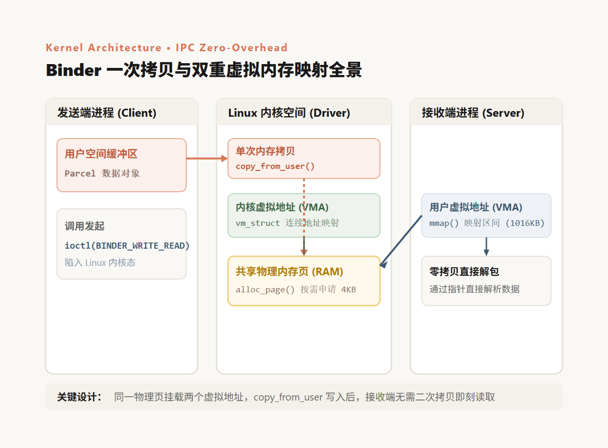
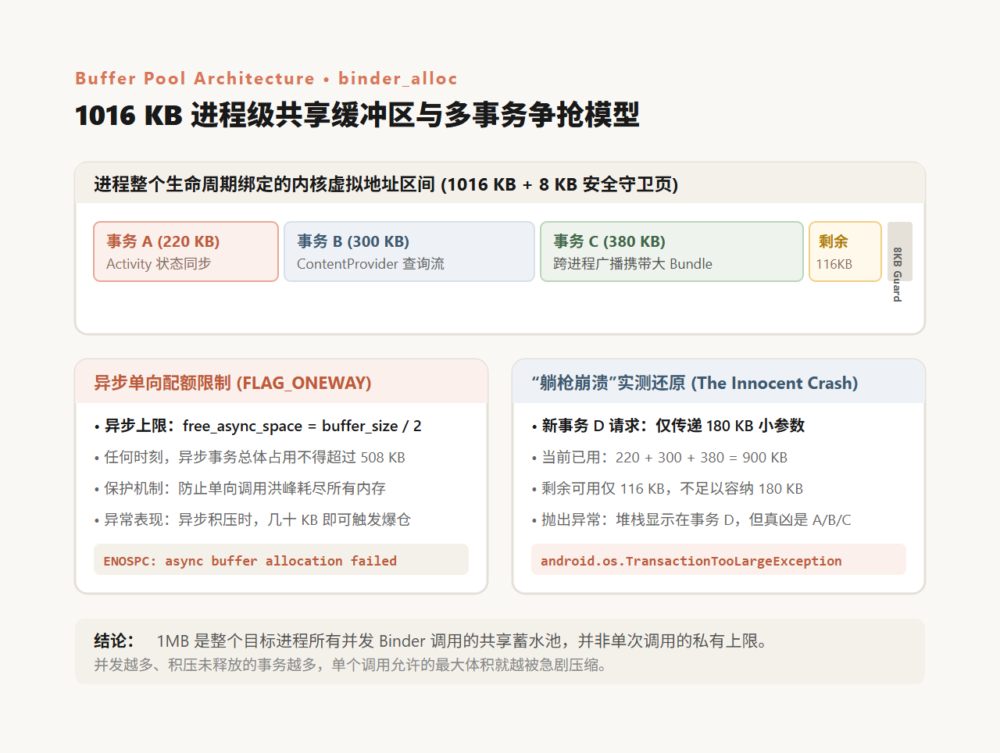
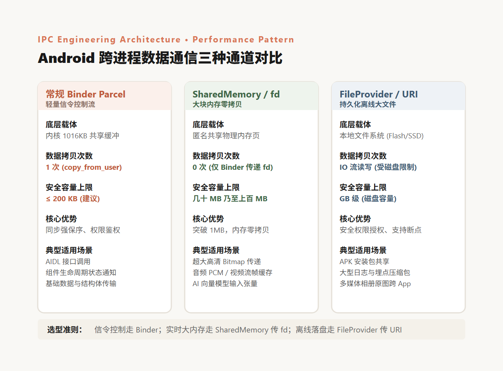

# Binder 内核映射与 1MB 内存限制真相

在 Android 开发与线上稳定性治理中，几乎每一位资深工程师都遭遇过这样一个经典的系统级异常：**`android.os.TransactionTooLargeException`**。

面对这个异常，业界流传着一句几乎人尽皆知的八股文定论：**“Binder 跨进程调用的传输限制是 1MB，单次传数据不能超过 1MB。”**

然而在真实的生产环境中，工程师们往往会遇到一系列极其诡异的崩溃场景：

- 明明 Intent 里面只装了一个仅几十 KB 的简单对象，跳转页面时系统依然抛出了 `TransactionTooLargeException`；
- 某个跨进程 AIDL 接口传递 600 KB 的数据，在单元测试中能稳定执行，但在高并发多线程场景下却频频闪退；
- 崩溃日志里的调用堆栈所指向的业务代码，往往只传递了几个布尔值或简短字符串，看起来完全是“无辜”的受害者。

这背后引出了一组深刻的核心技术疑问：

**“1MB 的限制到底是对单次调用的约束，还是针对整个进程的配额？Binder 驱动是如何在 Linux 内核层管理这块内存的？既然 1MB 经常不够用，Google 为什么不把它设计得更大，或者允许运行时动态扩容？”**

本文将从 Linux 内核驱动源码与 Android 运行时架构出发，深入拆解 Binder 的内存映射模型与分配策略，彻底廓清跨进程通信中的内存运作真相。



---

## 1. 概念澄清：1MB 到底限制的是谁？

要彻底搞清 `TransactionTooLargeException` 的触发诱因，首先必须纠正一个流传甚广的认知误区。

### 1.1 进程级共享缓冲区，而非单次调用额度

**1MB 绝非单次 Binder 调用的独立私有容量，而是整个进程所有正在并发处理的 Binder 事务共同瓜分的内存总池。**

当一个 Android 应用进程启动时，Android 运行时会在本地加载初始化 `ProcessState` 单例对象。在 `ProcessState::open_driver()` 完成驱动节点打开之后，紧接着会向 Linux 内核发起一次著名的 `mmap` 系统调用：

```cpp
// frameworks/native/libs/binder/ProcessState.cpp
#define BINDER_VM_SIZE ((1 * 1024 * 1024) - sysconf(_SC_PAGE_SIZE) * 2)

ProcessState::ProcessState(const char *driver) {
    if (mDriverFD >= 0) {
        // 向内核申请一块固定大小的虚拟内存映射区间
        mVMStart = mmap(nullptr, BINDER_VM_SIZE,
                        PROT_READ, MAP_PRIVATE | MAP_NORESERVE,
                        mDriverFD, 0);
        if (mVMStart == MAP_FAILED) {
            close(mDriverFD);
            mDriverFD = -1;
        }
    }
}
```

请仔细观察常量宏定义 `BINDER_VM_SIZE` 的计算公式：

- `1 * 1024 * 1024` 即 1024 KB；
- `sysconf(_SC_PAGE_SIZE) * 2` 表示扣除 2 个物理页大小（在常规 4KB 页面架构下为 8 KB）。

为什么系统要扣减这 8 KB？因为内核要在缓冲区末尾保留 2 个物理页作为**安全守卫页（Guard Pages）**，防止指针意外越界踩坏邻近的内存空间。

因此，普通 Android 应用进程在启动时，内核所建立的 Binder 接收缓冲区物理容量上限实际为：
`1024 KB - 8 KB = 1016 KB`。

这个 1016 KB 的总池子，必须由该进程承载的**所有进出 Binder 事务共享**。如果该进程当前同时接收到多个并发 IPC 请求（例如多线程同时访问 ContentProvider、后台服务接收推送广播、AMS 同步组件生命周期），所有尚未释放的传输载荷都在实时挤占这 1016 KB 的公共空间。

一旦累积的载荷把这 1016 KB 撑满，后续即便只是到达一个仅 20 KB 的微小事务，内核也会由于无法分配出连续内存块而直接报错。

### 1.2 异步调用的配额削减：FLAG_ONEWAY 的“腰斩”规则

很多开发者为了避免主线程阻塞卡顿，会将跨进程 AIDL 方法声明为 `oneway`（即异步单向调用），或者在 Intent 标志位中设置 `FLAG_ONEWAY`。这种调用发出后无需等待服务端响应，调用方即可立即恢复执行。

然而，内核为了防止客户端恶意疯狂调用引发服务端缓冲区瘫痪，对异步事务施加了更为苛刻的约束：



```c
// drivers/android/binder_alloc.c
static struct binder_buffer *binder_alloc_new_buf_locked(
                struct binder_alloc *alloc,
                size_t data_size, size_t offsets_size,
                size_t extra_buffers_size, int is_async) {
    ...
    // 如果是异步事务，严格检查当前的异步可用空间配额
    if (is_async && alloc->free_async_space < size) {
        binder_alloc_debug(BINDER_DEBUG_BUFFER_ALLOC,
            "%d: binder_alloc_buf size %zd failed, no async space left\n",
            alloc->pid, size);
        return ERR_PTR(-ENOSPC); // 返回无剩余空间错误
    }
    ...
}
```

在内核驱动实现中，`free_async_space` 的初始上限设定为整个缓冲区大小的一半（即 `buffer_size / 2`，约等于 **508 KB**）。

这意味着：**所有处于在途排队状态的异步单向事务，加在一起所能消耗的内存总和不能超过 508 KB。**

如果业务层在一个死循环或者高频轮询中连续发送 `oneway` 消息，一旦服务端的 Binder 线程池处理稍有滞后，508 KB 的异步配额就会在极短时间内告罄，进而抛出 `TransactionTooLargeException`。

---

## 2. 内存底座：Binder 是如何做到“一次拷贝”的？

要透彻理解这 1016 KB 缓冲区的作用机制，必须先搞清楚计算机体系结构中进程间通信（IPC）的内存拷贝开销。

### 2.1 传统 IPC 的两次拷贝与共享内存的同步困境

在标准 Linux 操作系统中，两个普通进程之间彼此拥有完全隔离的虚拟地址空间。常规 IPC 手段（如管道 Pipe、消息队列 Message Queue、本地 Socket）的数据流转路径遵循两次内存拷贝模型：

1. **第一次拷贝**：发送端进程将数据从自身的用户空间缓冲区，拷贝到内核态临时申请的内存缓冲区（`copy_from_user`）；
2. **第二次拷贝**：内核态再将这批数据从内核缓冲区，拷贝到接收端进程的用户空间缓冲区（`copy_to_user`）。

两次完整的内存内存拷贝，伴随着 CPU 指令执行、缓存失效（L1/L2 Cache Miss）与两次用户态到内核态的上下文切换，难以满足移动设备对高帧率与极低操作延迟的要求。

而 Linux 原生的共享内存（Shared Memory）虽然能够实现零拷贝，却缺乏严格的访问控制、身份鉴权机制。在 Android 这个开放多应用同台运行的沙盒操作系统中，各应用进程无法建立天然信任链，原生共享内存极易导致越权读取或并发死锁。

### 2.2 内核 mmap 与物理页双重映射机制

Binder 架构创造性地引入了基于内核 `mmap` 的**双重虚拟内存映射（Double Mapping）**机制，在兼顾严密权限控制的同时，将内存拷贝次数压缩到了物理极限的**仅有一次**。

整个编排链路的机械原理如下：

1. **启动期建立映射**：接收端进程在初始化 Binder 基础设施时，向驱动发起 `mmap`。内核 Binder 驱动在接收端进程的虚拟地址空间开辟了一段虚拟区间（`vm_area_struct`），同时在内核空间本身也开辟了一段对应的内核虚拟地址区间（`vm_struct`）；
2. **两组虚拟地址指向同一物理内存**：驱动将**内核空间的这块虚拟内存**与**接收端用户空间的这块虚拟内存**，通过修改系统页表，同时挂载到**完全相同的一组物理内存页（Physical RAM Pages）**上；
3. **单次写入即全局可见**：当发送端发起调用时，它把数据放入自身用户空间的 Parcel 中，随后通过 `ioctl` 陷入内核；
4. **唯一的内存拷贝**：内核驱动调用 `copy_from_user`，直接将数据从**发送端用户空间**拷贝到**接收端内核虚拟地址映射的物理页**中；
5. **接收端免拷贝直读**：因为接收端进程的用户空间虚拟地址早已映射到了同一组物理内存页上，数据一旦写入，接收端用户空间的对应虚拟地址立刻就能“看到”这批数据。接收端只需手持指针解析 Parcel，无需发生任何二次拷贝。

这种设计使得 Binder 在移动端兼具了极高的传输性能与严格的 UID/PID 内核态身份校验能力。

---

## 3. 内存编排核心：binder_alloc 的动态分配与按需分页

既然每个应用进程启动时都执行了 `mmap(nullptr, 1016KB, ...)`，这是否意味着系统为每一个存活的 App 都预先锁定了 1MB 的宝贵物理内存？

答案是：**绝对没有**。

### 3.1 预占虚拟地址，按需分配物理页

在现代操作系统内存管理中，**虚拟地址空间（Virtual Address Space）**与**物理内存（Physical RAM）**是完全解耦的两个概念。

`ProcessState` 中调用的 `mmap` 仅仅是在进程的虚拟地址段上标记并圈定了 1016 KB 的连续地址范围。在这一刻，**内核连一个字节的物理 RAM 都没有为它分配**。

只有当真正有跨进程数据传输到达该进程时，内核驱动的内存分配模块 `binder_alloc` 才会介入：

1. 计算当前事务 payload 需要消耗的页框数量；
2. 检查哪些页面尚未映射物理内存；
3. 动态调用内核的 `alloc_page(GFP_KERNEL)` 实时申请物理页；
4. 随后通过 `map_kernel_range_noflush` 与 `vm_insert_page` 将物理页分别挂入内核页表与用户页表。

一旦事务消费完毕、接收端调用 `free_buffer` 归还内存时，内核会在适当的垃圾回收时机释放这些物理页，将其重新归还给系统空闲内存池。

### 3.2 红黑树组织与最佳适配算法

为了在极低耗时内完成内存块的借调与归还，`binder_alloc` 内部维护了两棵自平衡红黑树：

- **`free_buffers`**：维护所有当前空闲的内存块（按内存块尺寸由小到大排序）；
- **`allocated_buffers`**：维护所有正在使用中的内存块（按内存起始地址排序）。

当一个新事务请求内存空间时，内核采用**最佳适配（Best-Fit）算法**在 `free_buffers` 树中快速检索能容纳该数据的最小空闲块。若该空闲块大于请求尺寸，内核会将其一分为二：前半部划入 `allocated_buffers` 承载数据，后半部作为新的碎片存回 `free_buffers`。

而在事务释放内存时，内核不仅会把节点从 `allocated_buffers` 移出，还会顺便检查其在物理地址上相邻的前后内存块。如果相邻块处于空闲状态，内核会自动执行**合并（Coalesce）**操作，将其融合成一个更大的连续空闲块，最大限度抑制外部内存碎片。

当且仅当 `free_buffers` 树中检索不到足够大的连续区间，且总容量触顶时，内核才会向应用层返回 `-ENOSPC` 错误码。

---

## 4. 根源追溯：为什么系统不将缓冲区设计得更大？

不少工程师曾提出疑问：当今主流智能手机的物理运存已经普及到 8GB 乃至 16GB，为什么 Google 依然坚持将普通进程的 Binder 缓冲区硬性限制在 1MB 左右？为什么不支持像普通堆内存那样动态扩容？

这背后是 Linux 内核安全防护、系统服务架构与 32 位历史遗产三者权衡的最终结果。

### 4.1 32 位地址空间的历史约束

在 Android 诞生初期以及随后的较长时间内，硬件平台均为 32 位 CPU 架构。32 位处理器的用户空间虚拟寻址上限仅有 3GB。

如果系统为运行着的几十上百个进程都预分配几十 MB 的连续内核虚拟映射区间，不仅容易加剧内核虚拟地址空间（vmalloc 区域）的碎片化，甚至会导致系统在重载运行状态下无法找到大块连续虚拟地址。

### 4.2 核心系统服务的 DoS 防护与资源隔离

Binder 绝不仅仅用于两个普通 App 之间的点对点通信，它更是整个 Android 操作系统运行的中枢命脉。无论是 `ActivityManagerService`、`WindowManagerService`、`PackageManagerService`，还是音频渲染、图形合成，全都依托系统级进程中的 Binder 线程池。

假设系统允许 Binder 缓冲区无限扩大或单次传输数十 MB 数据：

- 任何一个恶意或编写不规范的普通第三方应用，只要疯狂向 `system_server` 发起超大 IPC 事务，便会瞬间吃光系统核心服务的内存配额；
- 系统服务的 Binder 线程池（默认仅 16 个工作线程）会被大量耗时的内存拷贝和对象反序列化任务彻底霸占，导致整台设备界面卡死、无响应（ANR）乃至发生系统级看门狗（Watchdog）重启。

因此，**1MB 限制从本质上构成了系统核心服务的资源隔离与拒绝服务攻击（DoS）防护墙。** 它倒逼上层开发者必须克制地使用 IPC 通道，只传递轻量级的控制信令，严禁将 IPC 充当廉价的数据流管道。

### 4.3 动态扩容的技术成本与并发死锁风险

为什么不能在缓冲区耗尽时，动态触发 `remap` 自动扩容？

从 Linux 内核工程角度来看，在多线程高并发运行的复杂 IPC 场景下，动态调整 `mmap` 映射是一项极具破坏性的高危操作：

1. **内核锁争抢与性能剧降**：修改进程的虚拟内存区间（VMA）必须获取全局内存管理信号量 `mmap_lock`（旧称 `mmap_sem`），这会导致进程中所有的内存分配、缺页中断全部挂起阻塞；
2. **指针失效与并发竞态**：并发的 Binder 工作线程正依赖旧的虚拟地址指针解析 Parcel，一旦底层解绑重新分配地址区间，旧指针瞬间退化为悬垂指针（Dangling Pointer），轻则引发内存错乱，重则引发内核空指针异常（Kernel Oops）；
3. **死锁风险**：Binder 驱动内部的 `alloc->mutex` 锁与内核进程的 `mmap_lock` 存在交叉获取的时序，极易形成跨进程环形锁依赖，诱发无法恢复的系统死锁。

---

## 5. 架构避坑指南：大体量跨进程传输的工程方案

理解了上述底层机制后，我们便能在日常架构设计与疑难故障排查中，制定出清晰的技术决策。

### 5.1 准确定位：为什么 Crash 堆栈往往是“无辜”的

当监控平台捕获到 `TransactionTooLargeException` 时，不要轻易把焦点全部集中在堆栈顶端的那个方法上。

排查步骤应当梳理为三步：

1. **排查并发流量**：检查同一时间段内，是否存在大量并发发起的跨进程操作（例如多端并发同步、后台批量轮询接口）；
2. **排查异步广播堆积**：检查是否存在大量未注销的跨进程监听回调（Callback），调用方是否在短时间内高频向它们广播复杂事件；
3. **排查 Activity 状态保存**：在页面切换时，系统会触发 `onSaveInstanceState(Bundle outState)`。这个 Bundle 最终会经由 Binder 传输到系统的 `ActivityTaskManagerService`。如果在 Bundle 里误放了未压缩的大型 Bitmap、序列化长列表，就会直接把当次 IPC 打爆。

针对必须跨进程传输大数据（如高分辨率图片、AI 推理张量、音视频原始流、巨型配置文件）的场景，业界有三套成熟的工程解法：



### 5.2 方案一：SharedMemory 匿名共享内存零拷贝

从 Android 8.0（API 27）开始，官方正式引入了通用的 **`android.os.SharedMemory`** API，其底层直接基于 Linux 内核的匿名共享内存（Ashmem）实现。

其优雅之处在于：**数据本身保存在一块独立的物理内存中，跨进程传递的仅有一个轻量级的文件描述符（File Descriptor）**。Binder 在序列化 `ParcelFileDescriptor` 时，仅仅在内核中执行一次文件描述符的拷贝（dup），Binder 缓冲区消耗只有可怜的几十个字节：

```kotlin
// 1. 发送端：创建匿名共享内存并写入大体积数据（例如 10MB）
fun sendLargePayloadViaSharedMemory(data: ByteArray, service: IRemoteDataService) {
    val sharedMemory = SharedMemory.create("LargePayloadBuffer", data.size)
    val byteBuffer = sharedMemory.mapReadWrite()
    byteBuffer.put(data)
    SharedMemory.unmap(byteBuffer) // 解除本地映射以确保落盘同步

    // 跨进程通过 Binder 仅传递一个轻量的文件描述符
    service.postSharedBuffer(sharedMemory)
    sharedMemory.close()
}

// 2. 接收端：从跨进程传递过来的 SharedMemory 零拷贝读取
fun receivePayload(sharedMemory: SharedMemory): ByteArray {
    val byteBuffer = sharedMemory.mapReadOnly()
    val result = ByteArray(byteBuffer.remaining())
    byteBuffer.get(result)
    SharedMemory.unmap(byteBuffer)
    sharedMemory.close()
    return result
}
```

### 5.3 方案二：CursorWindow 分批与分页流式读取

许多开发者在查询数据库时触发 `RowTooBigException` 或 `TransactionTooLargeException`，是因为使用了 `ContentProvider` 一次性拉取过量的数据行。

在 Android 早期版本中，`CursorWindow` 的默认内存硬编码限制为 2MB。在 Android 9.0 及以上版本中，虽然系统调整了配置，但仍然不应将 Cursor 当作全量内存容器使用。

正确的做法是**采用基于主键或游标的物理分页模式（Limit / Offset 或 Token Pagination）**：

- 每次跨进程仅拉取一页（如 20–50 条记录）；
- 驱动上层流式消费，既避免撑爆 Binder 缓冲区，又避免突发 GC 导致的丢帧。

### 5.4 方案三：FileProvider 与授权 URI 持久化通道

对于体积超过数十 MB 乃至上百 MB 的离线数据包、多媒体文件，直接放弃 IPC 管道，转为“落盘存文件 + 传递授权 URI”：

- 发送方将文件写入私有目录；
- 通过 `FileProvider` 授予接收方只读访问权限（`FLAG_GRANT_READ_URI_PERMISSION`）；
- 跨进程调用中仅仅传递一个包含授权的 `Uri` 字符串；
- 接收方通过 `ContentResolver.openInputStream(uri)` 执行基于文件流的稳健读取。

### 5.5 四项防爆死与架构治理规范

为了彻底根除 `TransactionTooLargeException`，架构团队可在技术治理中推行以下四项守则：

1. **信令与载荷强制分离**：Binder 接口仅用于交换状态码、ID、元数据或极短的控制信令。任何预期体积可能超过 50 KB 的数据实体，坚决禁止直接塞入 Parcel；
2. **严控 oneway 异步调用频次**：异步单向接口虽能解耦主线程，但拥有严苛的 508 KB 配额红线。高频事件应当在客户端本地先行执行防抖（Debounce）与聚合（Batching），禁止毫无节制地对远端实施事件轰炸；
3. **杜绝在 onSaveInstanceState 中暂存持久对象**：Activity 的临时状态仅应保存 UI 控件的 ID、分页偏移量等微型标量，模型数据应直接交由 ViewModel 或持久化缓存层托管；
4. **统一大图跨进程拦截**：在跨进程图片传输（如分享组件、相机回调）中，强制在入口处检查 Bitmap 字节尺寸；一旦超过安全阈值，直接转入 `SharedMemory` 通道或本地临时文件流。

---

## 6. 小结

回顾 Binder 的内核映射与内存管理机制，我们可以清晰归纳出四个核心基石：

1. **容量认知的纠偏**：1MB（实际为 1016 KB）是**整个目标进程所有并发 Binder 事务共同瓜分的共享内存池**，绝非单次 IPC 的私有上限；
2. **单向调用的腰斩规则**：异步单向调用（`FLAG_ONEWAY`）受内核保护机制制约，其在途累积上限仅有 **508 KB**，高频调用极易引发爆仓；
3. **双重映射带来的一次拷贝**：Binder 驱动借助 `mmap`，将内核虚拟地址与接收端用户虚拟地址同时挂载至同一物理内存页，从而在单次 `copy_from_user` 后实现接收端的免拷贝直读；
4. **架构分流原则**：轻量控制信令走 Binder，中大内存块走 `SharedMemory` 零拷贝，海量离线数据走 `FileProvider` 文件流。

## 参考资料

- [Android Binder IPC Driver Implementation](https://git.kernel.org/pub/scm/linux/kernel/git/torvalds/linux.git/tree/drivers/android/binder_alloc.c)（Linux Kernel Git Repository · 2024-02）
- [ProcessState.cpp Source Code](https://android.googlesource.com/platform/frameworks/native/+/refs/heads/main/libs/binder/ProcessState.cpp)（Android Open Source Project (AOSP) · 2024-04）
- [Android SharedMemory API Reference](https://developer.android.com/reference/android/os/SharedMemory)（Android Developers Documentation · 2024-01）
- [TransactionTooLargeException Troubleshooting Guide](https://developer.android.com/reference/android/os/TransactionTooLargeException)（Android Open Source Project · 2023-11）
