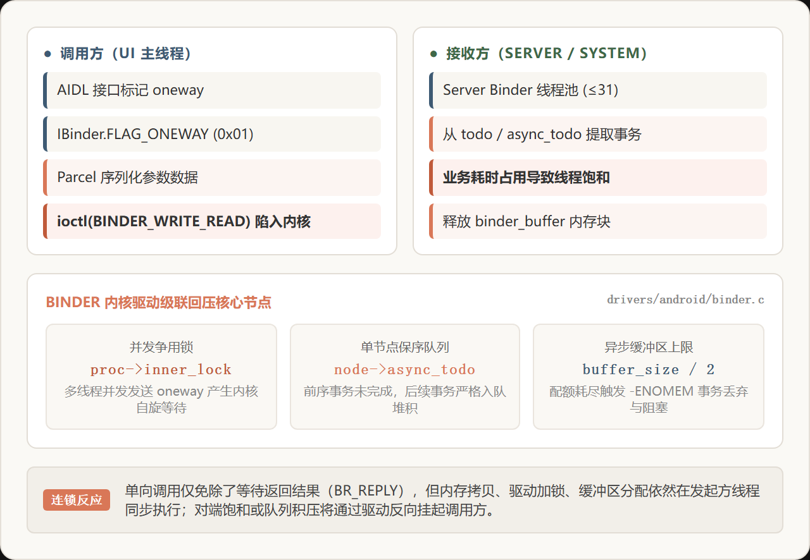
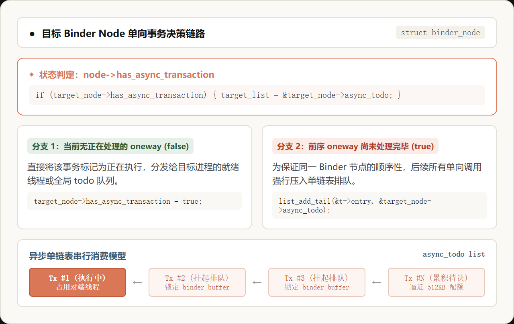
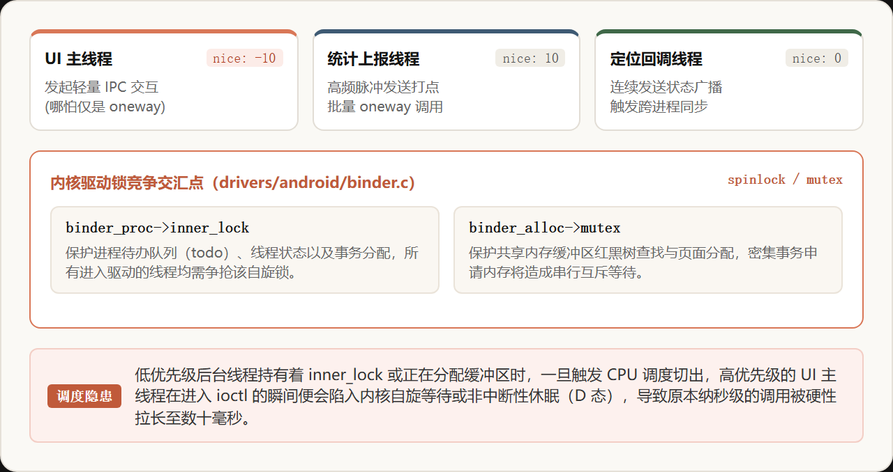
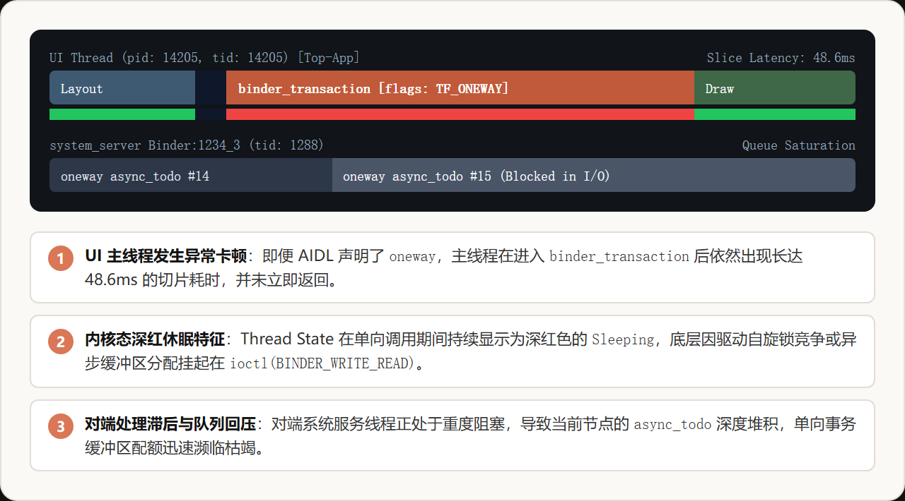

# Binder 异步事务队列积压与 oneway 回压机制

在 Android 系统的多进程架构与组件化工程实践中，进程间通信（IPC）是维系系统服务运转与跨进程业务协同的核心纽带。为了避免跨进程调用阻塞调用方的前台线程，Android 接口定义语言（AIDL）提供了一个极具诱惑力的关键字：`oneway`。

在很多开发者的直觉模型中，一旦为接口方法打上 `oneway` 标记，这次调用便会立即蜕变为“发射后不管”（Fire-and-Forget）的纯异步通信：

“既然 AIDL 接口声明了 `oneway void reportMetric(in Bundle data)`，调用方根本不需要等待对端进程返回任何结果，方法调用应当在几微秒内直接返回。既然是非阻塞调用，我们在 UI 主线程中直接调用该接口，怎么可能会拖慢界面渲染，甚至触发系统 ANR 呢？”

然而，翻开高日活商业应用的线上 APM 性能监控平台与系统 ANR 堆栈，常能捕捉到一系列令排查人员大惑不解的卡顿现场：

在用户快速滑动列表、冷启动加载或执行核心交互的瞬间，UI 主线程在执行普通的事件分发或视图更新时，突然遭遇长达 40 毫秒乃至 120 毫秒的严重停顿。抓取主线程的 Systrace 或 Perfetto 跟踪切片后，赫然发现主线程的代码逻辑恰恰停留在发起一次 `oneway` 的 IPC 调用处；其底层内核系统调用 `ioctl(BINDER_WRITE_READ)` 呈现出深红色的长时间休眠状态，甚至引发系统 Input 派遣超时。

更令人困惑的是，此时整机的 CPU 利用率往往不足 20%，后台并没有发生繁重的算力抢占。

面对这种反差，不少技术团队会陷入深深的困惑：“明明已经把调用声明成了 oneway 异步，为什么 UI 主线程依然会被强行卡死？”

这种认知偏差的根源，在于将“业务逻辑上的免除等待返回（No Reply Waiting）”与“操作系统内核驱动层的非阻塞（Non-Blocking Execution）”严重混淆。

在 Linux 内核与 Android Binder 驱动的底层设计中，`oneway` 单向调用仅仅解除了调用方对接收方处理结果（`BR_REPLY`）的同步等待；但将数据写入内核缓冲区、获取进程内自旋锁、在内核红黑树中查找目标节点，以及将事务加入目标节点待办队列的完整链路，依然在**发起方的线程上下文**中同步运行。

一旦目标节点的单向队列发生积压、内核异步事务缓冲区逼近配额水位、多线程并发争抢内核驱动锁，或者对端进程处于被系统冻结的状态，`oneway` 调用就会瞬间退化为致命的系统级回压，将看似无辜的 UI 主线程直接拖入内核态休眠的泥潭。

本文结合 AOSP 现代源码实现、Linux Binder 驱动内部数据结构、内核内存分配器与一线性能优化实战，全面拆解隐藏在 `oneway` 异步外衣下的全链路阻塞机理。



---

## 1. 认知重构：oneway 语义背后的非阻塞假象

要彻底弄清 `oneway` 为何会阻塞前台线程，首先需要从源码层面拆解 AIDL 编译器生成的底层代码，理清单向调用在跨越用户态与内核态时的真实开销。

### 1.1 从 AIDL 编译产物看 oneway 标志位的底层传递

当我们在 AIDL 文件中声明一个带 `oneway` 修饰的接口方法时，AIDL 编译器（`aidl-cpp` 或 Java 端 AIDL 插件）在生成的 `Proxy` 代理类中，仅仅做了一件看似非常微小的改动：

```java
// AIDL 自动生成的 Proxy 类内部实现
@Override public void reportMetric(android.os.Bundle data) throws android.os.RemoteException {
    android.os.Parcel _data = android.os.Parcel.obtain();
    try {
        _data.writeInterfaceToken(DESCRIPTOR);
        _data.writeTypedObject(data, 0);
        // 关键点：第 4 个参数传入了 IBinder.FLAG_ONEWAY (0x00000001)
        boolean _status = mRemote.transact(Stub.TRANSACTION_reportMetric, _data, null, IBinder.FLAG_ONEWAY);
        if (!_status) {
            throw new android.os.RemoteException("Method failed");
        }
    } finally {
        _data.recycle();
    }
}
```

紧接着，调用流转至 Native 层的 `IPCThreadState::transact` 方法（`frameworks/native/libs/binder/IPCThreadState.cpp`）：

```cpp
status_t IPCThreadState::transact(int32_t handle,
                                  uint32_t code, const Parcel& data,
                                  Parcel* reply, uint32_t flags) {
    status_t err = data.errorCheck();
    flags |= TF_ACCEPT_FDS;

    // 将事务指令与数据头写入 mOut 缓冲区
    err = writeTransactionData(BC_TRANSACTION, flags, handle, code, data, nullptr);
    if (err != NO_ERROR) {
        if (reply) reply->setError(err);
        return (mLastError = err);
    }

    if ((flags & TF_ONEWAY) == 0) {
        // 同步调用分支：必须等待对端响应
        if (reply) {
            err = waitForResponse(reply);
        } else {
            Parcel fakeReply;
            err = waitForResponse(&fakeReply);
        }
    } else {
        // 单向调用分支：传入空指针，不等待 BR_REPLY
        mLastError = NO_ERROR;
    }
    return err;
}
```

从上述源码逻辑中可以清晰地看出：

- **免除的仅仅是 waitForResponse**：只有在 `(flags & TF_ONEWAY) == 0` 时，当前线程才会执行 `waitForResponse` 进入休眠等待 `BR_REPLY`；如果设置了 `TF_ONEWAY`，代码确实跳过了等待响应阶段。
- **无法免除 writeTransactionData 与 talkWithDriver**：无论是否设置了 `TF_ONEWAY`，当前线程必须将 `BC_TRANSACTION` 连同打包好的 Parcel 数据写入 `mOut` 缓冲区，并在需要时立即触发 `talkWithDriver`，通过 `ioctl(mProcess->mDriverFD, BINDER_WRITE_READ, &bwr)` 正式陷入 Linux 内核。

### 1.2 为什么非阻塞不等于零开销：内核态介入与内存拷贝

这意味着，`oneway` 的“异步性”是在内核驱动接管并成功安排事务之后才生效的。在进入驱动到成功返回用户态的这一段路程中，发起调用的线程必须在**自己的上下文**中同步完成以下全部重型操作：

1. **Parcel 序列化开销**：如果传入的参数包含复杂的集合、大体积 `Bundle`、Bitmap 引用或嵌套数据对象，当前线程必须在用户态完成逐字段的内存序列化，面临内存申请与拷贝压力；
2. **CPU 用户态至内核态切换**：通过软中断陷入内核，触发硬件寄存器保存与上下文环境切换；
3. **驱动锁争抢**：进入 `binder_ioctl` 后，线程需要争抢当前进程与目标进程的内核互斥锁与自旋锁；
4. **共享内存分配（binder_alloc_new_buf）**：驱动必须在目标进程的虚拟内存映射区（mmap）中，通过红黑树检索并分配一块尺寸足够的物理页内存块；
5. **跨进程数据物理拷贝**：内核调用 `copy_from_user`，将发送方用户态缓冲区里的 Parcel 数据，硬性拷贝到目标进程对应的内核虚拟地址空间中。

如果上述任何一个环节在内核中遭遇瓶颈（例如锁竞争、内存不足或队列等待），发起调用的线程就会在内核空间被直接挂起。对于运行在 UI 主线程上的代码而言，这便意味着帧渲染管线的硬性中断。

---

## 2. 核心机制之一：Binder 内核驱动的 async_todo 队列与串行化调度

在搞清了 `oneway` 必须同步陷入内核之后，我们进一步深入 Linux 内核驱动源码（`drivers/android/binder.c`），探究单向事务在内核中是如何排队流转的。

### 2.1 binder_node 的并发控制：单节点串行处理模型

许多开发者误以为，当对端进程配置了 16 个或 31 个 Binder 线程时，多个 `oneway` 调用会被内核同时分发给不同的工作线程并发执行。然而，内核的真实实现完全相反。

在 Binder 驱动中，每个被跨进程引用的服务端对象对应一个 `struct binder_node` 结构体。为了保证同一个服务节点接收到的单向调用具备**严格的因果时序性**，Google 工程师在 `binder_node` 内部设计了一套基于单布尔标记的串行化状态机：



```c
// drivers/android/binder.c 内核驱动中的 TF_ONEWAY 核心判定逻辑
if (tr->flags & TF_ONEWAY) {
    if (target_node->has_async_transaction) {
        // 分支 A：前序异步事务尚未处理完，将当前事务强行挂入 async_todo 链表
        target_list = &target_node->async_todo;
        target_wait = NULL;
    } else {
        // 分支 B：当前无正在处理的异步事务，允许直接派发
        target_node->has_async_transaction = true;
    }
}
```

这一段内核逻辑揭示了一个极为残酷的事实：

- **单节点独占执行（One-at-a-Time）**：对于同一个 `binder_node`，系统在任意时刻**只允许存在一个**正在被服务端线程执行的单向事务。
- **强制进入 async_todo 堆积**：当第一个 `oneway` 事务被分发给服务端某个 Binder 线程处理时，`target_node->has_async_transaction` 会被立刻置为 `true`。在此期间，无论调用方发起多少次新的 `oneway` 调用，内核都不会将它们分配给其它空闲的服务端线程，而是无条件将其插入该节点的 `async_todo` 单链表中排队等待。

### 2.2 为什么必须串行：单向调用的保序性约束与副作用

内核为何要做出如此严苛的串行限制？其核心目的在于维持**单向调用的保序语义**。

假设一个客户端先后发送了两个单向事件：`oneway void onStateChanged(State.INIT)` 和 `oneway void onStateChanged(State.RUNNING)`。如果驱动允许这两个调用被目标进程的两个线程并发提取执行，由于线程调度的不确定性，处理 `State.RUNNING` 的线程完全可能先于处理 `State.INIT` 的线程执行，从而导致服务端状态发生不可逆的错乱。

然而，这种基于节点粒度的串行化保证，在工程实践中往往会演变为灾难性的级联阻塞：

如果接收方服务端在处理某个 `oneway` 事务时执行了慢逻辑（例如读写本地文件、查询 SQLite 数据库、或者发生了线程锁等待），导致该事务的耗时被拉长至 50 毫秒；那么在此期间，所有发往该节点的后续 `oneway` 调用全部无法被消费，只能在内核的 `async_todo` 链表中层层堆积。

更严重的是，每一笔挂在 `async_todo` 队列中的单向事务，都死死占有着内核为它分配的物理内存块。随着队列越排越长，系统将不可避免地撞向内核 Binder 的另一道硬性红线——异步缓冲区配额。

---

## 3. 核心机制之二：内核缓冲区配额与 512KB 异步断崖

在跨进程通信中，内存永远不是无限的。在 Android 系统的常规设计中，每个普通应用进程通过 `ProcessState` 初始化时，向 Binder 驱动申请的虚拟内存映射空间（mmap）通常为 `1MB - 8KB`（`BINDER_VM_SIZE`，约 1016KB）。

### 3.1 异步事务缓冲区的硬限制：buffer_size / 2

为了防止恶意或失控的应用通过疯狂发送单向调用将目标进程的整个 1MB 内存全部占满，导致同步调用因无内存可用而全面瘫痪，Binder 驱动在内存分配器（`drivers/android/binder_alloc.c`）中设置了极其严格的异步空间配额：

```c
// drivers/android/binder_alloc.c 异步事务配额校验
if (is_async &&
    alloc->free_async_space < size + sizeof(struct binder_buffer)) {
    binder_alloc_debug(BINDER_DEBUG_BUFFER_ALLOC,
         "%d: binder_alloc_buf size %zd failed, no async space left\n",
          alloc->pid, size);
    return ERR_PTR(-ENOSPC);
}
```

在驱动初始化时，`alloc->free_async_space` 被硬编码初始化为总缓冲区尺寸的一半：

$$\text{FreeAsyncSpace}_{max} = \frac{\text{buffer\_size}}{2}$$

这意味着：

- 普通应用进程接收异步事务的最大共享内存配额通常仅有 **508 KB** 左右；
- 系统的 `system_server` 进程虽然拥有更大的映射区，但面对系统中几十甚至上百个并发应用的洪峰，其分配给单个服务或全局异步调用的缓冲水位同样极为脆弱。

### 3.2 缓冲区耗尽后的灾难：-ENOMEM、DeadObjectException 与事务丢失

当目标节点的 `async_todo` 队列出现积压，且积压的事务数据总量（包括 Parcel 实体数据以及 32 位/64 位元数据头）消耗殆尽这 508 KB 的配额时，后续的内存申请将会瞬间撞墙：

1. **内核返回 -ENOSPC / -ENOMEM**：`binder_alloc_new_buf` 判定可用异步空间不足以容纳当前事务，拒绝分配内存，向调用栈返回错误码；
2. **驱动处理分化**：
   - 在早期 Android 源码中，如果单向事务内存分配失败，内核会默默丢弃该事务，甚至不向用户态抛出异常，造成线上业务的关键状态更新悄无声息地丢失；
   - 在现代 Android 内核（Android 8.0+ 及 10+ 强化补丁）中，如果发送给对端的异步调用遭遇内存耗尽，驱动会判定目标进程处于不可用或饱和状态，直接向发起方返回 `BR_FAILED_REPLY` 或在 Java 层抛出著名的 `android.os.TransactionTooLargeException` 乃至 `DeadObjectException`。
3. **牵连同步调用**：虽然异步配额限制了上限，但如果整个 Binder 映射区因为大量异步事务碎片化严重，导致连续可用的物理页耗尽，即便是高优先级的同步 IPC 也将无法分配到缓冲区，引发全链路跨进程通信雪崩。

---

## 4. 核心机制之三：内核自旋锁争用与系统服务级联回压

除了内存耗尽导致的硬性报错，在日常工程中最常引发 UI 主线程掉帧与严重卡顿的，是多线程高并发发送 `oneway` 时引发的**内核驱动锁竞争**与**系统服务线程池饱和**。

### 4.1 锁竞争风暴：inner_lock 与 alloc->mutex 的隐形阻塞

许多工程师在优化多线程性能时，往往会创建专职的后台线程池来执行 `oneway` 形式的数据上报、日志同步或定位信息分发，以为这样就能与 UI 主线程彻底隔离。

然而，所有属于同一个应用进程的线程，在底层共享着**同一个 Binder 驱动句柄（`/dev/binder`）**与**同一个 `struct binder_proc` 描述符**：



在 Binder 驱动内部，有两个极其关键的内核同步原语：

- **`binder_proc->inner_lock`（自旋锁）**：用于保护进程的线程列表、事务就绪队列（todo）、单向待办队列（`async_todo`）以及引用计数结构；
- **`binder_alloc->mutex`（互斥锁）**：用于保护进程虚拟内存红黑树的查找、空闲内存块合并与物理页面映射。

当后台的数个工作线程以毫秒级频率密集调用 `oneway` 接口时，这些线程在内核层会频繁争抢并持有 `proc->inner_lock` 与 `alloc->mutex`。

此时，如果位于前台的 UI 主线程因为处理触摸事件、更新窗口布局或访问系统服务，也需要发起一次跨进程交互（哪怕仅仅是读取一次窗口状态，或是调用一个轻量的系统单向通知）：

1. UI 主线程调用 `ioctl(BINDER_WRITE_READ)` 陷入内核；
2. 驱动尝试执行 `spin_lock(&proc->inner_lock)` 或 `mutex_lock(&alloc->mutex)`；
3. 如果此时某个后台线程恰好持有着该锁，且由于后台线程优先级较低（nice: 10），在持锁的微秒级窗口内被 Linux 完全公平调度器（CFS）强行切出 CPU；
4. 悲剧瞬间发生：高优先级的 UI 主线程（nice: -10）必须在内核态陷入自旋或被系统打入 `D`（Uninterruptible Sleep）不可中断休眠状态，等待低优先级线程重新获得时间片并释放内核锁。

在主线程视角中，这次本该几微秒完成的操作，硬生生被拉长到了 30 毫秒甚至 100 毫秒，引发了极其严重的界面丢帧与卡顿。

### 4.2 system_server 线程池饱和（31 线程上限）引发的全系统回压

单向调用的另一个致命影响，在于对接收端系统服务线程池的无序冲击。

以 Android 核心的 `system_server` 进程为例，其内部承载了 `ActivityTaskManagerService`、`WindowManagerService`、`NotificationManagerService`、`SensorService` 等数百个系统级服务。

在 AOSP 实现中，系统服务的 Binder 线程池大小并不是无限制扩容的，而是受到严格硬约束的：

```cpp
// frameworks/native/libs/binder/ProcessState.cpp
#define DEFAULT_MAX_BINDER_THREADS 15

// frameworks/base/services/core/jni/com_android_server_SystemServer.cpp
// system_server 启动时显式扩容线程池，上限通常固定为 31 条
ProcessState::self()->setThreadPoolMaxThreadCount(31);
```

整个 `system_server` 进程在任意时刻最多只有 31 个工作线程能够并发处理来自全系统所有应用进程的 Binder 调用。

当多个第三方应用或前台模块通过 `oneway` 疯狂向系统服务灌入广播接收器注册、传感器监听、窗口状态同步或统计通知时：

- 系统的 31 个 Binder 线程可能瞬间被全部拉起并投入繁重的数据解析与本地持久化操作；
- 此时，即便调用方声明的是 `oneway`，其事务在进入内核后依然必须在全局或节点的待办队列中等待系统线程提取；
- 更致命的是：当 UI 主线程随后发起任何一次需要立即获取返回结果的**同步 Binder 调用**（如 `checkCallingOrSelfPermission`、`requestLayout` 涉及的窗口尺寸计算）时，由于系统服务的 31 个线程已被密集的 `oneway` 事务全部占满，UI 主线程的同步请求只能在内核中苦苦等待空闲工作线程，直接引发长达数秒的系统级停摆，最终触发惨烈的 ANR 弹窗。

---

## 5. 现代特性的连锁反应：App Freezer 进程冻结与异步黑洞

自 Android 11 引入、并在 Android 12/13 中成为主流标配的 **Cached App Freezer（缓存应用冻结器）** 机制，给 `oneway` 异步调用带来了全新的隐形陷阱。

### 5.1 Cached App Freezer 的运作机制与异步事务滞留

为了在有限的移动端电池与内存条件下压榨系统能效，Android 系统服务中的 `ActivityManager` 会结合 Linux 内核的 cgroup v2 Freezer 控制器，将退入后台缓存态（Cached State）的应用进程整组冻结：

- 系统向目标进程发送冻结指令，通过内核 cgroup 暂停该进程内全部线程的调度执行（类似于全进程收到非致命的挂起信号）；
- 处于冻结状态的应用不会消耗 CPU 周期，其内存被完好保留，以便用户下次切回时实现秒级热启动。

然而，当应用 A 尝试通过 AIDL 向已进入冻结状态的应用 B 发送 `oneway` 跨进程调用时，灾难便悄然降临：

```c
// drivers/android/binder.c: 现代内核对 BINDER_FREEZE 与冻结状态的感知
// 当进程被 cgroup freezer 挂起时，其用户态线程根本无法被调度提取数据
if (target_proc->is_frozen) {
    // 事务被迫长期滞留在内核节点的 async_todo 链表中
    list_add_tail(&t->entry, &target_node->async_todo);
}
```

由于目标进程 B 的所有线程已被操作系统在内核调度器层面强行冻结，**没有任何用户态线程能够被唤醒**来执行 `binder_thread_read` 并从内核中消费这笔单向事务。

其直接后果是：

- 发送给该进程的 `oneway` 事务将永久驻留在内核的 `async_todo` 链表中；
- 驱动为该事务所分配的物理内存块无法被回收，导致这部分 Binder 异步缓冲区被彻底“钉死”在内核空间。

### 5.2 异步缓冲区钉死与系统级防御演进

如果应用 A 在不知道对方已被冻结的情况下，持续定时向应用 B 发送心跳、状态更新或广播回调：

1. 应用 A 很快便会将目标进程在驱动中对应的 508 KB 异步内存配额彻底打满；
2. 一旦配额枯竭，应用 A 随后尝试发送给其它正常进程的任何 `oneway` 调用，也将因为驱动全局检查或配额不足而遭遇级联失败；
3. 为解决这一系统级痼疾，Google 在 Android 12/14 的内核驱动中专门引入了 `BINDER_GET_FROZEN_INFO` 与异步事务自动同步拒绝机制，允许内核在检测到目标进程被冻结且队列超标时，主动拦截并向发送方告警，避免内核缓冲区被无休止拖垮。

---

## 6. 工程定位与实战治理：从 Perfetto 证据链到架构防护

认清了 `oneway` 异步调用的底层深渊，在面对复杂的线上卡顿、掉帧告警与 ANR 日志时，我们就可以借助系统级取证工具快速定位瓶颈，并在架构设计层面建立彻底的防护隔离。

### 6.1 在 Perfetto 时间线上识别 oneway 积压与 Binder 阻塞

排查 `oneway` 引起的卡顿，传统的 Java 埋点工具往往无法察觉，因为常规方法插桩无法穿透内核的真实等待状态。最精准的分析手段是借助系统级跟踪工具 **Perfetto**。

抓取应用交互过程中的系统级 Trace 后，在 Perfetto 仪表盘中，我们可以通过以下关键特征完成闭环取证：



1. **核对 UI 主线程上的 binder_transaction 切片**：
   - 展开主线程轨道，检索名称形如 `binder_transaction` 或代理类的方法调用；
   - 查看切片详情中的 `flags` 属性。如果看到 `flags: 0x1`（明确对应 `TF_ONEWAY`），但该切片在主线程上的执行耗时却长达数十毫秒，这便是发生内核级阻塞的铁证；
2. **观察 Thread State 内核调度轨道**：
   - 查看主线程在单向调用执行区间的线程调度状态。锁争用或缓冲区等待会导致状态显示为深红色的 `Sleeping`，底层驱动堆栈清晰指向 `ioctl` 与 `binder_alloc_new_buf`；
3. **查阅系统 debugfs / binder 状态日志**：
   - 在复现环境或通过日志提取 `/sys/kernel/debug/binder/proc/<pid>` 文件，通过命令 `cat /sys/kernel/debug/binder/proc/$PID | grep -E "node|async_todo"` 检查目标 Binder 节点的单向事务堆积与可用异步空间：`node 12890: ... async_todo 48, free_async_space 12480 / 520192`。如果发现某个节点的 `async_todo` 数量居高不下（如几十甚至数百），且可用异步空间 `free_async_space` 几乎见底，即可断定对端节点消费停滞，已触发全链路回压。

### 6.2 治理策略：主线程零 IPC、单向合并与异步缓冲隔离

彻底规避 `oneway` 带来的性能隐患，需要在工程架构层面推行严谨的防范规范。我们可以将其划分为四个层级递进的处理路径：

**治理路径一：主线程严格践行“零 IPC”原则（核心底线）**

在追求极致流畅度的现代 Android 应用中，主线程的职责应当纯粹收敛于视图测量、布局与绘制渲染，任何形式的跨进程调用（无论是同步调用，还是看似无害的 `oneway` 异步调用）都严禁直接放置在 UI 主线程执行：

- 哪怕是向本地常驻 Service 发送一条简单通知，也必须严格调度到专职的后台工作线程或单线程分发器（`SingleThreadExecutor`）上执行；
- 从物理层面斩断主线程因跨进程内核锁竞争或内存配额不足而被拖入内核态休眠的一切可能性。

**治理路径二：高频单向调用的批处理与窗口节流（Batching & Throttling）**

对于诸如传感器采样上报、触摸轨迹采集、页面滚动埋点等高频事件，严禁产生离散的密集单向 IPC 调用。应在应用层构建内存环形缓冲区，引入基于时间窗口与容量阈值的批处理聚合机制：

```kotlin
// 生产级高频事件聚合器：消除密集 oneway 冲击
class BatchedIpcDispatcher(
    private val remoteService: IMetricReporter,
    private val scope: CoroutineScope,
    private val maxBatchSize: Int = 50,
    private val flushIntervalMs: Long = 200L
) {
    private val buffer = ArrayDeque<MetricEvent>(maxBatchSize)
    private val lock = Any()
    private var flushJob: Job? = null

    fun enqueueEvent(event: MetricEvent) {
        synchronized(lock) {
            buffer.addLast(event)
            if (buffer.size >= maxBatchSize) {
                flushLocked()
            } else if (flushJob == null) {
                // 开启时间窗口防抖定时刷新
                flushJob = scope.launch(Dispatchers.IO) {
                    delay(flushIntervalMs)
                    synchronized(lock) { flushLocked() }
                }
            }
        }
    }

    private fun flushLocked() {
        if (buffer.isEmpty()) return
        flushJob?.cancel()
        flushJob = null
        val batchList = ArrayList(buffer)
        buffer.clear()

        // 在 IO 协程中统一执行单次单向跨进程传输
        scope.launch(Dispatchers.IO) {
            try {
                remoteService.reportBatchEvents(batchList)
            } catch (e: RemoteException) {
                // 异常隔离与降级重试机制
            }
        }
    }
}
```

通过在客户端将数十次离散的单向调用合并为单次批量数据块传输，不仅能大幅减轻 Binder 驱动内 `inner_lock` 的争用频率，更直接避免了目标节点 `async_todo` 队列的爆炸式堆叠。

**治理路径三：接收端异步化与快速脱钩（Fast Decoupling）**

在服务端或系统 Service 的 AIDL 实现类中，所有声明为 `oneway` 的方法实现，必须保证“纳秒级脱钩”：

- 严禁在 `oneway` 接口实现方法内部执行任何耗时的 I/O 操作、数据库读写、复杂反射计算或同步锁等待；
- 接收到参数后，仅仅将其以浅拷贝形式放入本进程的内存队列（如 `Handler` 或无锁环形队列），并立即结束方法返回；
- 只有确保单单向事务能够被服务端工作线程以极高速度消费并释放 `binder_buffer`，整个系统才能维持 `async_todo` 链表的扁平与清爽。

**治理路径四：生命周期感知与死链接防御（DeathRecipient & State Tracking）**

针对跨进程长期通信的场景，客户端必须建立健全的对端状态感知体系：

- 通过 `IBinder.linkToDeath` 注册死亡代理回调，在对端进程崩溃、被系统 LowMemoryKiller 杀掉或处于未知异常态时，立即熔断客户端的 IPC 发送逻辑；
- 在涉及与后台插件、外部组件通信时，动态跟踪对端的活跃状态，严禁向已知处于后台挂起或被系统 Freezer 冻结的进程无休止倾泻单向事务，从源头阻断异步内存黑洞的形成。

搞清了 `oneway` 在 Android 运行时、内核驱动调度模型与系统级回压维度的全链路机制，我们在设计高并发跨进程架构时，就能彻底走出“非阻塞即无代价”的思想误区，真正打造出高吞吐、强韧性、前台无阻滞的高品质 Android 架构。

## 参考资料

- [Android Binder Driver Internals](https://source.android.com/docs/core/architecture/kernel/binder)（AOSP Documentation · 2024-05）
- [Android App Freezer and Cgroup v2 Integration](https://source.android.com/docs/core/perf/app-freezer)（AOSP Core Architecture · 2023-11）
- [Linux Kernel drivers/android/binder.c & binder_alloc.c Source Code](https://git.kernel.org/pub/scm/linux/kernel/git/torvalds/linux.git)（Linux Kernel Organization · 2024-10）
- [Understanding IPCThreadState and ProcessState in Android Runtime](https://android.googlesource.com/platform/frameworks/native/)（Google Android Open Source Project · 2024-08）
