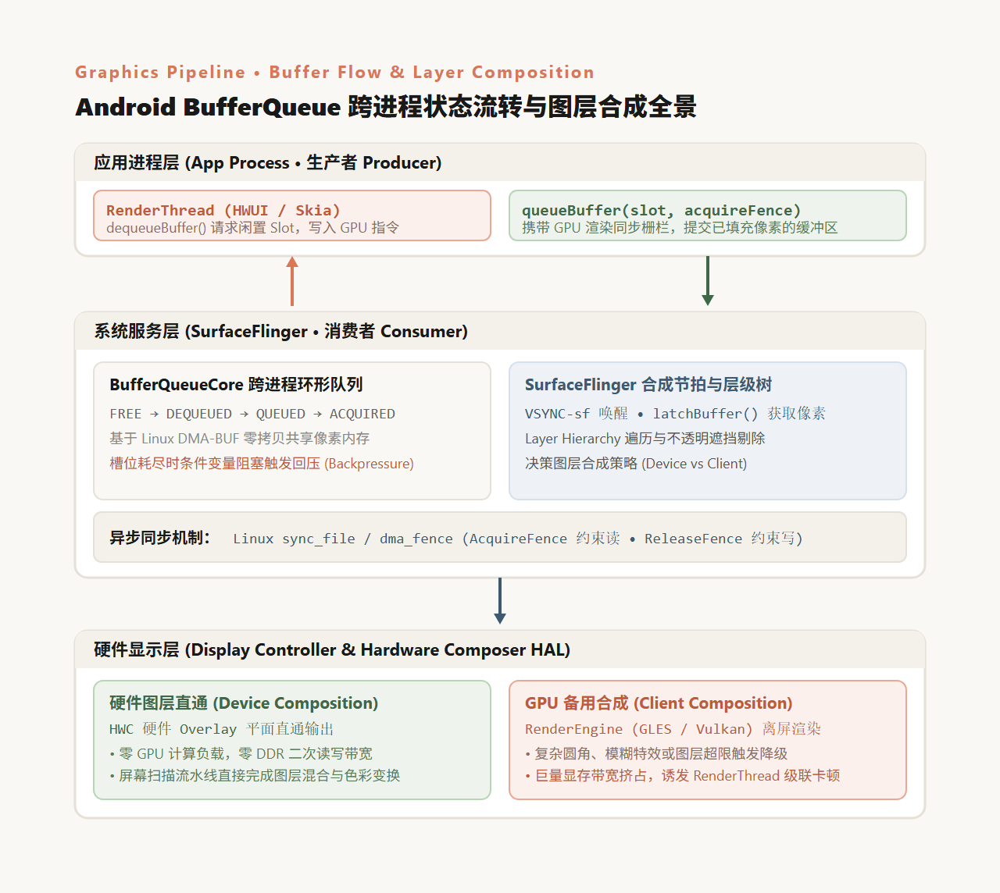
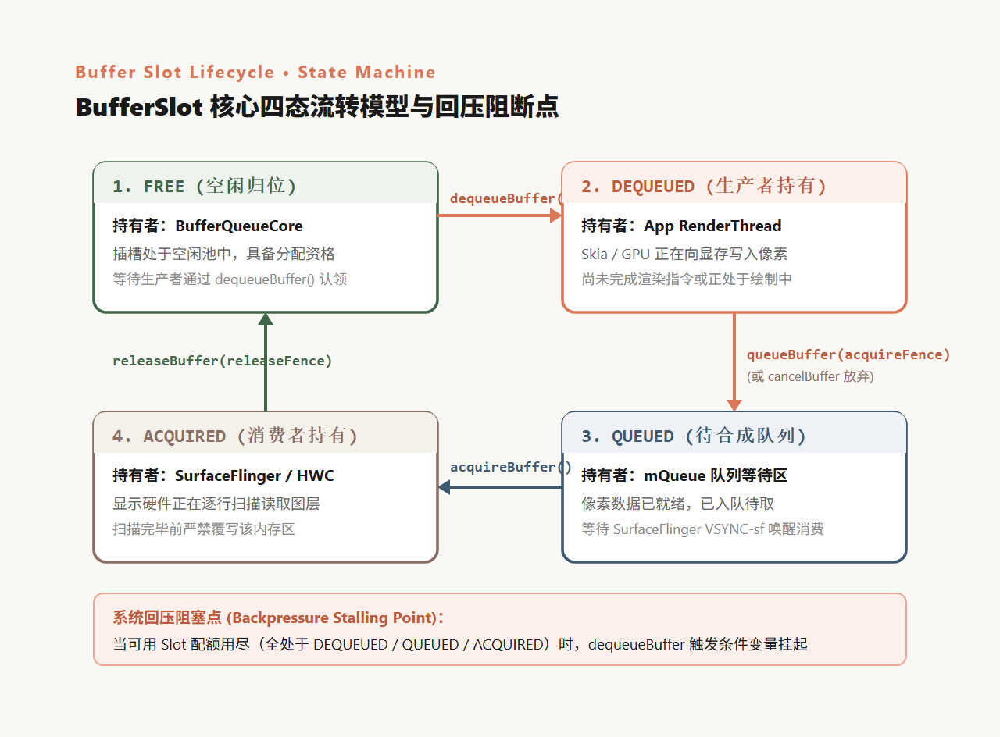
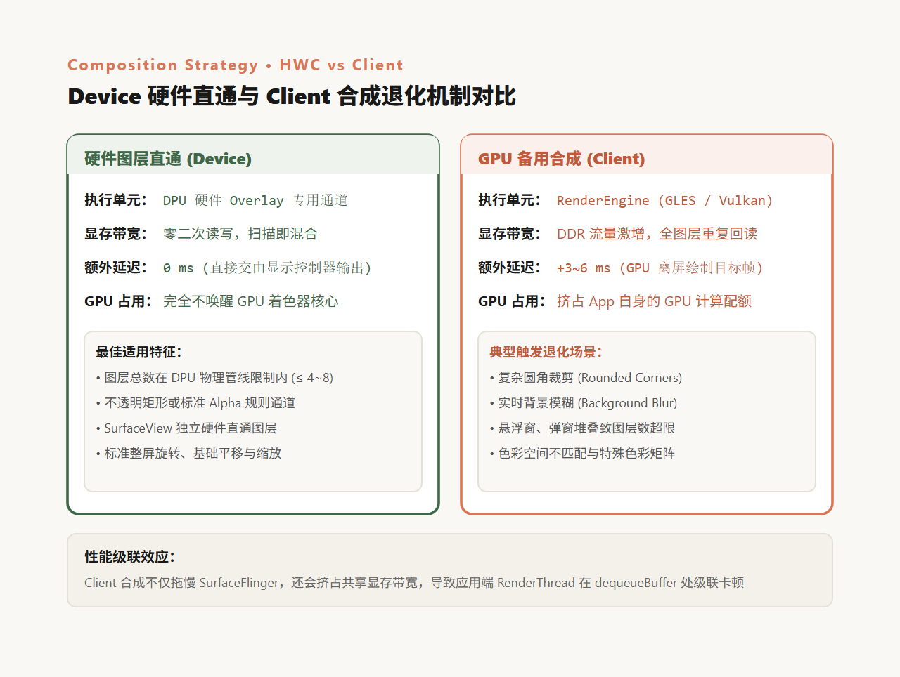

# BufferQueue 跨进程状态机、SurfaceFlinger 合成节拍与 HWC 硬件直通

在 Android 移动应用性能优化的漫长探索中，“掉帧”与“卡顿”始终是直接冲击用户核心体验的高频痛点。为了攻克这一难题，工程团队往往会在 UI 主线程与渲染管线上倾注大量心力：重构复杂布局、消除嵌套层级、优化列表 ViewHolder 的绑定逻辑，并将密集的业务计算彻底从主线程剥离。

在很多开发者的工程直觉中，面对一套经过深度优化的渲染流水线，界面滑动体验理应顺理成章地达到丝滑：

“根据 Android 系统的帧率预算，在当今主流的 120Hz 高刷屏幕下，每一帧画面的渲染预算约为 8.33 毫秒。如果我们在性能监控中看到，UI 主线程的 `Choreographer.doFrame` 耗时稳定在 1.5 毫秒内，而硬件加速线程 `RenderThread` 生成并提交 GPU 绘制指令仅耗时 2 到 3 毫秒，整条渲染链路的计算耗时连预算的一半都未达到，屏幕呈现出来的动态效果就绝无可能产生任何掉帧或顿挫。”

然而，在面对高复杂度的生产级电商列表、短视频信息流或者带有画中画、弹窗浮层的界面交互时，这种由本地耗时指标建立的“安全感”往往会被真实的用户反馈彻底打破：

用户在快速滑动页面时，界面肉眼可见地出现频繁的顿挫与不连贯；偶发性的微小卡顿（Micro-stutter）持续出现，甚至伴随画面轻微的撕裂与抖动感。

更令人困惑的是，当性能工程师抓取系统的 Perfetto 跟踪切片，深入到微秒级的执行时间线时，眼前呈现的却是一幅不可思议的画面：
UI 主线程与 RenderThread 确实非常轻盈，业务 View 的绘制逻辑只耗费了寥寥数毫秒；但在每帧刚开始渲染时，RenderThread 竟然被长时间挂起在一个名为 `dequeueBuffer` 的底层 Native 调用上，等待时长高达 10 到 15 毫秒。与此同时，系统的 `SurfaceFlinger` 进程 CPU 占用陡增，显示控制器的图层合成类型悄然从高效的 `DEVICE` 硬件直通退化为了 `CLIENT`（GPU 备用合成）。

RenderThread 自身的绘制明明仅耗时 3 毫秒，为什么界面依然会发生剧烈的掉帧？为什么它会在向系统申请绘制缓冲区时被迫陷入漫长等待？

这种反直觉现象的本质，在于开发者往往将“App 进程内的渲染耗时”粗暴地等同于“屏幕像素的最终呈现”，完全忽视了 Android 图形架构中真正的“下半场”：**BufferQueue 跨进程环形队列的状态机回压机制**、**SurfaceFlinger 在独立时钟节拍下的图层抓取与合成约束**，以及**底层硬件合成器（Hardware Composer，简称 HWC）在图层直通与 GPU 退化之间的性能鸿沟**。

本文结合 Linux 内核 DMA-BUF 共享内存模型、Android AOSP 原生 C++ 源码（`BufferQueueCore.cpp`、`BufferQueueProducer.cpp`、`SurfaceFlinger.cpp`、`HWComposer.cpp`）以及生产级 Perfetto 追踪证据，全面拆解图形缓冲区从应用生产、跨进程传递到屏幕像素扫描的全链路机理。



---

## 1. 认知重构：图形渲染的“生产-消费”双重世界

要探究为什么快速绘制的帧依然会掉在屏幕之外，首先必须打破“RenderThread 画完，图像就到了屏幕上”的单向思维，重新建立起图形子系统的全局生产者-消费者模型。

### 1.1 从 RenderThread 到屏幕呈现：被忽视的“下半场”

在现代 Android 系统的 UI 架构中，一个典型界面的生命周期被严格拆分为截然不同的两个阶段：

- **上半场：应用内部的图形生产（Production）**  
  VSYNC-app 信号到达应用进程，主线程（Main Thread）开始处理输入事件、更新动画状态，并调用 View 树执行 `measure`、`layout` 与 `draw`，生成一系列由 Skia 或 RenderNode 记录的显示列表（DisplayList）；紧接着，`RenderThread` 被唤醒，将显示列表中的绘制命令转化为具体的 OpenGL ES 或 Vulkan 图元指令，提交给手机 GPU 进行光栅化与像素着色。
- **下半场：系统层面的图层消费与硬件合成（Consumption & Composition）**  
  RenderThread 绘制出的像素并不能直接驱动屏幕面板。系统界面通常由多个彼此独立的窗口与图层构成（例如状态栏、导航栏、应用主窗口、视频播放器 SurfaceView、系统输入法浮层等）。每个独立的窗口都拥有自己的图像缓冲区序列。这些缓冲区必须跨越进程边界传输到系统合成服务进程 `SurfaceFlinger` 中，再由 `SurfaceFlinger` 与屏幕驱动芯片（DDIC）及硬件合成器（HWC）协同，把多个图层在正确的时钟节拍下合并成一幅最终画面，逐行扫描输出到物理显示屏。

当我们在应用层观测性能指标时，我们只能看到“上半场”的运行时间；而一旦“下半场”的消费通路遭遇阻塞，整个生产链路便会瞬间遭遇来自下游的级联回压。

### 1.2 跨进程像素流转基石：GraphicBuffer 与 DMA-BUF 零拷贝

在现代智能手机中，一块 1080×2400 分辨率、RGBA_8888 格式的未经压缩的屏幕缓冲区，单帧占用的物理内存高达约 10MB；若在 120Hz 刷新率下全速运转，每秒产生的原始像素吞吐量将超过 1.2GB/s。

如果在进程间传递这些像素数据时依赖常规的 IPC 机制（如 Binder 缓冲区拷贝或 Socket 串行化传输），CPU 核心将在内存拷贝操作上被彻底拖垮，移动设备的内存总线带宽也会被瞬间吃满。

为了实现极致的传输性能，Android 依托 Linux 内核的 **DMA-BUF（Direct Memory Access Buffer）** 与底层内存分配器（如 ION 或 Linux 5.x+ 的 DMA-BUF Heaps），构建了一套真正意义上的硬件级零拷贝共享内存体系：

```cpp
// AOSP frameworks/native/libs/ui/include/ui/GraphicBuffer.h
class GraphicBuffer : public ANativeWindowBuffer,
                      public RefBase,
                      public LightFlattenable<GraphicBuffer> {
public:
    enum {
        USAGE_SW_READ_NEVER    = 0x0,
        USAGE_SW_READ_OFTEN    = 0x3,
        USAGE_HW_TEXTURE       = 0x100,
        USAGE_HW_RENDER        = 0x200,
        USAGE_HW_COMPOSER      = 0x800,
    };
    // 内存分配核心：通过 gralloc HAL 从底层申请物理连续或 IOMMU 映射的显存页
    status_t reallocate(uint32_t inWidth, uint32_t inHeight,
                        PixelFormat inFormat, uint32_t inLayerCount,
                        uint64_t inUsage);
};
```

当应用窗口初始化时，系统通过 `gralloc` 模块在物理显存中分配连续物理页（或经由 IOMMU 映射的高速页），将其抽象为 `GraphicBuffer`。

在跨进程流转时，应用进程与 `SurfaceFlinger` 之间通过 Binder 驱动传递的**仅仅是该内存缓冲区的元数据及其对应的 Linux 文件描述符（File Descriptor，简称 FD）**。对端进程通过接收到的 FD 将相同的底层物理页直接映射到自身的虚拟地址空间中。这意味着，无论图像数据体量多么庞大，缓冲区在进程间的传递开销仅为传递一个整数文件描述符的微秒级成本。

### 1.3 宏观架构全景：App 生产者、BufferQueue 枢纽与 SurfaceFlinger

虽然内存是直接共享的，但两个独立的进程绝不能在同一个时间点对同一块内存同时执行写操作与读操作，否则屏幕上将出现极其严重的画面穿梭撕裂（Tearing）。

为此，Android 引入了图形流转的核心中枢——**BufferQueue**。

整套端到端图形管线由三个核心角色组成：

1. **生产者（Producer）**：通常是应用的 `RenderThread`，它通过 `IGraphicBufferProducer` 接口向 BufferQueue 申请可写的空闲缓冲区，完成 GPU 渲染后将缓冲区回传；
2. **连接枢纽（BufferQueueCore）**：维护在 `SurfaceFlinger` 进程内部的一个具备状态机特性的环形缓冲池，负责协调所有插槽的持有权流转、配额限制与同步约束；
3. **消费者（Consumer）**：通常是 `SurfaceFlinger` 内部的各图层对象（Layer），它通过 `IGraphicBufferConsumer` 接口在每一个垂直同步周期提取已填充的图像帧，递交给硬件进行最终合成。

---

## 2. 核心机制之一：BufferQueue 跨进程状态机与回压传导

为了让读者彻底弄清 `dequeueBuffer` 为什么会在 RenderThread 内部产生不可思议的等待，我们需要拆解 BufferQueue 最核心的数据结构——`BufferSlot` 状态机。

### 2.1 BufferSlot 四态流转模型：FREE、DEQUEUED、QUEUED、ACQUIRED

在 `BufferQueueCore` 内部，系统静态定义了一个大小为 64 的缓冲区插槽数组：`BufferSlot mSlots[NUM_BUFFER_SLOTS]`。虽然数组容量为 64，但在任何时刻，由系统活跃分配的物理缓冲区数量通常只有 2 到 3 个（对应双缓冲或三缓冲）。

每一个 `BufferSlot` 的生命周期，都在一套严密的四态模型中周而复始地流转：



每个状态的判定条件与流转逻辑如下：

::: info 状态模型详解

- **FREE（空闲态）**：该 Slot 当前既不归应用所有，也不归 SurfaceFlinger 所有，处于闲置池中。生产者可以立即将其借出；
- **DEQUEUED（已出队态）**：生产者通过调用 `dequeueBuffer()` 成功认领了该 Slot。此时应用进程获得了向该显存执行写操作的专属权限，GPU 正在其上执行栅格化；
- **QUEUED（已入队态）**：生产者完成渲染后，调用 `queueBuffer()` 将填满像素的 Slot 重新送回 BufferQueue。此时 Slot 处于等待队列中，等待 SurfaceFlinger 前来消费；
- **ACQUIRED（已获取态）**：当 SurfaceFlinger 准备合成时，调用 `acquireBuffer()` 将 Slot 取出。在合成阶段结束、显示芯片完成扫描之前，该缓冲区严禁被任何一方修改。
  :::

### 2.2 为什么 dequeueBuffer 会陷入阻塞？配额枯竭与条件变量等待

现在，我们把目光对准引发微小卡顿的罪魁祸首：`BufferQueueProducer::dequeueBuffer`。

当应用主线程完成测量布局、RenderThread 开始渲染新的一帧时，RenderThread 第一步必须向 BufferQueue 索要一个可写的 `FREE` 状态槽位。我们直接查阅 AOSP 核心源码：

```cpp
// AOSP frameworks/native/libs/gui/BufferQueueProducer.cpp
status_t BufferQueueProducer::dequeueBuffer(int* outSlot, sp<Fence>* outFence,
                                           uint32_t width, uint32_t height,
                                           PixelFormat format, uint64_t usage,
                                           ...) {
    Mutex::Autolock lock(mCore->mMutex);

    // 1. 等待可用的空闲槽位
    while (true) {
        // 计算当前系统中处于已出队、已入队和已获取的槽位总数
        int dequeuedCount = 0;
        int acquiredCount = 0;
        for (int s = 0; s < BufferQueueDefs::NUM_BUFFER_SLOTS; ++s) {
            if (mSlots[s].mBufferState.isDequeued()) ++dequeuedCount;
            if (mSlots[s].mBufferState.isAcquired()) ++acquiredCount;
        }

        // 核心检查：如果当前没有 FREE 槽位，或者已出队的槽位达到了生产者配额上限
        int freeBufferCount = mCore->getFreeBufferCountLocked();
        if (freeBufferCount == 0 || dequeuedCount >= mCore->mMaxDequeuedBufferCount) {
            if (mCore->mDequeueBufferCannotBlock) {
                return WOULD_BLOCK;
            }
            // 致命停顿点：生产者在此处挂起！释放互斥锁，等待消费者发信号唤醒
            mCore->mDequeueCondition.wait(mCore->mMutex);
            continue;
        }

        // 成功找到可用的 FREE 槽位，更新状态为 DEQUEUED
        foundSlot = ...;
        mSlots[foundSlot].mBufferState.dequeue();
        break;
    }

    *outSlot = foundSlot;
    *outFence = mSlots[foundSlot].mFence; // 返回释放栅栏（Release Fence）
    return OK;
}
```

这段逻辑清晰地揭示了问题的根源：

当系统配置为三缓冲机制时，BufferQueue 内部最多只允许存在 3 个有效的物理 Buffer。假设在某一个瞬间：

1. **Slot 0** 处于 `ACQUIRED` 状态，SurfaceFlinger 和硬件显示控制器正在读取它以扫描到物理屏幕；
2. **Slot 1** 处于 `QUEUED` 状态，上一帧刚刚渲染完毕，正在排队等待 SurfaceFlinger 的下一次抓取；
3. **Slot 2** 处于 `DEQUEUED` 状态，RenderThread 刚在此前取出了它并正在执行常规渲染。

如果此时由于某种原因，下游的 SurfaceFlinger 发生了一次轻微的合成延迟（例如由于复杂的图层特效拖慢了节拍），导致 Slot 0 没能在原本的时限内被硬件释放并调用 `releaseBuffer`；或者应用本身试图在一个帧周期内连续生成多个重绘动作：

当 RenderThread 再次调用 `dequeueBuffer()` 时，`freeBufferCount` 瞬间跌至 0！

此时，`BufferQueueProducer` 会直接调用 `mDequeueCondition.wait(mCore->mMutex)`。**RenderThread 的底层 Linux 线程将在内核态被彻底休眠挂起**。只要下游的 SurfaceFlinger 不执行释放操作并触发 `mDequeueCondition.broadcast()`，应用端的硬件加速线程就寸步难行。

即使业务代码本身的 `onDraw` 逻辑仅仅花费了 1 毫秒，RenderThread 也会在这一行系统代码上白白耗去整整 12 毫秒。这正是性能分析中“绘制耗时极低但界面严重掉帧”的第一重底层诱因。

### 2.3 异步协同的核心枢纽：Linux Sync Timeline 与 Fence 栅栏机制

除了内存槽位数量不够之外，BufferQueue 中还存在第二种更为隐蔽的等待——**GPU 渲染与屏幕扫描的异步栅栏（Fence）等待**。

在高性能图形渲染中，CPU 发送绘制指令给 GPU 是异步非阻塞的。当 RenderThread 执行完所有的 OpenGL ES 或 Vulkan 绘制调用并执行 `queueBuffer` 时，GPU 的着色器核心实际上往往才刚刚开始在显存中涂抹像素。

如果要求 CPU 必须原地等待 GPU 把每一个像素全部填色完毕才能进行后续调度，整个系统的吞吐量将被腰斩。Android 是如何化解这一矛盾的？

答案是 Linux 内核级的同步机制：**Sync Timeline 与 `dma_fence`（在用户空间抽象为 `android::Fence`）**。

```cpp
// AOSP frameworks/native/libs/gui/BufferQueueProducer.cpp
status_t BufferQueueProducer::queueBuffer(int slot, const QueueBufferInput& input,
                                          QueueBufferOutput* output) {
    Mutex::Autolock lock(mCore->mMutex);

    // 从输入参数中解包出 GPU 生成的获取栅栏（Acquire Fence）
    sp<Fence> acquireFence = input.fence;

    // 标记槽位状态转为 QUEUED，并将 Fence 挂载在该 Slot 上
    mSlots[slot].mBufferState.queue();
    mSlots[slot].mFence = acquireFence;

    // 唤醒处于阻塞中的消费者（SurfaceFlinger）
    mCore->mConsumerListener->onFrameAvailable(item);
    return OK;
}
```

在整条流水线中，有两个最为核心的 Fence 对象共同维持着读写安全：

::: tip 关键 Fence 辨析

- **Acquire Fence（获取栅栏，生产者传递给消费者）**：  
  RenderThread 提交 buffer 时随身携带。它代表的语义是：“我已经向 GPU 下达完了当前帧的全部绘制指令，但我并不在 CPU 侧傻等它画完。我把这个 Fence 一起交给你，你必须等这个 Fence 的信号置位（Signaled）之后，才能让显示硬件去读取其中的像素。”
- **Release Fence（释放栅栏，消费者回传给生产者）**：  
  SurfaceFlinger 与 HWC 释放某个不再显示的旧 buffer 时产生。它代表的语义是：“虽然我把这个 Slot 归还给你重新渲染了，但屏幕硬件的物理电子束可能还在扫描该缓冲区的最后几行像素。你必须等到这个 Fence 变为 Signaled，你的 GPU 才能真正向这块物理显存写入新内容。”
  :::

在 `dequeueBuffer` 的实现中，系统返回该 Slot 的同时，会把之前绑定的 `Release Fence` 同步返回给 RenderThread。

如果 GPU 或显示硬件发生了管线拥塞，导致旧帧的 `Release Fence` 迟迟未被内核置位，RenderThread 在后续执行具体的 GPU 绘制（例如调用 `eglSwapBuffers` 或 Vulkan 提交）时，图形驱动就会在内核层执行 `sync_wait` 挂起线程。

---

## 3. 核心机制之二：SurfaceFlinger 合成节拍与 VSYNC-sf 调度逻辑

弄清了 BufferQueue 内部的状态流转，我们继续向下深入到系统的调度心脏——`SurfaceFlinger`。

许多开发者误以为整个系统的所有组件都是在同一个 VSYNC 信号敲响时同时开始工作的，这种误解掩盖了许多合成级联延迟的产生机理。

### 3.1 VSYNC 信号分流：VSYNC-app 与 VSYNC-sf 的相位偏移

物理显示芯片产生的硬件 VSYNC 脉冲是以极高的电气精度周期性发生的（例如 120Hz 下为 8.33ms）。为了让应用绘制与系统合成能够像齿轮一样紧密咬合，Android 显示驱动将同一个物理 VSYNC 信号通过软件锁相环（DispSync / VSyncReactor）分流为具有固定相位差的两路信号：

- **VSYNC-app**：派发给应用进程的 `Choreographer`，促使应用启动测量、布局与 RenderThread 绘制；
- **VSYNC-sf**：派发给 `SurfaceFlinger` 进程，促使系统服务启动图层抓取与最终合成。

```text
硬件 VSYNC: |----------------|----------------|----------------|
VSYNC-app:  |--> [App 绘制] ->|
                 相位偏移 (Phase Offset)
VSYNC-sf:          |--> [SurfaceFlinger 合成] ->|
                                                   |--> [硬件扫描呈现]
```

如果令 `VSYNC-app` 与 `VSYNC-sf` 在同一瞬间触发，由于 App 此时刚刚拿到 CPU 时间片、一帧画面连一个像素都还没画出来，SurfaceFlinger 在被唤醒的这一刻就抓不到任何新缓冲区，只能被迫将前一帧旧画面再次提交给显示屏，从而无端制造出一帧延迟。

因此，系统通过配置 **Phase Offset（相位偏移）**，特意让 `VSYNC-sf` 滞后于 `VSYNC-app` 若干毫秒（例如滞后 4~5ms）。

系统期望达到的黄金节奏是：应用利用这段偏移时间差完成渲染，正好赶在 `VSYNC-sf` 敲响前将 Buffer 提交至 `QUEUED` 状态；SurfaceFlinger 准时醒来将其取走并合成，实现完美的流水线吞吐。

然而，这套精密平衡极其脆弱：**一旦应用的绘制耗时发生轻微抖动，仅仅比预期晚了 0.5 毫秒提交，导致它错过了 VSYNC-sf 的关卡，该帧就会在 QUEUED 队列中硬生生滞留整整一个周期（在 120Hz 下直接损失 8.33ms，在 60Hz 下更是直接损失 16.6ms）！**

### 3.2 SurfaceFlinger 核心处理循环：latchBuffer 与图层可见性遍历

当 `VSYNC-sf` 信号敲响时，SurfaceFlinger 的核心事件循环通过 `MessageQueue` 收到 `REFRESH` 消息，进入一轮完整的合成处理周期：

```cpp
// AOSP services/surfaceflinger/SurfaceFlinger.cpp
void SurfaceFlinger::onMessageReceived(int32_t what, int64_t vsyncId, ...) {
    switch (what) {
        case MessageQueue::REFRESH: {
            // 1. 处理窗口位置、尺寸、层级等事务变更
            bool transactionFlags = handleMessageTransaction();

            // 2. 从 BufferQueue 中抓取最新提交的图层图像
            bool updateLayers = handleMessageInvalidate();

            // 3. 执行真正的图层合成与提交
            handleMessageRefresh();
            break;
        }
    }
}
```

在 `handleMessageInvalidate` 阶段，系统遍历屏幕上的所有活动图层，针对每个 `BufferStateLayer` 执行最关键的操作——**`latchBuffer`（锁存缓冲区）**：

```cpp
// AOSP services/surfaceflinger/BufferStateLayer.cpp
bool BufferStateLayer::updateTexImage(GraphicBufferProducer::BufferItem& item) {
    // 检查应用提交的 Acquire Fence 是否已经触发
    if (item.mFence->getStatus() == Fence::Status::Unsignaled) {
        // 如果 GPU 还在密集渲染中，Acquire Fence 尚未 Signal：
        // 系统将无法在当前周期锁存该帧，只能直接返回 false 跳过！
        return false;
    }

    // 成功通过检查，正式调用 acquireBuffer 锁定该 Slot 为 ACQUIRED
    mBufferInfo.mBuffer = item.mGraphicBuffer;
    mBufferInfo.mFence = item.mFence;
    return true;
}
```

逻辑非常严苛：即便应用已经把 Buffer 推进了 `QUEUED` 状态，如果 GPU 端的着色器运算没有在 `latchBuffer` 检查的瞬间完成置位，SurfaceFlinger 也会为了避免屏幕撕裂而毫不留情地跳过这一帧。

紧接着，SurfaceFlinger 遍历全局图层树（Layer Hierarchy），结合各图层的 Z-Order 层级与 Alpha 透明度属性，执行严格的**区域剔除（Occlusion Culling）**。如果某个下层图层被上层完全不透明的窗口遮挡，该图层对应的区域将不会参与后续合成。

### 3.3 缓冲槽归位与帧释放时序：releaseBuffer 的触发时机

一旦图层完成了锁存，前一帧旧图像的使命便宣告终结。

SurfaceFlinger 会在向硬件显示驱动提交当前合成任务后，针对被替换下来的旧 Slot 调用 `BufferQueueConsumer::releaseBuffer`。

在调用 `releaseBuffer` 时，系统会把显示驱动生成的 `Release Fence` 打包塞回对应的 Slot，并将状态重新置为 `FREE`，最后触发条件变量广播 `mDequeueCondition.broadcast()`。

至此，在应用端 RenderThread 中苦苦等待的上游线程，才终于被操作系统重新唤醒，继续其生命周期的下一轮迭代。

---

## 4. 核心机制之三：HWC 硬件图层直通 vs Client 合成退化

在整个图形链路的最底端，存在着决定整机性能与功耗的最终裁判——**Hardware Composer（硬件合成器，简称 HWC）**。

在许多工程讨论中，大家容易误以为 SurfaceFlinger 是靠自己的 CPU 或 GPU 代码把所有图层画在一起的。然而在现代高性能 SoC 上，这种常规做法恰恰是系统极力避免的性能下策。

### 4.1 硬件合成器（HWC）的核心威力：Device Composition

现代智能手机的 SoC 内部，除了 CPU 和 GPU 之外，还集成了一块专门用于显示输出的硬件模块——**显示处理器（Display Processing Unit，简称 DPU，例如高通的 MDP/MDSS 或联发科的 MiraVision）**。

DPU 内部具备若干条独立的**硬件图层图元通道（Hardware Overlay Pipes）**。

```text
┌──────────────────────────────────────────────┐
│  图层 A (状态栏)      ────────┐             │
│  图层 B (应用主视图)   ────────┼──> DPU 硬件  │ ──> 物理显示屏
│  图层 C (视频播放层)   ────────┘    直接混合  │    (MIPI DSI 扫描输出)
└──────────────────────────────────────────────┘
   零 GPU 介入 • 零显存二次回写 • 带宽消耗降至极限
```

当 SurfaceFlinger 准备好各个可见 Layer 之后，它并不会急于自己去画，而是将所有图层的边界矩形、旋转角度、色彩空间以及 `GraphicBuffer` 句柄打包成一个列表，通过 HIDL/AIDL 接口传递给 HWC HAL 层的 `prepare()` 接口。

如果这套图层结构完全符合硬件约束，HWC 会将这些图层的合成类型标记为 **`HWC2::Composition::Device`（硬件直通合成）**。

在 `Device Composition` 模式下：

- **GPU 核心完全保持休眠**，不消耗任何着色器算力；
- **显存带宽消耗降低到极限**：各个图层的像素内存由 DPU 硬件扫描控制器在逐行向物理屏幕输出的过程中，在片上缓存（Line Buffer）中以微秒级时间同步完成色彩混叠与缩放。没有任何像素需要被二次写入系统内存（DDR）。

这是移动端维持 120Hz 极限流畅度与超低功耗的基石。

### 4.2 为什么会退化为 Client Composition（GPU 备用合成）？

然而，芯片上的硬件 Overlay 通道数量是极其有限的（在大多数中高端 SoC 上通常仅有 4 到 8 个物理 Pipe）。此外，硬件通道对图形的几何变换与数学混合模式有着严苛的物理限制。

一旦遇到硬件无法直接处理的复杂场景，HWC 会在 `validateDisplay` 阶段向 SurfaceFlinger 明确返回：当前图层无法通过硬件直通完成，必须退化为 **`HWC2::Composition::Client`（客户端合成）**！



触发系统退化为 Client 合成的四大高发元凶包括：

::: warning 常见退化诱因

1. **活动图层总数突破硬件物理限制**：  
   当界面同时存在复杂的浮窗、系统状态栏、手势导航栏、自定义 Toast、第三方悬浮球，以及应用内部通过多 Window 嵌套的复杂弹窗时，图层总数突破了 DPU 管道上限，超额图层被迫降级；
2. **复杂的圆角裁剪与实时背景模糊（RenderEffect / Blur）**：  
   在 Android 12+ 引入的高斯模糊特效与多重嵌套的大圆角半透明裁剪，超出了硬件 Overlay 的几何处理能力，必须依赖 GPU 的 Fragment Shader 执行多轮采样才能完成数学合成；
3. **混合层级交错与不规范的 Alpha 通道**：  
   带有半透明 Alpha 通道且在 Z 轴空间上与普通矩形层产生复杂交错覆盖的图层，迫使硬件无法按照单向流水线顺序读取；
4. **色彩空间（Color Space）不兼容**：  
   在 HDR 视频图层（如 BT.2020 广色域）与标准 SDR 图层（如 sRGB）混合叠加时，若硬件通道缺乏实时色彩空间映射查找表（3D LUT），将直接退化为 GPU 合成。
   :::

### 4.3 显存带宽挤占风暴与 RenderThread 级联卡顿

一旦某个图层退化为 `Client Composition`，灾难便悄然降临。

在 Client 模式下，SurfaceFlinger 必须拉起自身的图形渲染引擎 **RenderEngine（基于 GPU 的 OpenGL ES 或 Vulkan）**：

1. SurfaceFlinger 命令 GPU 将这些退化的图层一个接一个地光栅化，重新画在一块全局的目标缓冲区中（称为 `FramebufferTarget`）；
2. 随后，再将这块由 GPU 刚刚画好的目标缓冲区以单一图层的形式递交给 HWC。

这种退化对整个系统会产生毁灭性的性能冲击：

首先，原本属于应用 RenderThread 独占的高频 GPU 计算核心，此时被迫切出上下文去为 SurfaceFlinger 跑合成任务；

其次，也是最致命的：**显存 DDR 读写带宽发生严重踩踏**。退化图层的每一个像素都需要被 GPU 从内存读出、计算混合、再写回内存的 `FramebufferTarget`，最后再被 DPU 从内存读取出来发射到屏幕。这相当于把系统的总线带宽消耗放大了整整两倍到三倍！

当系统 DDR 内存总线被 SurfaceFlinger 的 Client 合成完全占满时，上游应用 RenderThread 自身在执行常规 View 绘制时的显存访问速度会发生剧烈暴跌。原本只需 2 毫秒完成的光栅化操作被瞬间拉长到 8 毫秒以上，进而导致 `queueBuffer` 错失 `VSYNC-sf`，下游 BufferQueue 的 Slot 无法按时归位，`dequeueBuffer` 条件变量超时挂起……

一条由底层合成退化引发的系统级恶性循环回压链条，就此闭合。

---

## 5. 工程实战：Perfetto 深度诊断与高帧率渲染治理

搞清了从 BufferQueue 状态机到 HWC 硬件直通的全部内在逻辑，在实际工程开发与性能排查中，我们该如何快速判定并治理这类复杂的跨进程图形卡顿？

我们可以将其落地为三套行之有效的工程实践路径。

### 5.1 在 Perfetto 中精确定位 BufferQueue 阻塞切片

当遇到主线程耗时正常但界面明显掉帧的工单时，传统的 CPU Trace 工具（如 Simpleperf 或普通的 Java 方法采样）完全无能为力，因为线程大部分时间休眠在内核中。必须通过抓取包含系统级 Atrace 跟踪事件的 Perfetto 切片进行精准归因。

在配置 Perfetto 抓取参数时，确保开启以下核心 Tag：

- `gfx`（Graphics / HWUI 绘制）
- `view`（View 树遍历与 Choreographer）
- `binder_driver`（跨进程 IPC 通信）
- `sync`（内核 Fence 栅栏与同步时间线）

在 Perfetto 视图中，按照以下排查链路自顶向下追踪：

::: tip 排查步骤

1. **定位应用的 `RenderThread` 轨道**：  
   寻找宽度异常超过 8.33ms 的大切片。重点观察切片内部是否存在大段平直的 `dequeueBuffer` 调用；
2. **观察 `dequeueBuffer` 内部的阻塞特征**：  
   如果在 `dequeueBuffer` 内部观察到处于 `Sleeping` 状态的系统等待，切片名称通常显示为 `waitingForFreeSlot` 或指向 `mDequeueCondition.wait`，这直接印证了当前应用遭遇了下游 BufferQueue 配额枯竭；
3. **下潜至 `SurfaceFlinger` 进程轨道**：  
   找到与该帧时间点相对应的 `VSYNC-sf` 触发切片，查看 `latchBuffer` 是否准时抓取到了应用的 Slot。如果该周期直接跳过了该图层，或者在 `onMessageRefresh` 内部消耗了超过 5 毫秒的时间，说明 SurfaceFlinger 自身已经过载。
   :::

### 5.2 识破 Client 合成退化的现场证据与 dumpsys 诊断

要确认当前系统是否由于图层配置不当触发了昂贵的 Client 合成，无需去反编译系统源码，直接借助 Android 提供的命令行诊断工具即可在秒级时间内完成验证：

```bash
# 获取当前设备屏幕上所有活跃图层的合成状态清单
adb shell dumpsys SurfaceFlinger
```

在终端输出的报告中，直接检索名为 `Display 0 HWC layers:` 的核心数据段：

```text
Display 0 HWC layers:
-------------------------------------------------------------------------------
 Layer name             | Composition type |  Disp Frame (LTRB)  | Source Crop
-------------------------------------------------------------------------------
 StatusBar              | DEVICE           | 0 0 1080 84         | 0 0 1080 84
 MainApplicationWindow  | CLIENT           | 0 84 1080 2316      | 0 0 1080 2232
 CustomVideoPlayer      | DEVICE           | 0 500 1080 1200     | 0 0 1080 700
 NavigationBar          | DEVICE           | 0 2316 1080 2400    | 0 0 1080 84
-------------------------------------------------------------------------------
```

在这份报告中，每一层前面的 `Composition type` 字段是判定问题的关键：

- 如果全部呈现为 **`DEVICE`**，说明整屏处于极佳的硬件直通流水线状态；
- 如果核心应用主窗口显示为 **`CLIENT`**，这表明该应用窗口已经被 DPU 拒之门外，当前正由 GPU 的 RenderEngine 执行离屏渲染与二次回写！

同时，可以在 `dumpsys SurfaceFlinger` 底部继续核对退化原因标记（如 `unsupported transform`、`too many layers` 或 `blend mode mismatch`），快速缩小代码端的排查范围。

### 5.3 生产环境的四大高性能渲染治理规范

为了彻底消除由 BufferQueue 回压与 HWC 退化导致的卡顿隐患，在架构设计与业务开发中，应严格贯彻以下四项工程治理规范：

**规范一：收敛多 Window 架构，严控全局 Layer 总数**

部分业务在实现弹窗、悬浮吸顶栏或全局气泡时，习惯无节制地调用 `WindowManager.addView()` 挂载独立的子 Window。

每个独立的 Window 在系统底层都会创建一套专属的 `SurfaceControl` 与 `BufferQueue`。这不仅会迅速挤占系统的 GraphicBuffer 显存配额，更会轻而易举地突破 DPU 的 4~8 个物理通道上限，强行将整个界面拉入 Client 合成泥潭。

**治理准则**：在同一个 Activity 视图树内部，优先使用自绘制的伪浮层（如基于 `FrameLayout` 或自定义 CoordinatorLayout 的组合组件）替代真正的系统级 Window；严格审查第三方 SDK 在后台静默创建全局悬浮窗的劣质行为。

**规范二：审慎使用大面积 RenderEffect 与复杂背景模糊**

从 Android 12 起，系统提供了极为便捷的 `View.setRenderEffect(RenderEffect.createBlurEffect(...))` 接口。许多设计团队为了追求视觉磨砂质感，在列表滑动的高频容器上随手叠加动态模糊。

**治理准则**：高斯模糊是诱发 HWC 硬件直通全面瘫痪的典型因素。在滑动状态下，严禁对高频更新的视图容器开启实时模糊；如确有美学需求，应采用“静止时模糊、滑动开始瞬间淡出为预烘焙的单色静态半透明遮罩”的降级策略，确保高刷滑动期间图层维持在 Device Composition 模式。

**规范三：深刻理解 SurfaceView 与 TextureView 的性能分野**

在音视频播放器、相机预览与地图组件的开发中，技术选型往往在 `SurfaceView` 与 `TextureView` 之间纠结：

- **`SurfaceView`（推荐首选）**：  
  在系统底层拥有完全独立的 `SurfaceControl` 与私有的 BufferQueue。它的像素无需经过宿主 View 树的重绘，可以直接作为独立的硬件层打通至 HWC 的专属 Overlay 管道。它拥有最极致的性能与最低的功耗；
- **`TextureView`（性能洼地）**：  
  它本质上是一个“将视频帧当作纹理贴图贴到当前普通 View 树上”的组件。为了让宿主窗口能够对其执行旋转、平移或 Alpha 渐变，TextureView 强制要求每一帧像素在宿主 RenderThread 内部通过 OpenGL ES 重新采样绘制一次。这直接扼杀了 HWC 硬件直通的可能，不仅多占用了 1 到 2 帧的缓冲区延迟，更让显存带宽开销激增。

在绝大多数不需要与普通控件产生复杂三维变换交错的视频场景中，一律优先采用 `SurfaceView`。

**规范四：避免主线程与 RenderThread 的高频争抢与丢弃风暴**

如果业务代码在极短时间内（例如快速滑动的数十毫秒内）连续调用几十次 `invalidate()`，虽然 Choreographer 具备一定的去重合并能力，但在高刷屏结合高频事件采样的场景下，过度的重绘请求依然会导致 RenderThread 不断向 BufferQueue 执行 `dequeueBuffer`。

一旦消费者来不及消费，应用端虽然不会崩溃，但 BufferQueue 的重采样机制与插值器可能会丢弃中间过渡帧，或者在锁满后瞬间挂起 RenderThread。

利用 `ViewTreeObserver.OnPreDrawListener` 与防抖节流阀，将非必要的连续重绘压降至与屏幕物理刷新节拍精确对齐的节奏上，是防范缓冲区回压的最有效屏障。

## 参考资料

- [Android Graphics Architecture](https://source.android.com/docs/core/graphics/architecture)（Google Android Source Documentation · 2024-08）
- [Hardware Composer HAL Overview](https://source.android.com/docs/core/graphics/hwc)（Google Android Source Documentation · 2024-05）
- [Linux Kernel DMA-BUF Subsystem](https://www.kernel.org/doc/html/latest/driver-api/dma-buf.html)（Linux Kernel Documentation · 2024-02）
- [Understanding Android Frame Lifecycle with Perfetto](https://developer.android.com/topic/performance/rendering/profile-gpu)（Google Android Developers · 2023-11）
