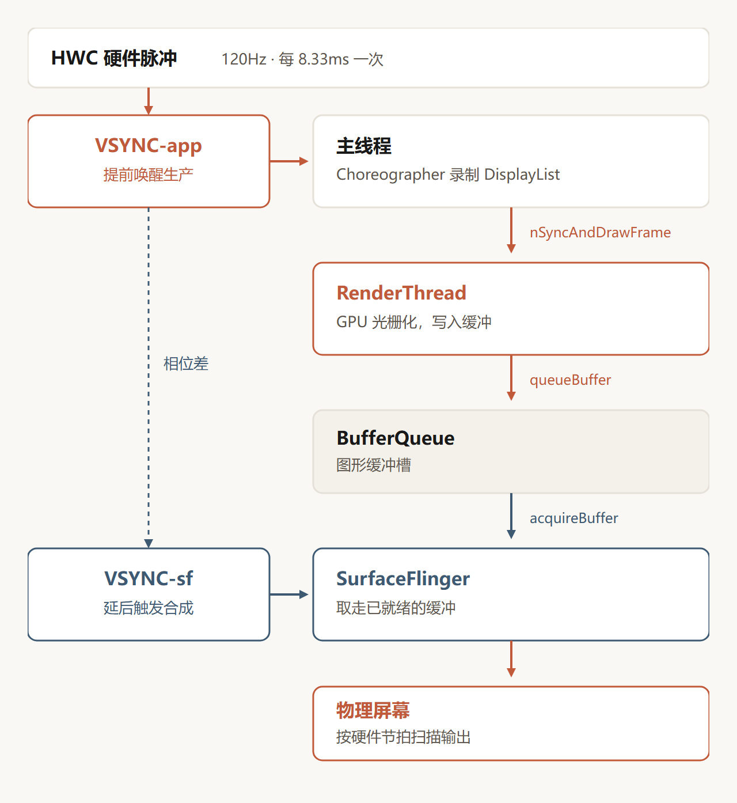
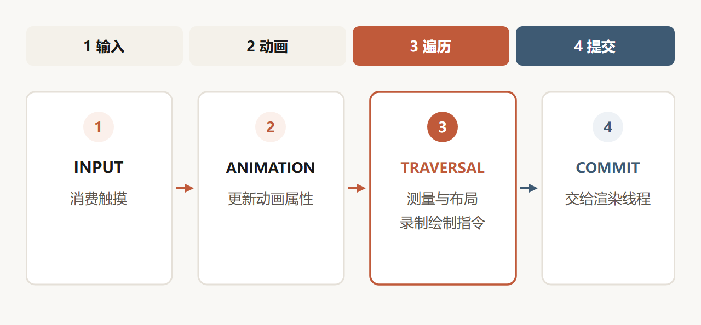
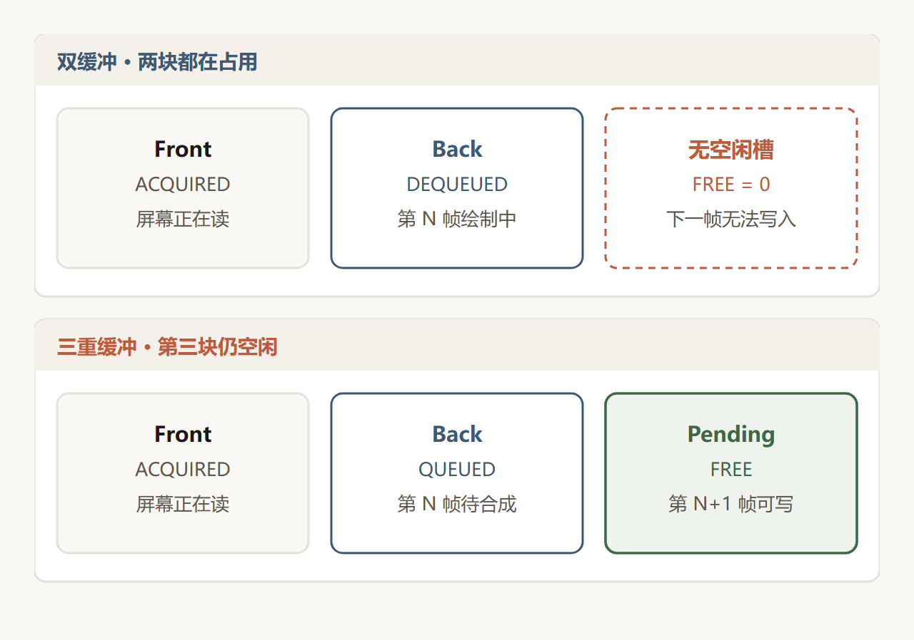
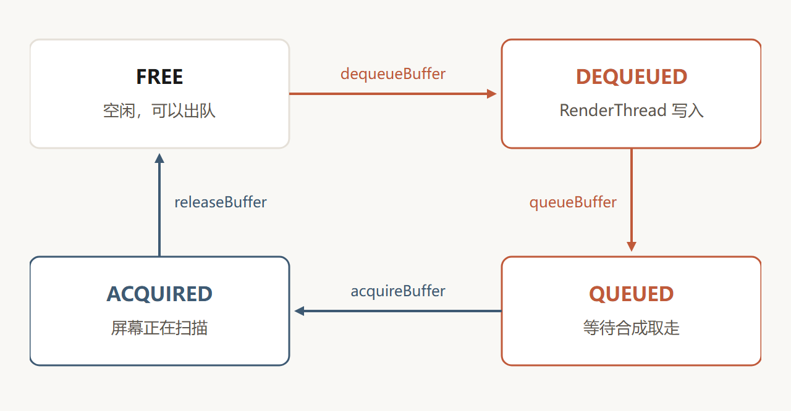
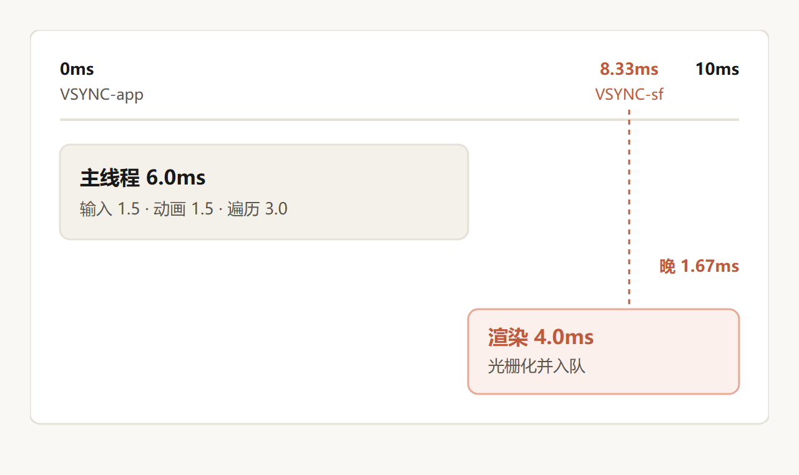
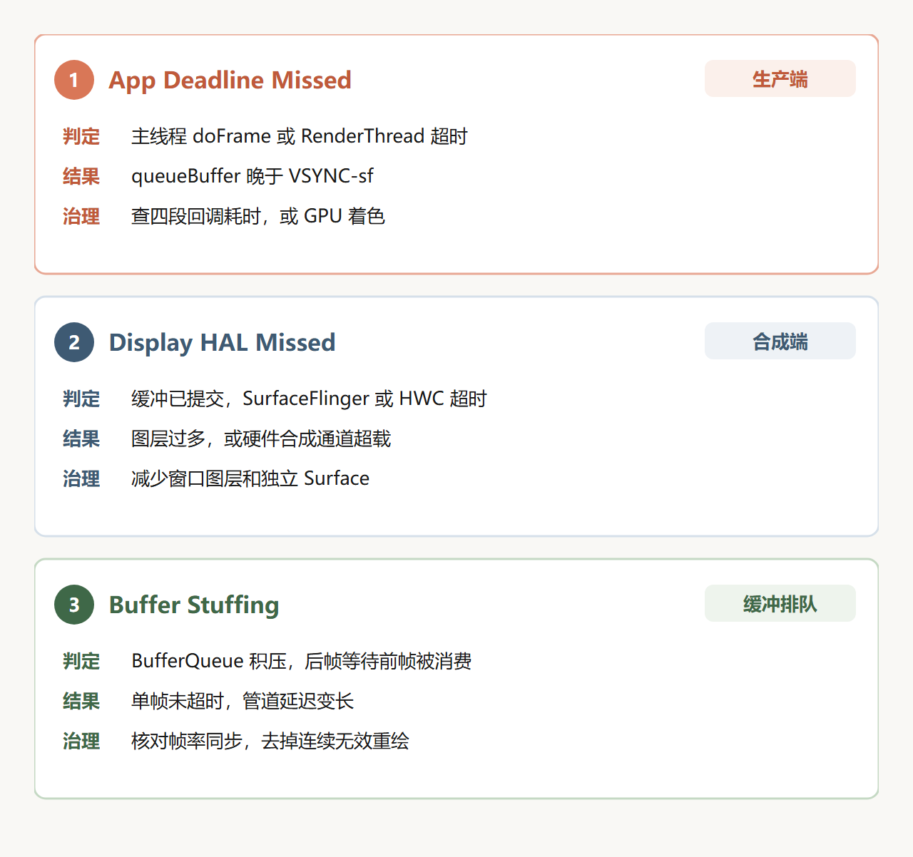

# Choreographer、VSYNC 偏移与三重缓冲机制

在 Android 设备中，90Hz、120Hz 甚至 144Hz 的高刷新率屏幕已广泛普及。

但在实际开发与性能治理中，经常会遇到一个现象：

**在 120Hz 模式下，页面滑动依然偶发卡顿；抓取系统 Trace 发现，某些帧的主线程耗时仅 6ms（低于 8.33ms 预算），系统依然记录了一次掉帧（Janky Frame）。**

不少开发者对渲染机制的理解仍基于静态时间划分：
_“60Hz 对应每帧 16.6ms，120Hz 对应每帧 8.3ms，只要主线程 doFrame 耗时控制在 8.3ms 内，页面就不会卡顿。”_

这种经验法则忽视了 Android 渲染的流水线特性。决定系统是否掉帧的，不仅是单个线程的执行耗时，还取决于硬件时钟、SurfaceFlinger、Choreographer、RenderThread 与硬件合成器（HWC）在特定时间窗口内的阶段对齐。

本文通过 AOSP 源码与系统实现，分析由 VSYNC 信号、Choreographer 调度器与图形缓冲机制构成的现代渲染管线，阐述 120Hz 高刷下产生掉帧的具体原因。



---

## 1. 节拍诞生：现代 VSYNC 分发与相位偏移

要弄清掉帧的根源，首先需要追溯 Android 是如何指挥整个系统有条不紊地刷新画面的。

### 1.1 从无序绘制到统一节拍脉冲

在 Android 4.1（Project Butter）之前，系统的绘制流程是完全无序的：

- 用户滑动屏幕，主线程随时随地开始响应输入事件并计算视图变化；
- 主线程计算完毕后直接向图形缓冲区提交数据；
- 屏幕刷新硬件以固定的物理频率（通常为 60Hz）逐行扫描读取显存。

这种“各干各的”异步模式带来了两项严重的显示缺陷：

1. **画面撕裂（Screen Tearing）**：当屏幕正在从显存扫描显示上一帧画面、刚扫描到屏幕一半时，应用层突然向显存写入了新的一帧数据，导致屏幕上半截显示旧画面、下半截显示新画面；
2. **严重的帧率不均与卡顿**：由于应用层的绘制启动时间完全随机，可能出现连续多个刷新周期没有新帧、而随后的周期里又密集拥挤多帧的失步状态。

为了解决这一问题，Google 引入了 **VSYNC（Vertical Synchronization，垂直同步信号）** 作为系统的统一定时脉冲。

### 1.2 现代 VSYNC 链路：HWC 到 EventThread 的接力

现代 Android 系统中的 VSYNC 信号来自于底层显示芯片硬件。

整条信号分发链路可以划分为四个阶段：

1. **硬件脉冲源（Hardware Composer, HWC）**：显示控制器以固定物理时钟周期（如 120Hz 下每隔 8.33ms）发出一次硬件垂直同步中断（HW-VSYNC）；
2. **SurfaceFlinger 核心接收器**：SurfaceFlinger 内部的 `HWVsyncController` 接收底层硬件中断，并将其作为时钟基准输入给调度控制器 `Scheduler`；
3. **软件锁相环（DispSync / VSyncTracker）**：AOSP 利用数学模型对硬件 VSYNC 脉冲进行平滑滤波，预测后续周期的基准时间戳，降低硬件时钟抖动的影响（注：在 Android 11 及更早版本中该组件被称为 `DispSync`，从 Android 12 开始在 `Scheduler` 内部重构演进为 `VSyncReactor` 与 `VSyncTracker` 协同模型，核心思想仍为软件锁相平滑预测；为便于连贯理解，本文沿用广义的软件锁相模型统称）；
4. **事件派发线程（EventThread）**：SurfaceFlinger 内部维持着多个专门派发事件的工作线程，将基准节拍转换并通过内核的 BitTube（一种基于匿名 socket 的跨进程数据管道，现代 AOSP 逐步演进为 Binder 接口与 Bpipe 封装）下发到各个进程。

### 1.3 核心机制：为什么需要 VSYNC-app 与 VSYNC-sf 的相位偏移

在早期设计中，若系统在同一时刻唤醒应用主线程和 SurfaceFlinger：

- App 收到信号后刚开始执行计算，新一帧数据尚未生成；
- SurfaceFlinger 同时醒来，只能取上一周期的旧帧进行合成；
- 这导致生成的画面必须在缓冲区内滞留一个完整的周期才能显示，增加了输入延迟。

为了优化流水线效率，现代 Android 在 SurfaceFlinger 调度层引入了**相位偏移机制（Phase Offsets）**：

系统将一个基准 VSYNC 脉冲拆分为两个具有固定时间差的派发节拍：

- **`VSYNC-app`**：提前下发给应用进程，通知 Choreographer 启动当前帧的布局与渲染；
- **`VSYNC-sf`**：在 `VSYNC-app` 之后推迟特定时间下发给 SurfaceFlinger。

在设定的时间差内，App 完成主线程计算与 GPU 渲染命令提交；当 `VSYNC-sf` 到达时，图形缓冲区中已准备好渲染完成的图层，SurfaceFlinger 可以立即执行合成送显。

在 60Hz 刷新率下，该时间差通常有 10ms~11ms 的缓冲空间；但在 120Hz 模式下，生产与合成的总窗口被压缩至 8.33ms 以内，任何阶段的调度滞后都可能导致无法赶上当前的合成窗口。

---

## 2. 深入 Choreographer：主线程四大阶段调度

应用进程通过 BitTube 收到系统的 `VSYNC-app` 脉冲后，由 **`Choreographer`** 负责协调主线程的执行流程。



### 2.1 从 FrameDisplayEventReceiver 到 doFrame 触发

在主线程中，`Choreographer` 通过继承自底层 C++ 层的 `FrameDisplayEventReceiver` 接收 VSYNC 事件。

核心调用逻辑如下：

```java
public final class Choreographer {
    private final class FrameDisplayEventReceiver extends DisplayEventReceiver
            implements Runnable {
        private boolean mHavePendingVsync;
        private long mTimestampNanos;
        private int mFrame;

        @Override
        public void onVsync(long timestampNanos, long physicalDisplayId, int frame,
                VsyncEventData vsyncEventData) {
            // 记录内核传递的纳秒级 VSYNC 时间戳与帧预期数据
            mTimestampNanos = timestampNanos;
            mFrame = frame;
            mLastVsyncEventData = vsyncEventData;

            // 构造异步 Handler 消息，投递给主线程 MessageQueue
            Message msg = Message.obtain(mHandler, this);
            msg.setAsynchronous(true); // 声明为异步消息，享有消息屏障最高调度优先级
            mHandler.sendMessageAtTime(msg, timestampNanos / TimeUtils.NANOS_PER_MS);
        }

        @Override
        public void run() {
            mHavePendingVsync = false;
            // 正式进入本帧的统筹调度
            doFrame(mTimestampNanos, mFrame, mLastVsyncEventData);
        }
    }
}
```

在实现细节上，代码中包含 `msg.setAsynchronous(true)`。
当 ViewRootImpl 请求重绘时，系统会在主线程 MessageQueue 中插入一个**同步屏障（Sync Barrier）**。该屏障会暂停普通 Handler 消息的处理，确保带有异步标记的 VSYNC 唤醒消息被优先执行。

### 2.2 四大回调队列的执行顺序与职责

进入 `doFrame()` 之后，`Choreographer` 按照固定顺序依次执行内部的四个回调队列：

```java
void doFrame(long frameTimeNanos, int frame, VsyncEventData vsyncEventData) {
    try {
        // 1. 处理输入事件回调（触摸滑动、按键反馈）
        doCallbacks(Choreographer.CALLBACK_INPUT, frameData, initialTimeUs);

        // 2. 处理动画计算回调（ValueAnimator、ObjectAnimator 计算新数值）
        doCallbacks(Choreographer.CALLBACK_ANIMATION, frameData, initialTimeUs);

        // 3. 处理沉浸式与窗口动画回调（Android 11+ 新增的窗口插值）
        doCallbacks(Choreographer.CALLBACK_INSETS_ANIMATION, frameData, initialTimeUs);

        // 4. 执行视图树布局与绘制遍历（measure、layout、draw 构建 DisplayList）
        doCallbacks(Choreographer.CALLBACK_TRAVERSAL, frameData, initialTimeUs);

        // 5. 提交本帧最终状态并触发渲染线程接力
        doCallbacks(Choreographer.CALLBACK_COMMIT, frameData, initialTimeUs);
    } finally {
        AnimationUtils.unlockAnimationClock();
    }
}
```

四个队列的分工与依赖关系如下：

1. **`CALLBACK_INPUT`**：优先执行。获取触摸位移与按键事件，决定后续界面的响应状态；
2. **`CALLBACK_ANIMATION`**：根据当前时间戳更新属性动画。若在 Traversal 之后计算动画，当前帧便无法体现属性变化；
3. **`CALLBACK_TRAVERSAL`**：调用 `ViewRootImpl.performTraversals()`，驱动 View 树执行 `measure`、`layout` 与 `draw`。在开启硬件加速时，`draw` 并不直接进行光栅化，而是向 `RecordingCanvas` 录制 GPU 绘制指令（DisplayList）；
4. **`CALLBACK_COMMIT`**：在完成绘制树的录制后，更新相关状态，并将当前帧的绘制任务交接给 RenderThread。

### 2.3 耗时累加机制

由于四大回调均运行在主线程中，**耗时呈串联累加关系**。

在 120Hz 刷新率下，单帧分配给主线程的处理预算约为 8.33ms。若前序阶段耗时增加，会直接压缩后续阶段的可用时间：

- 例如列表滑动时，`CALLBACK_INPUT` 处理手势分发耗时 2.5ms；
- `CALLBACK_ANIMATION` 计算属性动画插值耗时 2.5ms；
- 留给 `CALLBACK_TRAVERSAL` 遍历整棵 View 树的时间仅剩约 3.3ms；
- 此时若自定义 View 触发了多轮测量，或文本组件执行了密集的断行与排版计算，主线程总耗时便会超过 8.33ms。

主线程一旦超时，绘制指令就无法在预定相位前同步给 RenderThread，导致错过当期的 `VSYNC-sf` 合成窗口。显示系统在下一个刷新周期只能重复显示旧帧，产生掉帧。

**这也解释了开篇提出的场景：若四大回调总耗时仅为 6ms（低于 8.33ms 预算），系统为什么依然记录了掉帧？**

其原因在于主线程与渲染线程的分工边界：`Choreographer` 所度量的 6ms，仅为将 View 树指令转化为 `DisplayList` 的 **录制（Record）阶段**。当前帧能否如期送显，还取决于后续 `RenderThread` 的 GPU 光栅化与图形缓冲出入队耗时。

---

## 3. 缓冲与合成：双缓冲与三重缓冲的流转机制与瓶颈

主线程执行完毕仅代表**绘制指令录制完成**，图形数据的生成与送显依赖 RenderThread 和图形缓冲队列。

正如前文分析，即便主线程仅耗时 6ms，若随后的 `RenderThread` 在执行 GPU 绘制、大图纹理上传或等待可用缓冲区时消耗了 4ms，整条流水线的实际耗时便达到 10ms，超出了 `VSYNC-sf` 的合成时间窗口，系统依然判定为掉帧。



### 3.1 跨线程生产流水线：主线程、RenderThread 与 BufferQueue

在 Android 系统中，App 与 SurfaceFlinger 之间的数据交互通过 **`BufferQueue`**（环形图形缓冲区队列）完成：

整个流水线遵循生产者-消费者模型：

1. **主线程录制（Record）**：主线程构建包含绘制操作的 `DisplayList`，通过 `nSyncAndDrawFrame()` 唤醒 `RenderThread`；
2. **渲染线程出队（RenderThread Draw）**：`RenderThread` 调用 `dequeueBuffer()` 向 `BufferQueue` 申请空闲的图形缓冲（GraphicBuffer）；
3. **GPU 硬件光栅化（Rasterization）**：`RenderThread` 向 GPU 发送 Vulkan 或 OpenGL ES 绘制指令，将图元光栅化到申请的缓冲中；
4. **入队提交（queueBuffer）**：绘制完成后，`RenderThread` 调用 `queueBuffer()` 将写入像素的缓冲交还给 `BufferQueue`；
5. **合成消费（acquireBuffer）**：`VSYNC-sf` 到达时，SurfaceFlinger 调用 `acquireBuffer()` 获取就绪缓冲，交由 Hardware Composer 输出到物理屏幕。



### 3.2 双缓冲的硬伤：为什么跨越 VSYNC 会导致后续帧阻塞

在底层，BufferQueue 中的槽位在 `FREE`（空闲）、`DEQUEUED`（写入中）、`QUEUED`（就绪待合成）、`ACQUIRED`（屏幕显示中）四种状态之间循环。

在双缓冲机制（Double Buffering）下，系统为应用分配两块图形缓冲区：

- **Front Buffer（前台缓冲）**：屏幕硬件读取并显示的缓冲区（处于 `ACQUIRED` 状态）；
- **Back Buffer（后台缓冲）**：RenderThread 与 GPU 写入像素的缓冲区（处于 `DEQUEUED` 状态）。

双缓冲在单帧超时下的阻塞过程如下：

假设在第 N 帧，Front Buffer 正在屏幕上显示，RenderThread 正在 Back Buffer 上渲染第 N 帧。
若由于着色器复杂或大图纹理上传，绘制耗时达到 9ms（超出 8.33ms 周期）：

1. 下一个周期的 `VSYNC-sf` 到达时，Back Buffer 尚未渲染完毕，SurfaceFlinger 无法获取新缓冲，只能让屏幕继续显示旧的 Front Buffer；
2. 由于 Front Buffer 仍在屏幕上显示，SurfaceFlinger 不能调用 `releaseBuffer()` 将其释放为 `FREE`；
3. 随后下一个周期的 `VSYNC-app` 到达，主线程完成第 N+1 帧的构建并通知 RenderThread 绘制；
4. 此时两块缓冲区均被占用：Front Buffer 被屏幕锁定（`ACQUIRED`），Back Buffer 仍在绘制或等待消费（`DEQUEUED`/`QUEUED`），可用 `FREE` 缓冲数量为 0；
5. RenderThread 执行 `dequeueBuffer()` 无法获取空闲缓冲，线程进入挂起等待状态；
6. 直到第 N 帧在后续周期由 SurfaceFlinger 显示后，原 Front Buffer 才被释放为 `FREE`。

**双缓冲的容量限制，导致偶发的绘制超时不仅使当前帧跳过，还会因缓冲区占满直接阻塞下一帧的生产，产生连续掉帧。**

### 3.3 三重缓冲的机制取舍：缓解单帧偶发超时，无法解决持续性能不足

为了缓解双缓冲下可用缓冲归零引发的阻塞，Android 在图形层引入了 **三重缓冲机制（Triple Buffering）**。

在实现上，系统并非始终分配三块物理缓冲，而是**在检测到 BufferQueue 存在出队竞争或突发压力时，动态启用第三块备用缓冲**：

- **Front Buffer**：屏幕正在显示（硬件锁定）；
- **Back Buffer**：RenderThread 绘制完成、在队列中等待 SurfaceFlinger 消费；
- **Pending / Third Buffer**：系统动态启发的空闲缓冲，主线程与 RenderThread 可直接取用以绘制下一帧。

在这套调度下：

- 若第 N 帧在 GPU 端轻微超时、错过当前周期的合成；
- 下一个周期的 `VSYNC-app` 到来时，RenderThread 可以直接使用第三块空闲缓冲开始第 N+1 帧的绘制，无需等待；
- 第 N 帧在随后的周期显示后，流水线保持运转，避免了双缓冲下的停摆。

**三重缓冲同样存在权衡与局限：**

1. **增加输入延迟（Input Latency）**：三重缓冲满载时，从触摸操作到画面呈现在屏幕上，中间经历了两个完整的流转周期，输入延迟增加了一个周期（60Hz 下约为 16.6ms，120Hz 下约为 8.33ms）；
2. **无法解决持续的性能不足**：若页面布局复杂度过高，每帧耗时均稳定超过 8.33ms，缓冲区会被迅速占满。此时增加缓冲数量无法避免连续掉帧。

---

## 4. 诊断与工程治理：高刷场景性能优化

理清了渲染流水线在时间窗口上的这些约束，在面对高刷掉帧与卡顿告警时，定位与治理的切入点就会明朗很多。接下来结合实际开发场景，看看具体如何归因并开展针对性优化。

### 4.1 利用 Perfetto FrameTimeline 分析掉帧原因

在 Android 12 及以上版本中，AOSP 在 Perfetto 中引入了 **`FrameTimeline`** 体系。

在此之前，先通过流水线分析实际的时间分布：



如上图所示，在 120Hz 模式下：

1. **主线程阶段**：`VSYNC-app`（0ms）到达后，输入处理、动画计算与 View 树录制共耗时 **6.0ms**。从主线程自身视角看，6.0ms < 8.33ms，处于安全范围内；
2. **渲染线程阶段**：随后主线程唤醒 `RenderThread`，执行缓冲区申请、纹理上传并提交 GPU 绘制，该步骤消耗 **4.0ms**；
3. **产生掉帧**：整条流水线实际耗时达到 **10.0ms**，超出 8.33ms 的 `VSYNC-sf` 截止时刻。SurfaceFlinger 无法在当前周期获取就绪缓冲，只能继续显示旧帧。

在 Perfetto 中查看应用进程与 SurfaceFlinger 下方的 `Actual Timeline` 轨道，系统会标注卡顿的具体类型：



该归因模型有助于明确性能瓶颈位于主线程 CPU 阶段、RenderThread GPU 阶段还是系统合成阶段。

### 4.2 消除 Traversal 阶段的对象分配

`CALLBACK_TRAVERSAL` 承载 View 树的重构，应避免在该阶段引入额外开销：

```kotlin
class PerformanceView(context: Context) : View(context) {
    private val paint = Paint(Paint.ANTI_ALIAS_FLAG)
    private var cachedPath: Path? = null

    override fun onDraw(canvas: Canvas) {
        super.onDraw(canvas)
        // 严重反模式 1：严禁在 onDraw 中动态分配内存对象
        // 频繁触发 GC 会导致主线程暂停，彻底冲垮 8.3ms 预算
        // val rect = RectF(0f, 0f, width.toFloat(), height.toFloat()) // 禁止！

        // 严重反模式 2：严禁在绘制周期中读取跨进程 IPC 或高开销系统服务
        // 例如：context.getSystemService(...) 或通过 Binder 查询状态

        // 正确做法：复用预先分配好的图形路径与画笔
        cachedPath?.let { path ->
            canvas.drawPath(path, paint)
        }
    }
}
```

在 120Hz 刷新率下，单次 GC 停顿（2ms~3ms）即会占用约三分之一的帧预算。因此在 `onDraw` 与 `onLayout` 执行路径上避免对象分配，是维持高刷稳定的基础要求。

### 4.3 动画与主线程解耦：RenderNodeAnimator 实践

传统 `ValueAnimator` 在每帧的 `CALLBACK_ANIMATION` 中计算插值，并通过属性修改触发重新布局或绘制记录。

若动画播放期间主线程执行业务逻辑产生耗时，动画计算会随之推迟，产生视觉卡顿。

硬件加速架构支持将特定属性动画委托给渲染线程独立执行：

```kotlin
// 利用 RenderNode 直接在 RenderThread 上执行独立硬件动画
fun startSmoothHardwareAnimation(targetView: View) {
    if (Build.VERSION.SDK_INT >= Build.VERSION_CODES.Q) {
        val renderNode = targetView.updateDisplayListIfDirty()
        // 创建直接绑定在 RenderNode 上的动画对象
        val animator = RenderNodeAnimator(
            RenderNodeAnimator.TRANSLATION_Y,
            300f
        ).apply {
            setTarget(targetView)
            duration = 350
            // 动画指令直接同步至 RenderThread 驱动，主线程阻塞完全不影响动画顺畅执行
            start()
        }
    } else {
        // 低版本回退至 ViewPropertyAnimator（内部自动针对 RenderThread 做了硬件指令优化）
        targetView.animate()
            .translationY(300f)
            .setDuration(350)
            .start()
    }
}
```

通过将透明度、旋转、缩放与位移等变换交由 `RenderThread` 独立执行，即使主线程处理耗时任务，动画位移仍可在 120Hz 频率下正常流转。

### 4.4 针对动态刷新率（VRR）的帧调度规范

在支持可变刷新率（VRR / LTPO）的高刷设备上，系统会根据用户交互在不同刷新率之间切换。

从 Android 11 开始，AOSP 提供了显式的帧率控制 API：

```kotlin
// 为关键平滑滚动容器显式设定目标期望帧率
fun configureHighRefreshRateDisplay(surfaceView: SurfaceView) {
    if (Build.VERSION.SDK_INT >= Build.VERSION_CODES.R) {
        // 声明该图层期望运行在 120Hz，并指定匹配策略为精准锁定（FRAME_RATE_COMPATIBILITY_EXACT）
        surfaceView.holder.surface.setFrameRate(
            120f,
            Surface.FRAME_RATE_COMPATIBILITY_EXACT
        )
    }
}
```

通过声明帧率意图，系统调度器可将底层 HWC 与 VSYNC 脉冲保持在预期节拍，避免在交互切换时因刷新率骤降引发卡顿。

## 参考资料

- [Graphics Architecture Overview & SurfaceFlinger](https://source.android.com/docs/core/graphics/architecture)（Android Open Source Project · 2024-04）
- [Choreographer.java & DisplayEventReceiver.cpp Source Code](https://android.googlesource.com/platform/frameworks/base/+/refs/heads/main/core/java/android/view/Choreographer.java)（Android Open Source Project (AOSP) · 2024-03）
- [Understand FrameTimeline & Jank Detection in Perfetto](https://developer.android.com/topic/performance/vitals/render)（Android Developers Documentation · 2023-11）
- [Surface.setFrameRate & Variable Refresh Rate Guide](https://developer.android.com/reference/android/view/Surface#setFrameRate)（Android Developers Official Guide · 2024-01）
