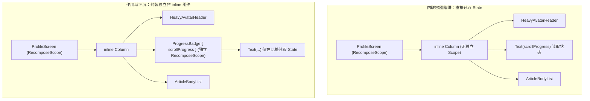

# Compose Snapshot 状态系统与重组优化实战

在使用 Jetpack Compose 开发复杂页面时，很多开发者都遇到过两类看似反直觉的性能问题：

1. 明明只修改了列表顶部一个开关的 `MutableState<Boolean>`，Layout Inspector 里却显示整块父容器甚至相邻子组件都跟着重组了一遍；
2. 已经为数据类加上了不可变字段，或者升级到 Kotlin 2.0 开启了 Strong Skipping Mode，列表滑动时帧率依然出现波动。

这些问题表象在 UI 刷新范围失控，根源在于对 Compose **状态追踪底层（Snapshot 状态快照系统）**、**编译器重组作用域划分（RecomposeScope）** 以及 **渲染三阶段状态读取时机** 的理解存在偏差。本文从 `androidx.compose.runtime.snapshots` 核心设计与编译器代码生成逻辑出发，系统梳理 Compose 重组机制的运行规律与工程调优方法。

---

## 1. Snapshot 状态快照系统：MutableState 如何做到精准感知？

在传统 View 体系中，数据变更后需要开发者显式调用 `notifyDataSetChanged()` 或 `View.invalidate()`；而在 Compose 中，调用 `mutableStateOf()` 并不需要手动注册任何 Listener，只要在 `@Composable` 函数中读取 `.value`，后续写入新值就能自动触发对应局部区域的重组。

支撑这套机制的，是位于 `androidx.compose.runtime.snapshots` 包下的 **Snapshot（状态快照）系统**。它借鉴了数据库多版本并发控制（MVCC）的思路，同时解决**并发读写隔离**与**状态读取追踪**两个核心问题。

### 1.1 `StateObject` 与 `StateRecord` 多版本链表

通过 `mutableStateOf(...)` 创建的对象，底层实现类是 `SnapshotMutableStateImpl<T>`，它实现了 `StateObject` 接口。

与普通对象直接持有一个 `var value: T` 字段不同，`SnapshotMutableStateImpl` 内部并不直接存储裸值，而是持有一个名为 `next: StateStateRecord<T>` 的**单向链表头节点**。链表中的每一个 `StateRecord` 节点都记录了两个关键信息：

- `snapshotId: Int`：创建该版本记录的快照 ID；
- `value: T`：该快照版本对应的实际数据值。

当我们在代码中读取或修改 `state.value` 时，内部流转如下：

```kotlin
// androidx.compose.runtime.SnapshotMutableStateImpl 简化逻辑
override var value: T
    get() = next.readable(this).value
    set(value) = next.withCurrent {
        if (!policy.equivalent(it.value, value)) {
            next.overwritable(this, it) { this.value = value }
        }
    }
```

这段精简代码背后隐藏着三个关键设计：

1. **读路径触发依赖采集**：调用 `readable(this)` 时，运行时会沿着 `StateRecord` 链表向后遍历，找到对当前活跃 `Snapshot` 可见（即 `record.snapshotId <= current.id` 且未被标记为 `invalid`）的最新一条记录，并回调 `currentSnapshot.readObserver?.invoke(this)`。在重组执行期间，Composer 正是通过这个 `readObserver` 记录下“当前正在执行的 `RecomposeScope` 读取了哪个 `StateObject`”。
2. **写路径先比对等价性**：写入新值前，会先使用 `SnapshotMutationPolicy` 进行等价性判断（默认使用 `structuralEqualityPolicy()`，底层即 `==` 结构相等；也可以显式传入 `referentialEqualityPolicy()` 或 `neverEqualPolicy()`）。如果新旧值等价，直接跳过写入，不会产生新的版本记录，也不会触发任何通知。
3. **写时隔离与记录复用**：若值确实发生变化，`overwritable()` 会判断链表中是否已经存在归属于当前 `Snapshot` 的记录（或已被所有活跃快照释放的过期记录），若存在则原地复用，否则在链表头部插入一个新的 `StateRecord` 节点，并触发 `currentSnapshot.writeObserver?.invoke(this)`。

::: info 为什么需要 StateRecord 链表而不是单值加锁？
Compose 的组合（Composition）允许在后台线程并发执行，而主线程同时可能正在响应用户输入修改状态。如果直接加锁读写单个变量，要么引发线程阻塞掉帧，要么在一次重组执行到一半时读到被篡改的中间态。通过 `StateRecord` 多版本链表，后台快照能始终看到开启快照那一刻的一致性视图，互不干扰。
:::

### 1.2 全局快照、子快照提交与 Recomposer 调度

整个应用进程共享一个根快照 `GlobalSnapshot`。在后台协程或事件回调中修改状态后，重组并不会在赋值的那一行代码同步发生，而是经过一条异步调度链路：


在标准 Android 环境中，`AndroidUiDispatcher` 会在合适的时机调用 `Snapshot.sendApplyNotifications()`，将全局快照上累积的变更集合通知给 `Recomposer` 注册的 `applyObserver`。`Recomposer` 根据先前记录的 `StateObject -> Set<RecomposeScopeImpl>` 映射关系，仅把受影响的作用域标脏，等待下一帧 `MonotonicFrameClock` 到来时统一刷新。

---

## 2. RecomposeScope 划分与“甜甜圈跳过”陷阱

搞清楚状态如何标记脏区域后，下一步要理解：**Compose 究竟以什么粒度去重执行代码？**

### 2.1 编译器注入的重启组与 Donut-hole Skipping

Compose 编译器插件在编译阶段会改写每一个非 `inline` 且无返回值（返回 `Unit`）的 `@Composable` 函数。以一个最常见的计数器组件为例：

```kotlin
@Composable
fun CounterCard(title: String) {
    var count by remember { mutableIntStateOf(0) }
    Text(text = title)
    Button(onClick = { count++ }) {
        Text(text = "点击次数：$count")
    }
}
```

编译器在生成字节码时，会自动向函数签名注入 `$composer: Composer` 与 `$changed: Int` 参数，并用 `startRestartGroup` 和 `endRestartGroup` 将函数体包裹起来：

```kotlin
// Compose 编译器生成代码的等价概念模型
fun CounterCard(title: String, $composer: Composer, $changed: Int) {
    val $composer = $composer.startRestartGroup(123456)
    // ... 判断参数 $changed 是否稳定未变，决定是否 skipToGroupEnd() ...
    Text(title, $composer, ...)
    Button(onClick = { count++ }, $composer, ...) {
        // Button 的 content Lambda 会独立生成一个 RestartGroup
        Text("点击次数：$count", $composer, ...)
    }
    $composer.endRestartGroup()?.updateScope { composer, _ ->
        CounterCard(title, composer, $changed or 1)
    }
}
```

注意看这段结构：`CounterCard` 本身是一个 `RecomposeScope`，而 `Button` 的尾随 Lambda 内部读取了 `count`。当 `count` 自增时，只有读取了 `count` 的那个**最内层 Lambda 对应的 `RecomposeScope`** 会被标脏；外层的 `CounterCard` 以及同级的 `Text(title)` 并未直接读取 `count.value`，因此它们会直接跳过执行，只有 `Button` 内部的文字发生重组。这种“外层跳过、只重跑中间受影响嵌套空洞”的行为，在官方社区通常被称为 **Donut-hole Skipping（甜甜圈跳过）**。

### 2.2 为什么 `Column`、`Row`、`Box` 无法隔离重组？

日常开发中最容易踩的一个隐蔽坑点，是把状态读取直接放进 `Column`、`Row` 或 `Box` 等基础布局容器里，误以为容器会帮自己“框住”重组范围。

看下面这段代码：

```kotlin
@Composable
fun ProfileScreen(viewModel: ProfileViewModel) {
    val scrollProgress by viewModel.scrollProgress.collectAsStateWithLifecycle()

    Column(modifier = Modifier.fillMaxSize()) {
        HeavyAvatarHeader() // 内部有复杂阴影或图片绘制
        Column {
            // 误区：开发者以为这个内层 Column 会隔离重组范围
            Text(text = "阅读进度：${(scrollProgress * 100).toInt()}%")
        }
        ArticleBodyList() // 复杂长文本区域
    }
}
```

实际用 Layout Inspector 观察时会发现：每当 `scrollProgress` 变化，不仅仅是 `Text` 在重组，整个 `ProfileScreen` 都会重新执行一次，连带把参数检查推送给 `HeavyAvatarHeader()` 和 `ArticleBodyList()`。

原因在于 `androidx.compose.foundation.layout` 中的 `Column`、`Row`、`Box` 全都是 **`inline fun`**！

```kotlin
@Composable
inline fun Column(
    modifier: Modifier = Modifier,
    verticalArrangement: Arrangement.Vertical = Arrangement.Top,
    horizontalAlignment: Alignment.Horizontal = Alignment.Start,
    content: @Composable ColumnScope.() -> Unit
)
```

由于使用了 `inline` 关键字，Kotlin 编译器在编译时会把 `Column` 的函数体连同 `content` Lambda 直接平铺内联进调用方 `ProfileScreen` 的字节码中。**`inline` 函数不会生成独立的可重启 `RecomposeScope`**。因此，在 `Column` 内部读取 `scrollProgress` 的操作，直接归属到了外层非内联函数 `ProfileScreen` 的作用域上。



解决方式非常直接：把状态读取下沉到一个**独立的小粒度非 `inline` Composable 函数**中，或者通过 Lambda 延迟读取，让 `ProfileScreen` 自身不再触碰 `scrollProgress.value`：

```kotlin
@Composable
fun ProfileScreen(viewModel: ProfileViewModel) {
    // 只收集 State 对象或传递 Lambda，不在顶层解包读取 .value
    val progressState = viewModel.scrollProgress.collectAsStateWithLifecycle()

    Column(modifier = Modifier.fillMaxSize()) {
        HeavyAvatarHeader()
        ProgressBadge(progressProvider = { progressState.value })
        ArticleBodyList()
    }
}

@Composable
private fun ProgressBadge(progressProvider: () -> Float) {
    // 状态读取被严格限定在 ProgressBadge 自身的 RecomposeScope 内
    val percent = (progressProvider() * 100).toInt()
    Text(text = "阅读进度：$percent%")
}
```

经过这一步改造，`scrollProgress` 变化时，Compose 仅重新执行 `ProgressBadge` 这一个节点，外层 `ProfileScreen` 及兄弟节点完全不会参与重组。

---

## 3. 编译器稳定性推断与 Strong Skipping Mode

就算外层容器发生了重组，只要子组件的参数没有发生变化，Compose 理论上应该直接跳过该子组件的执行。但在早期版本中，开发者经常遇到“参数明明没变，子组件却怎么也跳不过”的困扰。这涉及 Compose 编译器的**稳定性推断（Stability Inference）**与 **Strong Skipping Mode（强跳过模式）**。

### 3.1 稳定类型（Stable）与不稳定类型（Unstable）的判定规则

为了安全地跳过一个 Composable 函数，编译器必须确信：如果传入参数的值没有变化，函数运行结果也绝不会变化。Compose 编译器将参数类型分为两类：

| 类别                   | 典型代表                                                                                                                          | 编译器处理方式                                        |
| :--------------------- | :-------------------------------------------------------------------------------------------------------------------------------- | :---------------------------------------------------- |
| **Stable（稳定）**     | 基本类型、`String`、函数类型（Lambda）、标注 `@Immutable` / `@Stable` 的类、所有 `val` 字段均为稳定类型的 `data class`            | 可靠地参与跳过判断，使用 `equals`（`==`）比对前后参数 |
| **Unstable（不稳定）** | 包含 `var` 属性的类、标准库集合接口（`List<T>`、`Set<T>`、`Map<K, V>`）、未接入 Compose 编译器的模块（如纯 `:domain` 模块）中的类 | 传统模式下直接剥夺所在函数的跳过资格                  |

为什么标准库 `kotlin.collections.List<T>` 会被判定为不稳定？因为从类型系统上看，`MutableList<T>` 实现了 `List<T>` 接口。编译器无法保证运行期传入的 `List` 背后是不是一个正在被外部悄悄 `add()` 修改的可变 `ArrayList`，为了防止 UI 漏刷新，编译器保守地将所有标准集合接口视为 Unstable。

### 3.2 Strong Skipping Mode 改变了什么，又有哪些边界？

为了降低开发者手动标注 `@Immutable` 或引入 `ImmutableList` 的心智负担，Compose 编译器从 `1.5.4` 引入试验特性，并在 **Kotlin `2.0.20` 起默认开启了 Strong Skipping Mode（强跳过模式）**。

开启 Strong Skipping Mode 后，编译器行为发生两项关键变化：

1. **带有 Unstable 参数的 Composable 也可以跳过**：
   - 对于 **Stable 参数**：继续使用结构相等（`Object.equals` / `==`）比较；
   - 对于 **Unstable 参数**（如 `List<Article>` 或跨模块 POJO）：改为使用**引用相等（`===`）**比较。只要传入的对象实例还是同一个内存引用，函数依然可以跳过重组。
2. **Lambda 自动记忆化（Auto-remembering）**：
   - 过去常见的一个性能杀手是在子组件传入 `onClick = { viewModel.deleteItem(item.id) }`，如果 `viewModel` 不稳定，每次重组都会生成一个新的 Lambda 实例，导致子组件跳过失败。
   - 在 Strong Skipping Mode 下，编译器会自动用 `remember(capturedKeys...) { ... }` 包裹 Composable 内部的 Lambda。其中稳定捕获值按 `==` 作为 key，不稳定捕获值按 `===` 作为 key。

::: warning 开启 Strong Skipping Mode 后，为什么依然会无效重组？
很多工程团队升级到 Kotlin 2.0 后发现列表还是在频繁全量重组，常见原因有以下三类：

1. **每次重组都在现场派生新的不稳定集合**：例如在父组件中直接写 `UserList(users = uiState.users.filter { it.isActive })`。`.filter {}` 每次执行都会返回一个全新的 `ArrayList` 实例，导致 Unstable 参数的引用比较 `===` 结果为 `false`，直接击穿强跳过保护。正确做法是用 `remember(uiState.users)` 缓存过滤结果。
2. **数据更新时整体替换引用但子项未稳**：虽然 Strong Skipping 允许引用相等时跳过，但如果业务状态频繁通过 `copy()` 产生新对象，而对象内部包含新构建的 `List` 或未正确实现 `equals` 的跨模块实体，仍会触发重绘。
3. **Lambda 捕获了 `var` 局部变量**：如果 Lambda 捕获了直接在 Composable 体内的局部 `var`（而非 `MutableState`），编译器出于语义一致性考虑无法将其自动 `remember`。
   :::

### 3.3 跨模块类型的静态治理：`compose_compiler_config.conf`

对于纯 Kotlin/Java 的 `:domain` 或 `:model` 模块，由于它们不依赖 Compose Runtime，通常不方便引入 `@Immutable` 注解。除了依赖 Strong Skipping 的引用比较外，更稳妥的做法是在项目根目录配置 Compose 稳定性配置文件（Stability Configuration File），显式声明那些事实上不可变的跨模块类型或 JDK 类型：

```text
// compose_compiler_config.conf
// 声明项目领域模型包下的不可变实体为稳定类型
com.example.app.domain.model.*
// 声明标准库或三方不可变时间/集合类型
java.time.Instant
java.time.LocalDate
kotlinx.collections.immutable.*
```

然后在模块的 `build.gradle.kts` 中接入配置（Kotlin 2.0+ Compose Compiler Gradle Plugin）：

```kotlin
composeCompiler {
    stabilityConfigurationFiles.add(
        rootProject.layout.projectDirectory.file("compose_compiler_config.conf")
    )
}
```

配置生效后，编译器会直接把匹配的跨模块模型当作 Stable 处理，在比较时恢复使用精确的 `==` 结构比较，即便上游重新实例化了相同内容的实体对象，下游 UI 依然能够精准跳过。

---

## 4. 延迟状态读取：把高频变动推迟到 Layout 与 Draw 阶段

即便把 `RecomposeScope` 切割得再细、把稳定性配置得再完美，有一类场景依然不适合在组合阶段解决——**跟随手势或动画每帧高频变化的状态**（例如 `LazyListState` 滚动偏移量、`ScrollState.value`、连续缩放手势位移）。

Compose 渲染一帧画面依次经过三个阶段：

1. **Composition（组合）**：执行 `@Composable` 函数，构建或更新界面树结构；
2. **Layout（布局）**：测量（Measure）与放置（Place）各个节点尺寸及坐标；
3. **Draw（绘制）**：将节点内容绘制到 `Canvas` 图层。

**Snapshot 的状态读取追踪并不仅限于 Composition 阶段，它同样覆盖 Layout 和 Draw 阶段。** 只要把 `State.value` 的读取动作推迟到后续阶段的 Lambda 中，就可以让系统在状态变化时直接跳过前面的阶段。

### 4.1 案例对比：滚动驱动的吸顶位移与透明度变化

假设我们需要实现一个随列表滚动而产生视差位移和渐变透明度的顶部卡片：

```kotlin
// 反例：在 Composition 阶段直接读取 scrollState.value
@Composable
fun ParallaxHeaderBad(scrollState: ScrollState) {
    val offsetDp = with(LocalDensity.current) { (scrollState.value / 2).toDp() }
    val alphaValue = (1f - scrollState.value / 400f).coerceIn(0f, 1f)

    Box(
        modifier = Modifier
            .offset(y = offsetDp)
            .alpha(alphaValue)
    ) {
        HeaderContent()
    }
}
```

在反例中，用户手指每滑动 1 像素，`scrollState.value` 发生变化，由于读取发生在 `ParallaxHeaderBad` 的函数体中，**每一帧都要重新执行 Composition -> Layout -> Draw 完整三阶段**。

将其改为**基于 Lambda 的延迟读取**：

```kotlin
// 正例：将状态读取延迟到 Layout 与 Draw 阶段
@Composable
fun ParallaxHeaderGood(scrollState: ScrollState) {
    Box(
        modifier = Modifier
            // graphicsLayer 内部 Lambda 在 Draw 阶段执行，跳过 Composition 和 Layout
            .graphicsLayer {
                translationY = scrollState.value * 0.5f
                alpha = (1f - scrollState.value / 400f).coerceIn(0f, 1f)
            }
    ) {
        HeaderContent()
    }
}
```

如果确实需要改变节点在父容器中的真实布局占位（而不仅仅是视觉平移），可以使用 `Modifier.offset { IntOffset(0, scrollState.value / 2) }`，它会将状态读取推迟到 **Layout 阶段**，同样完全跳过了 Composition 阶段。如果是纯视觉变换（位移 `translationX/Y`、缩放 `scaleX/Y`、旋转 `rotationZ`、透明度 `alpha`）或背景渐变色变化（`Modifier.drawBehind { drawRect(animatedColor.value) }`），优先使用 `graphicsLayer { }` 或 `drawBehind { }`，把整个刷新代价压缩到 **Draw 阶段**。

### 4.2 `derivedStateOf` 与 `remember(key)` 的精确选型边界

在管理派生状态时，另一个高频混淆点是 `derivedStateOf` 和 `remember(key)` 的滥用。

两者的适用准则非常明确：

- **使用 `remember { derivedStateOf { ... } }`**：当**输入状态的变化频率远高于输出结果的变更频率**时使用。例如判断列表是否已经滚过首屏显示“回到顶部”按钮：

```kotlin
val listState = rememberLazyListState()

// listState.firstVisibleItemIndex 在滚动过程中可能频繁变化，
// 但 showScrollToTop 只有 0 <-> 1 边界跨越时才改变 true/false
val showScrollToTop by remember {
    derivedStateOf { listState.firstVisibleItemIndex > 0 }
}
```

`derivedStateOf` 内部维护了一个 `DerivedSnapshotState`，它会截断高频的上游状态变更通知，只有当计算结果真正发生改变（通过结构相等判断）时，才向下游读取 `showScrollToTop` 的作用域发送失效信号。

- **使用 `remember(key1, key2) { ... }`**：当**输入与输出按 1:1 同频率变化**，且只需要缓存较重的计算结果时使用。例如根据 `firstName` 和 `lastName` 拼接全名，每次姓或名改变，全名必然改变，此时使用 `derivedStateOf` 只会平白多出一层依赖追踪开销。

::: warning derivedStateOf 漏传 remember key 导致状态陈旧的常见 Bug
`derivedStateOf` 只能自动追踪内部读取到的 **`Snapshot` 状态对象（如 `State<T>`）**，无法追踪普通的函数入参！

```kotlin
// 错误示范：threshold 是普通 Int 参数，并非 State<Int>
// 当外部传入新的 threshold 时，derivedStateOf 内部不会重新计算！
@Composable
fun ExceedNotice(count: State<Int>, threshold: Int) {
    val exceeded by remember {
        derivedStateOf { count.value > threshold }
    }
    // ...
}

// 正确示范：将非 State 依赖显式作为 remember 的 key
@Composable
fun ExceedNoticeFixed(count: State<Int>, threshold: Int) {
    val exceeded by remember(threshold) {
        derivedStateOf { count.value > threshold }
    }
    // ...
}
```

:::

### 4.3 `LazyColumn` 长列表中的 `key` 与 `contentType`

在长列表场景中，除了 item 内部重组控制外，还必须关注槽位表（SlotTable）的复用策略：

```kotlin
LazyColumn {
    items(
        items = feedList,
        // 1. 绑定业务唯一标识，避免头部插入/排序时全列表按索引错位重组
        key = { item -> item.id },
        // 2. 区分异构卡片类型，让 SlotTable 只在同类视图结构间复用节点
        contentType = { item -> item.cardType }
    ) { item ->
        FeedItemCard(item)
    }
}
```

未设置 `key` 时，Compose 默认使用列表位置索引 `index` 关联组合槽位。一旦在列表头部插入一条新数据，后续所有位置的 `item` 都会因为对应索引上的数据对象改变而触发整屏重组；而补充 `contentType` 后，不同布局结构的卡片不会相互抢占槽位导致整棵子树销毁重建。

---

## 5. 可验证的排查手段：Compiler Metrics 与 Layout Inspector

性能优化不能靠猜。Compose 提供了编译器级静态指标报告与运行期可视化检测工具，能够直接验证每一条优化改动是否真实落地。

### 5.1 生成与解读 Compose Compiler Metrics

在 Kotlin `2.0+` 项目中，可以在目标模块的 `build.gradle.kts` 中开启编译器报告输出：

```kotlin
composeCompiler {
    reportsDestination = layout.buildDirectory.dir("compose_compiler")
    metricsDestination = layout.buildDirectory.dir("compose_compiler")
}
```

执行一次 Release 或对应变体的编译任务（如 `./gradlew :app:assembleRelease`）后，在 `build/compose_compiler/` 目录下会生成两份关键文本报告：

1. **`*-composables.txt`**：列出模块内所有 `@Composable` 函数的编译结论与参数稳定性标记。

```text
restartable skippable scheme("[androidx.compose.ui.UiComposable]") fun FeedItemCard(
  stable item: FeedUiModel
  stable onItemClick: Function1<String, Unit>
)
```

如果看到某核心列表项函数缺少 `skippable`，或者参数前缀出现 `unstable`，就需要顺着参数类型往回排查。

2. **`*-classes.txt`**：给出每个类的稳定性判定细节，精确到引发不稳定的具体字段：

```text
unstable class LegacyArticleModel {
  stable val id: String
  unstable var tags: List<String>
  <runtime stability> = Unstable
}
```

通过这两份报告，可以逐个清理核心页面路径上的意外 `unstable` 类型，或者确认 `compose_compiler_config.conf` 是否已经正确命中。

::: tip 注意使用 Release 变体检查生产指标
不要在未关闭混淆或仅运行 Debug 快速构建时只看局部片段，建议在接近生产配置的 Release 变体下生成 Metrics，确保跨模块依赖与编译器规则与线上一致。
:::

### 5.2 使用 Layout Inspector 观测运行期重组次数

静态报告只能保证“具备跳过条件”，而**状态读取范围是否下沉到位、是否发生了高频无效刷新**，则需要在 Android Studio 的 **Layout Inspector** 中实时验证：

1. 运行应用并打开 **Tools -> Layout Inspector**，连接当前调试进程；
2. 在 Component Tree 面板工具栏打开 **Show Recomposition Counts**；
3. 操作页面（例如滑动列表、点击单选框、展开输入框），观察树形节点右侧的**两个数字**：
   - **左侧数字**：实际发生重组的次数（Recompositions）；
   - **右侧灰色数字**：成功跳过的次数（Skips）。

如果页面处于静止或仅局部控件做动画时，某个顶层页面容器或无关兄弟节点的左侧重组计数仍在持续攀升，通常意味着该节点或其内部 `inline` 容器直接读取了高频变更的 `State.value`，或是向子组件传递了每次都在重新实例化引用的集合/对象。此时顺着节点向上定位读取点，应用前文提到的“状态读取下沉”或“延迟至 Layout/Draw 阶段”，即可在面板上直观看到左侧计数归零或停止增长。

---

## 6. 总结

治理 Jetpack Compose 重组性能的核心，并不在于盲目到处加注解或过度封装，而是按渲染链路逐层确认三个问题：

1. **读取位置是否合理**：状态读取得越晚、作用域越小越好；不在 `inline` 布局容器（`Column`/`Row`/`Box`）中直接解包外层高频状态，视觉动画与滚动偏移尽量延迟到 `graphicsLayer { }`、`offset { }` 或 `drawBehind { }` 中读取。
2. **跳过条件是否成立**：理解 Strong Skipping Mode 下不稳定参数按 `===` 比较、稳定参数按 `==` 比较的规则；不要在组合阶段每次现场构造新集合，善用 `remember(key)`、`derivedStateOf` 以及跨模块 `compose_compiler_config.conf`。
3. **排查结果是否可观测**：养成用 Compose Compiler Metrics 检查热点组件 `skippable` 属性，并用 Layout Inspector 的重组计数面板验证运行期行为的习惯。

---

## 参考资料

- [Android Developers — Jetpack Compose Phases](https://developer.android.com/develop/ui/compose/phases)
- [Android Developers — Stability in Compose](https://developer.android.com/develop/ui/compose/performance/stability)
- [Android Developers — Strong Skipping Mode](https://developer.android.com/develop/ui/compose/performance/stability/strongskipping)
- [Android Developers — Follow best practices (Compose Performance)](https://developer.android.com/develop/ui/compose/performance/bestpractices)
- [AndroidX Source — `Snapshot.kt` (`androidx.compose.runtime.snapshots`)](https://cs.android.com/androidx/platform/frameworks/support/+/androidx-main:compose/runtime/runtime/src/commonMain/kotlin/androidx/compose/runtime/snapshots/Snapshot.kt)
