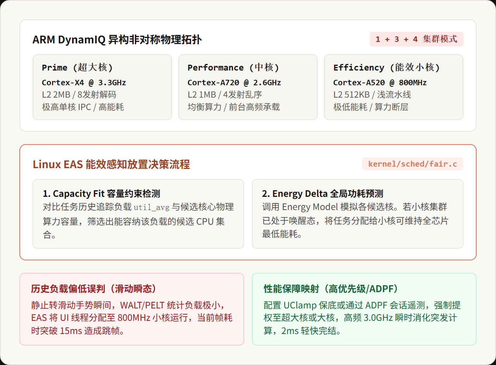
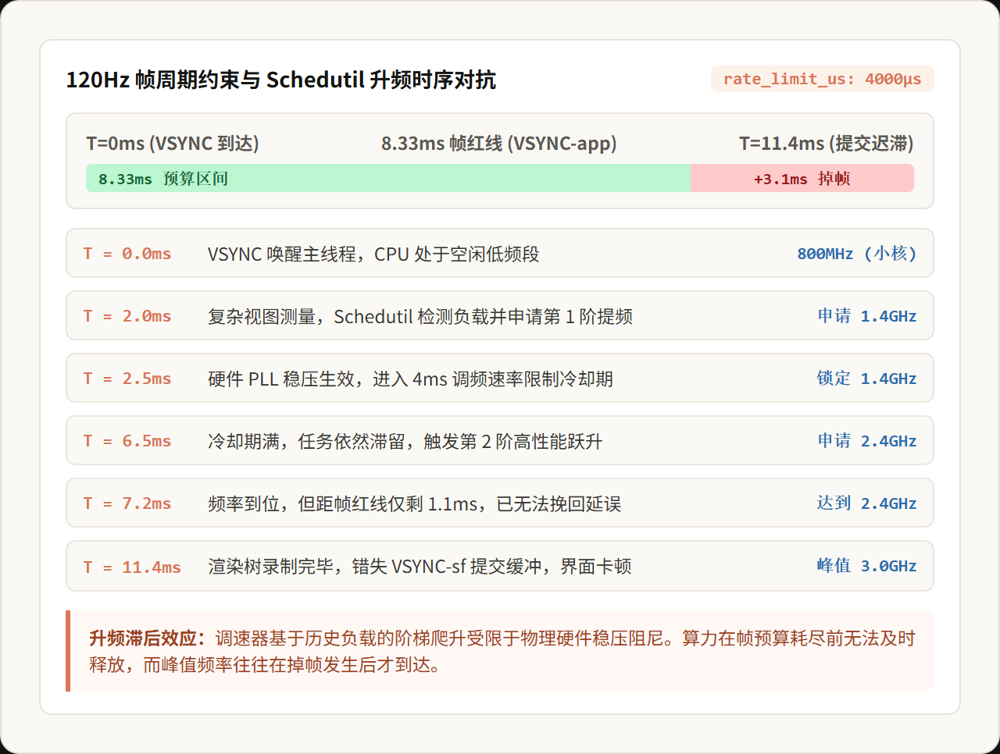
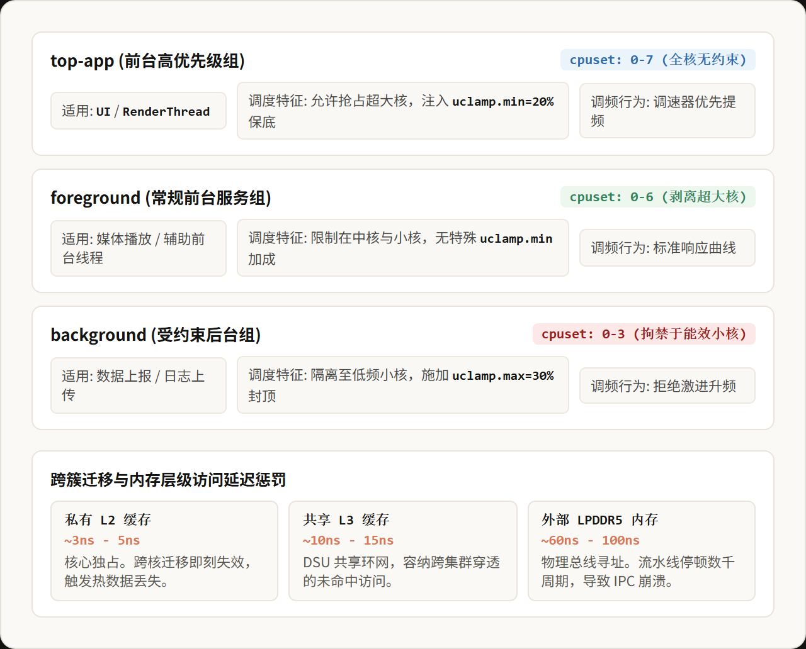

# EAS 能效调度、CPUFreq 调频延迟与 Task Cgroup 核迁移

在 Android 性能调优与卡顿治理的深度实践中，许多资深工程师都曾面对过一组极具迷惑性的监控数据：

当线上用户或线下自动化测试频繁上报滑动卡顿、丢帧告警时，我们调取设备全局状态与 APM 指标，往往会发现系统呈现出一种“看似极度闲暇”的假象：

- 全局 CPU 使用率仅在 20% 到 30% 之间徘徊，没有任何一处算力打满的迹象；
- 设备电池温度稳定在 33°C 左右，不存在机身过热降频的硬件限制；
- 系统可用内存充足，没有前后台频繁触发的低内存杀进程行为；
- 主线程的 Java 业务逻辑既没有死锁，也没有发生阻塞性的磁盘或网络同步 IO。

然而，一旦在 120Hz 高刷屏上快速滑动列表，肉眼可见的顿挫与跳帧却接踵而至。抓取卡顿瞬间的 Perfetto 跟踪记录展开分析，会发现一个不可思议的事实：原本应该在 8.33ms 内从容结束的 `Choreographer#doFrame` 调度周期，耗时竟然被硬生生拉长至 14ms 到 18ms；而在整个超时的帧周期内，主线程一直在执行标准的测量与布局计算，代码量与平时毫无二致。

面对这种反常的数据，团队内部常常陷入认知分歧：“既然 CPU 整体占用还不到三分之一，说明芯片算力完全过剩，卡顿怎么可能是 CPU 算力不足引起的？肯定是被其他未知因素阻碍了。”

这种推断建立在传统的对称多核（SMP）直觉之上。在现代移动智能终端中，这种经验直觉早已彻底失效。

现代 Android 手机的片上系统（SoC）绝非 PC 端对称多核的简单等比缩小，而是由超大核（Prime）、大核（Performance）与能效小核（Efficiency）构成的复杂异构体系。在 Linux 内核 EAS（能效感知调度器）、CPUFreq 动态调频机制以及 Android 系统级 Task Cgroup 策略的三重交织下，**25% 的平均利用率背后，完全可能潜藏着核心线程被投递至 800MHz 能效慢速核、以及升频滞后数个周期的算力饥渴困境**。

本文立足 Linux 内核源码实现、ARM 异构硬件架构与 AOSP 框架调度演进，深入拆解导致“低利用率下严重卡顿”的底层机理。



---

## 1. 认知重构：为什么“整体低负载”并不等于“算力充足”？

要理解全局 CPU 低利用率下的局部卡顿，首先必须粉碎“平均 CPU 占用率”这一指标在移动端构建的伪安全感。

### 1.1 异构多核架构与算力不对称性

在早期的 PC 与服务器架构中，处理器核心通常是对称同构的（SMP）。每个核心具备完全相同的微架构、指令吞吐能力（IPC，Instructions Per Cycle）与运行主频。在这种环境下，全局 CPU 利用率达到 25%，通常意味着系统整体负载处于健康区间。

然而，现代智能手机受限于极为严苛的功耗红线（整机功耗通常要求控制在 3W 到 5W 以内），无法承受全核心高频并发运行带来的发热。因此，自 ARM 提出 big.LITTLE 及后续的 DynamIQ 共享单元（DSU）拓扑以来，移动 SoC 全部演进为非对称异构计算集群。

以当前主流的“1+3+4”或“1+5+2”三丛集架构为例：

- **超大核丛集（Prime Cluster）**：通常搭载 1 枚超高性能核心（如 Cortex-X4），配备超宽的指令解码宽度（6 到 8 级解码）、高达 2MB 的私有 L2 缓存，峰值主频可突破 3.3GHz。其设计目标是为突发性的极端单线程任务提供瞬时吞吐能力，但能耗曲线随主频呈指数级跃升；
- **大核丛集（Performance Cluster）**：搭载 3 到 5 枚性能均衡核心（如 Cortex-A720），兼顾较高的指令吞吐与可控的能耗，主要承接前台持续性的高负载渲染与运算；
- **小核丛集（Efficiency Cluster）**：搭载 2 到 4 枚能效核心（如 Cortex-A520），采用精简的顺序执行或浅流水线乱序执行架构，私有缓存仅 512KB，主频通常限制在 800MHz 到 1.8GHz 之间。其主要使命是在超低功耗下承载后台保活与低频轮询任务。

::: info 算力断层
在相同的 1GHz 主频下，Cortex-X4 单周期的指令执行吞吐量是 Cortex-A520 能效核的 3.5 倍以上；如果叠加主频维度的落差（超大核 3.3GHz 对比小核最低调频点 800MHz），两者瞬时算力的峰值倍率差距甚至达到 **8 到 10 倍**。
:::

这意味着，**核心与核心之间是不平等的**。如果系统将一个原本需要 500 万时钟周期的复杂视图渲染任务派发给超大核运行，仅需不到 2ms 即可完成；但若将该任务分配给仅以 800MHz 维持运作的能效小核，耗时将瞬间突破 15ms，直接跨越高刷屏的帧周期红线。

### 1.2 为什么总利用率是具有欺骗性的平均数

操作系统统计的全局 CPU 使用率，通常是通过遍历 `/proc/stat` 中记录的各核心状态时间片累加平均计算得出的：

$$\text{CPU Utilization} = \frac{\sum (\text{user}_i + \text{nice}_i + \text{system}_i)}{\sum \text{total}_i}$$

在一个包含 8 个物理核心的设备上，假设核心 0 和核心 1（两枚能效小核）由于被密集计算占满，负载达到 100%；而其余 6 枚中核与超大核全部处于等待中断的空闲省电状态（WFI，Wait For Interrupt，负载为 0%），此时系统计算得出的全局 CPU 利用率仅为：

$$\text{Average Utilization} = \frac{100\% + 100\% + 0\% \times 6}{8} = 25\%$$

在监控面板上，25% 显得极其安全、从容不迫；但在微观现实中，承接关键绘制路径的主线程此时可能正死死挤在满载且主频低劣的小核上排队等待调度。**统计学上的宏观平均，掩盖了关键执行通路上微观算力的极度匮乏**。

---

## 2. 调度底色：Linux EAS 与任务放置决策

既然不同核心的算力差距如此悬殊，为什么操作系统的调度器不能“聪明地”把所有前台渲染任务无脑塞给大核与超大核呢？

这背后的博弈中枢正是 Android 系统的默认内核调度器——**EAS（Energy-Aware Scheduling，能效感知调度器）**。

### 2.1 从 CFS 到 EAS：能效感知的根本考量

传统的 Linux 桌面与服务器系统广泛采用 **CFS（Completely Fair Scheduler，完全公平调度器）**。CFS 的核心哲学是“公平”与“吞吐量最大化”。调度器维护一棵以任务虚拟运行时间（`vruntime`）为键的红黑树，尽量保证每个就绪任务获得平等的 CPU 时间片，完全不考虑当前选择的核心消耗了多少毫瓦电力。

但在电池供电的移动智能手机上，这种对能耗漠视的策略会导致灾难。如果 CFS 频繁将轻量级任务扔向超大核，手机的电量消耗与发热将呈几何级数恶化，迅速引发电池耗尽与硬件热保护降频。

为此，ARM 与 Linaro 联手主导研发了 EAS，并在 Android 核心分支中全面落地。EAS 并不追求绝对公平，而是引入了一个预先测绘好的硬件数学模型——**能量模型（Energy Model，简称 EM）**。

翻阅 Linux 内核 `kernel/sched/fair.c` 的核心调度路径，当一个休眠唤醒的任务需要寻找承载 CPU 时，EAS 会触发 `select_task_rq_fair` 进而调用 `find_energy_efficient_cpu`：

```c
/* kernel/sched/fair.c - Energy-Aware Scheduling 任务放置决策 */
static int find_energy_efficient_cpu(struct task_struct *p, int prev_cpu) {
    unsigned long prev_energy, best_energy, cur_energy;
    int best_cpu = prev_cpu;

    /* 计算保持当前放置状态下，系统整体的基线能耗 */
    prev_energy = best_energy = compute_energy(p, prev_cpu);

    for_each_energy_cpu(cpu) {
        /* 在任务合法的 CPU 亲和性掩码与拓扑丛集中遍历候选核 */
        if (!cpumask_test_cpu(cpu, p->cpus_ptr))
            continue;

        /* 试探性地将任务放入候选核心，测算全芯片预测能耗 */
        cur_energy = compute_energy(p, cpu);

        /* 只有当候选核心能在满足容量约束的前提下降低能耗，才更新目标 */
        if (cur_energy < best_energy) {
            best_energy = cur_energy;
            best_cpu = cpu;
        }
    }
    return best_cpu;
}
```

EAS 的决策逻辑可以精简为两道数学关卡：

1. **容量拟合（Capacity Fit）**：计算目标候选核心当前可提供的有效算力容量（Capacity），是否能覆盖该任务当前估算的运行需求（Task Utilization）；
2. **能耗增量测算（Energy Delta）**：遍历各个 CPU 丛集，试探性地将任务放置于该核心上，根据 Energy Model 计算系统在调频与执行后的全局总功耗。**调度器倾向于选择能让全局能耗增量最小的核心**。

::: warning 机制权衡
超大核虽然算力惊人，但其能效比（Perf per Watt）通常低于大核，更远低于中低频运转的小核。如果调度器评估当前任务的负载量不大，Energy Model 的计算结果会强力引导任务留置在能效小核或中核集群中，以换取宝贵的续航时间。
:::

### 2.2 WALT 与 PELT：历史窗口负载追踪的预判失误

EAS 在决定任务是否需要“升舱”到大核时，依赖的核心输入是**该任务的预期负载（Task Utilization）**。

调度器无法预知未来，它只能根据历史运行表现来推测任务接下来的算力开销。在主流 Android 内核中，负责衡量任务负载的算法主要有两类：

- **PELT（Per-Entity Load Tracking，实体级负载追踪）**：标准 Linux 内核机制。将物理时间划分为以 1024µs（约 1ms）为单位的窗口，任务的历史贡献按指数衰减累计，大约每过 32ms 衰减一半。其优点是平滑稳健，缺点是**对突发负载的响应极其迟钝**；
- **WALT（Window-Assisted Load Tracking，窗口辅助负载追踪）**：高通及部分芯片厂商维护的定制方案。通常以固定时长（例如一个帧周期的 16ms 或 20ms）作为一个观测统计窗口，统计任务在该窗口内累计消耗的物理 CPU 时间。

无论采用哪种机制，都存在一个共同的认知盲区：**对静止到爆发的瞬态缺乏预判能力**。

考虑用户在滑动界面的真实交互场景：

```text
[静止浏览阶段: 连续数秒无触摸]
- 主线程几乎全处于休眠状态 (epoll_wait)
- 历史窗口平均负载接近零: util_avg ≈ 0%

[手势触发瞬间: 快速向上滑动列表]
- 第 1 帧: 滑动首个复杂 Item 入屏
- 必须立刻执行 XML 反序列化、复杂的测量断行与 RenderNode 录制
- 该帧真实的瞬时算力需求: 瞬间跃升至 85%
```

在突发滑动的第 1 帧启动时，EAS 查看该主线程在过去几十毫秒内的历史记录，看到的统计数字依然是极低的 `util_avg ≈ 5%`。

调度器根据这个极低的历史数据进行 Energy Model 演算，得出结论：“这只是一个极轻量的任务，安排在能效小核的低频段运行是最省电且最完美的方案”。

结果，主线程被毫不留情地分配到小核上启动。等到当前帧执行了 6ms，系统终于发觉小核算力不足、任务迟迟未完成时，早已来不及挽救这错失的半个帧周期。

---

## 3. 调频滞后：CPUFreq 动态调频与 Schedutil 升频阻尼

如果说 EAS 的核心放置决策决定了“任务落在哪个核心上”，那么内核的 **CPUFreq（CPU 频率动态调节子系统）** 则决定了“这个核心当前以多高的速度运行”。

很多工程师以为，只要负载一上来，CPU 就会立刻拉满主频。然而在硬件物理规律与调频控制算法的双重制约下，频率的提升存在显著的时间差。



### 3.1 Schedutil 调速器的运作机理与升频步长

在早期的 Android 系统中，CPUFreq 调速器（Governor）以独立轮询的 `interactive` 或 `ondemand` 为主。它们独立于调度器，定时每隔几十毫秒去采样 CPU 利用率，反应极为迟钝。

从 Android 9 / Linux 4.9 时代起，AOSP 强制普及了 **schedutil 调速器**。schedutil 直接整合到了调度器内部，每当任务入队、出队或状态变化更新负载时，直接触发频率评估函数：

```c
/* kernel/sched/cpufreq_schedutil.c - Schedutil 目标频率选取算法 */
static unsigned int get_next_freq(struct sugov_policy *sg_policy,
                                 unsigned long util, unsigned long max) {
    unsigned int freq = arch_scale_freq_invariant() ?
        sg_policy->policy->cpuinfo.max_freq : sg_policy->policy->cur;

    /* Schedutil 目标计算公式: 保持 1.25 倍的算力余量冗余 */
    freq = (freq + (freq >> 2)) * util / max;

    if (freq > sg_policy->policy->max)
        freq = sg_policy->policy->max;

    return freq;
}
```

其计算逻辑非常直观：核心目标频率等于 `1.25 × 当前利用率占比 × 硬件最大频率`。预留 25% 的冗余（Headroom）是为了让任务有空间继续爬升。

然而，频率不可能在每次计算后无限即时调整。芯片硬件的锁相环（PLL，Phase-Locked Loop）改变输出振荡频率并稳定供电电压需要消耗时间与物理电荷。如果在微秒级别内频繁升降频，硬件稳压电容的充放电损耗甚至会超过运算本身。

为此，schedutil 内置了严格的调频阻尼参数——**速率限制周期（`rate_limit_us`）**。

在绝大多数商业设备的内核配置中，`rate_limit_us` 被设定在 **2000µs（2ms）到 10000µs（10ms）** 之间。这意味着：一旦内核向底层时钟与供电子系统（Clock & Regulator）发送了一次频率调整指令，在接下来的数毫秒窗口内，调速器将进入冷却锁定期，拒绝接受新的调频申请。

### 3.2 突发负载与 8.3ms 帧预算的时间差博弈

当我们把 120Hz 屏幕的 8.33ms 帧生命周期，与 CPUFreq 的调频阶梯并置在同一时间线上时，就会发现一条残酷的时间裂缝：

::: info 调频与帧周期的微观对抗

1. **$T_0 = 0\text{ms}$（VSYNC 到达）**：主线程从休眠中唤醒。此时核心由于之前处于空闲状态，运行在最低节能主频（例如小核 800MHz，大核 1.1GHz）；
2. **$T_1 = 2\text{ms}$**：主线程执行密集的复杂 View 测量。由于核心处于低频运行，指令处理极慢，任务队列出现堆积。schedutil 检测到负载上升，发出第 1 阶提频指令（提升至 1.4GHz）；
3. **$T_2 = 2.5\text{ms}$**：底层硬件稳压完成，频率升至 1.4GHz；同时调速器触发 `rate_limit_us` 冷却锁定（假设为 4ms）；
4. **$T_3 = 6.5\text{ms}$**：冷却期结束。主线程的任务依然积压未完，schedutil 发出第 2 阶提频指令，申请跃升至 2.4GHz；
5. **$T_4 = 7.2\text{ms}$**：核心终于攀升至 2.4GHz 的高性能状态。然而此时留给整帧计算的剩余预算仅剩 **1.1ms**，即使算力全开，也无法在 8.33ms 的截止点前完成布局与渲染树录制；
6. **$T_5 = 11.4\text{ms}$**：当前帧终于提交。然而 VSYNC 脉冲早已错失，屏幕被强制拉长展示前一帧画面，卡顿已成定局。
   :::

在很多掉帧现场的 Perfetto 轨迹中，我们可以清晰观察到：**在掉帧结束后的那一瞬间，CPU 频率反而飙到了最高点**。

这就形成了滑稽的“调频马后炮”：最需要算力的关键时刻，CPU 在慢条斯理地爬升阻尼阶梯；等到掉帧造成、界面已经卡死之后，高频算力才姗姗来迟，无谓地浪费电量。

---

## 4. 空间隔离：Task Cgroup、CPUset 与核迁移风暴

除了能效算法与调频滞后，Android 操作系统在用户空间针对进程施加的资源隔离机制，也是导致算力受限的隐蔽幕后推手。



### 4.1 Top-App、Foreground 与 Background 的 CPUset 拓扑

Linux 内核提供了 **Cgroups（控制组）** 机制以实现系统资源的层级限制。Android 在此基础上深度定制了针对移动端进程生命周期的管理模型——**Task Profiles / Sched Policy**。

在 Android 系统中，系统服务 `ActivityManagerService` 与 `OomAdjuster` 会根据进程的前后台状态、窗口可见性与交互焦点，将其动态归类到不同的控制组中：

- **`top-app`（顶层交互组）**：当前获得用户焦点、处于屏幕最前台的进程。为了保证流畅度，其关联的 `cpuset` 通常被配置为允许访问设备的所有物理核心（Cores 0-7）；
- **`foreground`（普通前台组）**：没有直接与用户交互的前台服务进程。其允许调度的核心集合通常被剔除掉超大核，仅允许使用中核与小核；
- **`background`（纯后台组）**：被切入后台、用户不可见的进程。系统通过 `cpuset` 强制将其拘禁在能效小核（例如仅允许运行在 Cores 0-3），彻底断绝其抢占大核算力的可能。

在 Android 原生底层库 `system/core/libprocessgroup/sched_policy.cpp` 中，我们可以看到系统对进程状态切换的底层调度绑定：

```cpp
// system/core/libprocessgroup/sched_policy.cpp - 进程策略核心配置
int set_sched_policy(int tid, SchedPolicy policy) {
    switch (policy) {
        case SP_TOP_APP:
            // 顶层焦点应用：解除核绑定，配置高优先级与调度预留
            set_cpuset_policy(tid, "/dev/cpuset/top-app");
            set_uclamp_min(tid, 20); // 注入 20% 的算力底线约束
            break;
        case SP_BACKGROUND:
            // 后台应用：强制约束在能效小核，封锁上限
            set_cpuset_policy(tid, "/dev/cpuset/background");
            set_uclamp_max(tid, 30); // 算力上限锁死在 30%
            break;
        default:
            set_cpuset_policy(tid, "/dev/cpuset/foreground");
            break;
    }
    return 0;
}
```

在大部分正常情况下，当前正在交互的 App 处于 `top-app` 组。然而在工程实战中，以下异常流转会导致严重的算力封锁：

1. **多 Window / 悬浮窗切换时的 Cgroup 状态失真**：当 App 处于复杂画中画、透明弹窗或特定的跨进程组件联动时，如果系统焦点判断产生微小偏差，主进程可能被误判为普通的 `foreground`，导致关键的渲染链路瞬间丢失对超大核的访问权限；
2. **异步工作线程遗漏提权**：很多开发者在主线程通过协程或线程池分派并行排版计算任务时，新建的底层线程并未继承主线程的调度特征，甚至由于创建时机过早，依然被锚定在较低的 cgroup 配置中，导致并行算力严重失衡。

### 4.2 跨簇调度（Inter-Cluster Migration）引起的 L2/L3 缓存失效

即便任务拥有全核心的访问权限，如果调度器在短时间内频繁让线程在不同的物理核心集群之间“来回跳跃”，就会引发隐形的**缓存颠簸（Cache Thrashing）**。

在现代 ARM CPU 微架构中，缓存层级具有强烈的物理本地性：

- 每枚 Cortex-X 超大核与 Cortex-A720 大核都配备独立的 **私有 L2 缓存（通常为 1MB 到 2MB）**，其访问延迟仅为几个时钟周期（约 3ns 到 5ns）；
- 多个核心之间通过 DynamIQ 共享 **L3 缓存（通常为 4MB 到 8MB）**，延迟在 10ns 到 15ns 左右；
- 外部 LPDDR5 物理内存的访问延迟则长达 60ns 到 100ns。

当一个主线程正在大核 4 上紧密执行 RecyclerView 的数据绑定与文本布局时，其涉及的 Model 数据结构、Paint 对象属性与字体字形缓存（Glyph Cache）已经被大面积加载到了大核 4 的私有 L2 缓存中。

此时，由于主线程发生了一次短暂的微秒级同步锁等待（例如主线程向渲染线程递交任务时的瞬时唤醒），EAS 调度器介入。如果调度器依据当前的全局能耗最优解，将刚刚唤醒的主线程重新放置到了小核 1 上：

- 小核 1 的私有 L2 缓存内完全没有先前的上下文数据，命中率暴跌为 0%；
- 主线程的每一次内存寻址都不得不穿透到高延迟的 L3 甚至外部 DRAM 内存总线；
- CPU 流水线因为密集的缓存未命中（Cache Miss）而陷入长达数千个时钟周期的等待停滞（Stall）。

在 Perfetto 的 CPU 计数器（PMC）指标中，这种现象表现为 **IPC 指标断崖式下跌**。表面看线程依然在 CPU 上处于 Running 状态，实际上一半以上的有效时钟周期都消耗在从总线搬运内存数据的空耗中。

---

## 5. 破局之道：现代 Android 算力确定性治理

搞清楚了 EAS 任务放置、CPUFreq 调频阻尼与 Cgroup 空间隔离的底层机理，我们在排查“CPU 低占用率下的卡顿”时，就不再是盲人摸象。治理这一问题的核心目标，是**在关键帧周期内，建立确定性的算力交付通道**。

### 5.1 善用 ADPF 与 PerformanceHintManager 的主动提频

如前文所述，导致 CPUFreq 调频滞后的根源在于调速器只能被动观察历史。为了彻底打破这种被动轮询的滞后性，Google 自 Android 12 起引入、并在 Android 13/14 持续深化的核心架构正是 **ADPF（Android Dynamic Performance Framework，Android 动态性能框架）**。

ADPF 的杀手级能力是 **`PerformanceHintManager`**。它允许应用进程绕过缓慢的内核历史窗口采样，直接向底层硬件供应商的 PowerHAL 提供实时帧耗时遥测数据：

```kotlin
// Android 13+ 基于 ADPF 的主动帧耗时遥测机制
class FramePerformanceAdvisor(context: Context) {
    private val hintManager = context.getSystemService(PerformanceHintManager::class.java)
    private var hintSession: PerformanceHintManager.Session? = null

    /**
     * 将界面关键线程纳入 Hint 会话管理
     * @param targetDurationNanos 目标帧周期 (如 120Hz 下为 8_333_333L 纳秒)
     */
    fun bindRenderPipeline(uiThreadId: Int, renderThreadId: Int, targetDurationNanos: Long) {
        val targetThreads = intArrayOf(uiThreadId, renderThreadId)
        hintSession = hintManager?.createHintSession(targetThreads, targetDurationNanos)
    }

    /**
     * 在 Choreographer 回调末尾主动上报当前帧的真实总耗时
     */
    fun onFrameRendered(actualDurationNanos: Long) {
        val session = hintSession ?: return

        // 主动向硬件驱动发送算力反馈
        // 若实际耗时接近或超出目标阈值，PowerHAL 将直接跳过调频阻尼，在下一帧瞬间拉升核心主频
        session.reportActualWorkDuration(actualDurationNanos)
    }
}
```

其运作逻辑的优雅之处在于建立了闭环通信：

- 当应用感知到上一帧的实际耗时逼近或突破了 8.33ms 预算，它通过 `reportActualWorkDuration` 明确告知系统底层：“当前负载已超出常态，请立刻提供算力援助”；
- 接收到底层遥测的 PowerHAL 会直接给 EAS 调度器与 CPUFreq 注入临时的**提频偏置（Freq Boost Bias）**，在下一帧到来时直接以 2GHz+ 的高频就绪，完全斩断了数个周期的爬坡延迟。

### 5.2 核心线程的优先级管理与 UClamp 算力锚定

在应用层，确保核心线程具备正确的调度属性是避免被抛掷到慢速小核的第一道门槛。

自 Android 11 起，AOSP 在 Linux 内核层面全量启用了 **UClamp（Utilization Clamping，利用率限制）** 机制。UClamp 取代了过往粗暴的强绑定或单纯的 Nice 值计算，通过两个核心参数约束调度：

- `uclamp.min`：任务的算力保底线。调度器在为任务寻找核心时，如果该任务的 `uclamp.min` 为 30%，即使它过去的历史负载为 0%，调度器也会强制将其视为具备 30% 负载的高需求任务，直接触发大核分配；
- `uclamp.max`：任务的算力上限。主要用于后台保活线程，防止其突发失控抢占前台资源。

在应用代码中，我们必须规范线程优先级的配置：

```kotlin
// 规范后台关键计算线程的调度优先级，确保映射正确的 uclamp 特征
val CriticalWorkDispatcher = Executors.newFixedThreadPool(
    Runtime.getRuntime().availableProcessors().coerceAtMost(3)
) { targetRunnable ->
    Thread {
        // 设置为 DISPLAY 级别的严格前台优先级
        // 底层将直接映射为 Linux 负 Nice 值 (-4)，并激活 frameworks 分配的 uclamp.min 保底
        android.os.Process.setThreadPriority(
            android.os.Process.THREAD_PRIORITY_DISPLAY
        )
        targetRunnable.run()
    }.apply {
        name = "critical-layout-thread"
        isDaemon = true
    }
}.asCoroutineDispatcher()
```

::: tip 避坑要点
千万不要使用标准的 Java `Thread#setPriority(1..10)`，该方法在 Android 运行时中对底层 Linux 调度策略的影响极其微弱；必须通过 `android.os.Process.setThreadPriority()` 设置符合 Android 语义的常量（如 `THREAD_PRIORITY_DISPLAY` 或 `THREAD_PRIORITY_URGENT_DISPLAY`）。
:::

### 5.3 线程池弹性收敛：消除调度队列竞争

很多工程师为了加速页面打开或滑动，会在主线程之外开启大量并行协程去异步加载数据、解析图片与构造视图。

这种做法极其容易适得其反，诱发**调度队列雪崩**：

```text
[无序多线程爆发]
- 开启 16 个并发协程执行复杂数据解析
- 瞬间向就绪队列 (Runqueue) 灌入大量就绪任务
- EAS 调度器被迫将各个就绪任务迅速分散到各个核心上抢占配额
- 主线程与渲染线程在大核上被这些突发的并发工作线程轮流打断上下文
- 调度器为了平衡能耗，最终将关键的主线程驱逐到了小核队列中
```

为此，大型商业应用必须贯彻严格的**线程治理规范**：

- **根据物理核心拓扑精简线程池规模**：计算型线程池的最大并发数绝对不要粗暴设置为 `availableProcessors()`。在 8 核手机上，真正具备强算力的高性能大核往往只有 3 到 4 枚。计算型线程池的上限建议严格限制在 2 到 3 个，避免向调度器注入过载的并发实体；
- **锁竞争降级**：坚决排查主线程在关键帧路径上持有的同步锁。任何微小的同步锁争抢，都会直接让出 CPU 执行权，使主线程陷入休眠。一旦重新唤醒，就必须重新经历 EAS 的任务放置与冷缓存惩罚。

### 5.4 在 Perfetto 中精确诊断调度延迟与核状态

最后，建立一套科学的 Perfetto 定位手段，是破除“低利用率谜团”的终极法宝。面对疑似由于调度引起的卡顿，建议严格执行以下四步排查链路：

::: tip 调度问题排查建议

1. **查看主线程的状态条形图（Thread State Track）**：
   - 聚焦在掉帧对应的那一帧 `Choreographer#doFrame` 切片；
   - 观察颜色分布：如果是深绿色（`Running`），说明正在执行代码；如果是浅蓝色（`Runnable`），**请立刻警觉**——这代表主线程此时代码已经就绪、急需运算，但 Linux 调度队列没有给它分配 CPU 核心；
   - 如果一帧中 `Runnable` 状态累计超过 2ms 到 3ms，说明遭遇了严重的调度挤压或核争抢；
2. **核对物理核心 ID（CPU Allocation）**：
   - 点击卡顿区间内的 `Running` 切片，在下方属性面板中查看其运行所在的物理核心编号（CPU 0 到 CPU 7）；
   - 对照设备的 SoC 规格表：如果关键测量代码正运行在 CPU 0 到 CPU 3（能效小核）上，即可直接确认为任务放置失配；
3. **拉出 CPU 频率轨道（CPU Frequency Track）**：
   - 在 Perfetto 顶部展开 `CPU Freq` 分组，找到承载主线程的核心所在集群的实时主频曲线；
   - 查看在主线程处于高负荷运算的这几毫秒内，该集群的频率曲线是平直趴在 800MHz 底线，还是已经迅速拉满到最高阶？如果处于低频平直状态，确诊为调频滞后；
4. **追查上下文切换源头（Context Switches）**：
   - 检查卡顿区间内的 `sched_switch` 与 `sched_wakeup` 锚点；
   - 确认是哪个后台线程在关键时刻抢占了大核，或者主线程被哪把同步锁挂起引发了跨核迁移。
     :::

现代移动端性能优化，早已不再局限于“压减主线程 Java 代码耗时”这一单一维度。在异构多核、能耗红线与动态调频深度纠缠的复杂体系下，**理解内核能效调度算法的边界、消除调频阻尼的时序裂隙、保障关键线程的算力通道，才是真正将高刷体验推向极致的工程真谛**。

## 参考资料

- [Energy Aware Scheduling in Linux Kernel](https://www.kernel.org/doc/html/latest/scheduler/sched-energy.html)（Kernel Documentation · 2024-01）
- [Android Dynamic Performance Framework (ADPF)](https://developer.android.com/games/optimize/adpf)（Android Developers · 2024-06）
- [Managing CPU Utilization Clamping (UClamp)](https://source.android.com/docs/core/perf/uclamp)（Android Open Source Project · 2023-09）
- [Understanding CPU Sched and Frequency in Perfetto](https://perfetto.dev/docs/data-sources/cpu-freq)（Perfetto Project · 2024-04）
