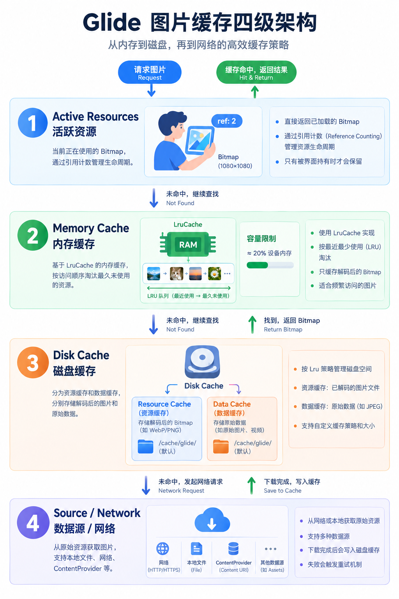
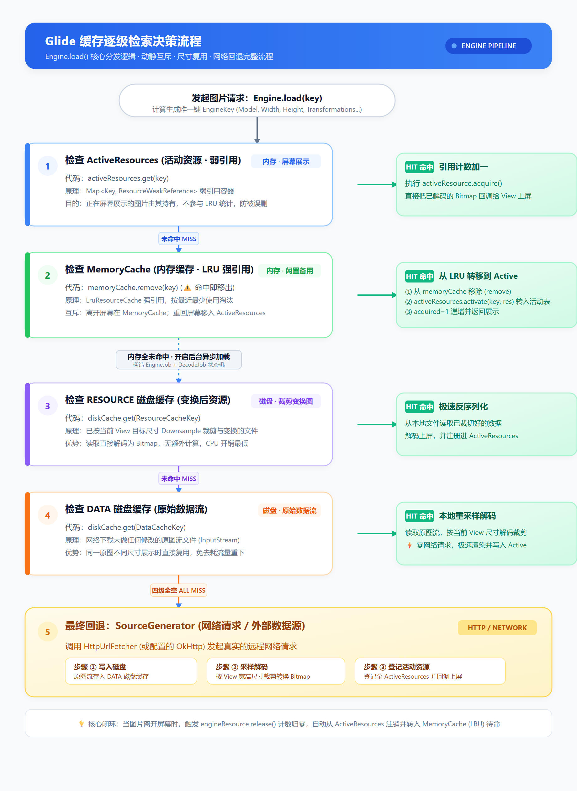
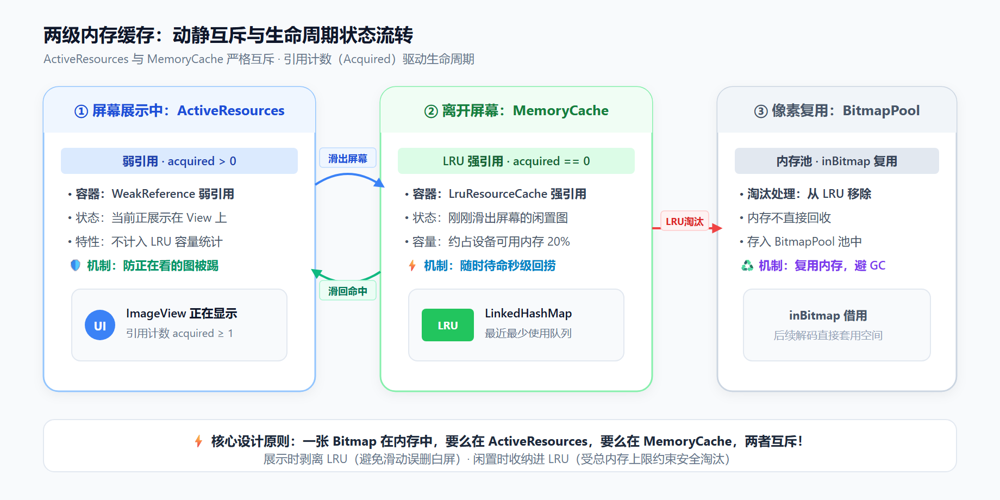
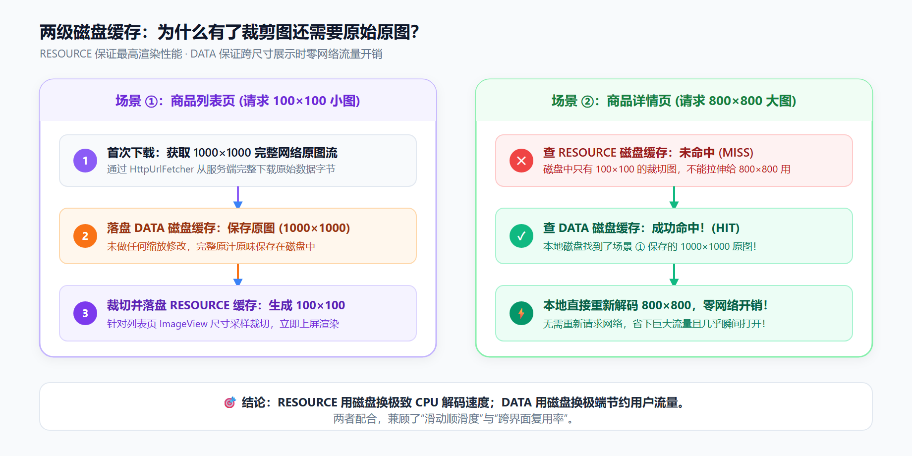

# Glide四级缓存

Glide 的缓存体系按 **两级内存 + 两级磁盘** 划分。设计核心在于：**在用与闲置内存互斥，磁盘按尺寸变换分层**。

---

## 缓存架构



---

## 检索决策流程

图片请求经由 `Engine.load()` 进入分发，依次执行四级检查：



### 0. 生成缓存键 EngineKey

在检索缓存前，Glide 依据请求参数构造出唯一的 `EngineKey`：

```java
EngineKey key = keyFactory.buildKey(
    model,              // 图片源地址或资源ID
    signature,          // 签名（如版本号）
    width, height,      // 目标 View 的实际宽高
    transformations,    // 几何变换（如圆角、Crop）
    resourceClass, transcodeClass,
    options
);
```

---

### 第一级：ActiveResources（活动缓存 · 弱引用）

`Engine.load()` 首先查询活跃资源表：

```java
// Engine.java
private EngineResource<?> loadFromActiveResources(Key key) {
  EngineResource<?> active = activeResources.get(key);
  if (active != null) {
    active.acquire(); // 引用计数 +1
  }
  return active;
}
```

- **实现结构**：`Map<Key, ResourceWeakReference> activeEngineResources`。
- **设计目的**：正在屏幕上展示的图片由其持有，不参与 LRU 统计，避免在后台加载新图时被误踢白屏。

---

### 第二级：MemoryCache（内存缓存 · LRU 强引用）

活动缓存未命中，继续查 LRU 内存缓存：

```java
// Engine.java
private EngineResource<?> loadFromMemory(EngineKey key, boolean isMemoryCacheable) {
  // 1. 从 LruResourceCache 中取出
  EngineResource<?> cached = getEngineResourceFromCache(key);
  if (cached != null) {
    cached.acquire(); // 引用计数 +1
    // 2. 转移到 ActiveResources 弱引用表中
    activeResources.activate(key, cached);
  }
  return cached;
}

private EngineResource<?> getEngineResourceFromCache(Key key) {
  // ⚠️ 注意：此处是 remove，而不是单纯读取
  Resource<?> cached = memoryCache.remove(key);
  if (cached == null) return null;
  return new EngineResource<>(cached, true, true, key, this);
}
```

- **实现结构**：`LruResourceCache`（继承自 `LruCache`，底层基于 `LinkedHashMap`）。
- **互斥转移**：命中后立即从 `MemoryCache` 移除并转入 `ActiveResources`。

---

### 异步线程调度：DecodeJob 状态机

内存两级均未命中，Glide 提交后台任务，通过 `DecodeJob` 状态机流转磁盘与网络阶段：

```java
// DecodeJob.java
private Stage getNextStage(Stage current) {
  switch (current) {
    case INITIALIZE:
      return diskCacheStrategy.decodeCachedResource()
          ? Stage.RESOURCE_CACHE : getNextStage(Stage.RESOURCE_CACHE);
    case RESOURCE_CACHE:
      return diskCacheStrategy.decodeCachedData()
          ? Stage.DATA_CACHE : getNextStage(Stage.DATA_CACHE);
    case DATA_CACHE:
      return Stage.SOURCE; // 磁盘全空，走网络数据源
    ...
  }
}
```

---

### 第三级：RESOURCE 磁盘缓存（处理后文件）

状态机优先执行 `ResourceCacheGenerator`：

```java
// ResourceCacheGenerator.java
File cacheFile = helper.getDiskCache().get(currentKey);
if (cacheFile != null) {
  // 读取已完成裁剪、缩放与圆角变换的文件
  loadData = modelLoader.buildLoadData(cacheFile, helper.getWidth(), helper.getHeight(), helper.getOptions());
}
```

- **特点**：已对齐目标 View 宽高。直接解码为 Bitmap，无额外矩阵运算，解码开销最低。

---

### 第四级：DATA 磁盘缓存（原始文件流）

未命中则流转至 `DataCacheGenerator`：

```java
// DataCacheGenerator.java
File cacheFile = helper.getDiskCache().get(new DataCacheKey(helper.getSourceKey(), helper.getSignature()));
if (cacheFile != null) {
  // 读取网络下载的原始流文件 (未缩放)
  loadData = modelLoader.buildLoadData(cacheFile, helper.getWidth(), helper.getHeight(), helper.getOptions());
}
```

- **特点**：存储网络下载的原汁原味二进制流。当同张图以不同尺寸再次请求时，可直接在本地重新采样裁剪，免去网络请求。

---

### 第五级：SourceGenerator（网络数据源）

四级缓存全空，由 `SourceGenerator` 发起网络请求：

```java
// SourceGenerator.java
// 1. 调用 HttpUrlFetcher 从网络拉取原始流
// 2. 根据 DiskCacheStrategy 写入磁盘（DATA 或 RESOURCE）
// 3. 解码上屏，并将资源注册进 ActiveResources (acquired = 1)
```

---

## 内存两级缓存：动静互斥与引用计数

如果仅保留一层 LRU 内存缓存，快速滑动时后台加载的新图容易挤出屏幕上正在展示的 Bitmap，造成白屏或访问已回收内存。因此 Glide 采用双内存层设计：



### 引用计数流转源码

```java
// 1. View 开始展示图片：
engineResource.acquire(); // acquired++
activeResources.activate(key, engineResource); // 登记入活动表

// 2. View 离开屏幕或加载新图：
engineResource.release(); // acquired--
if (acquired == 0) {
  activeResources.deactivate(key);      // 从弱引用活动表注销
  memoryCache.put(key, engineResource); // 转存进 MemoryCache (LRU 强引用)
}
```

- **上屏展示**：`acquired > 0`，驻留 `ActiveResources`（弱引用），不计入 LRU 缓存上限。
- **移出屏幕**：`acquired == 0`，注销后移入 `MemoryCache`（LRU 强引用），参与内存容量调度。
- **二次上屏**：命中 `MemoryCache` 时立刻 `remove` 出 LRU，重新加入 `ActiveResources`。
- **互斥特性**：一张图片在内存中，**要么在 ActiveResources，要么在 MemoryCache，两者不会同时存在**。

---

## 磁盘两级缓存：性能与流量的权衡

磁盘划分 RESOURCE 与 DATA 两级的目的，是为了在 **解码性能** 与 **网络流量** 之间取得平衡：



- **RESOURCE 缓存（处理后文件）**：
  文件尺寸与目标 `ImageView` 精确对齐。读取时无需再做缩放计算，牺牲一部分磁盘存储换取列表滑动的帧率与流畅度。
- **DATA 缓存（原始文件）**：
  存储未经过尺寸变换的网络原始流。当同张图片在不同页面（如列表 100×100 与详情 800×800）展示时，直接从本地 DATA 缓存提取原图二次采样，**避免重复消耗手机网络流量**。

---

## 交互演示：检索沙盘

滑动下方步骤，右侧 FIG 看板同步展示各阶段命中与流转状态：

::::scrolly
:::step 01 · 活动资源 (ActiveResources)
图片请求发起时，`Engine.load()` 首先查询 `ActiveResources`。这里存储的是正在被 View / Target 消费的图片（内部通过 WeakReference 持有，引用计数 `acquired > 0`）。活动资源不参与 LRU 容量统计，从根本上杜绝了正在屏幕上显示的 Bitmap 被后台大图挤出内存的问题。
:::
:::step 02 · 内存缓存 (MemoryCache)
活动缓存未命中，接着查 `LruResourceCache`（基于内存的 LRU 缓存）。若命中，说明这张图刚被用过（滑出屏幕后引用计数归 0），Glide 会将其**从 MemoryCache 中移除并转移到 ActiveResources**，引用计数置为 1，供当前 Target 展示。若内存吃紧，未被命中的旧图片会被 LRU 逐出，其像素内存交由 `BitmapPool` 待机复用。
:::
:::step 03 · 磁盘资源缓存 (DiskCache RESOURCE)
内存中均无此图，说明需要读取本地持久化存储。`ResourceCacheGenerator` 优先查找经过尺寸裁剪、旋转及 Transformation（如圆角）处理后的磁盘文件。因为该文件尺寸和格式完全匹配目标 ImageView，解码时无需二次计算与变换，速度最快。
:::
:::step 04 · 磁盘原始数据 (DiskCache DATA)
如果对应尺寸的 RESOURCE 磁盘缓存不存在，`DataCacheGenerator` 继续查找磁盘中的原始文件数据（未经缩放与变换的网络原流）。若命中，Glide 会直接从本地读取原始流并根据当前 View 尺寸进行采样解码，省下了耗费网络流量的开销。
:::
:::step 05 · 网络回退 (SourceGenerator)
四级缓存全未命中，`SourceGenerator` 启动 HTTP 网络请求。获取到原始数据流后：① 写入磁盘缓存（根据 `DiskCacheStrategy` 写入 DATA 或 RESOURCE）；② 进行解码、采样并渲染上屏；③ 将产出的 `EngineResource` 登记到 `ActiveResources` 中。
:::
::::
