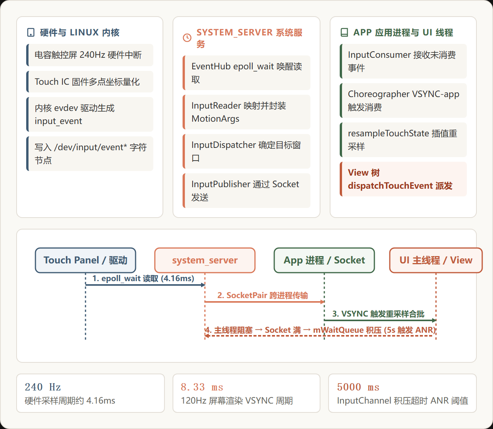
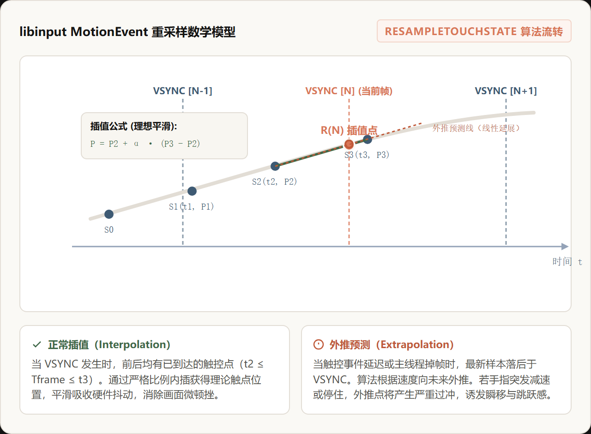
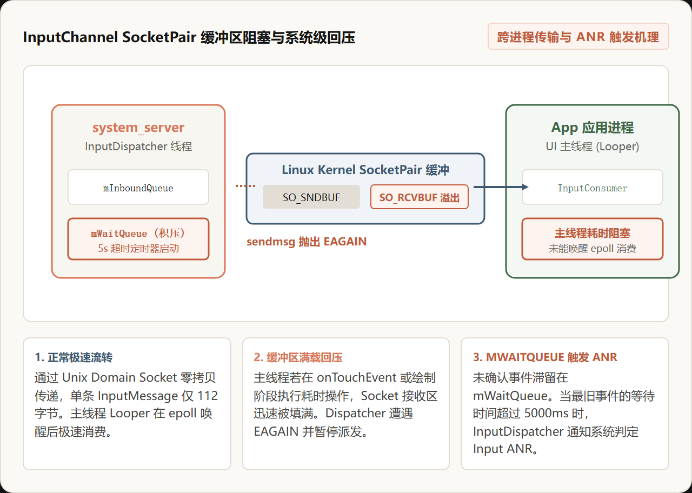
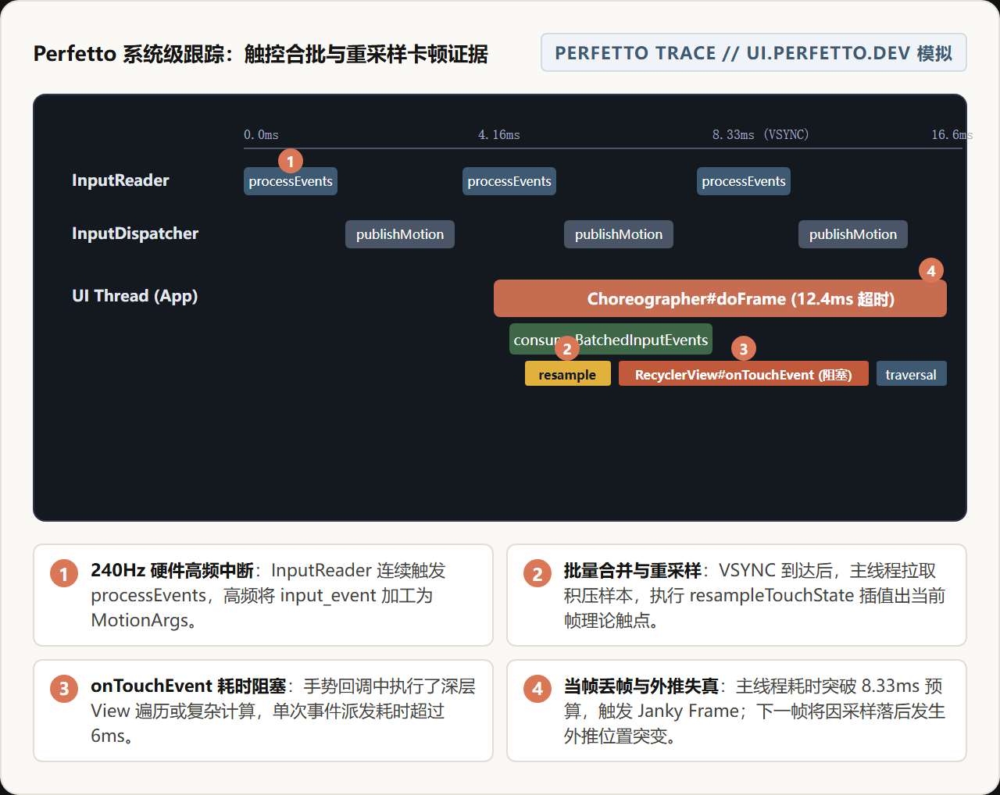

# InputReader 内核采集、SocketPair 与 MotionEvent 重采样

在 Android 移动设备的硬件演进历程中，“触控采样率”与“屏幕刷新率”始终是衡量终端交互体验最为直观的性能指标。从早期的 60Hz 屏幕搭配 120Hz 触控采样，到当今旗舰机型普及的 120Hz 高刷屏与 240Hz、360Hz 乃至 480Hz 的超高频触控芯片，硬件厂商在触控芯片与面板驱动层投入了海量的研发资源。

在许多开发者的工程直觉中，面对一套触控采样率高达 240Hz 的硬件系统，手势交互的流畅度似乎早已有了一套理所应当的确定性逻辑：

“屏幕刷新率是 120Hz，意味着每隔约 8.33 毫秒渲染一帧画面；而触控芯片以 240Hz 的超高频率采样，每隔约 4.16 毫秒就会向系统上报一次手指的物理坐标。硬件采样的密度达到了屏幕刷新密度的整整两倍，每一次手指划过屏幕，系统都能以极低的时延获取指尖位置，列表滑动（Scroll / Fling）与手势拖拽理应丝滑顺手，绝无卡顿或迟滞的可能。”

更进一步，在排查界面掉帧与微小卡顿（Micro-stutter）时，如果开发者查验主线程的耗时统计，发现主线程在大多数绘制周期内都能在 5 到 7 毫秒内完成测量与绘制，大家通常会直接排除触控链路的嫌疑，转而怀疑是不是动画插值器不平滑或者 GPU 发生偶发降频。

然而，翻开大型商业应用在高端机型上收集的真实用户体验反馈，我们经常能收到这样的抱怨：

用户在快速滑动短视频瀑布流、长文本图文资讯或电商商品列表时，界面在没有发生明显丢帧的情况下，手指却明显感觉“跟手性差”、“滑动顿挫”，甚至在手指离开屏幕或停顿的瞬间，列表内容出现肉眼可见的“轻微回弹”或“瞬移飞跃”；而在某些复杂界面中，手指仅仅是轻微划过屏幕，系统甚至会突发性地抛出极为严重的 `Input dispatching timed out`（输入派发超时 ANR）。

抓取对应的系统级 Perfetto 跟踪切片后，更令人困惑的现象浮出水面：主线程没有执行繁重的布局测量，也没有发生频繁的 GC 停顿，主线程的大量时间甚至消耗在名为 `consumeBatchedInputEvents` 与 `resampleTouchState` 的原生方法中；而在发生 ANR 的时刻，主线程的 Java 调用栈竟然平静地休眠在 `MessageQueue.nativePollOnce` 上。

硬件采样率明明已经高达 240Hz，为什么手势滑动依然会频繁遭遇顿挫与延迟？UI 主线程在处理轻盈的触摸事件时，究竟遭遇了哪些看不见的性能陷阱？

这种认知反差的根源，在于将“硬件物理采样频率”粗暴地等同于“屏幕呈现与渲染频率”，同时忽略了现代 Android 输入系统（Android Input Pipeline）内部三套交织运行的核心机制：**Linux 内核 `evdev` 与 `system_server` 的跨进程 SocketPair 通信管道**、**`libinput` 与 `Choreographer` 协同驱动的 `MotionEvent` 插值与外推重采样算法（Resampling）**，以及**输入缓冲区满载诱发的系统级回压（Backpressure）机制**。

本文结合 Linux 内核输入驱动、Android 框架层原生 C++ 源码（`InputReader.cpp`、`InputDispatcher.cpp`、`InputConsumer.cpp`）以及上层 `ViewRootImpl` 逻辑，全面拆解触控事件从硬件电容屏到达像素着色的全链路机理。



---

## 1. 认知重构：触控事件的全链路流转与频率失配困境

要弄清手势为什么会在高频采样下产生顿挫，首先需要打破对触控事件“瞬时直达 View 树”的浅层想象，理解电容屏硬件中断与操作系统显示垂直同步信号（VSYNC）之间的天然失配矛盾。

### 1.1 从物理电容屏到内核：evdev 与 struct input_event

当用户的指尖按压或滑过手机屏幕时，电容感应矩阵的电荷分布发生改变，触控控制器芯片（Touch IC）以硬件时钟为基准周期性扫描互感电容阵列，完成噪声滤波与多点触控（Multi-touch）坐标解算。

解算出物理坐标后，Touch IC 通过硬件中断引脚（INT Pin）向手机 SoC 处理器发起中断请求，驱动程序通过 I2C 或 SPI 总线读取寄存器中的原始坐标数据包。

在 Linux 内核层，输入子系统（Linux Input Subsystem）统一抽象了各类硬件输入设备：

```c
struct input_event {
    struct timeval time;
    __u16 type;
    __u16 code;
    __s32 value;
};
```

驱动程序遵循 Linux 多点触控协议（Multi-touch Protocol Type B），将一次手指触摸动作分解为一系列细分事件帧：
通过 `EV_ABS` 类型的 `ABS_MT_SLOT` 区分不同手指，`ABS_MT_TRACKING_ID` 标识触摸轨迹的生命周期，配合 `ABS_MT_POSITION_X` 与 `ABS_MT_POSITION_Y` 传递坐标，最后通过 `EV_SYN`（`SYN_REPORT`）向内核字符设备节点 `/dev/input/event*` 提交一次完整的硬件扫描帧。

### 1.2 采样率与刷新率的天然时钟异步：240Hz vs 120Hz/60Hz

现代智能手机拥有两个完全独立的硬件晶振与控制回路：

1. **触控输入回路**：由 Touch IC 的独立晶振驱动，以 240Hz（周期约为 4.16ms）无间断采样；
2. **显示渲染回路**：由显示控制器（Display Controller）与屏幕驱动芯片（DDIC）根据当前刷新率（如 120Hz，周期约为 8.33ms）发出硬件 VSYNC 信号。

这两个回路在时钟相位上是**完全异步且相互解耦**的：

- 触控硬件产生坐标的瞬间，屏幕驱动芯片可能正处于一帧画面扫描的中间阶段；
- 当屏幕垂直同步信号 VSYNC-app 到达、通知 UI 主线程开始绘制下一帧画面时，上一笔触控输入可能刚刚到达 0.5 毫秒，也可能已经到达了 3.8 毫秒。

这种时钟相位的随机偏移与频率失配，给操作系统带来了一个根本性的工程两难：

如果系统将 240Hz 的硬件触控事件“来一个就向应用派发一个”，UI 主线程每秒钟将被唤醒 240 次。不仅大量的 CPU 时间会被浪费在解析轻微的移动位移上，每一次 `onTouchEvent` 触发的重绘请求更会将 Looper 消息队列彻底灌满，导致测量、布局与动画计算被严重推迟。

反之，如果系统选择将事件积压并批量合并，在每一帧 VSYNC 信号到来时，应用主线程究竟该选取哪一个坐标来更新列表位移？如果直接选取最新到达的样本，触控事件到达时间与 VSYNC 信号之间的相位抖动（Phase Jitter），将瞬间转化为屏幕上位移距离的不均匀缩放，直接诱发视觉顿挫。

### 1.3 宏观架构全景：Hardware → Kernel → system_server → App UI Thread

为了在削减高频事件处理开销的同时维持细腻的滑动体验，Android 系统设计了一套严密的分层架构：

- **内核层（Kernel Space）**：Touch 驱动将硬件中断转化为 `/dev/input/event*` 设备节点的字符数据；
- **系统服务层（system_server）**：`InputReader` 线程通过 `EventHub` 使用 Linux `epoll` 监听设备节点；加工后的数据移交给 `InputDispatcher` 线程进行目标窗口寻址，随后通过非阻塞的 Unix Domain Socket 将事件推送至目标应用；
- **应用进程层（App Process）**：主线程 Looper 监听 Socket 读端，当 VSYNC 信号到来时，由 `Choreographer` 驱动 `ViewRootImpl` 统一提取批处理事件，通过数学插值算法重构该帧理论触点，最终进入 `View.dispatchTouchEvent`。

---

## 2. 核心机制之一：InputReader 与 InputDispatcher 的跨进程流转

在事件从内核流向具体应用的过程中，`system_server` 扮演了关键的枢纽与路由器角色。许多性能问题在事件抵达应用之前，就已经在系统服务层埋下了隐患。

### 2.1 EventHub 与 epoll 监听：InputReader 线程的数据加工

在 `system_server` 内部，运行着一个高优先级的专用本地线程——**InputReader 线程**。该线程依托 C++ 原生类 `EventHub`，通过 Linux 内核的 `epoll_wait` 机制统一监听所有输入设备的物理节点。

当 `/dev/input/event*` 产生新的输入数据时，内核唤醒 `InputReader` 线程。`EventHub` 将底层的 `input_event` 结构批量读入内存缓冲区，并由对应的 `InputMapper`（针对触控屏使用 `TouchInputMapper`）进行物理坐标转换与轴向映射：

- 将电容屏原始物理坐标转换为当前屏幕分辨率与旋转方向（Orientation）下的逻辑像素坐标；
- 计算多点触控的手指接触面积（`TOOL_TYPE`、`TOUCH_MAJOR`、`TOUCH_MINOR`）；
- 将一系列细碎的轴向事件组装成面向框架的高级结构体 `NotifyMotionArgs`，并通过无锁或轻量同步队列移交给 `InputDispatcher`。

### 2.2 InputDispatcher 窗口寻址与安全策略

紧随其后运行的是 **InputDispatcher 线程**。它的核心职责是确定当前事件应当派发给系统中的哪一个窗口：

1. **窗口焦点与可触摸区域检索**：`InputDispatcher` 从 `WindowManagerService` 处同步最新的窗口层级状态（Window Handles），依据多点触控的绝对坐标执行几何命中测试（Hit Testing），判定事件应当流向哪一个活动窗口（Focused Window 或 Touch Target）；
2. **输入拦截器（InputFilter）与无障碍过滤**：系统服务在此处执行系统级全局手势判定（例如三指截屏、背部轻敲）以及无障碍辅助服务的事件重定向；
3. **入队并准备发送**：确定目标窗口后，`InputDispatcher` 将事件包装为 `DispatchEntry`，分别推入全局的待分发队列 `mInboundQueue` 以及针对该窗口专有连接的待确认队列 `mWaitQueue`。

### 2.3 InputChannel 与 SocketPair 全双工通信管道

在 Android 系统中，绝大多数跨进程通信（IPC）都依赖 Binder 驱动。然而，输入系统却是一个极为罕见的例外：**它完全绕开了 Binder，转而采用 Unix Domain Socket（即 SocketPair）构建专用的输入通道（InputChannel）**。

这一设计的底层考量十分明确：

- **避免 Binder 事务缓冲区竞争**：Binder 驱动在应用端拥有约 1MB 的共享内存映射配额，在高频并发传输大型数据时极易产生 `TransactionTooLargeException` 或锁竞争；
- **极致的传输时延与零线程切换开销**：Unix Domain Socket 工作在纯内核内存层面，采用非阻塞的顺序数据包模式（`SOCK_SEQPACKET`），支持双向全双工通信，数据拷贝开销极低；
- **天然适配主线程事件循环**：Socket 产生的文件描述符（FD）可以直接挂载到应用主线程的 `Looper`（基于 Linux `epoll`）中，无需额外的线程池介入调度。

```cpp
status_t InputChannel::sendMessage(const InputMessage* msg) {
    size_t msgLength = msg->size();
    ssize_t nWrite;
    do {
        nWrite = ::send(mFd.get(), msg, msgLength, MSG_DONTWAIT | MSG_NOSIGNAL);
    } while (nWrite == -1 && errno == EINTR);

    if (nWrite < 0) {
        int error = errno;
        if (error == EAGAIN || error == EWOULDBLOCK) {
            return WOULD_BLOCK;
        }
        return -error;
    }
    return OK;
}
```

每个 `InputChannel` 都在底层持有一个 Socket 文件描述符。通过固定尺寸的 `InputMessage` 结构体（体积仅约 112 字节），`system_server` 端借助 `InputPublisher` 写入事件，应用端借助 `InputConsumer` 读取事件。两端借助轻巧的内核 Socket 管道，搭建起一条高吞吐的通信桥梁。

---

## 3. 核心机制之二：批量合并与 MotionEvent 插值重采样算法

当高频的触控数据包通过 Socket 涌入应用进程后，Android 框架并未任由其肆意冲击 View 树，而是通过一套精密的数学补偿机制，完成了触控坐标与屏幕刷新的相位对齐。

### 3.1 为什么不能直接使用最新事件：触摸抖动与视觉顿挫

很多开发者容易陷入一个误区：既然 240Hz 采样率带来了两倍于屏幕刷新的数据量，那么在 VSYNC 信号到来时，直接提取“最新到达的那一个触控点”作为列表滚动的基准位移，难道不是最及时、最准确的吗？

答案是否定的。我们来看一个真实的硬件物理时钟案例：

假设屏幕刷新周期固定为 8.33 毫秒（120Hz），触控芯片以 4.16 毫秒为间隔稳定上报数据。由于两个晶振的时钟相位存在漂移，事件到达应用的时间与每一帧 VSYNC 信号的时间差并不是一个常数：

- 在第 1 帧绘制前，最新的触控事件可能刚好在 VSYNC 前 **0.4 毫秒** 到达；
- 在第 2 帧绘制前，最新的触控事件却是在 VSYNC 前 **3.9 毫秒** 到达；
- 在第 3 帧绘制前，时间差又缩短为 **1.1 毫秒**。

即使指尖在屏幕上做完美的匀速直线运动，每一帧所采集的“最新坐标点”，其代表的物理时间与画面实际渲染的时间，都存在剧烈的相对抖动。根据物理公式：

$$\Delta x = v \cdot \Delta t$$

由于时间采样间隔 $\Delta t$ 忽长忽短，导致算出的位移差 $\Delta x$ 剧烈起伏。如果在绘制时直接使用最新点，用户在视觉上看到的将是一串忽快忽慢、边缘高频抖动的画面，这种现象被称为**相位抖动诱发的微卡顿（Phase Jitter Micro-stutter）**。

### 3.2 批处理机制：Choreographer 与 consumeBatchedInputEvents

为了彻底抹平这种时钟相位抖动，Android 引入了输入批处理机制（Input Batching）：

1. **瞬时事件无延迟直发**：针对按下动作（`ACTION_DOWN`）以及抬起动作（`ACTION_UP`），系统不进行任何批处理合并，直接唤醒主线程快速响应，确保点击与手势识别的时延最低；
2. **移动事件暂存批处理列表**：对于高频产生的移动动作（`ACTION_MOVE`），`InputConsumer` 在从 Socket 读取后，并不会立刻调用 `View.dispatchTouchEvent`，而是将其按时间戳顺序追加到内部的批处理列表中（`mBatchedInputEventList`）；
3. **由 Choreographer 按帧驱动消费**：`ViewRootImpl` 监听 `Choreographer` 的节拍。在每一帧渲染循环启动时，`Choreographer` 首先触发优先级最高的 `CALLBACK_INPUT` 回调，调用原生方法 `consumeBatchedInputEvents(frameTimeNanos)`。

```java
void doConsumeBatchedInput(long frameTimeNanos) {
    if (mConsumeBatchedInputScheduled) {
        mConsumeBatchedInputScheduled = false;
        if (mInputEventReceiver != null) {
            if (mInputEventReceiver.consumeBatchedInputEvents(frameTimeNanos)) {
                scheduleConsumeBatchedInput();
            }
        }
        doProcessInputEvents();
    }
}
```

主线程不再被零散的触控事件频繁打断，而是在每一帧绘制的最开始，一次性消费自上一帧以来积累的所有批处理事件，并将其精准投射到即将显示的物理时刻上。

### 3.3 重采样数学推演：插值（Interpolation）与外推（Extrapolation）

在 `consumeBatchedInputEvents` 的底层，运行着 C++ 原生库 `libinput` 中最为精妙的算法——**`resampleTouchState`（触控状态重采样）**。



算法的核心目标非常明确：**根据当前这帧画面预期的显示时间戳 $T_{frame}$，推算出在这一瞬间指尖应当处于的精确几何坐标**。根据触控样本与帧时间的相对关系，算法分为两种处理路径：

**1. 正常插值（Linear Interpolation）**

当 VSYNC 时间戳 $T_{frame}$ 恰好落在前后两个已到达的触控样本 $S_1(t_1, P_1)$ 与 $S_2(t_2, P_2)$ 之间时（即 $t_1 \le T_{frame} \le t_2$），算法执行确定性的线性插值：

$$\alpha = \frac{T_{frame} - t_1}{t_2 - t_1}$$

$$P(T_{frame}) = P_1 + \alpha \cdot (P_2 - P_1)$$

```cpp
static inline PointerCoords interpolate(
        const PointerCoords& c1, const PointerCoords& c2, float alpha) {
    PointerCoords c;
    c.setAxisValue(AMOTION_EVENT_AXIS_X,
            c1.getAxisValue(AMOTION_EVENT_AXIS_X) +
            alpha * (c2.getAxisValue(AMOTION_EVENT_AXIS_X) - c1.getAxisValue(AMOTION_EVENT_AXIS_X)));
    c.setAxisValue(AMOTION_EVENT_AXIS_Y,
            c1.getAxisValue(AMOTION_EVENT_AXIS_Y) +
            alpha * (c2.getAxisValue(AMOTION_EVENT_AXIS_Y) - c1.getAxisValue(AMOTION_EVENT_AXIS_Y)));
    return c;
}
```

通过这一线性插值计算，系统获得了一个在时间上与显示帧完全同步的连续坐标值，既消除了硬件采样的相位抖动，又保证了画面渲染时指尖位置的绝对均匀推进。

**2. 未来外推（Extrapolation Prediction）**

如果由于调度延迟、触控驱动偶发停顿或主线程自身调度受阻，导致在执行 `consumeBatchedInputEvents` 时，**所有已到达的触控样本时间戳都早于当前帧时间戳**（即 $t_{latest} < T_{frame}$），算法将无法执行插值，只能切换为基于速度的未来外推：

算法利用最近两个有效样本推算手指当前的速度矢量 $\vec{v}$，并沿着该方向向未来时间预测位移：

$$P_{extrapolate} = P_{latest} + \vec{v} \cdot (T_{frame} - t_{latest})$$

为了防止预测失控，Google 工程师在 `InputConsumer.cpp` 中设立了严格的置信区间上限：外推的最大时间跨度不得超过 **20 毫秒**。一旦超出阈值，系统便放弃外推，直接使用最新样本的原始坐标。

### 3.4 外推失真与掉帧级联：为什么卡顿后滑动会“瞬移飞跃”

正是这套本意用于平滑运动的“外推预测”机制，在应用出现偶发性能抖动时，成为了诱发严重视觉卡顿与坐标跳跃的罪魁祸首。

我们可以复盘这样一个典型的工程故障链条：

1. **主线程当帧绘制超时**：在第 $N$ 帧绘制时，某个复杂 View 触发了深层递归遍历，导致主线程执行耗时达到了 20 毫秒，当前帧严重掉帧；
2. **预测时间大幅超前**：当第 $N+1$ 帧终于被调度执行时，其计算出的帧时间戳 $T_{frame}$ 相比上一次处理的样本时间跨度极大；
3. **算法被迫激进外推**：`resampleTouchState` 误以为手指依然在以之前的高速匀速推进，向未来外推了一个极为夸张的坐标位移；
4. **用户指尖实际已经减速**：在物理世界中，用户的手指实际上已经停顿或减速。此时应用利用错误的外推坐标将列表滚动了一大截；
5. **下一帧断崖式纠偏**：到了第 $N+2$ 帧，真实的硬件触控样本终于到达，算法发现之前的预测产生了巨大误差，被迫在这一帧将位移拉回正确轨道。

在用户眼中，看到的现象就是：**列表在卡住一瞬间后，突然向前猛烈窜动了一大段距离，随后又发生轻微的逆向抽动**。这种反物理规律的视觉跳跃，彻底摧毁了交互的跟手质感。

---

## 4. 核心机制之三：Socket 缓冲区溢出与系统级回压

如果说重采样外推失真属于交互视觉层面的体验破坏，那么由输入通道缓冲溢出引发的系统级回压，则是导致主线程遭遇致命崩溃（ANR）的“深水炸弹”。

### 4.1 Unix Domain Socket 发送与接收缓冲区配额

前文提到，系统服务与应用进程之间通过 Unix Domain Socket 传递数据。在 Linux 内核中，每个 Socket 都有其严格的发送缓冲区（`SO_SNDBUF`）与接收缓冲区（`SO_RCVBUF`）大小限制。

对于 Android 默认创建的 `SOCK_SEQPACKET` 类型的 SocketPair，内核分配的单端缓冲区大小通常在 **128KB 到 256KB** 之间。虽然单条 `InputMessage` 数据包只有 112 字节，但这并不意味着缓冲区是无限的。



### 4.2 当 UI 主线程发生耗时：mWaitQueue 积压与 EAGAIN 阻断

在正常情况下，应用主线程的 Looper 每次被 epoll 唤醒后，都会迅速调用 `InputConsumer` 将 Socket 接收缓冲区中的字节流排空，并向 `system_server` 发送消费确认。

然而，在大型商业应用中，主线程的阻塞往往不可避免：

- 在 `RecyclerView.onBindViewHolder` 中突发性地执行了耗时反序列化或反射；
- 在列表滚动过程中触发了未优化的图片加载磁盘缓存检索；
- 某个第三方 SDK 在主线程调用了高耗时的跨进程 Binder 同步调用。

一旦 UI 主线程在处理某一条消息时被挂起超过数十毫秒甚至数秒：

1. **应用端 Socket 接收区被打满**：Touch IC 依然在以 240Hz 的频率源源不断地生成硬件中断，`InputDispatcher` 依然在拼命向 Socket 发送数据包。由于应用主线程无法执行 `read`，内核的 `SO_RCVBUF` 在极短时间内被塞满；
2. **内核阻塞系统服务发送**：当接收缓冲区饱和后，内核的 `SO_SNDBUF` 随即被填满。`InputDispatcher` 再次调用 `::send(..., MSG_DONTWAIT)` 时，内核直接返回错误码 **`EAGAIN`（资源暂时不可用）**；
3. **mWaitQueue 灾难性积压**：`InputDispatcher` 发现 Socket 已经无法写入，被迫暂停向该应用派发新事件，并将所有未能成功发送的事件堆积在针对该窗口的 **`mWaitQueue`** 队列中。

### 4.3 五秒超时定时器与 Input ANR 触发机理

当事件被推入 `mWaitQueue` 的那一刻，`InputDispatcher` 就在系统内部为该事件启动了一个倒计时定时器：

- 在原生 Android 系统中，默认的输入派发超时阈值定义为 **`DEFAULT_INPUT_DISPATCHING_TIMEOUT = 5000ms`**；
- 如果应用主线程在整整 5 秒内未能完成当前任务的执行，未能清空 Socket 接收队列并向系统返回输入消费确认；
- `InputDispatcher` 判定该应用处于完全无响应状态，向 `ActivityManagerService` 发出致命告警，在屏幕上弹出广为人知的系统弹窗：
  **“Application Not Responding: Input dispatching timed out”**。

这解释了为什么在抓取 Input ANR 现场的堆栈时，我们经常看到主线程停留在看似无害的 `MessageQueue.nativePollOnce` 上：
因为当 5 秒超时到期的瞬间，主线程可能刚刚执行完那段漫长的大任务并回到消息循环休眠，但由于前面的事件在 `mWaitQueue` 中滞留超过了 5000 毫秒的法定时限，系统裁决依然会无情生效。

---

## 5. 工程排查与取证：Perfetto 时间线上的触控全链路证据

理清了触控硬件中断、`InputReader` 跨进程通信、`resampleTouchState` 重采样数学模型以及 Socket 缓冲区回压机制，在面对生产环境中的手势顿挫、跟手性劣化或输入超时告警时，我们就可以借助系统级跟踪工具 **Perfetto** 建立确凿证据链，准确定位性能劣化的真实诱因。

### 5.1 在 Perfetto 中还原从 InputReader 到 View 树分发的时间线

在捕获了交互卡顿现场的 Perfetto 跟踪切片后，我们可以按照以下四个递进的排查阶段完成闭环取证：



1. **查验系统服务层的输入采集节拍（system_server 轨道）**：
   - 展开 `system_server` 进程中的 `InputReader` 线程轨道，观察其中的 `processEvents` 切片。在 240Hz 采样率下，该切片应呈现高密度、均匀分布的细密脉冲；如果脉冲出现大段空白，表明触控屏硬件或底层内核驱动存在采样停顿；
   - 展开 `InputDispatcher` 线程轨道，检查 `publishMotionEvent` 的发送时序。如果发现该切片在某段时间内完全停滞，且伴随着向内核写入的失败日志，表明下游应用的 Socket 管道已经饱和；
2. **分析应用主线程的帧输入消费（App Main Thread 轨道）**：
   - 定位应用主线程的 `Choreographer#doFrame` 切片，观察其子切片 `input`；
   - 检索 `consumeBatchedInputEvents` 的执行耗时与内部细分子切片：正常情况下，合批消费与重采样的执行耗时应在 **0.2 毫秒** 以内；如果该切片耗时异常拉长至数毫秒，表明应用在处理历史样本点时存在严重的低效循环；
3. **查验重采样模式是插值还是外推**：
   - 展开 `resampleTouchState` 的原生切片参数：观察当前帧使用的重采样方式。如果频繁捕获到 `Extrapolate`（外推）标记，且外推时间跨度持续逼近 20 毫秒上限，证实主线程自身的绘制延迟已经严重破坏了输入与显示的相位锁定；
4. **定位 View 树 dispatchTouchEvent 的真实阻塞点**：
   - 顺流向下观察 `View.dispatchTouchEvent` 以及具体组件（如 `RecyclerView.onTouchEvent`）的执行堆栈；
   - 检查是否有深层视图层级的遍历、复杂的触摸拦截（`onInterceptTouchEvent`）决策，或者在手势滑动过程中触发了不必要的测量布局请求（`requestLayout`）。

### 5.2 区分“触控采样抖动”与“主线程掉帧”的特征图谱

在日常工程治理中，精准甄别性能瓶颈究竟出在“硬件与系统输入层”还是“应用自身绘制层”至关重要：

::: info 触控体验劣化的双源特征图谱

- **特征模式 A：纯输入采样抖动（Input Jitter）**
  - **Perfetto 现象**：主线程的 `doFrame` 耗时非常健康（如 4–6ms），每一帧都完美对齐 120Hz VSYNC 刷新节拍，完全无系统级丢帧标记；但 `InputReader` 轨道的事件间隔忽长忽短（例如时而 2ms，时而 9ms）；
  - **核心诱因**：屏幕表面污损、充电器共模干扰引起的电容屏降频，或特定机型内核触控驱动未开启高频性能模式；
  - **体感特征**：滑动虽无视觉断裂，但指尖能感知到高频的微小漂移。

- **特征模式 B：主线程级联卡顿与外推失真（Janky Extrapolation）**
  - **Perfetto 现象**：`InputReader` 硬件脉冲极为均匀；但应用主线程的 `Choreographer#doFrame` 频繁突破 8.33ms 预算，伴随深红色掉帧告警；紧随掉帧帧之后的下一个 `consumeBatchedInputEvents` 中，外推位移发生阶跃；
  - **核心诱因**：应用自身主线程负载过重，布局复杂度失控，导致重采样算法被迫执行预测外推并发生过冲；
  - **体感特征**：列表在瞬间冻结后发生跳跃窜动，交互伴随剧烈顿挫。
    :::

---

## 6. 架构治理与实战优化：消除手势滑动顿挫的五大工程路径

搞清了 240Hz 硬件触控流转、Socket 通信管道、`resampleTouchState` 重采样算法以及输入回压的底层机理，我们在治理手势滑动性能时，就能彻底摆脱盲目猜测，构建起系统化的工程治理路径。

治理的核心哲学在于：**坚决守护主线程在手势过程中的算力预算、严禁在触摸路径上产生无谓内存分配、科学处理多点与历史触点，并确保手势逻辑与 Choreographer 的刷新节拍同频共振**。

我们可以制定五项递进的工程治理策略：

### 6.1 坚决杜绝在 onTouchEvent 与 dispatchTouchEvent 中执行耗时操作

当用户的手指按在屏幕上滑动时，每一次手势分发都是在与 8.33 毫秒（120Hz）的严苛物理倒计时赛跑：

- **严禁在手势分发路径上创建临时对象**：
  在 `onTouchEvent`、`dispatchTouchEvent` 以及自定义手势监听器中，严禁实例化 `Rect`、`Point`、`Paint`、`StringBuilder` 等临时对象。高频的触摸派发将瞬间引发青年代堆内存的剧烈抖动，最终诱发 ART 并发垃圾回收（Concurrent Copying GC）的安全点暂停（Safepoint Pause），直接打断正在进行的滑动；
- **杜绝低效的字符串拼接、正则表达式与反射**：
  将所有手势计算所需的几何矩阵与临时变量预先分配为成员字段复用；
- **严禁在触摸回调中触发同步 I/O 与跨进程调用**：
  触摸事件的回调大括号内，只允许进行轻量的数学坐标运算与组件状态标记。

### 6.2 规避破坏批量合并的反模式：慎用 unbuffered input

在 Android 12（API 31）及后续版本中，系统针对低时延交互场景（如手写笔绘图、低延迟游戏）引入了 `View.requestUnbufferedDispatch` API：

```kotlin
class StylusDrawingView @JvmOverloads constructor(
    context: Context, attrs: AttributeSet? = null
) : View(context, attrs) {

    init {
        // 仅在明确需要毫秒级手写笔轨迹时局部启用
        if (Build.VERSION.SDK_INT >= Build.VERSION_CODES.S) {
            requestUnbufferedDispatch(MotionEvent.ACTION_MOVE)
        }
    }
}
```

这项特性虽然能够让输入事件跳过 `Choreographer` 的批量合并与重采样、以 240Hz 的原始频率直达 View 树，但如果在通用的列表滚动、长图浏览或页面切换组件中滥用该接口，将产生灾难性的后果：

- 主线程每秒钟将被迫承受数百次冗余的事件分发与局部重绘计算；
- 由于跳过了 `resampleTouchState`，原本被插值算法抹平的硬件时钟相位抖动将毫无保留地暴露在界面渲染上，导致列表以肉眼可见的微小震颤向前移动。

**工程治理规范**：通用手势交互与滑动列表严禁启用无缓冲派发，必须无条件遵循系统的 `consumeBatchedInputEvents` 批量合并链路。

### 6.3 科学对齐 VelocityTracker 与 fling 惯性计算

在用户手指抬起（`ACTION_UP`）的瞬间，系统需要根据当前滑动的瞬时速度，驱动列表执行惯性滑动（Fling）。速度计算的精度，直接决定了惯性滑动的自然度与阻尼感：

许多团队在自定义滑动容器时，习惯性地直接读取 `MotionEvent.getX()` 与 `getY()`：

```kotlin
fun handleTouchVelocity(event: MotionEvent) {
    velocityTracker.addMovement(event)
    velocityTracker.computeCurrentVelocity(1000)
    val yVelocity = velocityTracker.yVelocity
}
```

这种做法实际上遗失了大量的触控精度。在系统启用批处理合并后，单个 `MotionEvent` 实例内部其实封装了自上一帧以来积累的多个历史样本点（Historical Points）：

```kotlin
fun handlePreciseTouchMovement(event: MotionEvent) {
    val historySize = event.historySize
    val pointerCount = event.pointerCount

    // 严禁忽略历史样本点：历史点记录着真实发生的微观轨迹
    for (h in 0 until historySize) {
        val historicalTime = event.getHistoricalEventTime(h)
        for (p in 0 until pointerCount) {
            val hx = event.getHistoricalX(p, h)
            val hy = event.getHistoricalY(p, h)
            // 执行高精度轨迹跟踪与物理特征拟合
        }
    }

    // 处理当前帧的重采样点
    val currentX = event.x
    val currentY = event.y
}
```

通过直接使用官方推荐的 `VelocityTracker` 并确保所有历史样本被完整输入，或者在自定义阻尼计算中结合 `getHistoricalEventTime` 进行加速度微积分运算，应用才能精准捕捉手指脱离瞬间的真实物理动量，彻底消除惯性滑动启动瞬间的“突兀冲刺”或“生硬停顿”。

### 6.4 优化复杂手势竞争：NestedScrolling 与拦截决策轻量化

在嵌套滑动（如下拉刷新挂载横向 ViewPager2 再挂载纵向 RecyclerView）的复杂界面中，触摸事件需要经过漫长父子视图链条的反复审判：

- **缓存手势拦截决策，避免重复几何计算**：
  在父容器的 `onInterceptTouchEvent` 中，对于“一旦判定成功便不再变更”的状态，必须在内部设置显式标志位。严禁在每一次微小的 `ACTION_MOVE` 到来时，都重新执行昂贵的子 View 边界判定与勾股定理距离计算；
- **严禁在滑动过程中调用 requestLayout**：
  在手势移动（`ACTION_MOVE`）处理中，如果仅仅是为了改变某个悬浮标签的位置或改变位移视差，必须直接调用 `View.setTranslationX`、`setTranslationY` 或者通过修改 `RenderNode` 属性来实现。
  严禁调用 `requestLayout()`，否则每一次触摸派发都将触发全量 View 树的重新测量与重排版，瞬间吞噬掉主线程的所有计算预算。

### 6.5 监控线上触控端到端延迟（Touch-to-Response Latency）

最后，为了防范线上环境因偶发性能劣化导致的触控跟手性倒退，我们需要在客户端构建起对触控时延的实时观测体系：

- **采集端到端触控时延指标**：
  利用 `MotionEvent.getEventTime()` 与当前处理时刻的时间戳差值：

$$\text{Latency} = T_{\text{handled}} - \text{event.getEventTime()}$$

当用户处于持续滑动手势时，如果该差值持续超过 **16 毫秒**，说明输入通道已经遭遇了严重的调度积压或回压风险；

- **集成 AndroidX FrameMetrics 深度归因**：
  通过 `Window.OnFrameMetricsAvailableListener` 监听每一帧的 `FrameMetrics.INPUT_HANDLING_DURATION`。如果线上监控发现输入处理耗时（Input Handling Duration）在特定机型或特定页面频繁突破 4 毫秒阈值，结合 APM 抓栈工具自动抓取此时的 CPU 调度状态与锁竞争痕迹。

搞清了 Linux 内核输入采集、`system_server` 的 SocketPair 通信管道、`libinput` 的重采样数学模型以及输入缓冲区的系统级回压机制，我们在设计与优化 Android 触控交互时，就能彻底打破“采样率越高就越流畅”的盲目迷信，真正打造出如丝般顺滑、精准跟手的高品质旗舰级客户端应用。

## 参考资料

- [Android Input Subsystem Architecture & Linux evdev Pipeline](https://source.android.com/docs/core/interaction/input)（Android Open Source Project Documentation · 2024-06）
- [MotionEvent Resampling & Latency Optimization (libinput InputConsumer.cpp)](https://cs.android.com/android/platform/superproject/+/main:frameworks/native/libs/input/InputConsumer.cpp)（Android Open Source Project Source Code · 2024-03）
- [Touch Latency & Event Hub Architecture in Android system_server](https://developer.android.com/topic/performance/vitals/render)（Android Developers Technical Guide · 2023-10）
- [Linux Kernel Multi-Touch (MT) Protocol Specification (Type A & Type B)](https://docs.kernel.org/input/multi-touch-protocol.html)（The Linux Kernel Organization · 2024-01）
- [Unix Domain Sockets: Non-blocking SocketPair Performance and Buffering Semantics](https://man7.org/linux/man-pages/man7/unix.7.html)（Linux Manual Pages · 2023-12）
