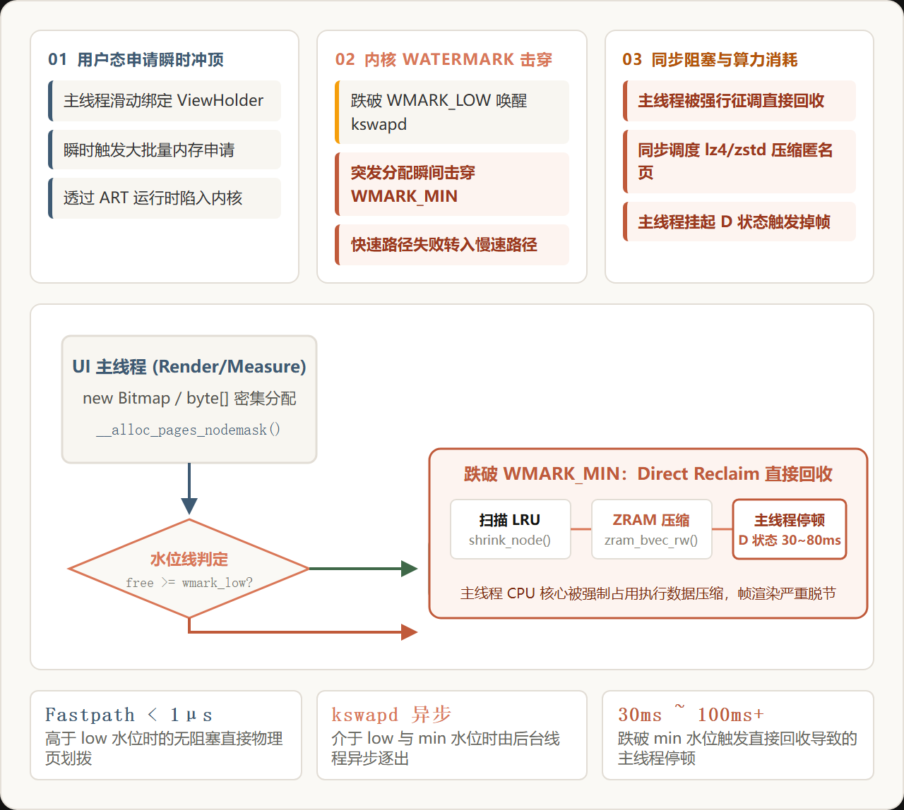
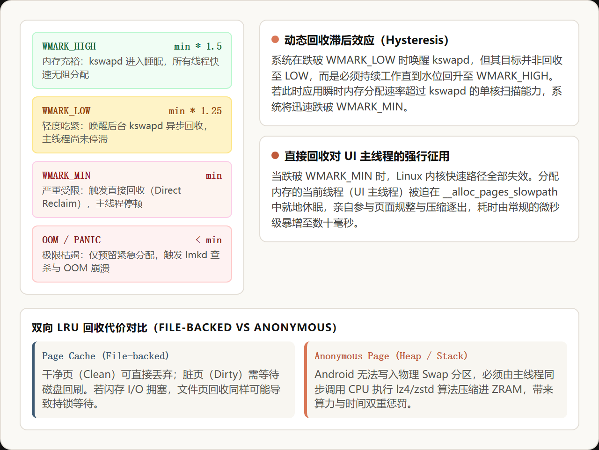
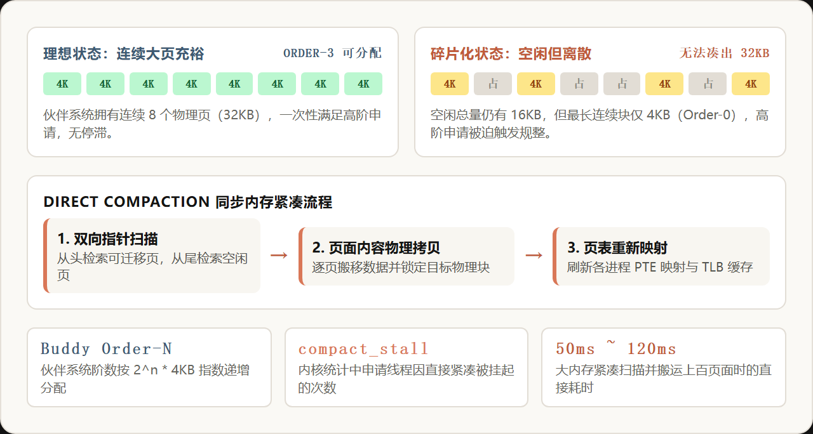
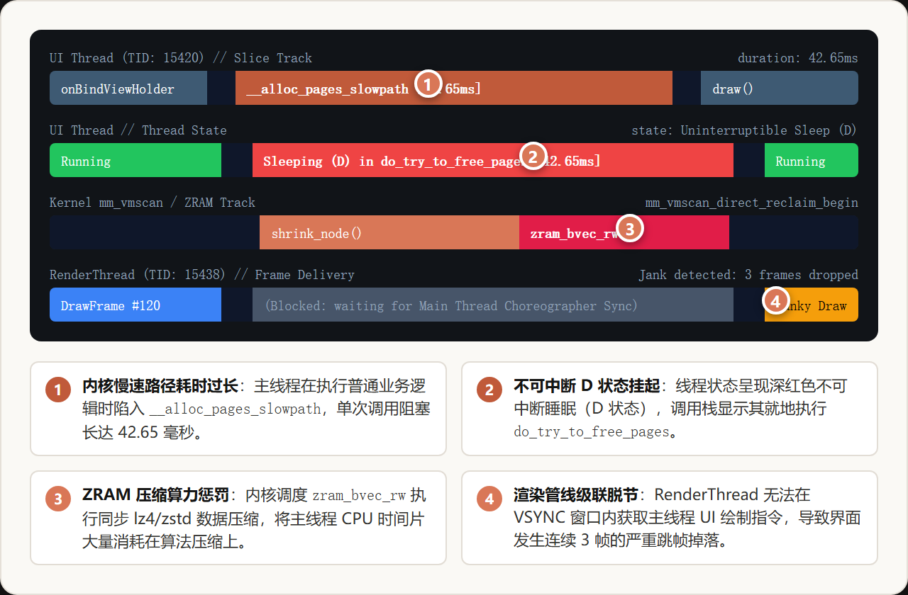

# Linux Kswapd 水位线、ZRAM 压缩惩罚与 Direct Reclaim 停顿

在 Android 应用的性能工程与高刷体验治理中，流畅度永远是技术团队最为看重的核心指标之一。在很多工程师的直觉模型中，内存与卡顿之间的因果链条通常非常单一：

“只要应用没有发生剧烈的 Java 堆内存泄漏，内存占用没有触碰系统设定的单进程上限，日志中也没有频繁打印出 Stop-The-World 的 Full GC 停顿，内存子系统就不应该拖慢界面的绘制渲染。”

更进一步，在查阅设备运行状态时，如果整机的可用内存（`MemAvailable`）依然稳定保持在 300MB 乃至 500MB 以上，离 LowMemoryKiller（lmkd）杀进程或触发系统 OOM（Out Of Memory）崩溃还有相当长的一段安全距离，我们更倾向于认为系统当前的物理内存空间非常宽裕。

然而，翻开大型商业应用在线上生产环境捕获的帧率掉帧告警、高刷卡顿事件以及局部掉帧日志，我们常能看到这样一幅令人百思不得其解的反差画面：

在用户快速滑动列表（Fling）、点击切换主导航 Tab、或者在页面间做共享元素转场动画的瞬间，屏幕界面突然出现肉眼可见的卡死，连续丢失 3 到 5 个 VSYNC 刷新节拍。

抓取对应的系统级 Perfetto 跟踪切片后，主线程代码并没有在执行任何耗时的磁盘 I/O，没有调用跨进程 Binder，也没有发生繁重的 Java 垃圾回收；代码仅仅是在执行一次普通的列表数据绑定，或者实例化一个尺寸仅有几十 KB 的临时对象。

然而，就是这样一次平淡无奇的内存申请，却让 UI 主线程在操作系统内核层陷入了深红色的不可中断休眠状态（Uninterruptible Sleep，即 Linux `D` 状态），耗时高达 40 毫秒乃至 80 毫秒。

内核调用栈清晰地记录着主线程当时的运行踪迹：`__alloc_pages_slowpath`、`do_try_to_free_pages`、`zram_bvec_rw`……

系统可用内存明明还有几百兆，为什么 UI 主线程会因为一次微小的内存申请，在内核态被直接拦截挂起？

这种认知偏差的根源，在于将 Linux 内核维度的“可用内存总量（MemAvailable）”与“即时可供极速分配的自由物理页（Free Pages）”划上了等号，同时忽略了移动操作系统中极其关键的两套系统机制：**Linux 内存区域的三级水位线模型（Zone Watermarks）**与**Android ZRAM 内存压缩体系**。

本文结合 Linux 内核内存管理源码（`mm/` 子系统）、AOSP 现代运行时实现以及商业级 APM 性能优化实战，全面拆解主线程遭遇直接内存回收（Direct Reclaim）与 ZRAM 算力惩罚的全链路机理。



---

## 1. 认知重构：MemAvailable 的虚幻假象与 Linux 内存水位线模型

要理解主线程为什么会被内核挂起，首先需要打破对 `/proc/meminfo` 中各项内存统计数值的粗放认知，弄清操作系统衡量“内存吃紧”的真实尺度。

### 1.1 为什么 MemAvailable 不能代表即时可用物理内存

在 Linux 与 Android 系统中，许多开发者习惯通过 `MemAvailable` 来判断当前系统的内存健康度。然而，`MemAvailable` 只是内核提供给用户空间的一个**估算值**，其算法逻辑大致如下：

$$\text{MemAvailable} \approx \text{MemFree} + \text{Active(file)} + \text{Inactive(file)} - \text{Watermark}_{\text{reserve}}$$

这意味着，系统向你展示的几百兆可用内存中，绝大部分并不是已经清空、随时可以拿来直接写入数据的自由物理页（`MemFree`），而是被大量的**文件页缓存（Page Cache）**与系统服务数据所占据。

Linux 遵循“充分利用物理 RAM”的设计哲学：只要物理内存没有耗尽，空闲空间就会被内核自动挪用作文件系统的读写缓冲，以加速后续的磁盘读取与代码段执行。

当应用发起一次内存申请时，内核无法直接拿 Page Cache 分配给应用程序。内核必须在两个选项中做出抉择：

1. 如果该文件页是干净的（Clean），内核可以直接丢弃其映射，将其转变为自由物理页；
2. 如果该文件页已经被修改过（Dirty），或者需要回收的是匿名页（Heap / Stack），内核就必须付出磁盘回写或内存压缩的物理开销。

因此，`MemAvailable` 代表的是“在理论上付出代价后可以腾出的内存上限”，绝不等于“调用线程可以零等待立即拿到的物理内存”。

### 1.2 内存区域（Zone）与三级水位线（WMARK_MIN / LOW / HIGH）

在 Linux 伙伴系统（Buddy System）的底层管理中，物理内存被划分为不同的区域（如 64 位 Android 设备上核心的 `ZONE_NORMAL` 与低地址 `ZONE_DMA`）。

为了在不拖垮系统的前提下平稳调控内存水位，Linux 内核为每个内存区域设定了三道递进的物理页水位线（Watermarks）：



这三道水位线由系统启动参数（如 `/proc/sys/vm/min_free_kbytes`）经由内核公式计算得出：

- **`WMARK_MIN`（最低警戒线）**：
  $$\text{wmark\_min} = \text{min\_free\_kbytes 对应的物理页数}$$
  这是内核保留给中断上下文与关键系统调用的最后自留地。一旦空闲页跌破该线，普通用户态申请将被强行阻断。
- **`WMARK_LOW`（后台回收启动线）**：
  $$\text{wmark\_low} = \text{wmark\_min} \times \frac{5}{4} = \text{wmark\_min} \times 1.25$$
  当空闲物理页跌破该水位时，内核判定内存出现吃紧迹象，立即唤醒后台内核守护线程 `kswapd`，由 `kswapd` 在后台异步扫描并回收物理页。
- **`WMARK_HIGH`（后台回收安全线）**：
  $$\text{wmark\_high} = \text{wmark\_min} \times \frac{3}{2} = \text{wmark\_min} \times 1.5$$
  当 `kswapd` 持续工作，将空闲物理页重新拉升至该水位以上时，内核判定系统已重回充裕区间，`kswapd` 重新进入休眠状态。

在快速分配路径（Fastpath）中，Linux 内核在 `mm/page_alloc.c` 中通过 `zone_watermark_fast` 进行判定：

```c
/* Linux 内核快速路径中的水位线检查逻辑 (mm/page_alloc.c) */
static inline struct page *
get_page_from_freelist(gfp_t gfp_mask, unsigned int order, int alloc_flags,
                       const struct alloc_context *ac)
{
    struct zone *zone;
    for_next_zone_zonelist_nodemask(zone, ...) {
        unsigned long mark;
        if (alloc_flags & ALLOC_HIGH)
            mark = high_wmark_pages(zone);
        else
            mark = low_wmark_pages(zone);

        /* 快速判断当前空闲页是否能满足目标水位与高阶连续性要求 */
        if (!zone_watermark_fast(zone, order, mark, ac->highest_zoneidx, alloc_flags, gfp_mask)) {
            /* 跌破水位线，快速路径失败，无法从该 zone 获得页面 */
            continue;
        }
        return buffered_rmqueue(ac->preferred_zoneref->zone, zone, order, gfp_mask, alloc_flags, ac->migratetype);
    }
    return NULL;
}
```

从源码中可以看到，只有当目标 Zone 当前的自由物理页高于所要求的 Watermark 时，快速路径才会成功返回。一旦跌破限制，内存分配将被强行驱入慢速路径。

---

## 2. 核心机制之一：kswapd 异步回收与 Direct Reclaim 同步停顿

弄清了水位线的设计，我们就能看清卡顿发生时的微观因果链条：为什么本该在后台默默工作的 `kswapd`，无法阻止前台 UI 主线程的严重停顿？

### 2.1 kswapd 为什么会跟不上主线程的内存分配节奏

在理想状态下，`kswapd` 作为一个后台内核线程，它的设计初衷就是为了对前台线程屏蔽回收代价：
当内存跌破 `WMARK_LOW` 时，`kswapd` 被唤醒，悄悄在后台把不活跃的页面回收掉，在空闲内存触及危险的 `WMARK_MIN` 之前将水位抬升回 `WMARK_HIGH`。在此期间，前台应用线程依然可以在快速路径中顺畅拿到内存。

然而，这一理想模型在移动端复杂的工程场景下面临着严重的现实瓶颈：

1. **瞬时内存分配速率（Allocation Rate）过高**：
   在用户快速滑动列表（如社交媒体瀑布流或图文长列表）时，主线程在执行 `onBindViewHolder`、解析 JSON 数据包、或者通过 `BitmapFactory` 申请位图缓冲时，单位时间内的内存申请量往往会出现脉冲式暴涨，短时间内的分配速率可达 100MB/s 乃至 200MB/s；
2. **kswapd 的单核算力局限与调度竞争**：
   在多数 Linux 内核配置中，每个 NUMA 节点或 Zone 通常仅对应一个 `kswapd` 线程（如 `kswapd0`）。`kswapd` 遵循 CFS（完全公平调度器）的普通进程优先级运行。如果整机处于多线程并发处理的高负载状态，`kswapd` 无法独占 CPU，其单位时间内能扫描并释放的物理页数量非常有限；
3. **水位滞后效应（Hysteresis Gap）**：
   `wmark_low` 与 `wmark_min` 之间的缓冲间隙通常只有数十兆字节。当应用的内存申请洪峰以极高速度涌来时，`kswapd` 甚至还没来得及扫描完第一条 LRU 链表，可用物理页就已经瞬间穿透了 `WMARK_LOW`，直接击穿了最底层的 `WMARK_MIN`。

### 2.2 __alloc_pages_slowpath：主线程如何被迫就地直接回收

一旦空闲内存跌破 `WMARK_MIN`，内核便不再允许任何普通优先级的线程继续从自由链表中划拨页面。

此时，内核代码在 `mm/page_alloc.c` 中退出快速分配逻辑，转而进入臭名昭著的慢速分配路径：`__alloc_pages_slowpath`。

```c
/* 慢速分配路径与直接回收触发 (mm/page_alloc.c) */
static inline struct page *
__alloc_pages_slowpath(gfp_t gfp_mask, unsigned int order, struct alloc_context *ac)
{
    /* 1. 唤醒后台 kswapd 线程开始异步扫描回收 */
    if (gfp_mask & __GFP_KSWAPD_RECLAIM)
        wake_all_kswapds(order, gfp_mask, ac);

    /* 2. 尝试使用降级水位线重试分配 */
    page = get_page_from_freelist(gfp_mask, order, alloc_flags, ac);
    if (page)
        return page;

    /* 3. 水位线依然低于安全红线，被迫进入同步直接回收 (Direct Reclaim) */
    if (can_direct_reclaim(gfp_mask)) {
        /* 当前调用线程（包括 UI 主线程）就地被阻塞，同步执行页面回收 */
        __perform_reclaim(gfp_mask, order, ac);
        page = get_page_from_freelist(gfp_mask, order, alloc_flags, ac);
        if (page)
            return page;
    }
    return NULL;
}
```

这段源码揭示了 Android 工程师最不愿面对的底层事实：

- **调用上下文的身份反转**：执行 `__perform_reclaim` 的不是系统后台的守护进程，而是**当前发起分配请求的线程本身**。如果此时是 UI 主线程在申请一个普通对象，主线程的代码执行流就会在内核中被就地截断；
- **全系统直接回收（Direct Reclaim）**：主线程被迫接管内核清洁工的工作，调用 `try_to_free_pages` -> `shrink_node`，遍历整个内存节点的不活跃链表，评估页面生命周期，执行页面逐出；
- **渲染管线彻底脱节**：在主线程替操作系统完成物理页腾退之前，该系统调用绝不会返回用户态。如果这次直接回收需要扫描成千上万个页面，主线程在内核态的耗时就会轻松突破 30 毫秒、50 毫秒乃至上百毫秒，将本应在 8.3 毫秒（120Hz）或 16.6 毫秒（60Hz）内完成的帧渲染节拍直接粉碎。

---

## 3. 核心机制之二：Android ZRAM 内存压缩与 CPU 算力惩罚

如果仅仅是释放只读的代码段或已同步的文件页缓存（Clean Page Cache），直接回收的耗时或许尚在可控范围内。然而，在以 Android 为代表的现代移动端设备上，直接回收往往伴随着一项更为沉重的额外负担——**ZRAM 内存压缩**。

### 3.1 移动设备为什么没有物理 Swap：ZRAM 的折衷与代价

在传统 PC 与服务器 Linux 环境中，当内存紧缺时，系统会将进程堆栈中不常使用的匿名页（Anonymous Pages）写入外置存储介质（如 SSD 或机械硬盘）的 Swap 交换分区。

但在智能手机与移动终端设备上，闪存颗粒（UFS / eMMC）的擦写寿命（P/E Cycles）极其宝贵，且嵌入式闪存的随机 I/O 写入性能与功耗表现难以承受高频的 Swap 换页冲击。因此，主流 Android 发行版从物理架构上坚决禁用了磁盘 Swap 分区。

为了解决移动端大内存常驻与物理内存有限的矛盾，Google 与芯片厂商在 Android 系统中全量启用了 **ZRAM（压缩内存盘）** 机制：

- 系统划分出一块虚拟的块设备（`/dev/block/zram0`），其物理存储后端依然是 RAM；
- 当内核需要换出匿名页时，并不将其写入外部存储，而是通过压缩算法（如 lz4、zstd）将其体积压缩（通常可压至原始尺寸的 30%~40%），再存回预留的物理内存池（`zsmalloc`）中；
- 这一机制本质上是**以 CPU 计算换取内存空间**。

### 3.2 匿名页换出链路：主线程被迫同步执行 lz4/zstd 压缩

当主线程跌入 Direct Reclaim 的慢速泥潭时，如果此时系统中的文件页缓存已经被压榨殆尽，内核就不得不对匿名页动手（`is_active_anon`）：

```c
/* 内核扫描不活跃链表并将匿名页写入 ZRAM (mm/vmscan.c) */
static noinline_for_stack unsigned long
shrink_inactive_list(unsigned long nr_to_scan, struct lruvec *lruvec,
                     struct scan_control *sc, enum lru_list lru)
{
    LIST_HEAD(page_list);
    /* 隔离出一批不活跃物理页 */
    nr_taken = isolate_lru_pages(nr_to_scan, lruvec, &page_list, ...);

    /* 处理隔离出的页面并推进换出 */
    nr_reclaimed = pageout_list(&page_list, lruvec, sc);

    /* 若为匿名页且系统配置了交换设备，则调用 pageout 转入 ZRAM */
    if (is_active_anon(lru)) {
        /* 触发与对端 ZRAM 驱动的同步写入交互 */
        swap_writepage(page, &wbc);
    }
    return nr_reclaimed;
}
```

紧接着，调用流转至内核 ZRAM 驱动模块（`drivers/block/zram/zram_drv.c`）：

```c
/* ZRAM 驱动中同步压缩数据页的核心路径 (drivers/block/zram/zram_drv.c) */
static int zram_bvec_write(struct zram *zram, struct bio_vec *bvec,
                           u32 index, int offset)
{
    struct page *page = bvec->bv_page;
    void *src = kmap_atomic(page);
    struct zcomp_strm *zstrm;

    /* 获取压缩流上下文与算法缓冲区 (lz4 / zstd) */
    zstrm = zcomp_stream_get(zram->comp);

    /* 同步调用压缩算法：当前线程 CPU 密集运行哈希与滑动窗口匹配 */
    ret = zcomp_compress(zstrm, src, &comp_len);

    kunmap_atomic(src);
    /* 分配物理压缩存储槽位并将数据写入 zsmalloc */
    handle = zs_malloc(zram->mem_pool, comp_len, ...);
    zcomp_stream_put(zram->comp);
    return ret;
}
```

这就是造成界面严重掉帧的关键瓶颈所在：

- **主线程 CPU 算力被强制挪用**：`zcomp_compress` 是纯粹的 CPU 密集型算法操作。本应该用于测量视图尺寸、绑定界面数据、计算动画插值的主线程 CPU 时间片，被强行征调去运行 lz4/zstd 算法的字典匹配与位操作；
- **温控限频（Thermal Throttling）的雪上加霜**：如果在炎热夏季或设备高负荷运行一段时间后，整机触发了温控降频，CPU 核心主频被限制在较低频率运行，那么原本耗时 10 微秒的单页压缩操作就会被拉长至 40 微秒。当一次回收需要连续压缩数百个物理页时，主线程的总挂起耗时将被成倍放大。

### 3.3 页面换入（Swap-in）与 Major Page Fault 的二次打击

更残酷的是，ZRAM 带来的性能惩罚并不是单向的，而是**双向闭环的**。

一旦某批页面被主线程压缩写入了 ZRAM：

1. **后续读取触发缺页异常**：当应用后续需要读取或执行这些被压缩的页面数据时，CPU 硬件单元发现页表项（PTE）的有效位为 0，立即触发硬件缺页异常（Page Fault）；
2. **陷入 Major Page Fault**：内核在异常处理函数 `handle_pte_fault` -> `do_swap_page` 中，发现该页面存在于交换设备中，将其归类为高开销的**重大缺页异常（Major Fault）**；
3. **主线程再度停顿解压**：内核必须再度在当前线程上下文调用 ZRAM 驱动的 `zcomp_decompress`，将其解压还原为原始的 4KB 物理页，并重新写入页表。

这种“分配时被直接回收卡死、访问时被解压缺页打断”的双向性能损耗，正是许多复杂页面在启动或快速滑动时出现连续阶梯式卡顿的根本原因。

---

## 4. 核心机制之三：内存碎片化与 Order-N 高阶页面分配死锁

在深入分析了物理页总量的回收瓶颈后，我们还需要审视另一个更为隐蔽、但在移动图形渲染中极具破坏力的维度：**物理内存碎片化（Memory Fragmentation）**。

### 4.1 单个物理页容易找，连续物理页寸步难行

Linux 伙伴系统（Buddy System）管理物理内存时，是按照 2 的阶数（Order 0 到 Order 10）来组织连续物理页块的：

- **Order 0**：单个物理页（$2^0 \times 4\text{KB} = 4\text{KB}$）；
- **Order 1**：连续 2 个物理页（$2^1 \times 4\text{KB} = 8\text{KB}$）；
- **Order 2**：连续 4 个物理页（$2^2 \times 4\text{KB} = 16\text{KB}$）；
- **Order 3**：连续 8 个物理页（$2^3 \times 4\text{KB} = 32\text{KB}$）。

在系统长时间运行后，频繁的内存申请与释放会导致物理地址空间高度碎片化：



正如上图所示：即使系统的总自由内存加起来还有 300MB（全是由离散的 Order 0 组成的单页碎屑），但如果某次系统调用需要申请一个 **连续 32KB（Order 3）** 的物理内存块，伙伴系统依然无法在当前内存空闲链表中找到合规的槽位，直接宣告分配失败。

### 4.2 为什么普通业务代码也会触发高阶分配

许多应用层工程师会质疑：“Java / Kotlin 代码中所有的普通对象都是分配在虚拟地址空间中，由 MMU 负责离散物理页的映射，我们在业务层怎么可能会需要大块连续的物理内存？”

在纯 Java 堆内存分配中确实如此。然而，在 Android 复杂的图形渲染、音视频管线与跨进程交互架构中，存在大量隐性依赖**连续物理页（Order > 0）**的底层系统调用：

- **图形缓冲区与 Gralloc / DMA-BUF 申请**：UI 绘制与硬件加速最终需要将帧图层提交给 SurfaceFlinger。部分老旧硬件平台的显示合成器（HWC）或 GPU 驱动在分配 Direct Buffer 或 DMA-BUF 时，出于硬件 DMA 传输寻址效率的考量，会硬性要求分配 `order > 0` 的连续物理页；
- **高性能音视频解码与相机采集**：Camera2 预览流采集缓冲区、AudioTrack 底层环形缓冲区（Ring Buffer）在通过 JNI 分配底层驱动映射时，必须一次性申请多页连续内存；
- **大型 JNI 本地数组与透明大页（THP）**：如果 Native 动态库通过 `mmap` 或特定标志位申请大块内存，内核在尝试进行高阶页面合并时，同样会触发高阶分配判定。

### 4.3 内存紧凑（Memory Compaction）与 Direct Compaction 级联挂起

当高阶分配遭遇碎片化阻碍时，Linux 内核并不会直接抛出失败，而是会启动另一项昂贵的应急机制：**内存紧凑（Memory Compaction）**。

```c
/* 内存紧凑的核心判定与双向扫描迁移 (mm/compaction.c) */
static enum compact_result compact_zone(struct compact_control *cc,
                                       struct capture_control *capc)
{
    /* 1. 扫描游标初始化：迁移游标从低地址递增，空闲游标从高地址递减 */
    cc->migrate_pfn = zone->zone_start_pfn;
    cc->free_pfn = zone_end_pfn;

    /* 2. 双向游标相遇前执行页面扫描与物理迁移 */
    while (compact_step(cc) == COMPACT_CONTINUE) {
        isolate_migratepages(cc);
        /* 物理拷贝内存页并更新页表 PTE 映射 */
        migrate_pages(&cc->migratepages, compaction_alloc, ...);
    }
    return cc->result;
}
```

在执行直接紧凑（Direct Compaction）时：

1. 内核以双向游标同时扫描 Zone：从低地址向高地址寻找分散的可迁移页面，同时从高地址向低地址寻找空闲槽位；
2. 逐一将散落的物理页内容硬性拷贝到连续的高地址空闲区域中；
3. 更新所有相关进程的页表项（PTE），并执行 CPU TLB 缓存的整体刷新。

这个物理内存重排的过程极其沉重。主线程如果在图形初始化或音视频渲染时陷入 `try_to_compact_pages`，其挂起耗时往往直接飙升至 50 毫秒乃至 120 毫秒，在性能监控平台中形成严重的 `compact_stall` 告警。

---

## 5. 工程定位与实战取证：Perfetto 时间线上的内存回收铁证

理解了底层流转逻辑，在面对实际项目中的卡顿与掉帧告警时，我们就能够借助系统级跟踪工具 **Perfetto** 快速固定证据链，精准定位内存抖动所引发的卡顿瓶颈。

### 5.1 如何在 Perfetto 中捕获 Direct Reclaim 与 ZRAM 解密切片

在抓取了高帧率卡顿现场的 Perfetto 跟踪切片后，我们可以按照以下四个递进的排查阶段完成闭环取证：



1. **锁定 UI 主线程的异常休眠区间（Thread State）**：
   - 展开应用进程的 UI 主线程轨道（通常为主线程名或主进程 PID 同名线程）；
   - 检查卡顿发生瞬间的线程调度状态条。如果主线程在执行某个普通业务切片（如 `onBindViewHolder` 或 `decodeByteArray`）时，状态条突兀地呈现出长达数十毫秒的**深红色 `Sleeping (D)`（不可中断休眠）**，这便是线程陷入内核等待的铁证；
2. **检索内核慢速路径核心切片（Slice Track）**：
   - 在主线程的方法调用链与系统调用轨道中，检索名称包含 `__alloc_pages_slowpath` 或 `try_to_free_pages` 的切片；
   - 核对切片的实际耗时。如果在该切片上消耗了 42.6 毫秒，则说明主线程在此处直接承载了系统级直接回收的沉重工作；
3. **查验内核 mm_vmscan 与 ZRAM 执行证据**：
   - 展开系统的内核事件轨道（Kernel Events / ftrace），检索 `mm_vmscan_direct_reclaim_begin` 与 `mm_vmscan_direct_reclaim_end` 配对事件；
   - 观察期间是否伴随密集的 `zram_bvec_rw` 或 `zram_read` / `zram_write` 切片。若有，则表明当前主线程正被高频挪用去执行 lz4/zstd 算法压缩与解压；
4. **比对渲染管线与 VSYNC 丢帧**：
   - 将主线程的阻塞区间与 RenderThread 轨道（`DrawFrame`）及 SurfaceFlinger 节拍对齐；
   - 观察到 RenderThread 因为无法在预期时间内获取主线程的绘制指令与同步信号，导致接连错过多个 VSYNC 周期，最终在 Perfetto 的 UI 界面中被标记为连续掉帧的红黄色 Janky Frame。

### 5.2 核心监控指标与系统节点提取

在工程调试或线上 APM 埋点中，我们可以通过读取 Linux `/proc` 与 `/sys` 虚拟文件系统节点，持续量化直接回收与内存压缩对应用的影响：

::: info 关键系统指标提取清单

- **`/proc/vmstat` 核心指标**：
  - `allocstall` / `pgalloc_direct`：系统发生直接内存回收的总次数。若该数值在线上快速跳变递增，表明系统正频繁击穿 WMARK_MIN 水位线；
  - `compact_stall`：应用触发直接内存紧凑（Direct Compaction）的累计次数；
  - `pgpgin` / `pgpgout`：内存换入换出的物理页总量。
- **`/sys/block/zram0/` 状态节点**：
  - `stat` 文件：按列记录了 ZRAM 的读写请求总数（换入换出次数）与未压缩/已压缩字节数；
  - 通过比对 `orig_data_size` 与 `compr_data_size`，可以精准评估当前设备 ZRAM 的压缩率与内存负载压力。
- **进程级 Major Fault 监控**：
  - 读取 `/proc/[pid]/stat` 中的第 12 个字段 `maj_flt`。如果主线程在某次操作前后的重大缺页数激增数十次，可直接证实该逻辑正遭遇剧烈的 ZRAM 换入解压惩罚。
    :::

---

## 6. 架构治理与实战优化：消除内存分配抖动的四大工程路径

搞清了 `kswapd`、`WMARK_MIN`、直接回收与 ZRAM 压缩的底层联动机制，我们在遇到界面卡顿或内存告警时，治理的思路就会清晰很多。治理的核心目标，在于**平抑瞬时内存分配速率（Allocation Rate），消除大块连续内存分配，并在系统跌破安全水位之前主动规避风险**。

我们可以制定四项递进的工程治理策略：

### 6.1 主线程零大块分配与对象生命周期池化（零临时垃圾）

在追求高刷新率的场景（如 RecyclerView 滑动、复杂列表刷新、动态流展示）中，导致内存瞬间跌破 `WMARK_MIN` 的罪魁祸首，往往不是常驻内存泄漏，而是短时间内以极高频率创建、随后立即丢弃的“瞬时内存垃圾”：

- 严禁在 `onDraw()`、`onLayout()`、`onBindViewHolder()` 中实例化大体积数据对象、解析 JSON 字符串或创建临时数据实体；
- 针对需要频繁使用的字节数组、数据缓冲块，构建生命周期可控的对象池或字节池（BytePool），实现内存碎片的物理复用：

```kotlin
/**
 * 高性能低碎片化内存缓冲池，平抑瞬时 Allocation Rate 脉冲
 */
class HighPerformanceBytePool private constructor(
    private val maxPoolSizeBytes: Int = 8 * 1024 * 1024 // 最大缓存 8MB
) {
    private val pool = ArrayDeque<ByteArray>()
    private var currentPoolSize = 0

    companion object {
        val instance by lazy { HighPerformanceBytePool() }
    }

    @Synchronized
    fun obtain(size: Int): ByteArray {
        val iterator = pool.iterator()
        while (iterator.hasNext()) {
            val buffer = iterator.next()
            if (buffer.size >= size) {
                iterator.remove()
                currentPoolSize -= buffer.size
                return buffer
            }
        }
        // 仅在池耗尽时才向系统申请新内存
        return ByteArray(size)
    }

    @Synchronized
    fun recycle(buffer: ByteArray) {
        if (currentPoolSize + buffer.size <= maxPoolSizeBytes) {
            pool.addLast(buffer)
            currentPoolSize += buffer.size
        }
    }

    @Synchronized
    fun evictAll() {
        pool.clear()
        currentPoolSize = 0
    }
}
```

通过复用预先分配好的物理内存块，应用在快速滑动时的瞬时分配速率可以从 150MB/s 骤降至 10MB/s 以下，让后台的 `kswapd` 能够从容应对物理页腾退，彻底阻断主线程滑入直接回收慢速路径的可能性。

### 6.2 Bitmap 内存复用与硬件位图（HARDWARE Bitmap）深度落地

图片与位图资源是 Android 应用中占用内存最庞大、也是最容易触发连续物理页（Order > 0）分配的元凶：

1. **全面推行 `inBitmap` 机制**：
   在图片加载框架（如 Glide、Coil）中，严格配置位图复用池。在解码新图片时，通过 `BitmapFactory.Options.inBitmap` 复用已存在的 Bitmap 内存空间，避免频繁向底层内存分配器申请全新的连续内存块；
2. **深度落地 `Bitmap.Config.HARDWARE`**：
   在 Android 8.0（API 26）及以上设备中，对于只用于界面展示、无需在 CPU 侧修改像素的图片资源，无条件配置 `Bitmap.Config.HARDWARE`；
   - 硬件位图的像素数据直接由 GPU/Gralloc 管理，在 Native 驱动层映射为只读的 GraphicBuffer；
   - 这不仅大幅减轻了 Java 堆与普通匿名页的内存压力，避免了 ZRAM 对这部分内存的频繁压缩扫描，更降低了 CPU 侧因 Major Page Fault 引发的解压停滞。

### 6.3 平滑冷启动与页面切换瞬时内存脉冲（Throttled Allocation）

在应用冷启动或主 Tab 切换时，多个功能模块往往并发拉起，各自申请大量的数据库缓存、本地配置与视图结构，引发整机内存水位的断崖式下跌：

- **引入按需分帧加载（Frame-Pacing Initialization）**：
  将非核心的组件初始化逻辑从主线程入口中剥离，借助 `Looper.myQueue().addIdleHandler`，在主线程每一帧渲染完成后的空闲间隙（Idle Slice）分批执行：

```kotlin
/**
 * 分帧初始化与内存压力主动感知联动机制
 */
class MemoryAwareInitializer(private val context: Context) : ComponentCallbacks2 {

    fun initDeferredComponents() {
        // 利用主线程空闲切片执行延期内存分配，避免挤压单帧渲染耗时
        Looper.myQueue().addIdleHandler {
            preloadSecondaryBitmaps()
            warmupLocalDatabaseCache()
            false // 执行一次后自动从 IdleHandler 队列中注销
        }
    }

    override fun onTrimMemory(level: Int) {
        when (level) {
            ComponentCallbacks2.TRIM_MEMORY_RUNNING_CRITICAL,
            ComponentCallbacks2.TRIM_MEMORY_RUNNING_LOW -> {
                // 收到系统内存吃紧告警，在跌破 WMARK_MIN 之前主动释放易失缓存
                ImageMemoryCache.clear()
                HighPerformanceBytePool.instance.evictAll()
            }
            ComponentCallbacks2.TRIM_MEMORY_UI_HIDDEN -> {
                // 界面退到后台，释放 UI 关联的大块图形缓冲
                ViewHierarchyCache.release()
            }
        }
    }

    override fun onConfigurationChanged(newConfig: Configuration) = Unit
    override fun onLowMemory() = onTrimMemory(ComponentCallbacks2.TRIM_MEMORY_COMPLETE)

    private fun preloadSecondaryBitmaps() { /* 预载二级图层 */ }
    private fun warmupLocalDatabaseCache() { /* 预热数据库连接 */ }
}
```

- **平抑并发分配峰值**：
  通过将大块内存申请分散在不同的时间窗口中进行，避免短时间内产生内存脉冲，使系统空闲物理页始终平稳维持在 `WMARK_LOW` 水位线之上。

### 6.4 系统级参数感知与主动降级（ComponentCallbacks2）

优秀的架构不仅要管好自身的分配速率，更要具备对整机内存环境的主动感知与防御能力：

- **深度联动 `ComponentCallbacks2`**：
  实现并注册 `ComponentCallbacks2` 接口。当收到系统回调的 `TRIM_MEMORY_RUNNING_LOW` 或 `TRIM_MEMORY_RUNNING_CRITICAL` 信号时，说明系统内存已经跌破正常警戒线，即将触发系统级直接回收；
- **主动释放易失性缓存（Volatile Cache Eviction）**：
  在内核被迫发起直接回收之前，应用层主动清空内存中的 Bitmap 缓存、重置静态集合、释放空闲的线程池与对象池，主动为操作系统“注入”充裕的自由物理页；
- **自适应降级渲染质量**：
  在内存极度受限的设备上，动态关闭复杂的高斯模糊、粒子特效，降低预加载图片的解码分辨率，从源头上遏制物理内存的消耗速度。

搞清了 Linux 内核内存管理模型、Zone 水位线判定、直接回收的停顿机制与 ZRAM 的算力开销，我们在进行 Android 性能优化与架构设计时，就能彻底摆脱对 `MemAvailable` 单一数值的盲目信赖，真正构建起抗分配抖动、耐高频滑动、前台流畅平稳的高品质移动端架构。

## 参考资料

- [Linux Kernel Memory Management: Page Allocation & Zone Watermarks](https://docs.kernel.org/mm/page_allocation.html)（Linux Kernel Documentation · 2024-06）
- [Understanding Linux Memory Reclaim: Kswapd and Direct Reclaim Architecture](https://kernelnewbies.org/Linux_Memory_Management)（Kernel Newbies Wiki · 2023-12）
- [Android Low Memory Killer Daemon (lmkd) and PSI Architecture](https://source.android.com/docs/core/perf/lmkd)（AOSP Documentation · 2024-04）
- [Linux Kernel drivers/block/zram Documentation & Compressed RAM Disks](https://docs.kernel.org/admin-guide/blockdev/zram.html)（The Linux Kernel Organization · 2024-08）
- [Memory Compaction and Anti-Fragmentation in the Linux Kernel](https://lwn.net/Articles/834857/)（LWN.net · 2023-09）
