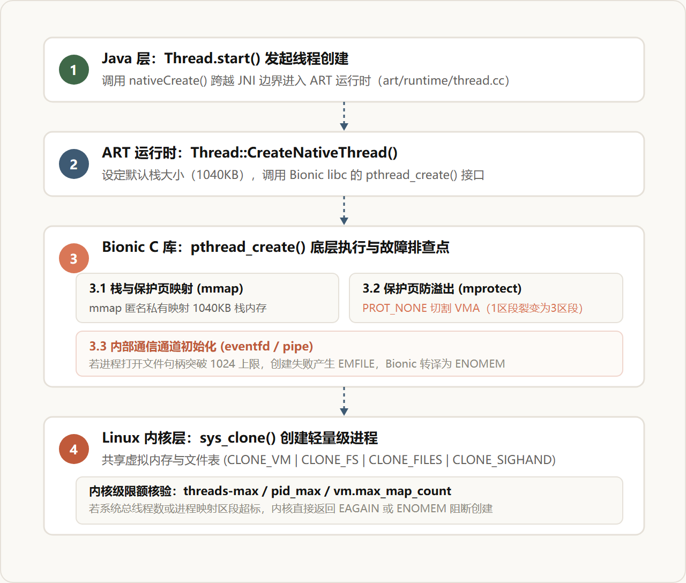
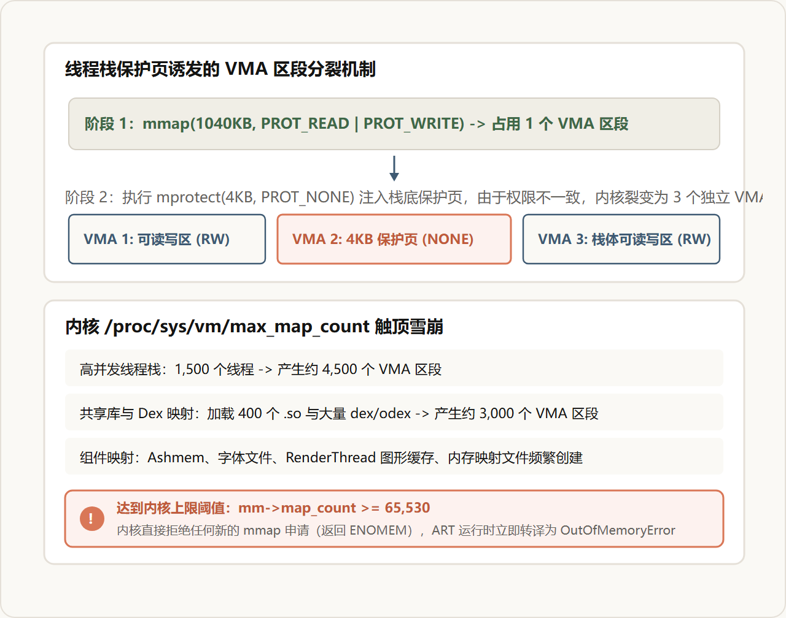
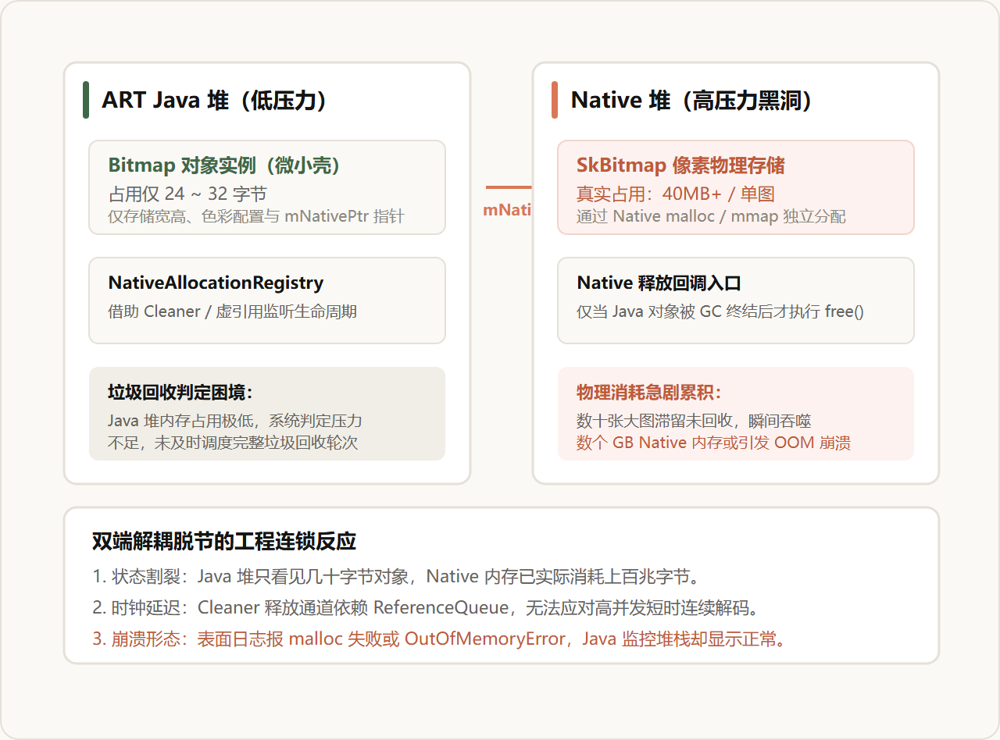

# OOM 底层剖析：虚拟内存耗尽、pthread 创建失败与 Native 内存黑洞

在 Android 移动端稳定性与性能治理中，OOM（`OutOfMemoryError`）一直位列线上疑难崩溃的前茅。无论是大厂核心业务的 APM 平台，还是中小团队的崩溃监控后台，OOM 崩溃往往因为现场缺乏清晰的业务堆栈、破坏范围广而成为排查的痛点。

在日常排查中，许多资深工程师经常遭遇一个看似反常的崩溃现象：

- 监控后台捕获了一批严重的 OOM 崩溃告警；
- 点开上报日志中的内存指标，Java 堆分配却显得格外“从容”：总堆上限配置了 512MB，当前分配仅为 80MB，空闲比例超过 80%；
- 甚至崩溃堆栈记录的分配请求微不足道，系统在尝试分配一个仅仅数十字节的普通对象时，直接抛出了异常终止进程：

```text
java.lang.OutOfMemoryError: Failed to allocate a 28 byte allocation with 434217728 free bytes and 414MB until OOM, target footprint 84934656, growth limit 536870912
```

或者在调用栈中赫然显示出底层线程创建的中止信息：

```text
java.lang.OutOfMemoryError: pthread_create (1040KB stack) failed: Out of memory
```

**面对这种日志，不少开发者的第一反应往往是：“Java 堆内存明明还空闲几百兆，系统怎么可能抛出 OOM？一定是底层系统误报，或者是设备厂商修改了系统代码引发的偶发缺陷。”**

这种推断忽略了操作系统底层架构与运行时的联动边界。

OOM 绝不仅仅是 ART 运行时内部 Java 堆耗尽时的专属产物，而是 Linux 操作系统内核、Bionic 运行时基础库与 ART 虚拟机多层级资源约束共同触发的异常契约。在更深层的系统运行机制中，进程虚拟地址空间耗尽、Linux 内核 VMA 区段数量触碰阈值、文件描述符（FD）泄漏导致的级联阻断，以及 Android 8.0 之后 Bitmap 迁移到 Native 堆引发的“状态失联”，都可能在 Java 堆依然充裕的平静表象下，瞬间引爆整个应用的 OOM 崩溃。

本文结合 AOSP 现代源码实现、Linux 虚拟内存管理机制与大型商业应用的线上排查实践，深入拆解这些隐藏在 Java 堆背后的 OOM 判定盲区与工程治理方案。


---

## 1. 认知重构：OOM 到底是在哪个层级被触发的？

要弄清为什么 Java 堆空闲时依然会爆发 OOM，首先需要打破将“内存”等同于“Java 堆物理占用”的认知局限。在 Linux 操作系统中，每一个 Android 应用进程都拥有独立且分层的内存视图。

### 1.1 内存指标辨析：VSS、RSS、PSS 与 ZRAM

在 Linux 进程模型与 Android 性能诊断中，内存有四个截然不同的观测维度。很多误判源于混淆了这四个维度的技术内涵：

- **VSS（Virtual Set Size，虚拟耗用内存）**
  - 技术本质：进程申请并保留的虚拟地址空间总量；
  - 核心特征：包括所有映射的共享库（`.so`）、Dex 文件、只读映射、已分配但从未读写的匿名内存段；
  - 判定影响：VSS 并不直接消耗等额物理 RAM，但它受限于 CPU 架构的虚拟寻址宽度以及内核映射区段配额。

- **RSS（Resident Set Size，常驻物理内存）**
  - 技术本质：当前实际驻留在物理 RAM 中的内存页总量；
  - 核心特征：包含进程独占的物理内存页，以及该进程与其他所有进程共享的动态链接库代码段物理内存；
  - 判定影响：由于累加了全部共享库的物理内存，多个进程的 RSS 直接相加会远大于系统物理内存总和，难以真实反映单进程的内存代价。

- **PSS（Proportional Set Size，比例常驻内存）**
  - 技术本质：Android 系统评估进程真实内存开销的核心指标；
  - 核心特征：等于进程独占的物理内存（Private Dirty + Private Clean），加上与其他进程平摊后的共享物理内存（Shared / 进程共享数）；
  - 判定影响：系统 lmkd（Low Memory Killer Daemon）在执行内存水位判定与进程回收决策时，主要参考 PSS 与 PSI（Pressure Stall Information）指标。

- **ZRAM / Swap（压缩内存与交换分区）**
  - 技术本质：Android 内核开辟的内存压缩存储区；
  - 核心特征：当物理内存紧张时，内核内存管理系统将匿名脏页压缩写入 ZRAM，释放出物理页框；
  - 判定影响：访问处于 ZRAM 中的内存页需要经历解压与缺页异常（Page Fault），引发 CPU 周期消耗与线程停顿。

许多开发者在排查 OOM 时只看 Java 堆的分配量，却忽略了进程的 VSS（虚拟内存）和系统的内核句柄早已逼近危险边缘。

### 1.2 ART 抛出 OOM 的底层判定逻辑

在 Android ART 运行时中，`java.lang.OutOfMemoryError` 并非仅在某单一类中孤立构造。翻阅 AOSP 源码 `art/runtime/gc/heap.cc`，我们可以清晰梳理出 ART 抛出 OOM 的三条核心路径：

```cpp
void Heap::ThrowOutOfMemoryError(Thread* self, size_t byte_count, AllocatorType allocator_type) {
  std::ostringstream oss;
  size_t total_bytes_free = GetFreeMemory();
  oss << "Failed to allocate a " << byte_count << " byte allocation with "
      << total_bytes_free << " free bytes and "
      << PrettySize(GetMaxMemory() - num_bytes_allocated_) << " until OOM,"
      << " target footprint " << target_footprint_.load(std::memory_order_relaxed)
      << ", growth limit " << growth_limit_;
  self->ThrowOutOfMemoryError(oss.str().c_str());
}
```

这三条路径分别对应着系统不同层次的资源枯竭：

1. **Java 堆空间不足**：
   当应用分配 Java 对象时，分配器首先在当前线程的 TLAB（Thread Local Allocation Buffer）或 RosAlloc/BumpPointer 分配器中查找可用块。若空间不足，ART 会触发并发垃圾回收（Concurrent Copying GC）；若回收后仍无法满足，会升级为非并发的停顿垃圾回收，甚至触发完整回收并清理所有软引用（SoftReference）。当经历全部抢救手段后，若连续内存空间依然低于申请大小，系统便会执行上述代码，生成包含 `target footprint` 与 `growth limit` 的典型报错。

2. **虚拟地址空间或 Native 内存耗尽**：
   当底层 JNI、Webview 渲染引擎或 Bitmap 存储调用 Bionic libc 的 `malloc()` 或 Linux 的 `mmap()` 时，若返回 `nullptr` 或 `MAP_FAILED`，C++ 层的异常处理逻辑会向当前 Java 线程抛出 `OutOfMemoryError`。在此类场景中，日志往往不会打印 Java 堆指标，而是直接伴随 Native 层的堆栈回溯。

3. **系统线程创建失败的转译**：
   在 Java 代码执行 `new Thread().start()` 时，底层最终依赖 Bionic libc 的 `pthread_create()` 接口。如果该系统调用返回非零错误码（如 `EAGAIN` 或 `ENOMEM`），ART 运行时的 `Thread::CreateNativeThread()` 会明确拼接错误信息并向外抛出：
   `java.lang.OutOfMemoryError: pthread_create (...) failed: Out of memory`。

### 1.3 64位架构并非虚拟内存的避风港

一个广为流传的误区是：“在早期的 32 位（ARMv7）设备上，进程虚拟地址空间只有 4GB，扣除内核占用的 1GB，用户空间只剩下 3GB，很容易遭遇虚拟地址耗尽；如今大家都全面适配了 64 位（ARM64）系统，寻址空间高达数十 TB，虚拟内存耗尽问题应该已经彻底消失了。”

事实并非如此。

在 64 位系统上，单纯因为“连续虚拟内存地址区间用尽”导致的 OOM 确实大幅降低，但引入了另一个更为严苛且隐蔽的内核约束：**Linux 内核对单进程虚拟内存映射区段数量的限制（`vm.max_map_count`）**。

在 Linux 内核内存子系统中，每一次成功的 `mmap()` 映射，都会在进程的 `mm_struct` 中注册一个 `vm_area_struct`（简称 VMA）。为了防止恶意程序或异常行为无限耗尽内核元数据内存，Linux 内核通过 `/proc/sys/vm/max_map_count` 强行限制了一个进程允许拥有的最大 VMA 数量。

在 Android 系统中，该参数的默认值通常是 **65,530**。

这意味着：**在 64 位系统上，哪怕你还有数百 GB 的空闲物理内存，一旦进程内的 VMA 数量超过 65,530，后续哪怕只是尝试执行一次仅仅 4KB 的 `mmap`，Linux 内核也会立刻拒绝并返回 `ENOMEM`！**

接下来，我们聚焦在线上最常见的 `pthread_create failed: Out of memory` 案例，深入分析这一崩溃是如何一步步演变为现实的。

---

## 2. 深度拆解：pthread_create 失败的四大工程诱因

线上排查中，`pthread_create failed: Out of memory` 占据了非 Java 堆 OOM 的半壁江山。当开发人员看到这行堆栈时，第一反应往往是去查看系统可用内存，结果发现物理内存完全够用。

要揭开这一谜团，必须顺着 `Thread.start()` 追踪到底层系统调用的全过程。



### 2.1 从 Thread.start() 到内核 clone() 的执行链路

在 Java 层调用 `Thread.start()` 后，执行链路迅速下潜到 Native 空间：

1. `java.lang.Thread.start()` 校验状态后调用 `nativeCreate()`；
2. JNI 路由到 `art/runtime/native/java_lang_Thread.cc`，转交 ART 运行时的 `Thread::CreateNativeThread()`；
3. ART 初始化线程属性，配置线程栈大小（通过 `pthread_attr_setstacksize`，Android 默认主线程为 8MB，子线程一般为 1040KB），随后调用 Bionic libc 的 `pthread_create()`；
4. 进入 Bionic libc（`bionic/libc/bionic/pthread_create.cpp`），Bionic 负责为新线程准备环境：
   - 调用 `mmap()` 为线程栈分配虚拟内存区间；
   - 调用 `mprotect()` 划定栈底的保护页（Guard Page）；
   - 初始化线程上下文及内部同步管道（`eventfd` 或 `pipe`）；
5. 最终调用 Linux 系统调用 `sys_clone()`，传入一系列共享标志（`CLONE_VM | CLONE_FS | CLONE_FILES | CLONE_SIGHAND | CLONE_THREAD | ...`），在内核中创建对应的轻量级进程（`task_struct`）。

在这条流水线上，任何一个阶段的资源供给不足，都会引发 `pthread_create` 返回错误，进而在 Java 层表现为 OOM 崩溃。

### 2.2 瓶颈一：系统级线程数配额与 PID 耗尽

Linux 内核为了保障整体系统的可用性，设定了系统全局和用户级的进程/线程上限：

- `/proc/sys/kernel/threads-max`：系统允许并发存在的最大线程总量；
- `/proc/sys/kernel/pid_max`：系统允许分配的最大进程/线程 ID（在 Linux 中，线程本质上是轻量级进程，共享 PID 编号池）；
- `/proc/sys/vm/max_map_count`：单进程虚拟映射区段上限。

在现代手机复杂的应用生态下，第三方广告 SDK、推送服务、即时通讯库以及各业务方自建的线程池往往处于无序扩张状态。

如果一个应用由于逻辑缺陷（例如在死循环中持续 `new Thread().start()`，或者使用了无界的 `Executors.newCachedThreadPool()`），导致应用内部线程数在短时间内飙升到数千个，不仅会极快耗尽应用的局部资源，还会触碰内核的线程数配额。此时内核 `sys_clone()` 将直接返回 `EAGAIN`，Bionic libc 随即通知 ART 抛出创建失败的 OOM。

### 2.3 瓶颈二：VMA 映射区段突破 vm.max_map_count 阈值

这是 64 位设备上最隐蔽的线程创建 OOM 根源所在。

翻看 Bionic libc 的线程栈分配源码，我们会发现一个关键的设计：

```cpp
// 节选自 AOSP bionic/libc/bionic/pthread_create.cpp
void* child_stack = mmap(nullptr, stack_size, PROT_READ | PROT_WRITE,
                         MAP_PRIVATE | MAP_ANONYMOUS | MAP_NORESERVE, -1, 0);
if (child_stack == MAP_FAILED) {
  return EAGAIN;
}

// 在栈底部划定一个保护页，防止栈溢出践踏其他内存
if (mprotect(child_stack, guard_size, PROT_NONE) == -1) {
  munmap(child_stack, stack_size);
  return EAGAIN;
}
```

这段代码揭示了 VMA 分裂的关键机制：

1. **初始状态**：`mmap` 申请了一段连续的 1040KB 虚拟内存，权限为 `PROT_READ | PROT_WRITE`。在内核中，这表现为一个单一的 VMA。
2. **保护页介入**：为了防止递归爆栈覆盖其他内存段，Bionic 必须将栈底的一个页（通常为 4KB）修改为 `PROT_NONE`（不可读、不可写、不可执行）。
3. **内核被迫分裂区段**：Linux 内核要求同一个 VMA 内部必须具备完全相同的访问权限属性。当原本均匀的区域被在中间或头部剥离出一块属性不同的保护页时，**内核必须将原本的 1 个 VMA 切割为 3 个独立的 VMA**！



这就产生了一个震撼的放大效应：
**每创建一个简单的 Java 线程，在操作系统内核层面就会直接净增 3 个 VMA 映射区段！**

我们来算一笔账：

- 一个大型应用如果并发存在 1,200 个线程，这些线程就会消耗近 3,600 个 VMA；
- 现代大型应用通常集成了数十个第三方库，加载了超过 300 个动态链接库（`.so` 文件）。每个 `.so` 文件包含代码段（`.text`）、只读数据段（`.rodata`）、数据段（`.data`）和 BSS 段，至少需要消耗 4 到 6 个 VMA，这就占据了近 2,000 个 VMA；
- 多 Dex 架构下，每个 Dex、Odex、Vdex 文件都要通过 `mmap` 载入内存；
- 加上字体资源文件映射、RenderThread 的图形着色器缓存、匿名共享内存（Ashmem），VMA 计数会持续上升。

如果业务代码中存在频繁开启短生命周期线程、或者动态载入大量插件并反复映射文件的行为，进程的 VMA 计数极易突破 **65,530** 的硬性上限。一旦越过此线，下一次调用 `mmap` 就会返回 `ENOMEM`，进而直接引发 `pthread_create failed: Out of memory` 崩溃。

### 2.4 瓶颈三：文件描述符（FD）泄漏诱发的假性 OOM

在实际线上故障归因中，有相当一部分看似是“内存耗尽”的 `pthread_create` 崩溃，真正的元凶居然是**文件描述符（File Descriptor）泄漏**。

为什么文件句柄不够，会导致内存不足的异常？

在 Bionic libc 初始化线程运行环境时，新线程与父线程之间、以及线程内部的信号通知机制，依赖于内核通信对象。在较新的 Android 版本中，Bionic libc 内部会使用 `eventfd()` 或管道（`pipe()`）来实现线程生命周期的同步与唤醒。

而创建 `eventfd` 或 `pipe`，必须由操作系统分配新的文件描述符。

每个 Android 进程允许打开的最大文件描述符数量受限于 `ulimit -n`。在绝大多数 Android 设备上，应用进程的 FD 上限被配置为 **1024**（部分现代设备放宽至 32,768）。

当应用发生严重的文件描述符泄漏时（例如未关闭的网络 Socket、未及时关闭的数据库 Cursor、未释放的 Ashmem 句柄、或者大量无序创建的 `HandlerThread` 导致 epoll 句柄暴涨）：

1. 进程内打开的 FD 数量迅速消耗至 1024 个；
2. 此时调用 `new Thread().start()`，Bionic libc 尝试为线程创建内部通知通道；
3. 内核因 FD 配额超标，返回 `EMFILE`（Too many open files）；
4. Bionic libc 在无法建立通信通道的情况下，放弃线程创建并回滚资源，将错误码转译或向上透传；
5. ART 虚拟机捕获到底层抛出的创建失败结果，直接包装为 `java.lang.OutOfMemoryError: pthread_create failed` 抛出！

线上很多看似偶发的 OOM 崩溃，背后往往隐藏着一连串泄漏的 Socket 句柄。

---

## 3. 内存黑洞：Native 堆内存与图形缓冲的失控失联

除了虚拟内存耗尽与线程创建失败，另一种常见的非 Java 堆 OOM 来自 Native 内存本身的无节制膨胀。这一现象在 Android 8.0 之后变得尤为突出。

### 3.1 Android 8.0 之后的 Bitmap 迁徙与回收脱节

Bitmap 的内存分配机制在 Android 历史版本中经历过两次重大变迁：

- **Android 2.3 时代**：Bitmap 像素存储在 Native 堆中，必须手动调用 `recycle()` 才能立即释放，否则只能依赖复杂的内部终结机制，内存泄漏排查极其繁琐；
- **Android 3.0 ~ Android 7.1**：Google 为了降低 Native 泄漏的治理成本，将 Bitmap 像素完全移入 Java 堆中。这带来了巨大的负面效应：Java 堆极易被数张大图迅速填满，高频触发 Full GC 导致主线程严重掉帧；
- **Android 8.0（API 26）至今**：Google 再次重构，将 Bitmap 像素存储（`PixelStorage`）重新请回 Native 堆，由 C++ 层的 `SkBitmap` 负责分配，Java 层的 `android.graphics.Bitmap` 仅保留为一个微小的包装对象。

这一架构变革显著缓解了 Java 堆的容积压力，但也埋下了严重的“状态割裂”隐患。



在 Android 8.0 及以上版本中，Java 层的 `Bitmap` 实例在 Java 堆中仅仅占用约 **24 到 32 字节** 的元数据（存储宽高、格式配置与指向底层 C++ 对象的指针 `mNativePtr`）。

然而，底层对应的 Native 像素数组，动辄占用数兆甚至数十兆物理内存（例如一张 4096×2400 分辨率的未压缩 ARGB_8888 图片，其实际 Native 占用高达 `4096 × 2400 × 4 = 39,321,600` 字节，约 37.5MB）。

连接这两端的纽带是 `libcore.util.NativeAllocationRegistry`。每当创建一个新的 Bitmap 时，系统会向 ART 运行时注册该 Native 分配，并借助 Java 内部的 `Cleaner`（基于虚引用 PhantomReference）来监听 Java 对象的消亡。当 Java `Bitmap` 实例变成不可达垃圾并被垃圾回收器回收时，`Cleaner` 的后台线程才会调用底层的 `free()` 或解除映射逻辑。

**这种机制的致命缺陷在于“GC 触发时钟的滞后性”：**

- ART 虚拟机的垃圾回收策略，主要依据 Java 堆内部对象的累积速率和当前堆水位进行决策；
- 如果业务代码中频繁解码并丢弃高分辨率图片，由于 Java 堆中增加的只是一批 24 字节的微小对象，Java 堆的水位上涨缓慢，系统认为“Java 堆还非常充裕，无需调度垃圾回收”；
- 此时，上百兆乃至数个 G 的 Native 像素内存却驻留在物理 RAM 中，底层无法得到回收信号；
- 当系统或进程 Native 内存逼近极限，后续的 `malloc` 或图形分配直接失败，应用随即崩溃。

### 3.2 Scudo 内存分配器的机制与虚拟内存碎片

从 Android 11 开始，Google 正式在 Android 用户空间运行时中引入了新的内存分配器：**Scudo**（替代了此前的 jemalloc）。

Scudo 是专为防御堆溢出、双重释放（Use-After-Free）等安全漏洞而设计的加固型分配器（Hardened Allocator）。虽然它在安全性上表现卓越，但在内存管理特性上带来了一些新的挑战：

1. **严格的内存隔离与隔离区（Quarantine）**：
   释放的内存块不会立刻合并返还给系统，而是先进入隔离区清洗，防止被攻击者立刻重用。这意味着 Native 内存的回收周期被拉长。

2. **主分配器（Primary Allocator）的固定内存池**：
   对于小于一定阈值（通常为几百 KB）的常规小对象，Scudo 采用大小类（Size Classes）划分固定的地址段进行映射。每个大小类维护自己的空闲链表。在高并发、异构对象频繁申请与释放的场景下，容易在虚拟内存空间内产生无法归并的内存空洞，造成严重的虚拟内存碎片化。

3. **辅助分配器（Secondary Allocator）的高频 mmap**：
   当 Native 申请大于特定阈值的大内存块时（例如解码大图、音视频帧缓冲），Scudo 会直接调用 `mmap` 分配独立的虚拟区间。这一操作再次增加了 VMA 区段的数量，加速逼近 `vm.max_map_count` 的防线。

### 3.3 图形缓存与 DMA-BUF / GraphicBuffer 隐蔽消耗

除了常规的堆内存，现代 Android 应用的渲染管线深度依赖硬件加速与共享图形缓冲区。

在 RenderThread 的工作流程中，每一个 `SurfaceView`、`TextureView` 以及复杂的 `HardwareLayer`，都需要向 SurfaceFlinger 申请专用的图形缓冲区（`GraphicBuffer`，现代内核通常走 `DMA-BUF` 或 `ION` 内存驱动）。

这些图形缓冲区的内存不计入常规的 Java 堆，甚至在标准的 `malloc` 统计中也无法完全显现，但它们会直接映射进入应用的进程虚拟地址空间，并真实占据物理内存。如果一个页面中嵌套了多层全屏大小的 `TextureView`，或者在动画播放中未及时解绑老旧的缓冲帧，就会在 Native 侧形成数百兆的暗区消耗，最终引发分配崩溃。

---

## 4. 实战定位：线上 OOM 崩溃的全景排查链路

搞清了虚拟内存、线程与 Native 内存的失衡机理，我们在面对线上离奇的 OOM 告警时，就能够制定一套结构化、递进式的排查与捕获链路。

### 4.1 崩溃现场四重关键信息采集

传统的崩溃捕获 SDK 往往只抓取 Java 层的调用栈和简单的系统属性。对于非 Java 堆引发的 OOM，仅凭这些信息无异于盲人摸象。

我们必须在应用发生 OOM 时，第一时间通过 Native 信号拦截或全局未捕获异常处理器，精准提取 Linux 虚拟文件系统的四大核心现场快照：

```kotlin
object OOMDiagnosticCollector {

    /**
     * 在发生 OOM 崩溃时采集系统底层指标
     */
    fun dumpProcStatus(): Map<String, String> {
        val result = mutableMapOf<String, String>()
        val file = File("/proc/self/status")
        if (!file.exists()) return result

        file.forEachLine { line ->
            // 重点过滤虚拟内存、常驻物理内存与线程数量
            if (line.startsWith("VmSize:") ||
                line.startsWith("VmRSS:") ||
                line.startsWith("VmHWM:") ||
                line.startsWith("Threads:")
            ) {
                val parts = line.split(":")
                if (parts.size >= 2) {
                    result[parts[0].trim()] = parts[1].trim()
                }
            }
        }
        return result
    }

    /**
     * 采集当前进程打开的文件描述符数量
     */
    fun getOpenFileDescriptorCount(): Int {
        val fdDir = File("/proc/self/fd")
        return fdDir.listFiles()?.size ?: -1
    }

    /**
     * 采集当前进程的 VMA 映射区段总数
     */
    fun getVmaCount(): Int {
        val mapsFile = File("/proc/self/maps")
        if (!mapsFile.exists()) return -1
        var count = 0
        mapsFile.forEachLine { count++ }
        return count
    }
}
```

通过采集上述数据，我们可以建立一张清晰的故障分类诊断卡片，快速判定问题所属的层级：

- **典型场景 A：Java 堆真实耗尽**
  - 指标特征：`VmSize` 正常，`Threads` 处于合理范围（< 150），FD 数量正常（< 300），Java 堆的 `allocated` 逼近 `growth_limit`；
  - 根因定位：存在大对象泄漏（如未释放的 Context、静态集合持有着业务数据、单例持有监听器）；
  - 解决方案：常规 Heap Dump 分析，利用 LeakCanary 或线上 Hprof 裁剪分析工具排查引用链。

- **典型场景 B：线程暴增引发的系统限制**
  - 指标特征：`Threads` 指标极高（通常 > 800，甚至达到数千），堆栈包含 `pthread_create failed`；
  - 根因定位：线程池缺乏容量限制，存在高频触发异步任务的逻辑死循环，或大量第三方 SDK 重复初始化各自的专有线程；
  - 解决方案：对 Native 层的 `pthread_create` 进行 Hook，收集线程创建的调用栈来源。

- **典型场景 C：VMA 溢出导致的虚拟内存枯竭**
  - 指标特征：`Threads` 处于中高水平（400 ~ 800），`VmaCount` 逼近或突破 65,530；
  - 根因定位：动态加载大量插件代码、重复映射庞大资源、高频创建销毁带保护页的线程；
  - 解决方案：收敛线程总数以减少保护页 VMA，合并重复动态库映射，复用已加载的资源文件。

- **典型场景 D：文件描述符（FD）泄漏导致的假性 OOM**
  - 指标特征：`Threads` 正常，Java 堆很空闲，但 `getOpenFileDescriptorCount()` 达到 1024 瓶颈上限；
  - 根因定位：网络连接未释放、输入输出流未关闭、Cursor 遗漏 close、Ashmem 句柄持续泄漏；
  - 解决方案：建立 FD 泄漏看门狗，定期扫描 `/proc/self/fd`，分析泄漏句柄的目标软链接类型。

### 4.2 线上线程泄漏自动化拦截与堆栈归因

当定位到问题是线程数超标时，由于线上抓到的 OOM 现场仅仅是压垮骆驼的“最后一根稻草”，无法知道此前到底是哪个业务模块创建了前 999 个线程。

要彻底根治这一问题，现代 APM 方案通常在 Native 层对 Bionic libc 的 `pthread_create` 建立 PLT Hook（或 Inline Hook）：

```cpp
#include <pthread.h>
#include <dlfcn.h>
#include <android/log.h>
#include <unwind.h>

// 原始 pthread_create 函数指针
static int (*orig_pthread_create)(pthread_t*, const pthread_attr_t*, void*(*)(void*), void*) = nullptr;

// 记录线程创建栈的轻量级结构体
struct ThreadCreateRecord {
    void* callers[16];
    size_t count;
};

// Hook 后的目标函数
int hook_pthread_create(pthread_t* thread, const pthread_attr_t* attr,
                        void* (*start_routine)(void*), void* arg) {
    // 1. 抓取当前调用线程的 Native 回溯栈（仅需记录 8-16 帧地址）
    // 2. 统计当前活跃线程总数
    // 3. 将栈信息与业务模块映射表做聚合归纳

    // 执行原生的系统创建调用
    return orig_pthread_create(thread, attr, start_routine, arg);
}
```

通过这一轻量级的拦截机制（在开发期或线上灰度小比例采样开启），每当线程数量超过告警水位线（例如 300 个）时，系统便会自动将当时各个业务模块持有的活跃线程数、创建堆栈聚合上报。这样一来，究竟是网络模块的线程池配置失控，还是推送 SDK 在后台无限重试，都能在后台看板上一览无余。

### 4.3 文件描述符（FD）监控与泄漏看门狗设计

针对文件描述符泄漏，Linux 的 `/proc/self/fd` 目录提供了一个得天独厚的观测窗口。该目录下的每一个文件名，都是一个正在打开的描述符数字，而读取它的软链接指向（`readlink()`），可以直接得知它到底是常规文件、网络 Socket、匿名管道还是 Ashmem 共享内存：

```kotlin
class FDWatchdog(private val alertThreshold: Int = 800) {

    fun inspectFdLeak(): Map<String, Int> {
        val fdDir = File("/proc/self/fd")
        val files = fdDir.listFiles() ?: return emptyMap()

        if (files.size < alertThreshold) {
            return emptyMap()
        }

        val typeStatistics = mutableMapOf<String, Int>()

        for (f in files) {
            try {
                // 读取软链接的真实目标，如 "socket:[123456]" 或 "/data/data/..."
                val realTarget = Os.readlink(f.absolutePath)
                val category = when {
                    realTarget.startsWith("socket:") -> "Socket"
                    realTarget.startsWith("pipe:") -> "Pipe"
                    realTarget.startsWith("anon_inode:[eventfd]") -> "EventFD"
                    realTarget.startsWith("/dev/ashmem") -> "Ashmem"
                    else -> "RegularFile"
                }
                typeStatistics[category] = (typeStatistics[category] ?: 0) + 1
            } catch (ignored: Exception) {
                // 读链接时文件可能已被其他线程并发关闭
            }
        }
        return typeStatistics
    }
}
```

当看门狗检测到 FD 总量突破阈值（例如达到 800 个）时：

- 若占比最高的是 `Socket`：排查 OkHttp 连接池配置、WebSocket 重连逻辑是否异常堆叠；
- 若占比最高的是 `Pipe` 或 `EventFD`：排查线程池的清理逻辑或 HandlerThread 是否被重复建立却从未执行 `quitSafely()`；
- 若占比最高的是 `RegularFile`：排查数据库 Cursor 或本地多媒体缓存文件的读写是否未遵循 `try-with-resources` 模式。

---

## 5. 架构治理：从源头遏制虚拟内存与 Native 泄漏

排查出根因之后，治理 OOM 绝不仅仅是“修补一个泄漏的变量”，而是需要在工程架构层面建立全方位的防御机制。

### 5.1 线程治理：统一协程调度器与收拢线程池

在很多大型 Android 工程中，线程池呈现出严重的“各自为政”状态：每一个第三方 SDK 都有自己独立的线程池，底层配置的线程参数五花八门，很多直接使用无界队列与无界核心线程。

要从源头治理线程数量失控与 VMA 分裂，应当确立三大架构原则：

1. **全面向 Kotlin 协程调度器收拢**：
   在业务代码层面，严禁业务工程师直接调用 `new Thread()` 或 `Executors.newFixedThreadPool()`。所有的并发计算一律转入 Kotlin 协程体系，并绑定受控的 `CoroutineDispatcher`。
   正如我们在深入分析 `CoroutineScheduler` 时所指出的，协程本质上是运行在有限系统线程上的轻量级任务切片。通过将全工程的 I/O 调度和计算调度收拢至统一的底层工作线程池，可以将应用的系统线程总数严格限制在数十个以内，从而彻底规避线程数和保护页 VMA 触顶的风险。

2. **限制外部 SDK 的独立线程权限**：
   在引入第三方 SDK 时，优先选择允许注入外部线程池的实现版本；对于无法注入的顽固 SDK，通过 Gradle 插件在编译期通过字节码插桩（ASM / ByteX），将外部库中 `new Thread` 替换为全局统一管理的代理线程池，统一设置线程命名、存活时间与异常处理器。

3. **设定合理的线程超时回收周期**：
   对于必须存在的线程池，严格配置 `allowCoreThreadTimeOut(true)`，让非前台高负载期间的空闲线程能够及时执行系统退出并释放栈底保护页，释放宝贵的 VMA 配额。

### 5.2 Bitmap 与图形渲染生命周期管控

针对 Android 8.0 之后 Bitmap 造成的“Native 内存黑洞”，应当从“预防、复用、强制兜底”三个维度施加约束：

1. **严格规避盲目的大图解码**：
   通过 `BitmapFactory.Options.inJustDecodeBounds = true` 预先获取图片原始尺寸，结合 UI 控件的真实展示区域计算精确的 `inSampleSize`。严禁在列表或小卡片中加载并渲染 4K 原图。

2. **积极运用 inBitmap 内存复用机制**：
   在频繁加载图片的场景中，借助 `BitmapPool`（如 Glide/Coil 底层的复用池），通过 `inBitmap` 参数复用已有一块 Native 内存连续区域，避免频繁向系统申请新的 `malloc` 块，从而规避 Scudo 分配器在高频分配下产生的内存碎片。

3. **建立关键生命周期的主动回收机制**：
   对于退出页面的重度图文展示或超长画卷，不要完全消极等待 Java 垃圾回收器触发 `Cleaner`。在 Activity 销毁（`onDestroy`）或组件脱离屏幕时，及时引导图片加载框架清空内存缓存（`clearMemory()`），促使图片底层及时释放像素内存。

### 5.3 生产环境多维监控与告警基线建设

最后，构建一个面向全维度内存指标的监控体系，才能确保治理成果长期稳固。

我们建议在客户端侧与数据平台侧制定明确的阶梯式告警基线：

- **一级阈值（健康关注区）**：
  - 线程数 > 250，FD 占用 > 400，VMA 数量 > 30,000；
  - 触发策略：在本地进行轻量级日志打点，不中断用户体验。

- **二级阈值（高危预警区）**：
  - 线程数 > 500，FD 占用 > 700，VMA 数量 > 50,000；
  - 触发策略：抓取当前 `/proc/self/status` 与线程调用栈摘要，通过 APM 异步上报，作为高优先级的潜在缺陷予以追踪。

- **三级阈值（自救熔断区）**：
  - 任何单一系统指标逼近硬件或内核崩溃线（如 FD > 900，VMA > 60,000）；
  - 触发策略：主动触发图片缓存清空、取消非核心网络请求、停止次要后台任务，全力保护主线程与关键交互不发生不可逆的崩溃。

## 参考资料

- [Android Runtime (ART) Architecture and Memory Management](https://source.android.com/docs/core/runtime)（Google AOSP Documentation · 2024-05）
- [Understand memory limits and out of memory crashes](https://developer.android.com/topic/performance/memory-management)（Android Developers · 2024-08）
- [Linux Kernel Virtual Memory Documentation (VMA and max_map_count)](https://docs.kernel.org/admin-guide/sysctl/vm.html)（The Linux Kernel Archives · 2024-02）
- [Bionic C Library Threading Implementation (pthread_create.cpp)](https://android.googlesource.com/platform/bionic/+/master/libc/bionic/pthread_create.cpp)（Google AOSP Source · 2024-06）
- [Scudo Hardened Allocator Architecture](https://llvm.org/docs/ScudoHardenedAllocator.html)（LLVM Compiler Infrastructure · 2023-11）
