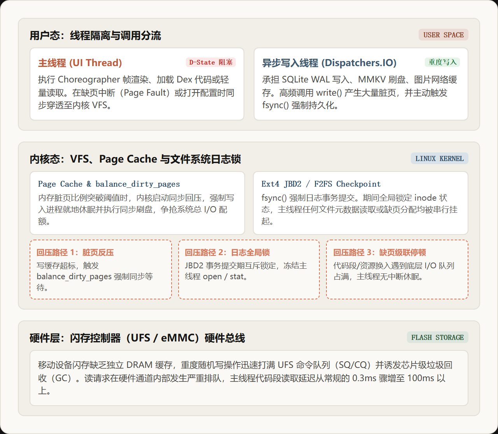
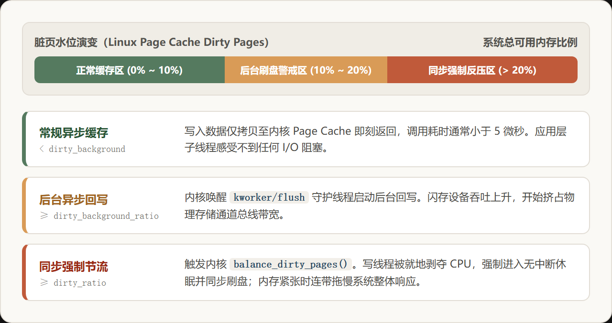
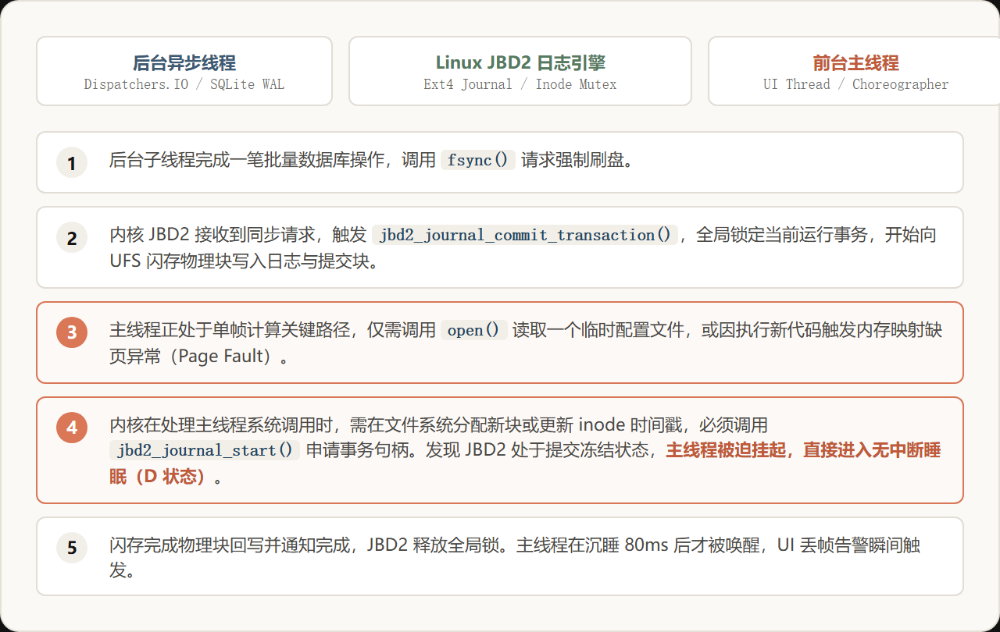
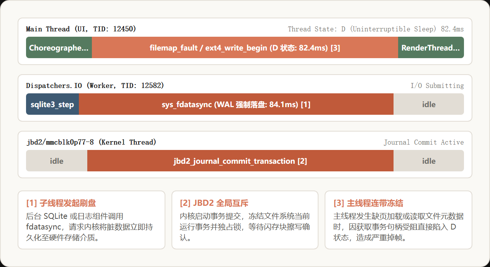

# Page Cache 脏页回压、文件系统日志提交与 fsync 级联阻塞

在 Android 移动端性能工程与流畅度治理的实践中，“把耗时操作移入子线程”一直被很多工程师奉为规避界面卡顿的金科玉律。面对磁盘文件读写、数据库持久化或键值存储更新，开发者的第一反应往往是在协程中切换到 `Dispatchers.IO`，或者向专属的后台线程池提交任务。

然而，翻开大型商业应用的线上监控数据与 ANR 堆栈，常能捕捉到类似这样的诡异现场：

主线程在执行常规的列表滑动、转场动画或组件渲染时突然遭遇数十毫秒乃至数百毫秒的停顿，导致界面剧烈掉帧，甚至触发系统 Input 派遣超时告警。当排查人员抓取主线程堆栈时，却发现其并未执行任何复杂的业务计算，甚至代码行仅仅停留在 `open()`、`read()`、`createTempFile()`，或者看似普通的类加载与静态资源访问上；线程的内核调度状态被系统打上了赫然在目的 `D`（Uninterruptible Sleep，无中断内核休眠）标记。

面对这种现象，不少团队会陷入困惑：“主线程明明没有直接调用任何大文件写入代码，耗时的保存逻辑早就分发给了后台线程，为什么前台界面依然频频被强行卡死？”

这种认知偏差的核心，在于将“用户态的线程并发隔离”等同于“内核态的存储子系统隔离”。

在 Linux 与 Android 存储栈中，不论应用层划分了多少个 Java 线程或协程，它们最终共享着同一套虚拟文件系统（VFS）、同一块内存页缓存（Page Cache）、同一个文件系统日志事务锁（如 Ext4 JBD2 或 F2FS Checkpoint），以及同一条物理闪存芯片（UFS/eMMC）的硬件总线。

子线程肆无忌惮的高频写入与强制同步（`fsync`），会通过内核脏页回压机制与文件系统全局锁，在整机甚至全进程范围内形成级联式的阻塞传导。即使主线程自身只发起了微小的元数据读取或遭遇缺页异常，也会被无差别地拖入内核休眠状态。

本文结合 Linux 内核存储模型、Ext4 文件系统日志实现、移动端闪存硬件特性与大型应用实战经验，深入拆解这条跨越用户态与内核态的隐形 I/O 阻塞链路。



---

## 1. 认知重构：用户态线程隔离不等于内核态存储隔离

要排查异步 I/O 拖垮主线程的根源，首先需要纠正两个在移动端开发中广泛存在的认知误区。

### 1.1 为什么把写操作移入子线程依然无法独善其身

在操作系统概念中，线程隔离主要体现在独立的用户态寄存器上下文与线程调用栈空间。然而，下沉到内核空间后，文件系统的状态是全局共享的：

- **共享系统页缓存**：所有线程对同一文件系统发起的读取与写入，均映射到内核统一管理的 Page Cache 物理内存页；
- **共享文件系统元数据锁**：针对目录项（dentry）、索引节点（inode）的修改，以及文件系统层级的日志提交，必须遵循严格的互斥锁与事务提交流程；
- **共享块设备驱动与硬件队列**：存储芯片同一时刻只能处理有限的物理扇区擦写请求，硬件控制器的并发承载能力存在刚性上限。

当后台子线程高频写入大体积日志、缓存网络图片或频繁提交数据库时，产生的 I/O 压力并不会被圈禁在后台线程自身内部，而是迅速转变为内核子系统与硬件总线的全局负荷。

### 1.2 穿透主线程的隐形 I/O：缺页异常与代码装载

许多开发者坚信：“只要主线程代码里没有显式调用 `FileInputStream` 或 `FileOutputStream`，主线程在执行过程中就绝对不会触发磁盘 I/O。”

事实恰恰相反。在现代 Android 运行时中，主线程每时每刻都在间接发起隐形 I/O：

- **代码与类加载**：应用安装包中的 DEX 字节码文件、AOT 编译产物（OAT 文件）以及 Native 动态链接库（.so 文件），在进程启动阶段均通过 `mmap` 系统调用建立虚拟内存映射，而不是一次性全量读入内存；
- **缺页中断唤醒**：当主线程运行到此前尚未执行过的类、跳转至新的方法，或者调用 Native 库中的符号时，CPU 的内存管理单元（MMU）会发现对应的虚拟地址并未分配物理页，从而触发一次缺页中断（Page Fault）；
- **同步物理换入**：如果系统此前因内存水位压力将该代码段的干净页释放（Page Drop），内核此时必须暂停主线程，同步从物理闪存中读取对应的 4KB 数据块填充物理页帧。

如果在主线程遭遇缺页中断的瞬间，底层的闪存硬件总线正被后台子线程的写操作完全占满，或者文件系统正处于日志提交锁定阶段，主线程的缺页换入操作就会被强行延后数十毫秒。在主线程看来，自己仅仅是在执行普通的 Java 方法调用，但在系统时间线上却已经发生了严重的掉帧与卡顿。

---

## 2. 隐形阻塞源之一：Linux Page Cache 脏页回压机制

当应用程序调用 `write()` 系统调用将数据写入磁盘时，为了保障执行吞吐，Linux 默认采用延迟写入策略：数据只要被拷贝进内核维护的 Page Cache，变为“脏页”（Dirty Pages），系统调用就会立即返回，整个过程仅耗费微秒级的 CPU 时间。

然而，物理内存是有限的，脏页绝不可能无限制地累积。为了防止系统内存被待刷盘的数据彻底吞噬，Linux 内核设计了精密的脏页回压节流机制。



### 2.1 脏页积累与 balance_dirty_pages 强制节流

在 Linux 内核内存管理子系统 `mm/page-writeback.c` 中，每一次写入调用在递交脏页后，都会执行 `balance_dirty_pages_ratelimited()` 函数：

```c
/* linux/mm/page-writeback.c 核心节流逻辑 */
void balance_dirty_pages_ratelimited(struct address_space *mapping) {
    struct inode *inode = mapping->host;
    struct backing_dev_info *bdi = inode_to_bdi(inode);
    struct bdi_writeback *wb = &bdi->wb;

    /* 检查当前脏页生成速率与全局水位阈值 */
    if (unlikely(current->nr_dirtied >= current->nr_dirtied_pause)) {
        balance_dirty_pages(wb, current->nr_dirtied);
        current->nr_dirtied = 0;
    }
}
```

内核针对脏页占系统总可用内存的比例预设了两道水位警戒线：

- **后台异步回写水位（dirty_background_ratio）**：通常设定为 5% 到 10%。当系统脏页总量超过该比例时，内核会异步唤醒 `kworker` 或 `flush` 守护线程，在后台静默向物理闪存下发写请求，此时调用 `write()` 的应用线程仍能迅速返回；
- **同步强制节流水位（dirty_ratio）**：通常设定为 20% 左右。一旦后台线程写入速度过快，或者系统总可用内存因多任务运行而萎缩，脏页比例一旦冲过此阈值，内核将直接判定当前写入失控。

在进入 `balance_dirty_pages()` 后，内核会强制将发起写入的应用线程投入睡眠状态，强迫该线程就地等待脏页同步刷盘，直至系统脏页水位回落到安全区间。

如果应用中的日志模块、数据同步组件或离线下载器在后台并发执行密集的磁盘写入，极易在短时间内使整个系统的脏页水位逼近上限。虽然被直接休眠的是后台线程，但更致命的次生灾害随即会在前台爆发。

### 2.2 内存压力与直接页面回收的级联放大

在 Android 设备常态处于高内存水位的环境下，密集的脏页生产会直接加剧操作系统的内存紧张状态：

- 当系统内存吃紧时，内核守护进程 `kswapd` 必须执行页面回收。对于只读的代码映射页，内核可以直接丢弃（Drop）；但对于匿名内存与脏文件页，内核必须先将其压缩写入 ZRAM 或落盘；
- 如果前台主线程此时需要申请一块内存用于 View 布局或图片解码，而内核已经无法通过快速路径划分内存，主线程就会被迫进入直接页面回收（Direct Reclaim）流程；
- 在直接回收过程中，主线程自身会被卷入漫长的内存腾挪与块设备等待中，执行状态同样转为 `D`，界面渲染彻底陷入冻结。

---

## 3. 隐形阻塞源之二：文件系统日志事务与 fsync 级联挂起

如果说 Page Cache 脏页回压是通过内存消耗引发的间接冲击，那么文件系统的日志事务锁（Journaling Transaction Lock），则是能将主线程直接拉入深渊的硬性互斥栅栏。

### 3.1 Ext4 JBD2 日志事务与原子提交流程

目前主流 Android 设备广泛采用 Ext4 或 F2FS 文件系统。以 Ext4 为例，为了防止设备在突然断电或异常崩溃时发生文件系统损坏，系统引入了 JBD2（Journaling Block Device 2）子系统。

任何针对文件系统元数据的修改（例如创建文件、扩大文件容量、更新目录索引、修改 inode 属性），都必须以事务（Transaction）的形式按序记录在独立的日志区域中。

当后台线程调用 `fsync()` 或 `fdatasync()` 请求强制落盘时，JBD2 必须确保当前处于运行态的事务（`T_RUNNING`）完整提交到底层闪存：

```c
/* fs/jbd2/commit.c 事务提交流水线 */
int jbd2_journal_commit_transaction(journal_t *journal) {
    transaction_t *commit_transaction;

    write_lock(&journal->j_state_lock);
    commit_transaction = journal->j_running_transaction;

    /* 1. 冻结当前事务，状态切换为 T_LOCKED，阻断后续元数据修改 */
    commit_transaction->t_state = T_LOCKED;
    journal->j_running_transaction = NULL;
    write_unlock(&journal->j_state_lock);

    /* 2. 将日志描述符块与已修改的数据块同步刷入物理介质 */
    jbd2_journal_write_commit_record(journal, commit_transaction);

    /* 3. 等待底层 UFS 硬件返回完成中断 */
    wait_event(journal->j_wait_done_commit, ...);
    return 0;
}
```

在事务提交的生命周期中，一旦事务状态转变为 `T_LOCKED`，整个文件系统便不允许任何新的元数据修改操作进入该事务。所有后续尝试修改文件系统的操作，都必须阻塞等待前一笔事务彻底刷入物理介质并释放锁。



### 3.2 子线程 fsync 如何锁死主线程的普通访问

现在审视典型的真实工程场景：

- **子线程的行为**：后台线程执行了一笔 SQLite 数据库插入操作，由于开启了事务与 WAL 机制，或者使用了强一致性配置，代码最终调用了 `sqlite3_step()` 与 `fdatasync()`，命令 JBD2 将元数据刷盘；
- **主线程的行为**：恰在此刻，主线程在界面渲染周期中尝试调用 `File#exists()` 检查某个皮肤资源，或者调用 `Context#getCacheDir()` 准备写入一条微小的临时状态；
- **内核的碰撞**：在 VFS 层，主线程的系统调用下沉到 `ext4_write_begin()` 或 `ext4_lookup()`。内核需要为当前操作开启一个新的日志句柄（`jbd2_journal_start()`）。然而此时 JBD2 的全局状态正被后台线程的 `fsync` 紧紧锁住，主线程直接被内核剥夺执行权，挂起在 `jbd2_journal_start` 的等待队列中；
- **致命的延迟**：移动端闪存单次完成物理同步落盘通常耗时 30ms 到 100ms 不等。在这漫长的数十毫秒内，主线程只能在内核中无中断休眠（`D` 状态），眼睁睁看着当前帧的 VSYNC 信号连续错过，掉帧不可避免。

这就是为什么即便主线程仅仅执行一次看起来无害的读写判断，也会遭遇惊人卡顿的根本机理所在。

---

## 4. 隐形阻塞源之三：闪存芯片（UFS/eMMC）硬件总线竞争与内部磨损

即使绕过了文件系统的日志全局锁，存储体系的最终物理执行点——闪存芯片（UFS / eMMC），也是整套硬件体系中最脆弱的并发瓶颈。

### 4.1 移动端闪存控制器的无 DRAM 缓存特征

与服务器或高端个人电脑中搭载独立高速 DRAM 缓存的 NVMe 固态硬盘不同，绝大多数智能手机出于功耗、体积与物料成本的严苛限制，其 UFS 芯片通常没有配备专用的片外物理 DRAM 缓存，而是依赖芯片内部微小的 SRAM 缓存，或者借助主机性能加速器（Host Performance Booster, HPB）借用系统内存保存部分逻辑块映射表（L2P Table）。

这种硬件架构决定了移动端闪存面对重度并发时的脆弱性：

- **擦除块粒度巨大**：NAND Flash 具有“读写按页（如 16KB），擦除按块（如数 MB）”的物理特性。密集的随机小文件写入会导致闪存内部产生严重的写入放大（Write Amplification）；
- **主控垃圾回收（Device-Level GC）**：一旦芯片内部的空闲预留块被填满，闪存主控芯片必须在后台停下外部指令接收，优先将有效数据页搬迁合并，再执行高压擦除操作。在闪存内部 GC 激活期间，整个芯片的外部响应延迟会陡增数倍。

### 4.2 块设备 I/O 排队与读饥饿放大

在 Linux 块设备驱动层中，I/O 请求被编入通往 UFS 控制器的提交队列（Submission Queue, SQ）。尽管 UFS 3.1 和 UFS 4.0 引入了全双工传输与多命令队列支持，但物理闪存颗粒底层的读写通道仍然是互斥且唯一的。

在读写混合的高负荷场景下：

- 后台子线程源源不断提交的大量写操作请求塞满了块设备的调度器窗口；
- 当主线程因缺页异常向内核申请读取 4KB 的代码段时，该读请求必须排在庞大的写请求序列后等待执行；
- 统计测试表明，在闪存空闲时，一次 4KB 随机读的物理延迟通常仅为 150 到 300 微秒；但在重度后台持续写入的冲击下，读延迟会飙升至 80ms 到 150ms 以上，产生了高达数百倍的延迟放大效应。

---

## 5. 现场定位：用 Perfetto 捕捉 I/O 隐形掉帧与 D 状态

搞清了内核与硬件的这些级联卡死机制，在遭遇线上或测试阶段的疑难掉帧案例时，我们应当如何利用性能跟踪工具将其准确定位？

通过 Perfetto 抓取包含系统调度事件（Scheduling Details）与系统调用（Syscalls）的跟踪轨迹，我们可以遵循清晰的定位路径。



### 5.1 识别线程状态 D (Uninterruptible Sleep) 与关键系统调用

在排查掉帧时间线时，我们可以将其梳理为三级递进的排查链路：

- **第一阶段：主线程状态条特征审视**
  - 核心观察目标：主线程轨道上方的状态标记条（State Bar）；
  - 典型特征颜色：区别于正常的绿青色 `Running` 或灰色的 `Runnable`，观察是否存在较宽的蓝色或紫色条块，状态文字标注为 `D (Uninterruptible Sleep)` 或 `Uninterruptible Sleep (non-IO)`；
  - 现象含义：主线程由于等待内核临界资源，被系统投入无法被信号唤醒的强制休眠，通常对应文件锁、JBD2 事务锁或直接物理 I/O 等待。

- **第二阶段：系统调用切片与缺页事件核验**
  - 核心观察目标：展开主线程下方的 `Syscalls` 轨道，核验停顿区间对应的函数调用；
  - 典型特征切片：`sys_openat`、`sys_fstat`、`sys_fdatasync`、`ext4_write_begin`，或者并无显式系统调用但伴随 `mm_filemap_fault` 内核切片；
  - 现象含义：若停顿发生在 `open` 或 `fstat`，表明受困于文件系统目录与日志锁；若停顿在无系统调用区域，表明遭遇了代码段映射缺页异常。

- **第三阶段：后台工作线程与内核守护线程关联分析**
  - 核心观察目标：同步排查 `Dispatchers.IO` 线程池轨道以及内核线程 `jbd2/mmcblk0p*`、`kworker/u:X`；
  - 典型特征切片：后台线程在相近时间戳内运行着漫长的 `sys_fdatasync` 或 `sqlite3_step`，同时内核 JBD2 线程正在密集执行 `jbd2_journal_commit_transaction`；
  - 现象含义：完全吻合后台刷盘引发全局文件系统事务锁定的级联阻塞特征。

### 5.2 运用 SQL 精确提取 I/O 阻塞切片与耗时分布

面对长达数十秒且包含海量线程的跟踪文件，人工翻找时间线费时费力。在 Perfetto 的 Query 控制台中运行以下 SQL 语句，我们可以瞬间聚合出主线程中所有因 D 状态挂起超过 10 毫秒的阻塞切片及其对应的调用点：

```sql
-- 提取主线程陷入 D 状态超过 10ms 的详细切片与起止时间
SELECT
    ts,
    dur / 1e6 AS dur_ms,
    state,
    (SELECT slice.name FROM slice
     WHERE slice.track_id = (SELECT track_id FROM thread_track WHERE utid = thread_state.utid)
       AND slice.ts <= thread_state.ts
       AND slice.ts + slice.dur >= thread_state.ts
     LIMIT 1) AS active_slice
FROM thread_state
JOIN thread USING (utid)
WHERE thread.name = 'com.example.app' -- 目标应用主线程
  AND state = 'D'
  AND dur >= 10 * 1000000 -- 超过 10ms 的阻塞
ORDER BY dur DESC;
```

如果查询结果中清晰显示多笔持续数十毫秒的 D 状态，并且切片名称集中在文件系统相关调用上，便可坚决排除“视图测量层级过深”或“CPU 算力不足”的干扰，将治理核心收拢在存储体系的异步反压上。

---

## 6. 治理策略：构建抗回压的移动端异步存储体系

理解了后台写入穿透到主线程的这三条级联通道，我们在工程落地中的架构设计就能直击靶心。治理的核心原则非常明确：**既要从主线程彻底剥离对文件系统元数据的隐式依赖，更要对后台子线程的写吞吐与落盘时机实施严格的削峰与平滑治理。**

### 6.1 关键路径杜绝同步 fsync 与主线程文件系统依赖

很多开发者虽然将写操作移入子线程，却依然在主线程保留了看似无害的文件查询代码：

- **移除主线程的磁盘状态探测**：严禁在 `Activity#onCreate()`、View 构造方法或列表滑动回调中调用 `File#exists()`、`File#length()` 或 `File#listFiles()`。这些调用在底层都会触发 `sys_fstatat` 并争抢文件系统 inode 锁，必须将其全量沉降至后台或在内存中建立缓存镜像；
- **清理弃用的 SharedPreferences 同步提交**：严格检查工程中所有的键值存储操作，杜绝使用 `SharedPreferences#commit()`，全量换用异步内存写入的 `apply()`，或者升级至基于内存映射的现代键值库；
- **关键交互期静默协议**：建立全局的“交互静默”广播机制。当用户处于转场动画展开、列表剧烈滑动或冷启动前 2 秒等极度敏感的时间窗内，后台任务管理器应暂停一切非紧急的大文件保存与日志归档动作，将整个闪存总线与 JBD2 事务完全留给前台。

### 6.2 异步写入削峰限流与脏页生产率约束

后台线程在向磁盘写入数据时，必须建立速率认知，绝不能“有多少字节就立刻一股脑推给内核”：

```kotlin
// 基于令牌桶的后台存储写入平滑限流器
class SmoothIoRateLimiter(
    private val maxBytesPerSecond: Long = 2 * 1024 * 1024 // 限制后台写入上限为 2MB/s
) {
    private var availableTokens = maxBytesPerSecond
    private var lastRefillTimestamp = System.nanoTime()

    @Synchronized
    fun acquire(bytesToWrite: Int) {
        refillTokens()
        while (availableTokens < bytesToWrite) {
            val sleepMs = ((bytesToWrite - availableTokens) * 1000L) / maxBytesPerSecond
            Thread.sleep(sleepMs.coerceAtLeast(5L))
            refillTokens()
        }
        availableTokens -= bytesToWrite
    }

    private fun refillTokens() {
        val now = System.nanoTime()
        val elapsedSec = (now - lastRefillTimestamp) / 1_000_000_000.0
        if (elapsedSec > 0) {
            availableTokens = (availableTokens + (elapsedSec * maxBytesPerSecond).toLong())
                .coerceAtMost(maxBytesPerSecond)
            lastRefillTimestamp = now
        }
    }
}
```

针对大批量日志落盘、离线视频分片写入或性能监控堆栈转储：

- **引入写入令牌桶**：强制将后台写入速率压制在低阈值（如每秒不超过 2MB 到 4MB），避免瞬间填满系统脏页缓冲区；
- **分块写入让渡 CPU 与 I/O**：在循环写文件时，每次写入固定尺寸（如 64KB）后主动调用短暂的休眠，为内核 `kworker` 提供从容的异步回写窗口，杜绝脏页水位突破 `dirty_ratio`。

### 6.3 SQLite WAL 检查点异步隔离与参数调优

SQLite 数据库是应用中最容易引发重度 `fsync` 的元凶之一。默认情况下，当 SQLite 的 Write-Ahead Log（WAL）日志积累达到 1000 页时，它会在当前执行写入的连接上自动触发一次被动的 Checkpoint 检查点操作，将日志合并回主库并调用同步落盘。

为了防止这种不可控的落盘行为击穿系统总线：

```kotlin
// 配置 SQLite 隔离式 WAL 检查点策略
fun configureOptimizedSqlite(db: SQLiteDatabase) {
    // 1. 关闭系统默认在写入线程上的自动检查点合并
    db.rawQuery("PRAGMA wal_autocheckpoint = 0;", null).close()

    // 2. 适当降低同步级别，在可控范围内减少硬件级物理刷盘频率
    db.rawQuery("PRAGMA synchronous = NORMAL;", null).close()
}

// 3. 在专属的后台空闲调度任务中，显式以非阻塞模式分阶段合并检查点
fun executeSafePassiveCheckpoint(db: SQLiteDatabase) {
    // PASSIVE 模式不会等待或阻塞其他正在进行的读写事务
    db.rawQuery("PRAGMA wal_checkpoint(PASSIVE);", null).use { cursor ->
        if (cursor.moveToFirst()) {
            val busy = cursor.getInt(0)
            val logPages = cursor.getInt(1)
            val writtenPages = cursor.getInt(2)
            // 记录检查点消化进度，避免日志无序无限膨胀
        }
    }
}
```

通过将 `wal_autocheckpoint` 调优为手动管理，并选用 `PASSIVE` 级别：

- 后台正常的轻量插入事务将只追加 WAL 内存页，不再产生动辄数十毫秒的日志合并与重度 `fsync`；
- 真正的检查点合并操作被转移到应用处于后台、息屏充电或主线程处于深度空闲时段统一调度，将对前台用户交互的负面干扰降至最低。

### 6.4 Linux I/O 优先级与线程调度组配合

充分利用 Android 底层提供的 Linux 进程调度机制，对线程实施全方位的配额约束：

- **显式分配后台线程优先级**：在后台写文件的线程入口处，显式调用 `Process.setThreadPriority(Process.THREAD_PRIORITY_BACKGROUND)`；
- **利用 Cgroup 实现 I/O 调度降权**：Android 框架层会将处于后台优先级的线程绑定至对应的 cpuset 与 I/O 控制组（blkio cgroup）。在支持 BFQ 或 CFQ 调度器的内核中，后台 I/O 线程的请求权重（`blkio.weight`）会被强制调低，当主线程发生缺页中断读取代码段时，块设备调度器会优先让渡通道，大幅缓解读请求的饥饿排队。

通过在架构层对主线程实施存储解耦、在后台层落实写入削峰与检查点隔离，我们能够切断用户态并发向内核态存储的卡顿渗透，在复杂多任务的移动终端上为用户打造真正坚固、丝滑的交互体验。

## 参考资料

- [Linux Kernel Page-Writeback Architecture](https://www.kernel.org/doc/html/latest/admin-guide/mm/page-writeback.html)（The Linux Kernel documentation · 查阅于 2026-10-31）
- [Ext4 Filesystem Disk Layout & JBD2 Journaling](https://www.kernel.org/doc/html/latest/filesystems/ext4/journal.html)（The Linux Kernel documentation · 查阅于 2026-10-31）
- [SQLite Write-Ahead Logging (WAL) Architecture](https://www.sqlite.org/wal.html)（SQLite Official Documentation · 查阅于 2026-10-31）
- [Perfetto System Profiling & Trace Analysis](https://developer.android.com/tools/perfetto?hl=zh-cn)（Android Developers · 查阅于 2026-10-31）
- [Universal Flash Storage (UFS) JEDEC Specification](https://www.jedec.org/standards-documents/focus-areas/universal-flash-storage-ufs)（JEDEC Solid State Technology Association · 查阅于 2026-10-31）
