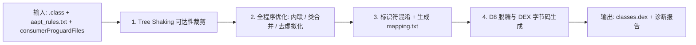

# R8 全模式优化、Keep 规则陷阱与包体积瘦身实战

升级 Android Gradle Plugin（AGP）8.0 以上版本后，很多工程在 Release 构建下会集中暴露两类看似矛盾的问题：一类是本地 Debug 运行完全正常的 Gson 解析、Retrofit 接口返回或反射逻辑，打成正式包后却抛出 `IllegalStateException: TypeToken must be created with a type argument` 或 `NoSuchMethodException`；另一类是业务模块里堆满了 `-keep class com.example.model.** { *; }` 这类通配规则，导致每次迭代包体积持续膨胀，却没人敢删。

这两类问题的共同根源在于对 **R8 编译管线** 与 **R8 Full Mode（全模式）** 行为边界的误解。从 AGP 8.0 开始，`android.enableR8.fullMode` 默认置为 `true`，R8 不再按传统 ProGuard 的保守兼容性假设保留类元数据和无参构造器。下面结合 R8 编译流程、Full Mode 规则变化、Keep 指令语义、资源严格裁剪以及量化排查工具，梳理一套可直接落地的配置与排障方法。

---

## 1. R8 编译管线：从字节码裁剪到 D8 降糖

在早期的 Android 构建链路中，代码压缩由 ProGuard 完成：先将所有 `.class` 输入转为优化后的 `.class`，再交给 `dx` 或 `D8` 编译成 `.dex`。R8 把**代码裁剪（Shrinking）、优化（Optimization）、混淆（Obfuscation）与 D8 脱糖降维（Dexing & Desugaring）**合并到同一趟中间表示（IR）管线中，减少了一次字节码反序列化与再生成的开销，也让跨方法、跨类的全局分析成为可能。

### 1.1 四阶段处理链路与入口集合

R8 并不会凭空判断哪些类有用，它以一组**入口点（Entry Points）**为根节点，沿引用图向外做可达性分析（Tree Shaking）。Android 构建中的入口点主要来自三个源头：

1. **AAPT2 自动生成的规则（`aapt_rules.txt`）**：编译期扫描 `AndroidManifest.xml` 与布局 XML 中的 `Activity`、`Service`、`Receiver`、`Provider` 以及自定义 `View` 构造器，自动生成对应的 `-keep` 规则。
2. **各依赖库随 AAR 携带的规则（`consumerProguardFiles`）**：三方库在打包时把自身必需的 Keep 规则打进 AAR 的 `proguard.txt`，宿主构建时会自动合并。
3. **项目自身的 `proguard-rules.pro` 与默认规则文件**：例如 AGP 提供的 `proguard-android-optimize.txt`。



### 1.2 全程序优化到底改写了什么

在 `build.gradle.kts` 中，默认模板通常建议引用 `getDefaultProguardFile("proguard-android-optimize.txt")` 而不是早期的 `proguard-android.txt`（AGP 8.0+ 已禁止使用禁用了优化的旧配置）。开启优化后，R8 会基于全局类层次结构（Whole-program Analysis）执行以下几类改写：

- **方法内联与死分支消除**：当某个接口或常量只在单一分支使用（例如 `if (BuildConfig.DEBUG)` 在 Release 下恒为 `false`），R8 会直接剔除整个条件代码块及其中仅被该分支引用的辅助类。
- **去虚拟化（Devirtualization）**：如果一个接口或抽象类在整个 APK 中只有一个实现类，R8 会把 `invoke-interface` / `invoke-virtual` 调用重写为直接调用，甚至进一步将类与接口合并。
- **水平与垂直类合并（Class Merging）**：结构相似、无外部引用的小类或单子类父类会被折叠，从而直接减少 DEX 中的类定义条目与方法数（Method Count）。
- **枚举拆箱（Enum Unboxing）**：对于未逃逸到反射或序列化边界的简单 `enum`，R8 可在字节码层将其替换为基本类型 `int` 常量，省去枚举类对象分配与 `<clinit>` 静态初始化开销。

::: info 优化为什么会放大 Keep 规则缺失的后果？
在未开启优化或 Debug 构建时，类结构、泛型签名与调用关系保持原样，反射框架总能找到目标；而 R8 的去虚拟化、类合并和参数裁剪会直接改变方法签名与类继承关系。只要框架依赖运行时反射读取结构，而规则又没有覆盖到对应元数据，Release 包就会在运行期崩溃。
:::

---

## 2. AGP 8.0+ R8 Full Mode 为什么会打断反射代码

在 AGP 7.x 时代，为了降低从 ProGuard 迁移的门槛，R8 默认运行在 **Compatibility Mode（兼容模式）**；从 **AGP 8.0** 起，R8 默认切换为 **Full Mode（全模式）**。官方不再建议通过 `android.enableR8.fullMode=false` 回退兼容模式，而应在规则层对齐 Full Mode 的语义约束。

### 2.1 Compatibility Mode 与 Full Mode 的核心分歧

| 机制维度                   | Compatibility Mode（兼容模式）     | Full Mode（AGP 8.0+ 默认）             | 常见线上影响                                     |
| :------------------------- | :--------------------------------- | :------------------------------------- | :----------------------------------------------- |
| `-keepattributes` 生效范围 | 全局声明后，通常对多数保留类生效   | 仅对被 `-keep` 规则显式匹配的元素生效  | Gson / Retrofit 无法读取泛型的 `Signature`       |
| 无参构造器保留策略         | 对被保留的类倾向于保留默认无参构造 | 未显式匹配且无静态引用的构造器会被裁剪 | Fragment / 反射实例化报 `InstantiationException` |
| 类与成员可见性修改         | 保守调整，较少跨包重打包           | 允许激进修改可见性、内联及包重组       | 跨模块反射访问非 `public` 成员失败               |
| 方法参数与返回值裁剪       | 仅在有限场景优化未使用参数         | 确认无调用读取时直接移除未用参数       | 依赖特定签名回调的 JNI 或反射查找失效            |
| 空接口与中间抽象层         | 多保留原始继承层级                 | 单实现接口会被合并或剥离               | 动态代理 `Proxy.newProxyInstance` 目标接口丢失   |

### 2.2 典型故障拆解：`TypeToken` 与泛型 `Signature` 剥离

使用 Gson 反序列化泛型集合时，业务代码里常见如下写法：

```kotlin
data class OrderItem(
    val orderId: String,
    val amount: Long
)

fun parseOrders(json: String): List<OrderItem> {
    val type = object : TypeToken<List<OrderItem>>() {}.type
    return Gson().fromJson(json, type)
}
```

Kotlin 编译上述匿名内部类时，会在字节码的 `Signature` 属性中写入父类泛型参数 `Lcom/google/gson/reflect/TypeToken<Ljava/util/List<Lcom/example/OrderItem;>;>;`，Gson 运行时正是通过 `Class.getGenericSuperclass()` 读取该属性来还原 `OrderItem` 类型。

在兼容模式下，只要规则文件里写了 `-keepattributes Signature`，匿名子类的 `Signature` 通常会被留下来。但在 **R8 Full Mode** 下，仅写 `-keepattributes Signature` 不再足够：如果 `TypeToken` 及其匿名子类没有被 `-keep` 规则显式命中，R8 会认为该类的泛型签名未被代码静态依赖，直接剥离其 `Signature` 属性，导致运行期抛出 `TypeToken must be created with a type argument`。

在 Full Mode 下，需要同时保留 `Signature` 属性并以条件规则精确命中 `TypeToken` 及其子类：

```text
# 保留泛型签名与内部类归属信息（TypeToken 匿名类依赖 EnclosingMethod / InnerClasses）
-keepattributes Signature,InnerClasses,EnclosingMethod

# 仅当项目确实使用到 Gson TypeToken 时，才保留其自身及所有匿名/具名子类
-if class com.google.gson.reflect.TypeToken
-keep,allowobfuscation class com.google.gson.reflect.TypeToken

-keep,allowobfuscation class * extends com.google.gson.reflect.TypeToken
```

::: warning 不要只保留 `TypeToken` 而忘了数据类字段
即使 `TypeToken` 拿到了 `List<OrderItem>` 的类型信息，如果 `OrderItem` 的字段被混淆重命名且没有 `@SerializedName` 注解，Gson 依然无法将 JSON 键映射到被改成 `a`、`b` 的字段上。对于 JSON DTO，要么全部显式标注 `@SerializedName`，要么改用基于 KSP / 编译器插件生成静态解析代码的 `Moshi`（`moshi-kotlin-codegen`）或 `kotlinx.serialization`，从根源上脱离运行期反射与 `Signature` 依赖。
:::

### 2.3 `-keepattributes` 的最小集合与堆栈还原

很多团队在排查 Crash 时习惯照抄网上的“万能属性行”，把所有调试属性一股脑塞进配置，导致包体积白白增加。在工程中应只保留确有用途的属性：

```text
# 1. 泛型与匿名类定位（Retrofit / Gson / 反射必需）
-keepattributes Signature,InnerClasses,EnclosingMethod

# 2. 运行期注解（Retrofit @GET/@POST、EventBus @Subscribe、Hilt/Room 等）
-keepattributes RuntimeVisibleAnnotations,RuntimeVisibleParameterAnnotations

# 3. 异常堆栈行号与文件名脱敏映射（配合 mapping.txt 使用 retrace）
-keepattributes SourceFile,LineNumberTable
-renamesourcefileattribute SourceFile
```

这里容易被忽略的是 `-renamesourcefileattribute SourceFile`：它能把原始源码文件名（如 `CheckoutRepository.kt`）统一抹成常量字符串 `SourceFile`，既保留了行号映射以供 Crash 平台通过 `mapping.txt` 还原真实堆栈，又不会泄露内部文件命名结构，还能减少字符串常量池冗余。

---

## 3. Keep 规则的精准语法与常见反模式

包体积失控往往不是因为业务逻辑太重，而是因为几条过于宽泛的规则让 R8 丧失了裁剪和混淆的能力。写规则前必须分清四条核心指令分别管“**不删除**”还是“**不改名**”，以及作用在“**类**”还是“**成员**”。

### 3.1 四类 Keep 指令的作用域矩阵

| 指令                      | 防止类被裁剪         | 防止类被重命名       | 防止成员被裁剪 | 防止成员被重命名 | 典型适用场景                                                      |
| :------------------------ | :------------------- | :------------------- | :------------- | :--------------- | :---------------------------------------------------------------- |
| `-keep`                   | 是                   | 是                   | 是（匹配成员） | 是（匹配成员）   | 被 Manifest / JNI / `Class.forName` 直接按全限定名引用的入口类    |
| `-keepclassmembers`       | **否**               | **否**               | 是（若类存活） | 是（若类存活）   | 数据模型、回调接口、序列化 DTO（类若无引用仍可整体删掉）          |
| `-keepclasseswithmembers` | 条件（含指定成员时） | 条件（含指定成员时） | 是（匹配成员） | 是（匹配成员）   | 带有 `native` 方法的类、特定签名的自定义 View 构造器              |
| `-keepnames`              | **否**               | 是                   | **否**         | 是（若成员存活） | 等价于 `-keep,allowshrinking`，允许裁剪死代码，仅保住存活项的名字 |

从上表可以看出关键差别：**`-keep` 会强行保活整个类，哪怕业务代码早就把调用删掉了**；而 `-keepclassmembers` 只在“该类本身通过正常引用链存活”时才保护其成员。

### 3.2 条件规则 `-if` 与修饰符 `allowobfuscation`

在封装基础库或排查历史规则时，经常需要处理“只有在某功能模块被用到时，才保留配套反射类”的场景。此时可以使用 `-if` 条件规则与修饰符组合：

- **`allowobfuscation`**：允许 R8 对类或成员进行短名称混淆，只禁止删除。配合 Gson `@SerializedName` 或仅需保留结构（如 `TypeToken` 匿名类）的场景，能把类名压成单字母，显著减小 `classes.dex` 字符串池。
- **`allowshrinking`**：允许 R8 在不可达时彻底删除该类，但如果它存活下来，则禁止重命名。
- **`-if` 条件触发**：只有当 `-if` 匹配的类的实例或方法在裁剪后依然存在，后续紧跟的 `-keep` 规则才会生效。

例如，某自研埋点或路由适配器仅在 `AnalyticsBridge` 存活时才需要保留对应的反射实现类，可以这样写：

```text
-if class com.example.analytics.AnalyticsBridge {
    public static void init(...);
}
-keep,allowobfuscation class * implements com.example.analytics.TrackProvider {
    public <init>();
}
```

如果某个变体（Flavor）或模块没有调用 `AnalyticsBridge.init(...)`，整个 `TrackProvider` 实现类都会被 R8 干净移除，不会留下死代码。

### 3.3 三个高发反模式与修正写法

**反模式 1：对整个包使用通配符 `-keep`**

```text
# 反模式：整个包及子包全部禁止裁剪、禁止混淆、禁止优化
-keep class com.example.network.** { *; }
```

这行规则会让网络包下的所有请求体、响应体、工具类、甚至已废弃的旧接口 Model 全部常驻 DEX 且保留完整类名与成员名。如果确实使用基于字段名的反射序列化且未标注注解，至少应降级为 `-keepclassmembers`，并限定为具体父类或注解：

```text
# 修正：仅对实现 BaseDto 且实际存活的类保留字段，类名允许混淆
-keepclassmembers,allowobfuscation class * extends com.example.network.BaseDto {
    <fields>;
}
```

**反模式 2：重复手工 Keep 四大组件与 `@Keep` 滥用**

`Activity`、`Service`、`BroadcastReceiver`、`ContentProvider` 以及 XML 中声明的自定义 `View`，已经由 AAPT2 自动写入 `build/intermediates/proguard-rules/<variant>/aapt_rules.txt`，不需要在 `proguard-rules.pro` 里再次整包 `-keep`。同理，在类级别随意贴 `@Keep`（等价于 `-keep class Foo { *; }`）也会把类连带全部未使用的方法锁死在包内；若只想保住某一个被反射调用的方法或字段，应把 `@Keep` 精确加在那个方法或字段上。

**反模式 3：忽视三方库 AAR 带入的 `consumerProguardFiles`**

有时业务自己的规则写得很克制，包体积却依然居高不下。原因往往是某个三方 SDK 在它的 `consumer-rules.pro` 里写了诸如 `-keep class com.thirdparty.** { *; }` 或 `-dontoptimize` 之类的全局指令。由于所有 AAR 规则会直接并入最终 R8 配置，这类全局开关会拖累全工程的优化效果。排查方法见第 5 节的 `-printconfiguration`。

---

## 4. 资源裁剪（ShrinkResources）与 `resources.arsc` 协同瘦身

代码裁剪只处理 DEX 字节码；布局 XML、图标、多语言文本和字体等资源占用的体积，需要开启资源裁剪与 `R8` 联动才能清理：

```kotlin
// app/build.gradle.kts
android {
    buildTypes {
        release {
            isMinifyEnabled = true
            isShrinkResources = true
            proguardFiles(
                getDefaultProguardFile("proguard-android-optimize.txt"),
                "proguard-rules.pro"
            )
        }
    }
}
```

只有 `isMinifyEnabled = true` 开启后，`isShrinkResources = true` 才会生效——因为资源裁剪器必须先知道哪些 `R.drawable.*` / `R.layout.*` 在代码裁剪阶段已经随着死代码一起被删掉了，才能把对应的资源从 APK 中剔除。

### 4.1 Safe Mode 与 Strict Mode 的判定差异

资源裁剪器默认工作在 **Safe Mode（安全模式）**。只要源码或任何三方依赖中出现 `Resources.getIdentifier("icon_" + type, "drawable", packageName)` 这类动态字符串拼接查找，安全模式就会采取保守策略：把所有名字以 `icon_` 开头或匹配正则前缀的资源全部标记为“可能被使用”，拒绝删除。很多大型项目里，某个老旧 SDK 写了一句 `getIdentifier`，就能让上百张废弃图片在安全模式下全部保留下来。

如果确认项目不依赖模糊前缀动态加载资源，或者已经明确列出了动态访问白名单，可以在 `res/raw/keep.xml` 中开启 **Strict Mode（严格模式）**，强制资源裁剪器仅保留静态引用以及显式声明的资源：

```xml
<?xml version="1.0" encoding="utf-8"?>
<resources xmlns:tools="http://schemas.android.com/tools"
    tools:shrinkMode="strict"
    tools:keep="@drawable/ic_dynamic_*,@layout/dialog_legacy_notice"
    tools:discard="@layout/unused_debug_panel" />
```

- `tools:shrinkMode="strict"`：关闭动态字符串前缀猜测，只保留代码和资源引用图可达的资源与 `tools:keep` 白名单。
- `tools:keep`：用逗号分隔需要强行保留的资源（支持 `*` 通配符），专门兜底确有 `getIdentifier` 调用的资源。
- `tools:discard`：强制移除已知废弃、但因间接引用或测试残留未被自动删掉的资源。

### 4.2 `resConfigs` 裁剪冗余多语言与密度资源

即便开启了 `isShrinkResources`，`androidx.*` 和 Google Material 等基础库自带的上百种语言翻译依然会保留在 `resources.arsc` 中，因为系统认为它们属于应用已支持资源的本地化变体。对于只面向特定地区发行的应用，在 `defaultConfig` 中配置 `resourceConfigurations`（旧 Groovy DSL 为 `resConfigs`）可以直接剥离无关语言表，大幅压缩 `resources.arsc` 体积：

```kotlin
android {
    defaultConfig {
        // 仅保留简体中文与英文字符串资源
        resourceConfigurations += listOf("zh-rCN", "en")
    }
}
```

::: tip 资源压缩并非删除文件条目，而是替换为占位空文件
需要注意的是，部分情况下被裁剪的资源（尤其是通过 `tools:discard` 或引用图移除的 XML/PNG）在生成的 APK 中并不是彻底从 `resources.arsc` ID 表抹除，而是被替换成一个极小的占位空资源（例如 1x1 透明 PNG 或空 XML），从而避免破坏编译期已内联的 `R` 常量索引；即便如此，原本几十 KB 到几 MB 的媒体体积也会降到几十字节。
:::

---

## 5. 线上混淆排查与包体积可观测工具链

调整 Keep 规则和裁剪策略时，不能靠“改一条打一次包看报错”盲猜。R8 和 Android SDK 已经提供了完整的构建诊断输出与二进制审计工具。

### 5.1 用 `-whyareyoukeeping`、`seeds.txt` 与 `usage.txt` 定位规则冲突

在 `proguard-rules.pro` 中临时或按需开启以下诊断指令（Release 构建产物输出在 `app/build/outputs/mapping/release/` 目录下）：

```text
# 输出所有被规则直接保活的类与成员，核查通配符误伤范围
-printseeds seeds.txt

# 输出被 R8 裁剪掉的死代码清单（确认目标废弃模块是否真正被删）
-printusage usage.txt

# 输出合并后的完整生效规则（包含 aapt_rules.txt 与所有三方 AAR 的规则）
-printconfiguration configuration.txt

# 追查某个特定类为什么没有被删除或混淆
-whyareyoukeeping class com.google.android.material.chip.Chip
```

执行 `./gradlew assembleRelease` 后，`-whyareyoukeeping` 会在编译日志中打印完整的引用溯源树，例如：

```text
com.google.android.material.chip.Chip
|- is referenced in keep rule:
|  app/build/intermediates/proguard-rules/release/aapt_rules.txt:14:1
```

如果发现某段不想保留的业务类出现在 `seeds.txt` 中，翻查 `configuration.txt` 就能立刻定位是哪一个 AAR 的 `consumer-rules.pro` 注入了宽泛通配符。资源层面同理，查看 `app/build/outputs/mapping/release/resources.txt` 可以看到每项资源的引用计数及保留/裁剪原因。

### 5.2 `retrace` 还原混淆堆栈

开启混淆和 `-renamesourcefileattribute SourceFile` 后，线上收集到的崩溃堆栈会变成类似 `a.b.c.a(SourceFile:42)` 的形式。Android SDK 命令行工具自带 `retrace`（位于 `$ANDROID_HOME/cmdline-tools/latest/bin/retrace` 或随 R8 工具链分发），可直接结合对应构建版本的 `mapping.txt` 还原出精确的类名、方法名与行号：

```bash
retrace app/build/outputs/mapping/release/mapping.txt stacktrace.txt
```

在 CI/CD 流水线中，每次发布 Release 包或 AAB 时都应当归档 `mapping.txt`（如果使用 Google Play App Signing，随 AAB 上传即可自动解密线上崩溃）。没有归档 `mapping.txt` 的正式包一旦出现混淆崩溃，后续几乎无法精确定位行号。

### 5.3 `apkanalyzer` 量化验证包体积收益

每次删减宽泛 Keep 规则或调整 `keep.xml` 后，建议使用 Android SDK 自带的 `apkanalyzer` 在 CLI 中对比 Release APK 的真实字节变化，把“瘦身”落到可复现的数据上：

```bash
# 查看 APK 整体下载体积与各组成部分占比
apkanalyzer apk summary app-release.apk

# 统计各包名下的 DEX 方法数与类数量，快速找出未混淆或体积异常的子包
apkanalyzer dex packages app-release.apk --defined-only

# 对比优化前后两个 Release APK 的精确体积差异
apkanalyzer apk compare --different-only app-release-before.apk app-release-after.apk
```

把 `apkanalyzer apk summary` 与 `apk compare` 接入 PR 校验或 nightly 构建后，一旦某次提交引入了新的宽泛 `-keep` 规则或带入了未裁剪的 AAR 依赖，团队在合入代码前就能直接看到 `classes.dex` 或 `resources.arsc` 的增量变化，避免问题积累到发版前才集中爆发。

---

## 参考资料

1. [Android Developers: Shrink, obfuscate, and optimize your app](https://developer.android.com/build/shrink-code)
2. [R8 Official Repository: Compatibility Mode vs Full Mode FAQ](https://r8.googlesource.com/r8/+/refs/heads/main/compatibility-faq.md)
3. [Android Developers: Analyze your build with APK Analyzer (`apkanalyzer`)](https://developer.android.com/tools/apkanalyzer)
4. [Android Developers: Customize which resources to keep (`keep.xml`)](https://developer.android.com/build/shrink-code#keep-resources)
