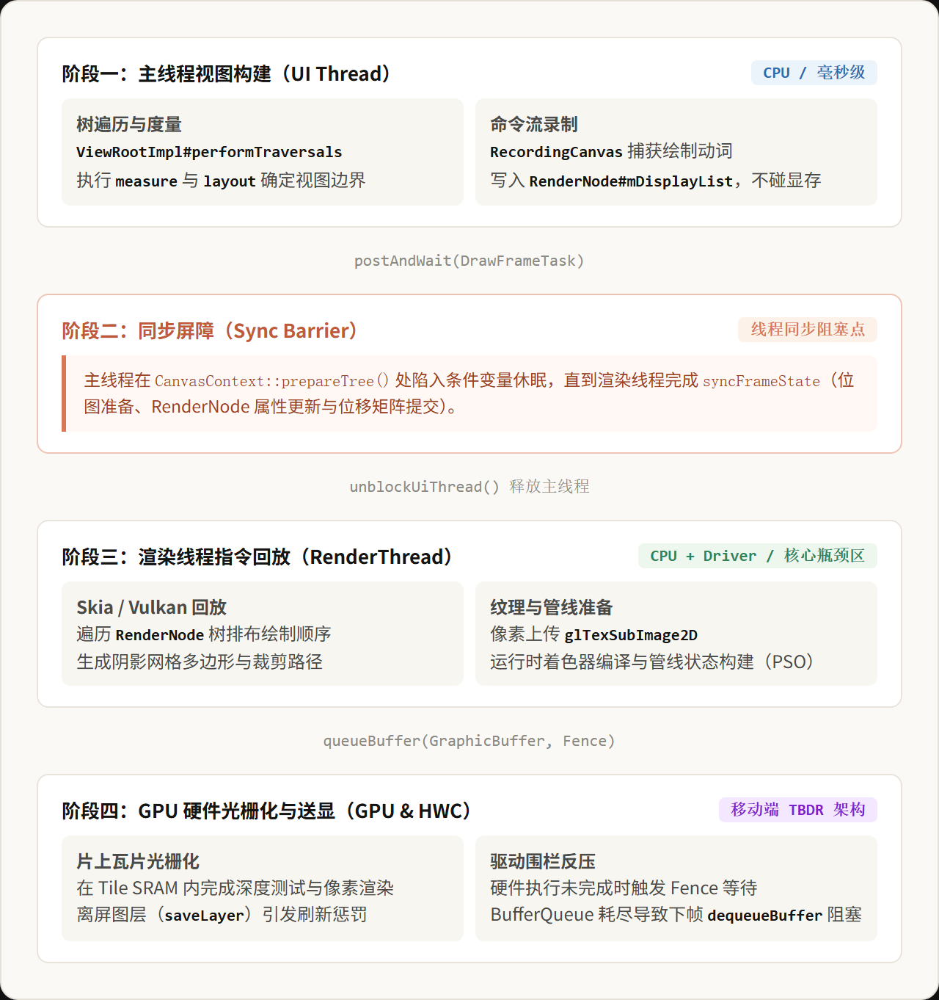
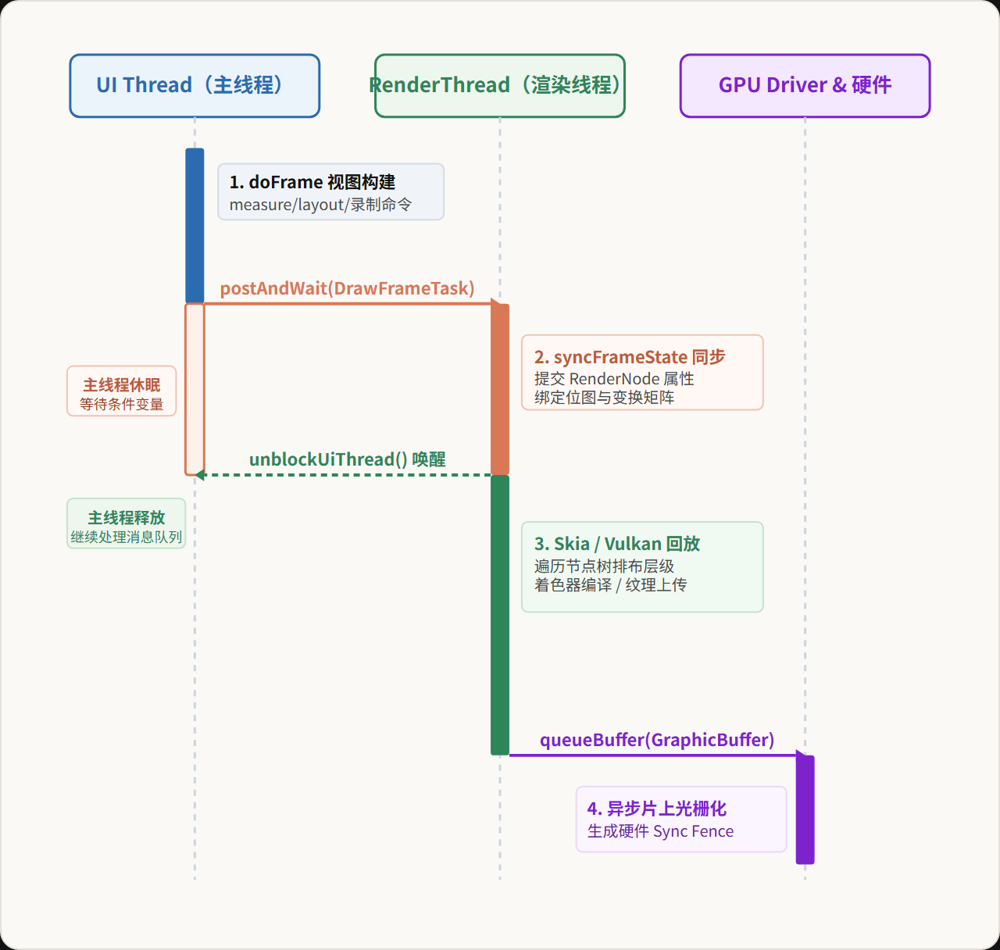
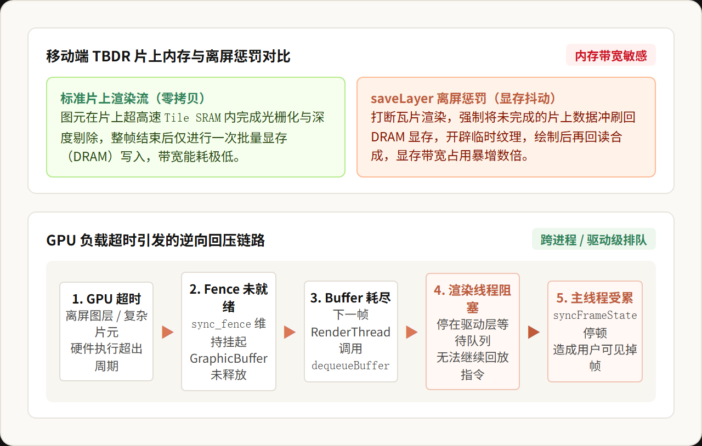

# RenderThread 硬件加速、Shader 编译停顿与 GPU Fence 回压

在 Android 性能调优与掉帧治理的实战中，许多开发者都经历过这样一种困惑：

在线上 APM 监控或线下自动化测试中，系统频繁报告界面掉帧（Janky Frame）。我们使用 Perfetto 或 Systrace 打开卡顿现场，查看主线程的执行轨迹，却发现主线程的表现十分理想：

- `Choreographer#doFrame` 的耗时只有 3ms 到 5ms；
- 自定义 View 的 `onMeasure` 与 `onLayout` 执行得十分轻快；
- `onDraw()` 方法里的绘制动词只有寥寥几笔，远远低于 60Hz（16.6ms）或 120Hz（8.33ms）的帧周期红线。

按照常见的经验直觉，只要主线程没有发生耗时操作，界面就应当行云流水。然而屏幕上的列表在滑动时依然出现了肉眼可见的停顿，丢帧指标毫不留情地飘红。

很多工程师面对这种现象会产生误判：“主线程明明还有充裕的空闲时间，怎么可能掉帧？一定是系统底层调度抽搐，或者是当前设备的 GPU 性能太差导致的。”

这种推断忽略了 Android 现代硬件加速渲染的真实分层协作。在开启硬件加速的 Android 应用中，`View#onDraw()` 根本不负责绘制像素。主线程的轻快，并不意味着一帧画面的渲染工作已经完成。真正决定像素何时呈现到屏幕上的重任，落在了后台的渲染线程（`RenderThread`）与 GPU 硬件驱动之间。

如果忽视了渲染线程中的同步屏障、运行时着色器（Shader）编译以及 GPU 硬件围栏（Fence）的反压回流，即使主线程耗时压降到 1ms，界面依然可能遭遇严重的连续卡顿。

本文结合 AOSP 现代渲染管线实现、移动端 GPU 硬件架构与商业大型应用的治理实践，深入拆解这条隐藏在主线程背后的渲染链路。



---

## 1. 认知重构：Android 硬件加速的双线程模型

要搞清楚主线程耗时极短时为何界面依然卡顿，首先必须建立正确的硬件加速认知。

### 1.1 从软件光栅化到命令录制的演进

在 Android 早期未开启硬件加速的时代，界面绘制采用的是纯 CPU 软件绘制链路：

- **软件绘制链路（CPU 独占）**：主线程在调用 `View#draw(Canvas)` 时，底层传入的是基于 Skia CPU 软件光栅化的 Canvas。每一个 `drawLine`、`drawRect` 都会直接由主线程的 CPU 核心计算每个像素的颜色值，并写入匿名共享内存中的 Bitmap。这种模式下，主线程既要处理用户输入、度量布局，又要一笔一划计算像素，CPU 负载极高，且无法利用现代移动 GPU 的并行算力。
- **硬件加速链路（双线程解耦）**：自 Android 3.0 引入硬件加速、Android 5.0 正式剥离出独立渲染线程（`RenderThread`）后，`View#draw()` 彻底转变为命令录制器。

在现代硬件加速模式下，`View#onDraw(Canvas)` 接收到的参数实际是一个 `RecordingCanvas`。当我们在该方法中调用绘制方法时，系统既不计算像素，也不调用 GPU 驱动，而是将这些操作打包为绘图命令（DisplayList Op），存入当前 View 所持有的原生图层节点 `RenderNode` 中。

换句话说，主线程的 `onDraw` 只是在“写菜单”，真正的“烹饪出餐”全部交由下游执行。

### 1.2 同步屏障：为什么主线程需要等待 syncFrameState？

既然命令录制已经解耦，主线程是否在录制完 DisplayList 后就可以毫无顾忌地返回、等待下一个 VSYNC 脉冲？

答案是否定的。在主线程与渲染线程之间，存在一道严格的同步机制。

当主线程完成整个视图树的遍历与绘制录制后，会通过 `ViewRootImpl` 触发 `HardwareRenderer#syncAndDrawFrame()`。翻阅 AOSP 原生库 `frameworks/base/libs/hwui/renderthread/DrawFrameTask.cpp`，我们可以看到该环节的核心调度逻辑：

```cpp
void DrawFrameTask::postAndWait() {
    AutoMutex _lock(mLock);
    mRenderThread->queue().post([this]() { run(); });
    // 主线程在此处陷入条件变量休眠，等待 RenderThread 完成同步
    while (mSyncResult & SyncResult::SyncFrameState) {
        mSignal.wait(mLock);
    }
}

void DrawFrameTask::run() {
    bool canUnblockUiThread = syncFrameState();
    if (canUnblockUiThread) {
        unblockUiThread(); // 唤醒主线程
    }
    // 渲染线程继续独立执行后续的真实绘制与 GPU 提交
    if (mContext) {
        mContext->draw();
    }
}
```

这段 C++ 源码清晰揭示了两者之间的依赖关系：

- 主线程在向 `RenderThread` 提交 `DrawFrameTask` 后，并不能直接回到消息队列去处理下一次触摸事件或下一帧。
- 主线程通过条件变量 `mSignal.wait(mLock)` 陷入休眠，必须等待 `RenderThread` 执行完 `syncFrameState()`。
- 只有当 `RenderThread` 把主线程在 Java 层变更的 `RenderNode` 属性、新录制的 DisplayList 数据以及位图引用完整同步到原生渲染树结构后，才会调用 `unblockUiThread()` 唤醒主线程。



如果视图树层级过深，或者当前帧有大量复杂的自定义 View 触发了重绘，导致 `syncFrameState` 需要拷贝和比对庞大的节点数据，主线程就会在这段条件变量等待中严重耗时。开发者在 Trace 中看到的“主线程耗时”，实际上可能包含着被渲染线程拖慢的无辜等待。

---

## 2. 渲染线程的暗耗：CPU 指令回放与资源加载

当渲染线程通过 `unblockUiThread()` 释放主线程之后，主线程便认为自己的工作已经结束。但对于渲染线程而言，真正的挑战才刚刚开始。

在 Perfetto 中展开 `RenderThread` 轨道，我们会发现紧随在 `syncFrameState` 之后的，是庞大的 `DrawFrame` 与 `flush layers` 切片。

### 2.1 DisplayList 遍历与 Skia 命令翻译开销

渲染线程接管渲染树后，必须对其进行深度优先遍历，并将高层次的 DisplayList 转换为底层 Skia 图形引擎的操作指令。

在 Android 10 以后，AOSP 的 HWUI 统一基于 Skia 管线实现（分为 SkiaGL 与 SkiaVulkan）。在将命令提交给 GPU 之前，CPU 端仍需要完成多项复杂的计算：

- **阴影网格多边形细分（Shadow Tessellation）**：在 Android Material Design 中，View 的 `elevation` 会产生环境光阴影（Ambient Shadow）与聚光灯阴影（Spot Shadow）。这些柔和平滑的阴影并不是由 GPU 着色器简单模糊计算出来的，而是由渲染线程在 CPU 端通过数学算法对轮廓进行三角网格剖分（Tessellation），计算出数以千计的顶点几何体，再交由 GPU 光栅化。如果界面中大量卡片同时动态变化高程或执行位移动画，渲染线程的 CPU 核心占用会迅速达到瓶颈。
- **几何裁剪与坐标重变换（Clip & Matrix Transform）**：圆角矩阵与异形裁剪路径（Path Clip）需要计算相交区域。复杂的非矩形裁剪无法直接映射为硬件视口剪裁（Scissor Test），往往需要退化为模版缓冲（Stencil Buffer）操作，大幅增加命令提交的复杂度。

### 2.2 纹理上传瓶颈：从系统内存到 GPU 显存的搬运代价

另一个极为常见的卡顿源头来自图片纹理上传。

许多开发者了解自 Android 8.0 起，Bitmap 的像素数据（Pixel Storage）从 Java 堆迁移到了 Native 堆，从而减轻了 Java GC 的压力。但需要强调的是：**Native 堆中的像素数据依然只是普通的 CPU 内存，并不是 GPU 显存中的纹理（Texture）**。

当一个新的图片首次出现在屏幕可见区域时：

```java
// 业务层在主线程快速加载完毕 Bitmap
imageView.setImageBitmap(bitmap);
// 主线程仅将 Bitmap 对象引用记录在 DisplayList 中，耗时极短
```

主线程的 `setImageBitmap` 几乎不耗时。然而当这一帧推进到 `RenderThread` 时，Skia 引擎发现该 Bitmap 在 GPU 显存中还没有对应的纹理句柄（Texture ID）：

- 渲染线程必须调用 OpenGL ES 的 `glTexSubImage2D`，或者 Vulkan 的暂存缓冲拷贝操作（`vkCmdCopyBufferToImage`）；
- 该过程需要将高达数兆字节的连续像素从 CPU 内存通过 PCIe / 内存总线复制到 GPU 专有显存空间；
- 如果这是一张未经压缩裁剪的 1080P 或 4K 大图，单次纹理上传操作在高端设备上需要耗费 10ms 到 20ms，在低端设备上甚至超过 40ms。

由于该上传发生在渲染线程的绘制关键路径上，当前帧的 `DrawFrame` 耗时必然超出帧预算，导致渲染线程无法在指定的 VSYNC-sf 节拍前提交缓冲区，从而直接触发掉帧。

---

## 3. 隐形停顿源：运行时 Shader 编译与管线状态构建

在分析一些复杂列表或转场动画的掉帧案例时，我们常常观察到一个奇特的规律：某个页面在第二次、第三次滑动时极为流畅，但在第一次滑入屏幕时，必定伴随着明显的顿挫。

排查发现，这往往是运行时着色器编译（Shader Compilation）引发的短暂停顿。

### 3.1 运行时着色器动态编译惩罚

在现代移动 GPU 架构中，图形流水线高度可编程化。顶点坐标的变换由顶点着色器（Vertex Shader）执行，像素颜色的混合与过滤则由片元着色器（Fragment Shader）执行。

在 Android 的 Skia 渲染管线中，着色器程序并非在 App 安装时全部预先编译完毕。Skia 采用了一种基于动态属性组合的按需生成策略：

- 视图是否开启抗锯齿（Anti-aliasing）；
- 画笔是否配置了圆角渐变（Shader）；
- 图层是否叠加了特定的颜色滤镜（ColorFilter）或混合模式（BlendMode）；
- 目标轮廓是否涉及复杂的局部反走样矩阵。

上述任意一个视觉属性的组合，都会生成一个独特的程序描述符（`GrProgramDesc`）。当渲染线程第一次遇到某种从未见过的视觉效果组合时，本地缓存中不存在对应的编译后机器码二进制，Skia 就必须在渲染线程内即时触发驱动编译：

```cpp
// frameworks/base/libs/hwui 依赖的 Skia 核心源码片段
std::unique_ptr<GrGLProgram> GrGLProgramBuilder::CreateProgram(...) {
    // 1. 动态拼接 GLSL / SPIR-V 着色器源码文本
    // 2. 调用驱动 API: glCompileShader(vertexShader)
    // 3. 调用驱动 API: glCompileShader(fragmentShader)
    // 4. 调用驱动 API: glLinkProgram(program)
    // 此过程完全发生在 RenderThread 的阻塞调用链中
}
```

移动设备上的 GPU 驱动编译器（如高通 Adreno 或 ARM Mali 驱动）并不以轻量著称。一个包含复杂渐变或阴影模拟的片元着色器，其源码解析、优化与底层机器码指令发射，耗时往往在 20ms 到 60ms 之间。

当这几十毫秒的驱动编译过程直接横亘在 `RenderThread` 中时，当前帧就会被硬生生卡住。即便主线程在该帧只消耗了 2ms，用户也能感受到清脆的卡顿。

### 3.2 Android 13+ AGSL 与自定义着色器陷阱

在 Android 13 及更高版本中，Google 提供了 AGSL（Android Graphics Shading Language），允许开发者在应用层编写自定义着色器实现炫酷的光影与扭曲特效。

```kotlin
// Android 13+ 运行时自定义着色器示例
val customShader = RuntimeShader(SHADOW_AND_BLUR_AGSL)
paint.shader = customShader
canvas.drawRect(bounds, paint)
```

AGSL 极大丰富了界面表现力，但也加剧了运行时编译的风险。如果开发者在复杂列表项的 `onDraw` 内部动态拼接着色器逻辑，或者频繁改变 Uniform 变量的结构定义，就会导致 Skia 底层的管线状态对象（Pipeline State Object, PSO）缓存失配，触发反复的重编译，使渲染线程陷入持续的性能泥潭。

---

## 4. 架构反压：GPU 负载如何逆向反噬渲染线程？

许多开发者误以为渲染线程把命令提交给 GPU 之后就万事大吉了。但实际上，CPU 与 GPU 之间是一个闭环的生产者-消费者系统。

当 GPU 自身的处理能力不堪重负时，它会通过硬件同步围栏（Sync Fence）机制，逆向将阻塞压力层层传递回渲染线程，最终波及主线程。



### 4.1 移动端 TBDR 架构与 saveLayer 离屏惩罚

要理解 GPU 为什么会变慢，必须先了解移动端 GPU 的物理架构。

与桌面独立显卡不同，智能手机受限于功耗与发热空间，无法配备数十吉字节每秒的超大位宽显存总线。为此，几乎所有现代移动 GPU（无论是高通 Adreno、ARM Mali 还是联发科使用的架构）都采用了 **TBDR（Tile-Based Deferred Rendering，贴片延迟渲染）** 架构：

- **极速片上瓦片缓存（Tile SRAM）**：GPU 芯片内部集成了极小（通常为几十到几百 KB）但速度极快的高速片上静态存储；
- **瓦片划分与本地光栅化**：屏幕被切分为若干个 16×16 或 32×32 像素的瓦片（Tile）。GPU 依次将几何图形的顶点归入对应的瓦片，然后在片上 SRAM 内部高速完成深度剔除、遮挡计算与片元着色；
- **低功耗单次写回**：当一个瓦片内的所有渲染全部完成后，GPU 才将最终结果一次性写入外部的主内存（DRAM，即系统共享内存），以此最大限度节约昂贵的内存带宽与电量。

然而，一旦开发者在代码中触发了离屏缓冲（Offscreen Buffer），TBDR 的高效设计就会遭受破坏：

```java
// 常见的不合理用法：为了做淡入淡出动画盲目开启透明图层
canvas.saveLayer(bounds, paint);
// 内部包含多层子 View 绘制
canvas.restore();
```

或者在 XML 中随意对复杂 ViewGroup 设置 `android:alpha="0.8"`。

当 Skia 遇到 `saveLayer` 时，它无法在一个连续的瓦片流内完成绘制，必须执行以下打断操作：

1. **强行冲刷（Flush）**：GPU 必须中止当前 Tile SRAM 的流水线，将尚未完成的半成品像素强制写回外部 DRAM；
2. **开辟离屏表面**：在外部显存中开辟一块新的临时缓冲区，将后续子 View 的绘制单独重定向到该表面；
3. **回读与混合（Readback & Blend）**：子绘制结束后，再把这块离屏缓冲当做纹理重新读入 Tile SRAM，与原来的底色进行半透明混合。

这一过程引发了数倍的外部显存带宽搬运与流水线停顿。如果一个页面中嵌套了多个半透明图层或复杂的圆角裁剪，移动 GPU 的片元处理单元就会严重积压，绘制耗时指数级拉长。

### 4.2 GPU Fence 阻塞机制：BufferQueue 的连锁反应

GPU 执行超时，是如何传导给 CPU 上的渲染线程的？答案是 **GraphicBuffer 耗尽与硬件围栏**。

应用进程与系统显示服务（SurfaceFlinger）通过 `BufferQueue` 进行跨进程缓冲交互：

- 渲染线程每次调用绘制之前，必须通过 `dequeueBuffer()` 从队列中取出一个空闲的图形缓冲（GraphicBuffer）；
- 渲染完成后，渲染线程调用 `queueBuffer()`，将挂载了绘制命令的图形缓冲还给队列，并附带一个由 Linux 内核管理的硬件同步文件描述符——**Sync Fence**；
- 这是一个异步操作：`queueBuffer()` 返回时，GPU 可能根本还没开始执行这一帧的光栅化。

当 GPU 因为复杂的离屏渲染或高负载片元着色器而严重延误时，前一帧甚至前前帧的 GraphicBuffer 依然被 GPU 的硬件操作牢牢锁住，其对应的 Sync Fence 迟迟无法触发就绪信号（Signaled）。

此时，渲染线程启动了新一帧的绘制，当它执行到 `dequeueBuffer()` 时：

- BufferQueue 发现当前所有的图形缓冲区都处于“GPU 尚未执行完毕”或“SurfaceFlinger 正在合成”的状态，可用空闲缓冲计数为零；
- 驱动程序直接使 `RenderThread` 陷入强制等待，直到硬件发出 Fence 信号并释放一个缓冲区；
- 在 Perfetto 中，这一现象表现为 `RenderThread` 上出现了漫长的 `dequeueBuffer` 或者是 `eglSwapBuffersWithDamageKHR` / `vkQueueSubmit` 的内核级等待（`fence_wait`）。

一旦渲染线程因为 GPU 回压而停顿在 `dequeueBuffer` 上，它就无法及时去处理主线程派发过来的 `DrawFrameTask`。

这导致主线程在随后的 `syncFrameState` 条件变量等待中陷入死等。**原本属于 GPU 硬件层的超负荷，通过驱动围栏层层逆流，最终将主线程死死按在等待位上。**

---

## 5. 体系化治理：打造真正的 120fps 现代渲染管线

搞清楚了渲染链路上的这些隐蔽约束与反压机制，在面对“主线程耗时很短但界面掉帧”的棘手问题时，排查与优化的思路就会清晰很多。我们可以将其划分为四个核心优化维度。

### 5.1 消除 syncFrameState 阻塞：RenderNode 扁平化与精细刷新

为了降低主线程与渲染线程在同步屏障处的停顿时间，必须精简原生图层树的更新开销：

- **区分属性动画与重绘**：在做位移、旋转、缩放或透明度动画时，严禁调用 `View.invalidate()`。应当直接使用 `View.setTranslationX()`、`setAlpha()` 等属性操作。在 Android 硬件加速下，这些属性直接映射为底层 `RenderNode` 的变换矩阵（Transform Matrix），不需要重新执行 `onDraw` 录制命令，在 `syncFrameState` 阶段仅需要原子更新几个浮点参数，耗时仅数微秒。
- **合理使用 View.setHasTransientState()**：对于包含复杂动画的子列表项，提示系统在动画期间保留其原生图层句柄，避免列表滑动复用时频繁重建整个 `DisplayList` 树。

### 5.2 消除 TBDR 离屏惩罚：精细化控制 saveLayer 与透明度

移动端 GPU 最怕显存来回冲刷，必须严格治理离屏绘制：

- **改写 View#hasOverlappingRendering()**：当一个 View 包含多层子元素且需要整体调整 Alpha 透明度时，Android 默认会调用 `saveLayer` 来保证半透明渲染的绝对正确。但对于很多背景与内容没有视觉重叠的组件，我们应当重写该方法返回 `false`：

```kotlin
class OptimizedCardView @JvmOverloads constructor(
    context: Context, attrs: AttributeSet? = null
) : FrameLayout(context, attrs) {

    // 告知 HWUI 当前组件的子内容无复杂重叠
    // 渲染时直接对单个元素应用 alpha，避免触发开销巨大的 saveLayer 离屏缓冲
    override fun hasOverlappingRendering(): Boolean {
        return false
    }
}
```

仅仅这一个重写，就能帮助 GPU 省去整套离屏缓冲的创建、冲刷与重读过程，显存带宽开销立减一半以上。

- **用 Outline 裁切替代复杂的 Path Clip**：不要在 `onDraw` 中使用 `canvas.clipPath(path)` 来做圆角矩形。应当优先使用 `View.setOutlineProvider()` 配合 `View.setClipToOutline(true)`。系统能将 Outline 直接映射到底层 GPU 的硬件裁剪特性（Scissor Rect）或专用着色器，而不会退化为模版缓冲。

### 5.3 纹理与着色器预热治理

针对初次滑动的首帧停顿，应当采取主动的预热措施：

- **Bitmap 预先上传显存**：在后台线程解码完图片后，不要等到它进入 `View#onDraw()` 才触发纹理上传。可以使用 Android 提供的 `Bitmap#prepareToDraw()` API：

```kotlin
// 在后台图片加载管道（如 Coil / Glide 拦截器）中执行
fun postProcessBitmap(bitmap: Bitmap): Bitmap {
    // 提示底层渲染系统在后台或空闲时将位图像素上传为 GPU 纹理
    // 规避首帧在 RenderThread 绘制路径上的阻塞式 glTexSubImage2D
    bitmap.prepareToDraw()
    return bitmap
}
```

- **RenderThread 闲时预热**：在 Android 10+ 中，可以使用 `HardwareRenderer.preload()`（或者利用隐藏的系统预热接口）在应用启动完成后的空闲阶段提前加载系统常用的基础 Shader，减少运行时的即时编译爆发。

### 5.4 在 Perfetto 中精确诊断 RenderThread 瓶颈

在日常排查时，不要只盯着主线程的 `Choreographer#doFrame`，应当建立三步定位路径：

::: tip 排查建议

1. **核对主线程与渲染线程的时序交错**：在 Perfetto 中同时勾选主线程与 `RenderThread` 轨道。观察主线程结束 `Choreographer` 时，是否在 `DrawFrame` 处有一长段深色切片并伴随 `syncFrameState`。如果有，说明原生渲染节点树过于庞大或有昂贵的同步计算；
2. **区分指令回放与 GPU 等待**：
   - 如果 `RenderThread` 的切片显示 CPU 正在密集执行 `DrawFrame`、`tessellate` 或 `Skia` 相关逻辑，且线程处于 Running 状态，说明是 CPU 端几何网格计算或阴影处理过重；
   - 如果 `RenderThread` 处于 Uninterruptible Sleep（D 状态）或在 `dequeueBuffer`、`fence_wait` 切片上长达十几毫秒，说明 CPU 本身并不忙，而是被下游 GPU 的硬件超载或显存带宽打满所反压；
3. **检索 Shader 编译签名**：在 Perfetto 搜索框中输入 `CreateProgram`、`compileShader` 或 `vkCreateGraphicsPipelines`。如果在掉帧瞬间伴随有这几个切片的出现，即可 100% 断定当前掉帧是由运行时着色器编译停顿引起的。
   :::

现代移动渲染的性能治理，早已超越了单个主线程或简单 Java 逻辑的范畴。搞清从主线程的 `RecordingCanvas`、渲染线程的 `syncFrameState`、Skia 的着色器编译，到移动 GPU 的 TBDR 片上显存流转，我们才能在面对那些表面上“代码很轻、主线程很闲，但界面依然掉帧”的疑难卡顿问题时，从容直击底层根源。

## 参考资料

- [Android Graphics Architecture Overview](https://source.android.com/docs/core/graphics/architecture)（AOSP Source Documentation · 2024-05）
- [Understanding Hardware Acceleration and HWUI](https://source.android.com/docs/core/graphics/hwui)（Android Open Source Project · 2023-11）
- [Tile-Based Deferred Rendering on Mobile GPUs](https://developer.arm.com/documentation/102662/latest)（ARM Developer Guides · 2023-08）
- [Diagnosing Jank with Systrace and Perfetto](https://developer.android.com/topic/performance/vitals/render)（Android Developers · 2024-03）
