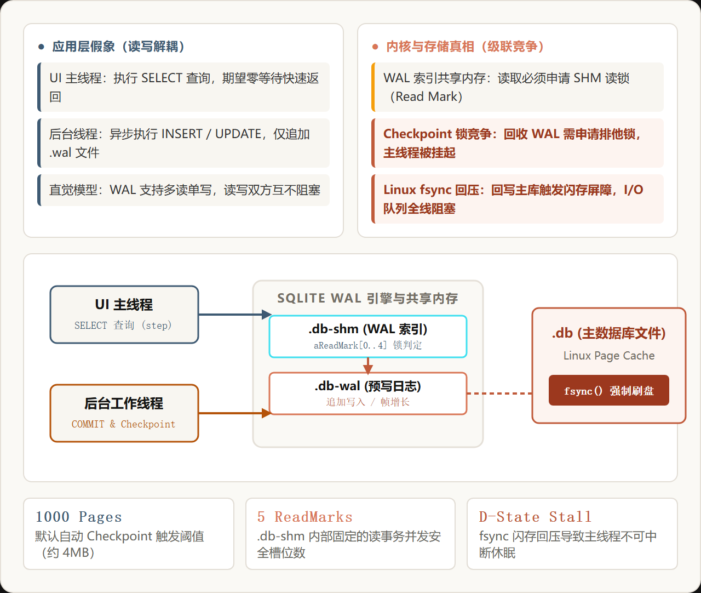
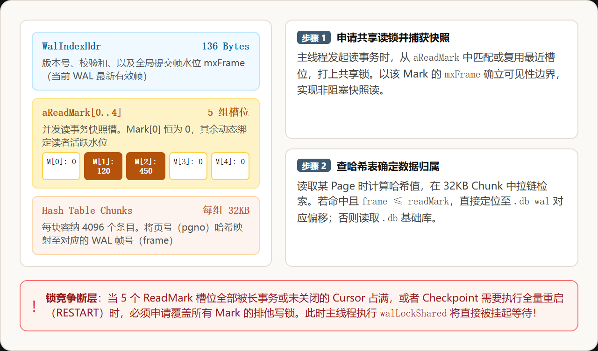
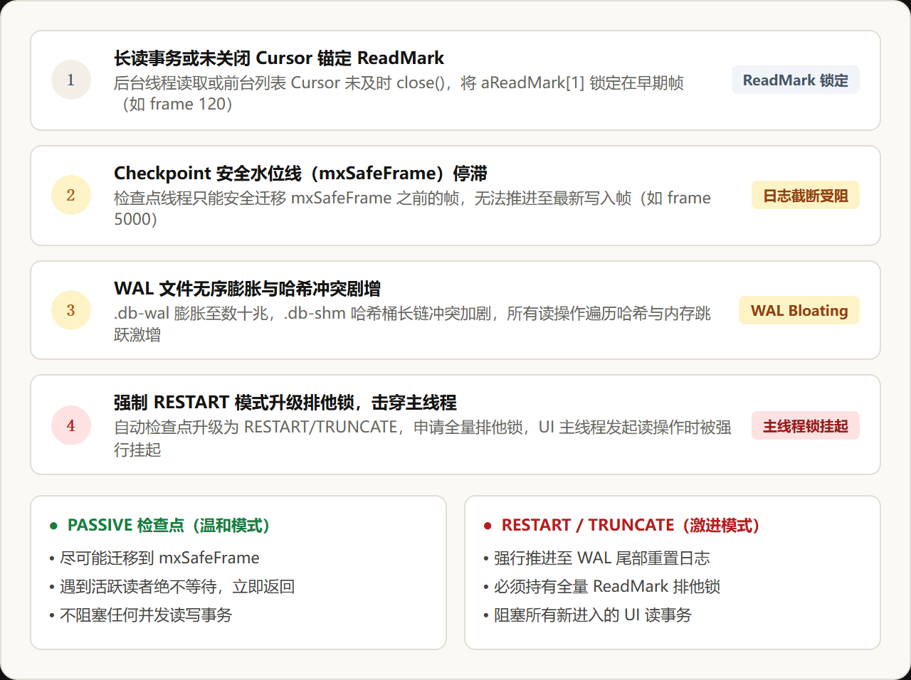
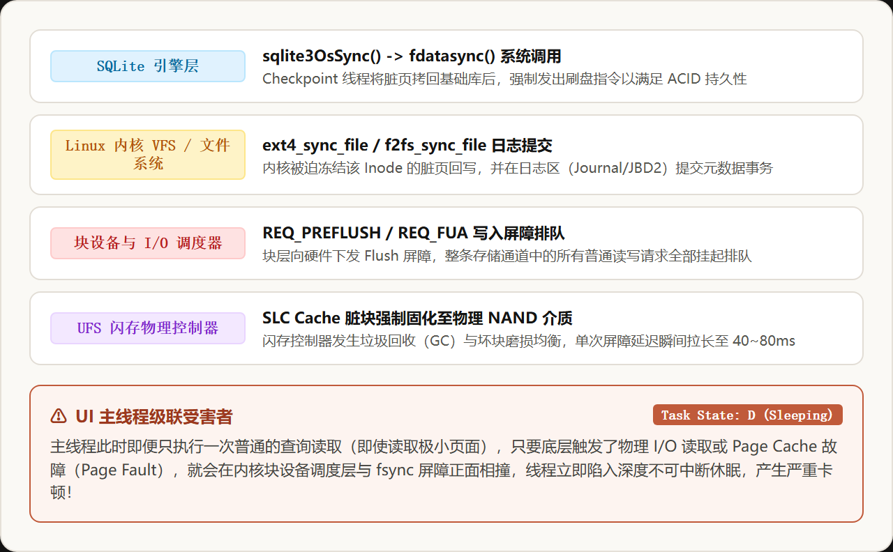
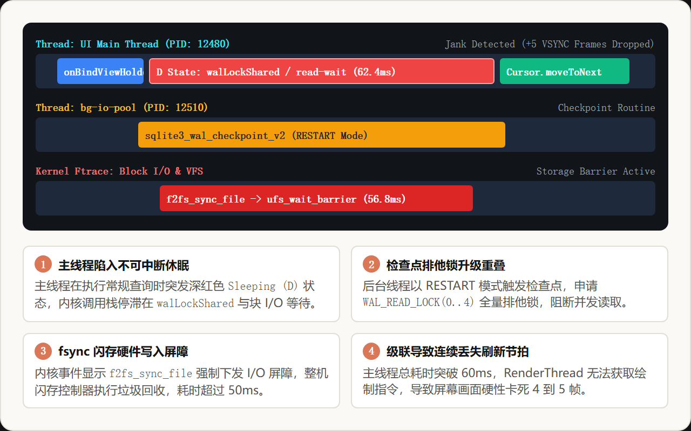

# SQLite WAL 索引共享内存、Checkpoint 锁竞争与 fsync 挂起

在 Android 应用的架构设计与持久化存储治理中，SQLite 始终扮演着最为核心的本地基础设施角色。伴随着 Jetpack Room 的普及以及现代移动架构对响应式数据流（如 Flow、Paging3）的深度依赖，数据库访问已经从过去的“偶发读写”演化为高频并发的“实时数据总线”。

在很多工程团队的直觉认知中，SQLite 的性能模型早已有了一套成熟的标准答案：

“在传统的 Rollback Journal 模式下，写事务会持有整库排他锁，导致所有读操作全部挂起；但只要在数据库初始化时开启了预写日志（WAL，Write-Ahead Logging）模式，并将所有 INSERT、UPDATE 等写操作严格移入后台子线程，读写分离机制就会生效——读事务读取基础库与共享内存，写事务向独立日志文件追加数据，两者互不阻塞，UI 主线程即使执行同步读取，也不应该产生严重的卡顿或 ANR。”

更进一步，在查验监控指标时，如果后台写事务的单次耗时并不高，磁盘剩余容量也极为充裕，开发者通常更倾向于认为本地存储层非常健康，不至于成为卡死主线程的罪魁祸首。

然而，翻开高刷商业应用在生产环境捕获的帧率掉帧告警、滑动卡顿事件以及局部不可中断休眠日志，我们常能看到这样一幅令人费解的反差场景：

在用户快速滑动列表（Fling）、切换页面或者刷新瀑布流数据的关键瞬间，界面突然出现肉眼可见的卡死，连续丢失 3 到 5 个 VSYNC 刷新节拍。

抓取对应的系统级 Perfetto 跟踪切片后，主线程代码并没有在执行繁重的反序列化，没有发生大对象的内存分配，也没有触发跨进程 Binder 调用；代码仅仅是在执行一次轻量的 Room 查询，或者通过 `Cursor.step()` 遍历几条已缓存的本地配置。

然而，就是这样一次平淡无奇的只读操作，却让 UI 主线程在操作系统内核层陷入了深红色的不可中断休眠状态（Uninterruptible Sleep，即 Linux `D` 状态），耗时高达 50 毫秒乃至 80 毫秒。

内核调用栈清晰记录着当时的运行痕迹：`sqlite3_step`、`walLockShared`、`f2fs_sync_file`、`ufs_wait_barrier`……

写操作早已剥离至后台子线程，为什么 UI 主线程的一次轻量读取，依然会在 SQLite 引擎与内核文件系统层被直接挂起？

这种认知偏差的根源，在于将 WAL 模式的“概念级读写并发”等同于“物理层绝对隔离”，同时忽略了现代移动操作系统中三套交织运行的核心机制：**`.db-shm` 共享内存索引的 Read Mark 锁判定**、**检查点（Checkpoint）在升级排他锁时的写回竞争**，以及**Linux 文件系统 `fsync` 刷盘触发的物理闪存写入屏障**。

本文结合 SQLite 源码（`wal.c`）、Linux 内核文件系统与块设备驱动实现，以及现代 Android 架构实践，全面拆解主线程遭遇数据库读取卡死的全链路机理。



---

## 1. 认知重构：WAL 模式的并发神话与读写分离假象

要弄清 UI 主线程为什么会在读取时被挂起，首先需要打破对 SQLite 并发模型的粗放理解，看清预写日志在底层存储介质上的真实流转路径。

### 1.1 从 Rollback Journal 到 WAL：看似完美的并发设计

在 SQLite 早期默认的 Rollback Journal 回滚日志模式下，数据库修改遵循“直接覆盖主库”的原则：
当某个线程执行写事务时，引擎先将旧数据页面拷贝至独立的 `.db-journal` 回滚日志中，随后直接在 `.db` 主数据库文件上就地修改物理页。为了保证 ACID 特性与数据一致性，写线程必须获取整库的排他锁（EXCLUSIVE Lock）。在此期间，任何并发读线程既不能读取旧数据，也不能读取新数据，整个数据库进入完全互斥的单线程状态。

为了打破这种强行互斥的瓶颈，SQLite 3.7.0 引入了 WAL（Write-Ahead Logging）预写日志模式，Android 也在后续版本中将其确立为 Room 与原生数据库的核心推荐选项：

1. **写操作追加化**：写事务不再直接触碰主数据库 `.db` 文件，而是将修改后的全新物理页，依次追加写入独立的预写日志文件（`.db-wal`）中；
2. **读操作快照化**：读事务发起时，直接记录当前日志文件的最新有效提交帧（`mxFrame`），以此作为可见性边界。读取某个页面时，如果该页面在 WAL 中存在且早于该边界，便读取 WAL 中的新副本；如果不存在，则读取 `.db` 主库中的基线数据；
3. **主库延迟更新**：主数据库 `.db` 中的内容保持只读与静态，直到积累了足够多的 WAL 帧之后，才通过独立的检查点（Checkpoint）机制将 WAL 中的页面批量写回主库。

这一模型在宏观架构上带来了极具诱惑力的结论：**读操作不阻塞写操作，写操作也不阻塞读操作，系统吞吐量大幅提升**。

### 1.2 为什么开发者误以为“读写永远互不阻塞”

许多开发者在阅读 SQLite 文档中的“Readers do not block writers and a writer does not block readers”后，往往会产生一种乐观的技术假想：

“只要主线程只负责 SELECT，后台线程负责写入，两条路径在物理上就是解耦的。写线程爱怎么写就怎么写，绝不会把主线程拖慢哪怕一微秒。”

然而，这一理想结论成立的前提，是**只考虑了日常平稳运行中的追加读写阶段**。它隐去了两个致命的物理约束：

- **WAL 索引的元数据同步并不是零成本的**：读线程如何知道自己想要的那一页到底是在 `.db` 里，还是已经被追加到了 `.db-wal` 的第 800 帧？这依赖于名为 `.db-shm` 的共享内存索引文件。对共享内存中元数据的访问与快照划定，依然需要依赖锁协议；
- **WAL 日志不可能无限制追加膨胀**：磁盘空间有限，WAL 文件必须在某个时机把数据搬回主库，并把日志指针复位清零。这个“把数据搬回主库并清理现场”的动作，就是 **Checkpoint**。当 Checkpoint 启动，或者 WAL 发生无序膨胀时，平静的读写分离模型将瞬间崩塌。

### 1.3 偶发性卡死重现：主线程在读取什么时被内核挂起

在大型工程的真实排查中，我们可以重现这样一段经典场景：

后台某个同步任务正在向数据库批量插入数千条用户消息或埋点记录，写入逻辑完整包裹在后台协程中。与此同时，用户在界面上滑动列表，UI 主线程通过 Room 的 DAO 接口执行一条极其简单的单条数据查询：`SELECT * FROM config WHERE key = ?`。

主线程并没有执行任何涉及磁盘写入的指令。然而，Systrace / Perfetto 的切片却显示：主线程在进入 `sqlite3_step` 后，整条时间线突然断崖式拉长，线程状态从绿色（Running）直接翻转为深红色（Sleeping），在内核文件系统驱动中卡死了 60 毫秒，直接导致当前这一帧绘制严重超时，列表滑动发生剧烈顿挫。

要解开这一反差的谜题，我们必须下潜到 SQLite 的微观数据结构中，看清 `.db-shm` 共享内存的内部运转机理。

---

## 2. 核心机制之一：.db-shm 共享内存与 Read Mark 读锁断层

许多工程师熟悉 `.db` 和 `.db-wal`，但往往会忽略与它们并存的第三个伴生文件：`.db-shm`。这个文件是 SQLite 在 WAL 模式下的灵魂枢纽，也是引发读事务竞争的第一个潜在瓶颈点。

### 2.1 预写日志的寻址中枢：.db-shm 的物理内存映射

如果每次读事务在查询某一个页面时，都需要从头到尾线性扫描整个 `.db-wal` 文件去查找该页是否被修改过，那么随着 WAL 文件的增长，读操作的 I/O 复杂度将退化为不可接受的 $O(N)$。

为了实现 $O(1)$ 级别的极速检索，SQLite 引入了 **WAL 索引（WAL Index）**：

- SQLite 在磁盘上创建同名的 `.db-shm` 文件，并借助操作系统的 `mmap` 系统调用，将该文件映射至所有并发进程与连接的虚拟内存空间中；
- `.db-shm` 内部维护了一组按 32KB 切分的哈希表（Hash Table Chunks）。哈希表将主数据库的页号（`pgno`）直接映射到其在 WAL 日志中的最新帧号（`frame`）；
- 读线程在读取某个页面时，无需访问慢速闪存，只需直接在映射的共享内存中计算哈希、查找槽位，就能瞬间确定该页面到底应该从 `.db-wal` 的哪一帧读取，还是直接从 `.db` 中读取。



### 2.2 aReadMark 槽位分配与读事务可见性快照

为了让读事务能够看到一致性的历史快照，同时不影响后续写事务继续追加写入新帧，SQLite 在 `.db-shm` 的头部结构（`WalIndexHdr`）中设计了一组名为 `aReadMark` 的读标记数组：

```c
/* SQLite wal.c 源码：WAL 索引头部结构与 Read Mark 数组 */
struct WalIndexHdr {
  u32 iVersion;                   /* WAL 索引结构版本号 */
  u32 unused;                     /* 未使用填充 */
  u32 iChange;                    /* 数据库每次事务提交递增的计数器 */
  u8 isInit;                      /* 共享内存是否已完成初始化 */
  u8 big_endian;                  /* 字节序标记 */
  u16 szPage;                     /* 数据库 Page 物理尺寸（如 4096） */
  u32 mxFrame;                    /* 当前 WAL 中最新已提交的有效帧号 */
  u32 nPage;                      /* 主数据库在当前快照下的总页数 */
  u32 aFrameCksum[2];             /* 最新提交帧的累计校验和 */
  u32 aSalt[2];                   /* 每次日志新建生成的随机盐值 */
  u32 aCksum[2];                  /* 索引头部自身的校验和 */
  u32 aReadMark[READMARK_NOT_USED];/* 读标记槽位数组，固定 5 组 */
};
```

在 32 位/64 位移动端架构中，`READMARK_NOT_USED` 的默认数值为 **5**。这 5 个槽位的分工极为严苛：

- **`aReadMark[0]`**：保留槽位，固定存储数值 0。它代表“完全不读取 WAL 文件，所有数据只读基础库”；
- **`aReadMark[1..4]`**：剩余的 4 个可用槽位，由并发的读线程动态争夺与复用。

当 UI 主线程发起一次读事务时，其在底层调用 `walTryBeginRead`：

```c
/* SQLite wal.c 源码：读事务尝试申请 Read Mark 槽位与快照边界 */
static int walTryBeginRead(Wal *pWal, int *pChanged, int useWal, int cnt){
  u32 mxReadMark;
  int mxI;
  WalIndexHdr *pInfo;

  /* 获取 WAL 索引头部的内存映射指针 */
  pInfo = walIndexHdr(pWal);

  /* 尝试在已有的 4 个活跃 Read Mark 槽位中寻找与当前 mxFrame 匹配的槽位 */
  mxReadMark = 0;
  mxI = 0;
  for(int i=1; i<WAL_NREADER; i++){
    u32 thisMark = pInfo->aReadMark[i];
    if( mxReadMark<=thisMark && thisMark<=pInfo->mxFrame ){
      /* 如果发现已有的槽位刚好匹配当前最新帧，尝试获取该槽位的共享锁 */
      if( walLockShared(pWal, WAL_READ_LOCK(i))==SQLITE_OK ){
        pWal->readLock = (i16)i;
        pWal->minFrame = pInfo->aReadMark[i];
        return SQLITE_OK;
      }
    }
  }
  /* 槽位未命中或申请失败，进入分配新槽位或排他重建逻辑 */
  return walAssignReadMark(pWal, pInfo);
}
```

从源码中可以清晰看到，读事务并不是空中楼阁，它必须在 `WAL_READ_LOCK(i)` 上施加**共享锁（Shared Lock）**。这一共享锁的生命周期，将从读事务开启一直持续到当前查询或者 `Cursor` 显式关闭为止。

### 2.3 槽位耗尽与 WalIndex 恢复：读操作为何不得不申请排他锁

如果一个应用的设计极为复杂，存在多个后台线程同时在执行耗时较长的异步查询，或者存在未被及时释放的数据库游标，系统的 4 个动态 `aReadMark` 槽位可能会被全部占满。

当主线程在此刻发起一次全新的读事务时，戏剧性的一幕发生了：

1. **无可用的既有槽位**：主线程在遍历 `aReadMark[1..4]` 时，发现所有的槽位都有活跃的读事务在持有共享锁，且记录的水位全部落后于当前的 `mxFrame`；
2. **被迫升级排他锁分配新槽位**：主线程为了给自己的读操作分配一个新的 Read Mark，必须调用 `walLockExclusive` 尝试修改共享内存头部的元数据；
3. **触碰 WalIndex 恢复流程（Index Recovery）**：更极端的是，如果在此期间发生了进程崩溃，或者读线程在校验头部校验和时发现 `aCksum` 与当前状态不匹配，SQLite 会判定共享内存已经“脏化（Dirty）”，要求当前线程承担**索引重建（WalIndex Recover）**的工作。

要重建索引，发起读请求的线程必须向内核申请对整整 5 个 Read Mark 槽位（`WAL_READ_LOCK(0)` 到 `WAL_READ_LOCK(4)`）以及 `WAL_WRITE_LOCK` 的**全量排他锁（Exclusive Lock）**！

如果此时后台任何一个子线程正在占用某一个读槽位，或者正在追加写入 WAL，主线程的这一排他锁申请就会在用户态或 Futex 内核态直接被阻断挂起。原本轻如鸿毛的单条查询，在此瞬间被迫承担起重构全库索引的沉重代价。

---

## 3. 核心机制之二：Checkpoint 锁竞争与 WAL 膨胀恶性循环

如果说 `.db-shm` 的槽位竞争属于高并发下的局部摩擦，那么由 **Checkpoint（检查点）** 引发的系统级冲突，则是让 UI 主线程遭遇毁灭性卡死的“主震区”。

### 3.1 四种检查点模式：PASSIVE、FULL、RESTART 与 TRUNCATE

为了防止预写日志无限扩张，SQLite 必须周期性地把追加在 `.db-wal` 中的修改写回主数据库 `.db` 文件。这个过程由 `sqlite3_wal_checkpoint_v2` API 驱动，支持四种递进的运行模式：

- **`SQLITE_CHECKPOINT_PASSIVE`（被动温和模式）**：
  检查点线程在后台尽力而为。它只把那些已经不再被任何活跃读事务所依赖的帧写回主库；如果遇到正在读取的读者，它绝不等待，直接退出。Android 系统在日志达到默认的 1000 页时，底层触发的默认自动检查点就是该模式；
- **`SQLITE_CHECKPOINT_FULL`（全量模式）**：
  检查点线程必须等待当前的写事务结束，并将 WAL 中的全部有效帧搬回主库，但不强制要求重置日志文件的起始游标；
- **`SQLITE_CHECKPOINT_RESTART`（重启模式）**：
  检查点不仅要把所有帧拷回主库，还必须把下一次写入的指针重新拨回到 WAL 文件的第 1 帧。**为了实现日志复位，它必须强制等待所有正在运行的读线程全部退出，并在所有 Read Mark 上加排他锁**；
- **`SQLITE_CHECKPOINT_TRUNCATE`（截断模式）**：
  在完成 RESTART 的全部步骤后，调用底层文件系统的截断系统调用，将 `.db-wal` 物理文件大小截断为 0 字节。



### 3.2 为什么未关闭的 Cursor 会强行阻断 Checkpoint 推进

在理想环境下，`PASSIVE` 模式的自动检查点运行得十分安静。然而在实际项目中，开发者的疏忽往往会打破这种平衡：

如果在某个界面的数据流订阅、后台定时同步逻辑中，存在一个查询执行后忘记调用 `cursor.close()`，或者某个后台长事务持有了几秒钟未提交，这个未释放的读连接就会在 `.db-shm` 中长期占用某一个 `aReadMark`（例如记录着 `frame = 120`）。

此时，检查点线程开始工作：

```c
/* SQLite wal.c 源码：计算 Checkpoint 能够安全写回的最大帧号 mxSafeFrame */
static int walCheckpoint(Wal *pWal, int eMode, ...){
  u32 mxSafeFrame;

  /* 扫描全部 5 个 Read Mark，寻找最小的活跃快照水位 */
  mxSafeFrame = pWal->hdr.mxFrame;
  for(int i=1; i<WAL_NREADER; i++){
    u32 y = pWal->pInfo->aReadMark[i];
    if( y>0 && y<mxSafeFrame ){
      mxSafeFrame = y; /* 安全水位被最古老的活跃读者死死锁住 */
    }
  }

  /* 检查点只能安全地把 <= mxSafeFrame 的页面写回主库 */
  rc = walCopyPages(pWal, pWal->ckptFrame, mxSafeFrame);
  ...
}
```

这段源码揭示了一个关键约束：**检查点写回主库的安全水位线 `mxSafeFrame`，由系统中存活的最古老读者的快照位置决定**。

如果一个后台未关闭的 Cursor 把 `aReadMark` 锁死在第 120 帧，哪怕当前写事务已经把 WAL 文件追加到了第 10000 帧，检查点线程也绝对不敢把第 121 帧及以后的数据写回主库！
因为一旦写回，由于旧读连接还需要从基础库中读取基线数据，主库的物理页覆盖将直接破坏该旧读连接的读取一致性。

### 3.3 WAL Bloating 灾难：哈希冲突长链遍历与 CPU 缓存击穿

当安全水位被锁死，自动检查点 `PASSIVE` 每次触发后都会无功而返：
写操作依然在以极高的频率产生，WAL 文件开始出现失控的无序膨胀（WAL Bloating）。原本只有几百 KB 的 `.db-wal` 文件，在几分钟之内迅速膨胀到 30MB、50MB 乃至上百兆，累计了成千上万个数据帧。

WAL 膨胀对 UI 主线程的性能造成了毁灭性的间接打击：

1. **共享内存索引急剧扩容**：每 4096 个 WAL 帧，SQLite 就必须在 `.db-shm` 中额外分配一个 32KB 的哈希块。当 WAL 增长到数万帧时，`.db-shm` 的体积迅速膨胀至数兆字节；
2. **哈希冲突与链表深遍历**：在固定尺寸的哈希桶内，高频更新导致大量的页号发生哈希碰撞。读线程在检索某个页面时，不得不沿着哈希链表进行连续数十次甚至上百次的内存跳转；
3. **CPU 缓存失效（L1/L2 Cache Miss）**：由于遍历的哈希槽位在虚拟内存中大幅跳跃，CPU 硬件预取单元完全无法命中局部性缓存，读操作的指令执行耗时呈现数量级式的非线性暴增。

### 3.4 检查点排他锁竞争与 UI 主线程级联挂起

随着 WAL 文件膨胀到令人发指的尺寸，SQLite 的内部保护机制或系统的 Room 连接管理器开始失去耐心：

为了抑制磁盘空间的彻底失控，某些后台维护组件或第三方框架逻辑会尝试发起一次激进的 **`SQLITE_CHECKPOINT_RESTART`** 或 **`SQLITE_CHECKPOINT_TRUNCATE`**。

正如前文所述，`RESTART` 模式绝不允许有任何并发读取存在。它会在底层依次调用 `walLockExclusive(WAL_READ_LOCK(1))` 到 `walLockExclusive(WAL_READ_LOCK(4))`，强行封锁所有读槽位。

此时，如果 UI 主线程刚好发起了一次数据库读取，其在 `walLockShared` 中请求读锁时，发现排他写锁正在被检查点线程重度持有。
主线程的读取流程被彻底锁死，只能在用户空间自旋或者在内核层陷入休眠等待。一旦检查点线程在处理庞大的 WAL 数据搬运时花费了上百毫秒，UI 主线程的卡顿时间就会同步飙升至上百毫秒，引发灾难性的界面冻结与 ANR。

---

## 4. 核心机制之三：Linux fsync 级联回压与闪存写入屏障

如果在排查卡顿现场时，我们发现检查点并没有在申请排他锁，系统也没有发生未关闭 Cursor 导致的锁槽位耗尽，为什么 UI 主线程依然会在读取阶段产生数十毫秒的内核挂起？

答案隐藏在操作系统内核与移动终端闪存介质的交界面上：**`fsync` 产生的存储子系统级联回压（I/O Barrier Backpressure）**。

### 4.1 检查点回写主库时的物理 fsync 开销

许多开发者以为，Checkpoint 把数据从 `.db-wal` 搬回 `.db`，只是简单的内存拷贝。事实绝非如此。

为了满足关系型数据库的耐久性（Durability）保障，当检查点将若干页面写入 `.db` 文件后，必须确保这些物理页已经真正写入了物理存储介质，然后才能允许后续事务覆盖或重置 WAL 日志。否则，一旦设备在此瞬间突发断电或电池脱落，主数据库的内容将彻底损坏。

因此，SQLite 在检查点完成数据复制后，必须在底层执行 `sqlite3OsSync()`：

```c
/* SQLite os_unix.c 源码：调用底层操作系统的持久化同步函数 */
static int unixSync(sqlite3_file *id, int flags){
  unixFile *pFile = (unixFile*)id;
  int rc;

  /* 依据编译参数与 PRAGMA 标记，调用 fdatasync() 或 fsync() */
#if HAVE_FDATASYNC
  rc = fdatasync(pFile->h);
#else
  rc = fsync(pFile->h);
#endif

  return (rc==0 ? SQLITE_OK : SQLITE_IOERR_FSYNC);
}
```

在 Linux 内核中，`fsync()` 是一个开销极其沉重的系统调用。它不仅要把系统 Page Cache 中该文件对应的所有脏页（Dirty Pages）强行下发给存储控制器，还必须等待控制器返回“物理刷盘已完成”的确认信号后，该系统调用才会返回。



### 4.2 文件系统日志提交（JBD2）与 Page Cache 脏页回压

在移动设备主流采用的 `ext4` 或 `f2fs` 文件系统中，`fsync` 的威力还会进一步被放大：

1. **元数据事务提交**：在执行 `ext4_sync_file` 或 `f2fs_sync_file` 时，文件系统必须将本次修改涉及的 Inode 元数据、间接块指针变更打成一个原子事务，提交到文件系统的内部日志区（如 ext4 的 JBD2 日志子系统）；
2. **脏页强制冲刷（Dirty Page Writeback）**：如果后台系统正有大量的图片加载、视频缓存或网络下载在并发进行，整机的 Page Cache 中积压了数十兆的脏页。当 `fsync` 下达强行冲刷指令时，内核的 I/O 队列中会瞬间被塞满密集的写请求数据块；
3. **I/O 调度器优先通道阻塞**：虽然 Linux 内核调度器（如 BFQ 或 mq-deadline）试图为读请求保留一定的调度优势，但当底层队列被海量的元数据提交与脏页冲刷彻底灌满时，读写通道的物理带宽将被完全耗尽。

### 4.3 UFS 硬件控制器屏障与主线程不可中断休眠（D 状态）

更为致命的瓶颈发生在手机主板上的物理闪存芯片——**UFS 存储控制器（Universal Flash Storage）**中：

- **写入屏障（Flush / FUA Barrier）**：为了响应操作系统的 `fsync` 指令，主机控制器驱动会向 UFS 芯片发出带有强屏障语义的 `REQ_PREFLUSH` 或 `REQ_FUA` 命令。UFS 控制器收到该指令后，必须将芯片内部 SLC 缓存区的数据强行固化写入 TLC/QLC 物理 NAND 颗粒中；
- **闪存内部垃圾回收（NAND GC）突发**：如果闪存芯片当前的可用空白块不足，强行固化会触发 UFS 固件内部的垃圾回收与磨损均衡（Wear Leveling）。此时，芯片控制器不仅无法响应新的主机请求，甚至会对内部命令总线进行毫秒级的硬件加锁；
- **主线程无辜躺枪**：此时，UI 主线程正在执行 `SELECT` 读取。即便主线程要读的数据只有 4KB，只要这一页当前不在内存的 Page Cache 中，内核就必须为它发起一次物理读 I/O。
  主线程的代码流转在内核的块设备调度层直接遭遇了尚未完成的 `fsync` 硬件屏障！

主线程被迫进入深度的 **不可中断休眠（Task State: D）**。它既不能被信号唤醒，也不能返回执行 Java 逻辑，只能在内核中苦苦等待硬件闪存完成它漫长而沉重的垃圾回收。

这，就是主线程明明只读了一行数据，却能在 `Cursor.step()` 上死死卡住 60 毫秒的底层硬件根源。

---

## 5. 工程排查与取证：Perfetto 时间线上的 SQLite 阻塞铁证

弄清了从 `.db-shm`、Checkpoint 到 Linux `fsync` 的三级竞争链条，在面对真实生产环境中的高刷掉帧与卡顿告警时，我们就能够借助系统级跟踪工具 **Perfetto** 迅速建立完整证据链，精准定位数据库卡死的直接诱因。

### 5.1 如何在 Perfetto 中捕获 SQLite 锁竞争与 D 状态停顿

在抓取了卡顿现场的 Perfetto 跟踪切片后，我们可以按照以下四个递进的排查阶段完成闭环取证：



1. **锁定 UI 主线程的异常休眠状态（Thread State）**：
   - 展开应用进程的主线程轨道，定位发生严重丢帧（Janky Frame）的时间区间；
   - 检查卡顿瞬间的线程状态条。如果主线程在执行 `onBindViewHolder`、`dispatchOnDraw` 时，突兀地出现长达数十毫秒的**深红色 `Sleeping (D)`**，立刻断定主线程陷入了内核级 I/O 或锁等待；
2. **检索 SQLite 核心切片与调用栈（Slice Track）**：
   - 在主线程的方法调用链中，检索包含 `SQLiteDirectCursor`、`SQLiteConnection.nativeExecuteForCursorWindow`、`sqlite3_step` 的切片；
   - 观察该切片内部的细分子切片：如果耗时主要集中在 `walLockShared`，表明主线程正遭遇 `.db-shm` 读锁被检查点排他锁压制的严重冲突；如果集中在底层系统调用，则顺流向下排查；
3. **查验后台工作线程的 Checkpoint 踪迹**：
   - 展开应用内其他工作线程（如 Room 的后台 I/O 线程池或通用协程分发器），寻找与主线程卡顿时间重叠的切片；
   - 检索名称为 `sqlite3_wal_checkpoint_v2`、`walCheckpoint` 或 `walIndexRecover` 的切片。如果在主线程休眠的同一时间窗口内，后台线程正在全力执行检查点，二者的锁竞争与资源抢占关系便可直接确凿定性；
4. **查验内核 Ftrace 事件中的 fsync 刷盘屏障**：
   - 展开内核事件轨道（Kernel ftrace），检索 `f2fs_sync_file`、`ext4_sync_file` 以及块设备事件 `block_rq_issue`；
   - 查看在卡顿发生期间，是否有连续的大块写入以及 `REQ_PREFLUSH` 屏障在排队等待。如果主线程的 `Sleeping (D)` 结束时刻刚好与 `f2fs_sync_file` 的返回时刻精确咬合，则证实主线程遭遇了底层的物理闪存回压。

### 5.2 提取核心指标：WAL 帧数、检查点耗时与 fsync 频率

在日常性能分析或 APM 本地诊断中，我们还可以通过执行原生 SQLite 的诊断命令，动态量化当前的 WAL 健康度：

::: info 关键存储指标排查命令清单

- **查验当前 WAL 文件大小与帧积压情况**：
  在应用运行时，通过终端或调试页面直接查看应用私有目录下数据库文件的大小：
  `ls -lh /data/data/<pkg>/databases/`
  如果 `.db-wal` 文件的物理大小远超基础库 `.db`，甚至长期稳定在 20MB 以上，说明应用已深陷 WAL Bloating 泥潭；
- **执行 PRAGMA wal_checkpoint(0) 探测水位**：
  在调试控制台中执行诊断语句：`PRAGMA wal_checkpoint(PASSIVE);`
  SQLite 会返回三个整数：`(busy, log, checkpointed)`。
  - `busy`：若为 1，表明当前有活跃连接正在阻塞检查点；
  - `log`：当前 WAL 文件中总共包含的数据帧数；
  - `checkpointed`：成功搬回主库的最大帧数。如果 `log - checkpointed > 1000` 且长期不回落，证实存在严重的快照锁死。
    :::

---

## 6. 架构治理与实战优化：消除 SQLite 卡顿的五大工程路径

搞清了 WAL 读写分离模型的边界、`.db-shm` 读锁断层、Checkpoint 锁竞争以及闪存 `fsync` 屏障的底层机理，我们在治理 Android 本地存储卡顿时，思路就会豁然开朗。

治理的核心哲学在于：**坚决杜绝 UI 主线程触碰任何数据库调用、严格压制 WAL 文件膨胀、消除高频闪存 fsync 屏障，并将 Checkpoint 的控制权由系统被动触发收归为架构主动调度**。

我们可以制定五项递进的工程治理策略：

### 6.1 彻底切断主线程数据库访问与协程响应式数据流

无论 WAL 的并发能力被宣传得多么强大，让 UI 主线程直接执行哪怕一条最简单的数据库查询，都是极度危险的架构反模式：

- **禁止在主线程运行任何 DAO 同步方法**：
  在 Room 的配置中，无条件保持 `allowMainThreadQueries()` 为关闭状态。在大型项目中，通过静态代码扫描（Lint 规则）全面拦截在 `@MainThread` 下调用任何数据库连接的行为；
- **全量推行 Kotlin 协程与响应式冷流（Flow）**：
  在 Room DAO 中，所有增删改查统一声明为 `suspend` 挂起函数，或者直接返回响应式的 `Flow<T>`。所有数据的加载与游标读取全部收敛在 `Dispatchers.IO` 中执行：

```kotlin
// 规范的 Room DAO 定义：强制隔离主线程执行流
@Dao
interface MessageDao {
    @Query("SELECT * FROM message WHERE conversation_id = :convId ORDER BY timestamp DESC")
    fun observeMessages(convId: String): Flow<List<MessageEntity>>

    @Query("SELECT * FROM message WHERE msg_id = :id")
    suspend fun getMessageById(id: String): MessageEntity?
}
```

通过将数据加载与 UI 绘制在线程维度上物理隔离，即便后台发生检查点或 I/O 阻塞，受到波及的也仅仅是数据推送到画面的延迟，主线程的帧渲染与手势交互绝不会被挂起。

### 6.2 严管 Cursor 生命周期与避免长事务锁定 ReadMark

为了避免最古老读者的快照把 Checkpoint 的 `mxSafeFrame` 永久锁死，我们必须严格治理应用内所有数据库游标与事务的生命周期：

- **强制使用 `use` 块确保 Cursor 瞬时释放**：
  在需要直接使用底层 Android 原生 `Cursor` 的场景下，严禁裸写 `cursor.close()`，必须通过 Kotlin 标准库的 `use` 扩展函数，确保游标在离开作用域时必然被关闭：

```kotlin
// 规范的 Cursor 使用范式：杜绝锁泄漏
context.contentResolver.query(uri, projection, null, null, null)?.use { cursor ->
    while (cursor.moveToNext()) {
        val title = cursor.getString(cursor.getColumnIndexOrThrow("title"))
        // 处理数据业务逻辑...
    }
} // 离开大括号瞬间立即执行 close()，自动释放 .db-shm 中的 Read Mark 共享锁
```

- **严禁将长耗时业务逻辑混入数据库事务**：
  在执行 `db.runInTransaction { ... }` 时，事务体内只允许执行纯粹的 SQL 变更。严禁在事务大括号内部执行网络请求、文件解压、复杂位图处理或大型 JSON 解析。事务必须在数毫秒内完成提交，防止写锁长期占位，并让 `mxFrame` 能够以清晰的节拍向前推移。

### 6.3 调优 SQLite PRAGMA：启用 synchronous = NORMAL

在 Android 的默认配置中，部分老旧系统或自定义 SQLite 连接可能会使用最为保守的 `PRAGMA synchronous = FULL`。在 WAL 模式下，这种配置是极其严重的性能浪费：

- 在 `synchronous = FULL` 下，SQLite 每次提交写事务都要执行一次物理 `fsync`，这会导致闪存控制器频繁遭遇 I/O 屏障，甚至拖垮并发读取的响应速度；
- **在 WAL 模式下推行 `synchronous = NORMAL`**：
  在 WAL 模式的物理架构中，只要设置了 `synchronous = NORMAL`，写事务在向 `.db-wal` 文件追加帧时，只需依赖操作系统的 Page Cache 写入即可，**不需要在每次提交时都同步调用 `fsync`**！
  SQLite 仅在 Checkpoint 发生时执行必要的刷盘。这一项设置可以削减 80% 以上的无谓闪存写屏障，而即便系统发生进程崩溃或应用闪退，WAL 日志的事务一致性依然坚不可摧。

```kotlin
// 在 Room 数据库构建时动态调优关键 PRAGMA 参数
Room.databaseBuilder(context, AppDatabase::class.java, "app.db")
    .addCallback(object : RoomDatabase.Callback() {
        override fun onOpen(db: SupportSQLiteDatabase) {
            super.onOpen(db)
            // 确保启用 WAL 模式并降低冗余刷盘频率
            db.enableWriteAheadLogging()
            db.execSQL("PRAGMA synchronous = NORMAL")
            // 设定合理的日志膨胀上限警戒线（例如 8MB = 2048 页）
            db.execSQL("PRAGMA journal_size_limit = 8388608")
        }
    })
    .build()
```

### 6.4 变被动为主动：精细化托管 Checkpoint 触发时机

默认的“每满 1000 页自动触发检查点”机制是完全盲目的。它根本不在乎当前用户是不是在疯狂滑动屏幕，也不在乎当前界面有没有正在运行动画。

为了彻底抹平这一不可控的性能抖动，我们可以将 Checkpoint 的触发权限从系统被动响应中收回，实行**应用层主动感知与空闲托管**：

- **关闭高危的隐性检查点，接入 `IdleHandler` 机制**：
  利用 Android 主线程的 `Looper.myQueue().addIdleHandler`，在主线程完成每一帧渲染后、完全无事可做的空闲片刻（Idle Time），在后台线程轻量调度一次 `PASSIVE` 检查点：

```kotlin
// 利用主线程空闲时间调度温和的后台 Checkpoint
class IdleDatabaseCheckpointHelper(private val db: SupportSQLiteDatabase) {

    fun registerIdleCheckpoint() {
        Looper.myQueue().addIdleHandler {
            // 当主线程处于完全空闲状态时，触发后台协程执行温和检查点
            CoroutineScope(Dispatchers.IO).launch {
                runPassiveCheckpoint()
            }
            false // 仅执行一次或按需重新注册
        }
    }

    private fun runPassiveCheckpoint() {
        try {
            // 执行 PASSIVE 检查点：绝不升级排他锁，绝不阻塞任何并发读写
            db.query("PRAGMA wal_checkpoint(PASSIVE)").use { cursor ->
                if (cursor.moveToFirst()) {
                    val busy = cursor.getInt(0)
                    val log = cursor.getInt(1)
                    val checkpointed = cursor.getInt(2)
                    // 记录监控指标或动态评估健康度...
                }
            }
        } catch (e: Exception) {
            // 异常捕获与容灾兜底
        }
    }
}
```

- **配合 WorkManager 在退火期执行深度整理**：
  在用户熄屏、设备接入充电器且处于闲置状态（Device Idle）的深夜维护窗口中，通过 WorkManager 调度一次带有重置语义的维护任务，执行 `PRAGMA wal_checkpoint(RESTART)` 或 `PRAGMA wal_checkpoint(TRUNCATE)`，将膨胀的 WAL 文件彻底清理归零，迎接第二天的流畅使用。

### 6.5 优化连接池配额与慢查询熔断告警

最后，针对 Android 框架层 `SQLiteConnectionPool` 的连接耗尽风险，我们需要构筑健壮的防护与观测能力：

- **合理配置连接池大小**：
  在原生 Android 中，默认的写连接只有 1 个，只读连接通常为 4 个。对于重度并发的应用，可以通过自定义 `SQLiteDatabase.OpenParams.Builder` 或配置 Room 的连接池策略，避免后台并发读取瞬间吃光所有读连接槽位，导致新进入的请求长时间排队等待；
- **布设慢查询与阻塞监听（Slow Query Tracing）**：
  在开发环境与线上灰度环境中，借助 Room 的 `RoomDatabase.QueryCallback` 或底层代理，针对单次耗时突破 16ms 的数据库操作打印堆栈告警，并提取其发生时的 WAL 帧数与连接池等待耗时；
- **熔断长耗时大查询**：
  针对包含多表复杂 JOIN、未建立索引的模糊检索等大体积查询，严禁直接绑定在首屏渲染路径上，必须结合分页组件（Paging3）进行强制分批拉取。

搞清了 SQLite WAL 预写日志的底层存储机制、`.db-shm` 共享内存的 Read Mark 锁判定、Checkpoint 的写回竞争以及 Linux 文件系统 `fsync` 产生的物理闪存回压，我们在设计 Android 本地数据存储与持久化架构时，就能彻底走出“只要开了 WAL 就高枕无忧”的技术盲区，真正构建起读写有序、无感回写、高刷平稳的高品质客户端架构。

## 参考资料

- [SQLite Write-Ahead Logging (WAL) Architecture and Internals](https://sqlite.org/wal.html)（SQLite Official Documentation · 2024-05）
- [SQLite File Formats: The WAL Index (.db-shm) and Shared Memory Protocol](https://sqlite.org/fileformat2.html#walindexformat)（SQLite Documentation · 2023-11）
- [Android Jetpack Room Architecture & SQLiteConnectionPool Implementation](https://developer.android.com/training/data-storage/room)（Android Developers Guide · 2024-08）
- [Linux Kernel File Systems: ext4 and f2fs Data Synchronization Mechanisms](https://docs.kernel.org/filesystems/f2fs.html)（The Linux Kernel Organization · 2024-03）
- [Universal Flash Storage (UFS) Controller Queuing and Write Barrier Latency](https://www.jedec.org/standards-documents/focus/flash/universal-flash-storage-ufs)（JEDEC Standard Document · 2023-09）
