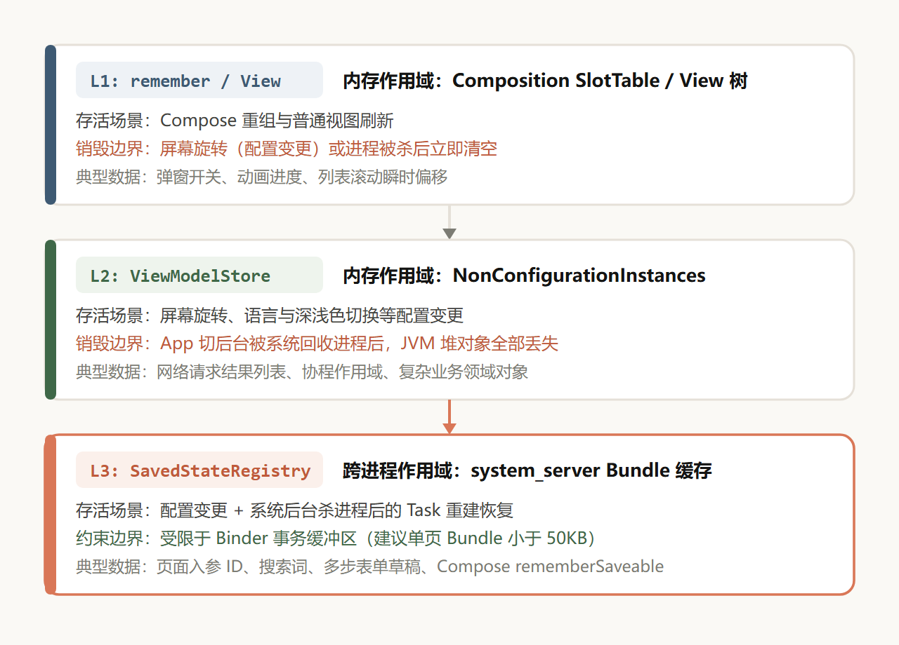
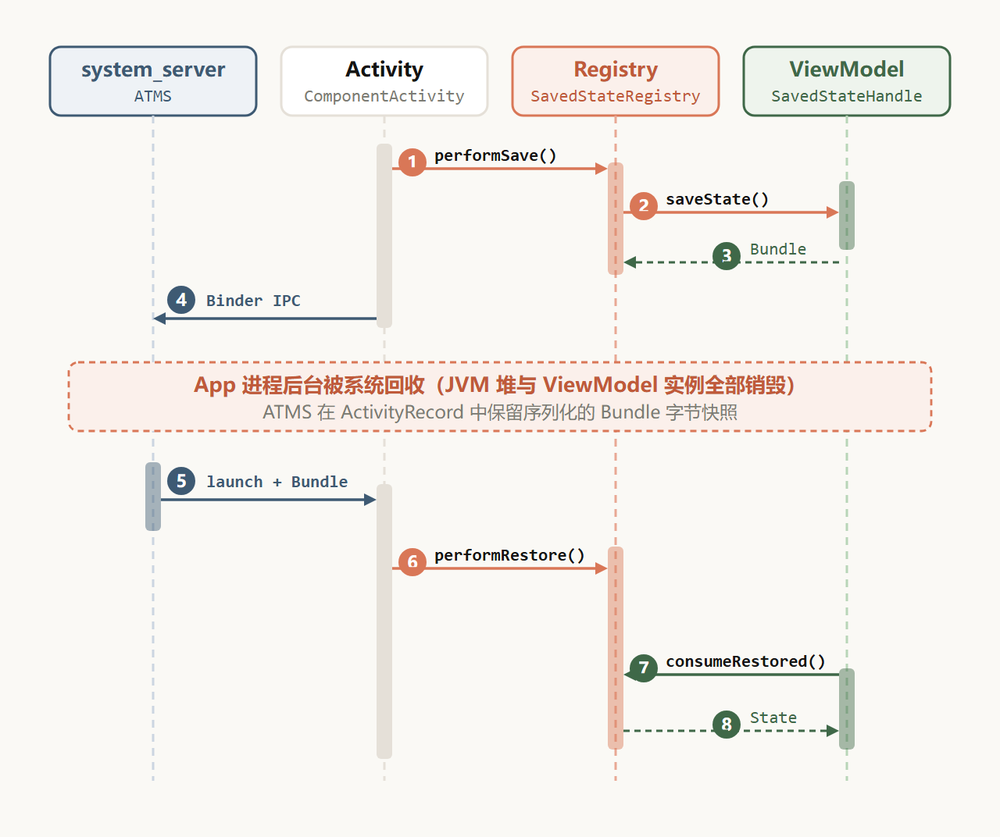
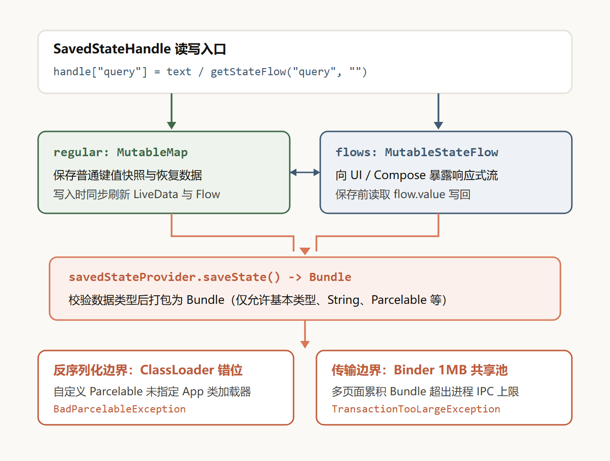

# SavedStateRegistry 与进程重建状态恢复机制

在日常 Android 业务开发中，很多工程师都有过这样的经历：订单填写页或搜索筛选页明明已经用上了 Jetpack `ViewModel`，在本地测试旋转屏幕、切换深浅色模式时，界面上的状态都能稳稳保留，没有任何异常。

可一旦应用上线，监控后台就会陆续收到一批很难在开发环境稳定复现的反馈：用户把 App 切到后台去回了几条微信消息，或者调起系统相机拍了张照，十几分钟后切回页面，屏幕上不仅刚填好的表单内容全部归零，甚至还会直接触发 `NullPointerException` 或 `BadParcelableException` 闪退。

问题出在哪里？

核心误区在于，许多开发者下意识地把“屏幕旋转不丢失数据”等同于“任何场景下都不会丢失数据”，忽略了 Android 系统在**配置变更（Configuration Change）**与**后台进程回收（Process Death）**这两类场景下的本质差异。`ViewModel` 本质上只是一个保存在内存里的普通对象，当后台进程因为内存紧张被系统回收后，整个 JVM 堆都会随之清空，`ViewModel` 实例自然也就不复存在。

真正能够跨过进程边界、在应用重新拉起时把关键状态带回来的，是 `SavedStateRegistry` 与 `SavedStateHandle` 这套基于跨进程持久化快照的底层体系[1]。下面我们顺着状态作用域、AndroidX 核心源码、Compose 桥接机制与高频线上故障四个维度，把这条链路彻底梳理清楚。

---

## 1. 认知纠偏：配置变更与进程重建的生存边界

要写对状态恢复逻辑，第一步必须先分清不同存储容器在 Android 生命周期中的真实存活边界。

### 1.1 为什么屏幕旋转没事，切后台却会丢失全部内存状态

先来看一段在实际项目中非常典型的写法：页面通过 `ViewModel` 持有当前选中的商品 SKU 与草稿备注，旋转屏幕时表现完全正常。

```kotlin
class CheckoutViewModel : ViewModel() {
    private val _uiState = MutableStateFlow(CheckoutUiState())
    val uiState: StateFlow<CheckoutUiState> = _uiState.asStateFlow()

    fun initOrder(skuId: String) {
        _uiState.update { it.copy(skuId = skuId) }
    }

    fun updateRemark(text: String) {
        _uiState.update { it.copy(remark = text) }
    }
}
```

当用户旋转手机屏幕时，系统会销毁旧的 `Activity` 实例并创建新实例。在这个过程中，应用进程本身并没有退出。`ActivityThread` 在执行重建前，会把旧 `Activity` 的 `NonConfigurationInstances` 对象暂存下来；其中就包含 `ComponentActivity` 持有的 `ViewModelStore`。新 `Activity` 启动后直接复用同一个 `ViewModelStore`，因此 `_uiState` 里的 `skuId` 和 `remark` 完好无损。

但当用户把 App 切到后台，系统内存调度器为了给前台相机或游戏腾出空间，随时可能直接终止当前应用进程。进程终止后，JVM 堆上的 `ViewModelStore`、`CheckoutViewModel` 以及各种内存单例全部随之清空释放。

当用户从系统任务列表再次点开这个 App 时，系统进程 `system_server` 中的 `ActivityTaskManagerService`（简称 ATMS）会根据保留的任务栈记录拉起一个全新的应用进程，并按原有返回栈重建栈顶的 `Activity`[2]。此时 `CheckoutViewModel` 是全新创建的，如果初始化入参原本只在 `onCreate` 时通过外部逻辑写入一次，或者用户编辑了一半的 `remark` 没有写入系统持久化的状态快照，新页面就会因为 `skuId` 为空而展示空白，甚至在后续强解包时直接崩溃。

### 1.2 Android 状态存储的三层作用域边界

为了避免在选型时混淆，我们可以把 Android 应用内的状态存储划分为三个逐层递增的作用域层级：



结合具体的工程场景，每一层的定位与约束可以归纳为以下三张决策卡片：

**L1：局部视图与组合作用域（`remember` / View 字段）**

- 载体位置：Compose `SlotTable` 内存槽位，或传统 View 实例成员变量。
- 存活范围：仅在视图树正常刷新、Compose 重组期间保留。
- 失效条件：发生屏幕旋转等配置变更，或进程被回收后全部清空。
- 适用数据：下拉菜单展开态、按钮点击波纹或过渡动画进度等纯视觉瞬态。

**L2：进程内配置留存作用域（`ViewModelStore`）**

- 载体位置：挂载在 `ActivityThread` 暂存的 `NonConfigurationInstances` 上。
- 存活范围：跨越屏幕旋转、语言切换、深浅色切换等配置变更。
- 失效条件：应用进程在后台被系统回收后，内存对象全部销毁。
- 适用数据：列表分页缓存、协程作用域、复杂业务领域实体等无需跨进程重建的对象。

**L3：跨进程状态快照作用域（`SavedStateRegistry` / `SavedStateHandle`）**

- 载体位置：通过 Binder 跨进程传递并保存在系统服务 `system_server` 进程的 `ActivityRecord` 中。
- 存活范围：同时跨越配置变更与后台进程回收重建（用户主动划掉任务卡片强杀除外）。
- 约束条件：必须支持 `Bundle` 序列化，且受限于进程全局 Binder 事务缓冲区配额。
- 适用数据：页面核心入参 ID、搜索关键词、当前选中的 Tab 索引、多步表单关键草稿。

---

## 2. 机制拆解：SavedStateRegistry 如何解耦生命周期与状态存取

搞清了生存边界，接下来我们深入 AndroidX `savedstate` 源码，看看系统究竟是如何把状态写进 `system_server`，又如何在新进程拉起时精准还回来的。

### 2.1 传统 `onSaveInstanceState` 的耦合困境

在早期没有 Jetpack `SavedStateRegistry` 的年代，所有状态保存逻辑都堆在 `Activity` 或 `Fragment` 的两个回调里：保存时重写 `onSaveInstanceState(outState: Bundle)`，恢复时在 `onCreate(savedInstanceState: Bundle?)` 中手工按键取值。

这种写法在大型工程中存在两个明显痛点。首先，`Activity` 被迫承担了“状态总管”的职责，页面里哪怕只是一个独立的日期选择器、分页控制器或自定义组件，想参与进程重建恢复，都必须由宿主 `Activity` 在两个生命周期方法里显式转发 `Bundle`，代码耦合极重。其次，`ViewModel` 在设计上不允许持有 `Activity` 引用，如果把所有状态都交给 `Activity` 手动存取再回传给 `ViewModel`，架构分层就会变得十分混乱。

为了彻底解耦，AndroidX 引入了 `SavedStateRegistry`：它把状态存取抽象成“按键注册 Provider”和“按需消费 RestoredState”的订阅制模型，任何组件只要拿到 `SavedStateRegistryOwner`，就能独立托管自己的状态切片。

### 2.2 `SavedStateRegistryController` 与双向挂载时序

在 `androidx.activity.ComponentActivity` 中，宿主通过 `SavedStateRegistryController` 来驱动整个 `SavedStateRegistry` 的初始化、恢复与保存动作。整个跨进程保存与进程重建恢复的交互时序如下：



我们可以通过一段简化后的 `ComponentActivity` 核心调度代码，直观观察这三个关键节点是如何嵌入生命周期的：

```kotlin
// androidx.activity.ComponentActivity 核心挂载逻辑
val savedStateRegistryController =
    SavedStateRegistryController.create(this)

init {
    // 1. 提前绑定生命周期观察者，维护可保存状态窗口
    savedStateRegistryController.performAttach()
}

override fun onCreate(savedInstanceState: Bundle?) {
    // 2. 必须在 super.onCreate 之前执行恢复
    // 这样后续 Fragment 与 LifecycleObserver 才能拿到状态
    savedStateRegistryController.performRestore(savedInstanceState)
    super.onCreate(savedInstanceState)
}

override fun onSaveInstanceState(outState: Bundle) {
    super.onSaveInstanceState(outState)
    // 3. 收集所有已注册 Provider 的 Bundle 并写入 outState
    savedStateRegistryController.performSave(outState)
}
```

这里有两处顺序设计非常关键：

第一处是 `performAttach()` 在对象构造期执行。`SavedStateRegistry` 会向宿主的 `Lifecycle` 注册一个观察者：当收到 `ON_START` 事件时，将内部标志位 `isAllowingSavingState` 置为 `true`；当收到 `ON_STOP` 事件时，将其置为 `false`。因为系统规定在 `onSaveInstanceState`（Android 9 起稳定在 `ON_STOP` 之后执行）完成后，页面随时可能被冻结，此时不再允许修改需要持久化重启的类登记。

第二处是 `performRestore(savedInstanceState)` 必须在 `super.onCreate(savedInstanceState)` 之前调用。原因在于 `super.onCreate` 会触发 `FragmentManager` 恢复子 Fragment，也会分发生命周期 `ON_CREATE` 事件。提前完成 `performRestore`，才能保证整个视图树和所有监听 `ON_CREATE` 的组件在启动第一时间就能读取到历史状态。

### 2.3 `registerSavedStateProvider` 的注册窗口与 `AutoRecreated` 机制

在实际使用 `SavedStateRegistry` 时，每个业务组件都通过唯一的字符串 `key` 注册一个 `SavedStateProvider` 接口，并在合适时机调用 `consumeRestoredStateForKey(key)` 取回上次保存的 `Bundle`。

```kotlin
class DraftController(
    private val registry: SavedStateRegistry
) {
    private var draftText: String = ""

    fun bind(lifecycle: Lifecycle) {
        // 注册当前组件的状态提供者（Key 必须全局唯一）
        registry.registerSavedStateProvider(KEY_DRAFT) {
            bundleOf("text" to draftText)
        }
        // 在 ON_CREATE 后消费上次进程重建遗留的状态
        lifecycle.addObserver(LifecycleEventObserver { _, event ->
            if (event == Lifecycle.Event.ON_CREATE) {
                val restored = registry.consumeRestoredStateForKey(KEY_DRAFT)
                draftText = restored?.getString("text").orEmpty()
            }
        })
    }

    companion object {
        private const val KEY_DRAFT = "draft_controller_state"
    }
}
```

需要特别注意两点内部约束：

1. **状态消费是一次性的**：`consumeRestoredStateForKey(key)` 在从 `restoredState` 取出对应的子 `Bundle` 后，会立刻把该 `key` 从缓存中移除。也就是说，同一个组件在重建期间只能消费一次，避免重复读取旧数据。
2. **延迟重连的 `AutoRecreated` 机制**：有些组件并非在 `onCreate` 时默认创建，或者需要在页面重建时自动重新注册自己。`SavedStateRegistry` 提供了 `runOnNextRecreation(clazz)` 方法，它内部向 `SavedStateRegistry` 写入了一个名为 `"androidx.savedstate.Restarter"` 的类清单，并校验当前是否处于 `isAllowingSavingState == true` 窗口内。当进程重建并执行 `performAttach()` 时，`Recreator` 会在 `ON_CREATE` 阶段通过反射实例化这些 `AutoRecreated` 类并回调其 `onRecreated(owner)`，从而实现“按需自动重挂”。

---

## 3. 桥梁剖析：SavedStateHandle 如何打通 ViewModel 与 Compose

理解了 `SavedStateRegistry` 的发布订阅机制，我们就能看懂 `ViewModel` 到底是如何绕开对 `Activity` 的直接依赖，却又能享受到进程级状态恢复能力的。

### 3.1 `CreationExtras` 与 `SavedStateHandleController` 的自动装配

在早期的 Jetpack 版本中，开发者想要在 `ViewModel` 里使用 `SavedStateHandle`，必须手动编写一个继承自 `AbstractSavedStateViewModelFactory` 的工厂类。而在现代 AndroidX（`lifecycle-viewmodel-savedstate` 2.5+）中，这套流程已经通过 `CreationExtras` 实现了全自动装配[3]。

当你通过 `by viewModels()` 或 `ViewModelProvider(this)` 创建 `ViewModel` 时，`ComponentActivity` 与 `Fragment` 会在 `defaultViewModelCreationExtras` 中自动塞入三个关键上下文键：

- `SAVED_STATE_REGISTRY_OWNER_KEY`：指向当前宿主的 `SavedStateRegistryOwner`；
- `VIEW_MODEL_STORE_OWNER_KEY`：指向当前的 `ViewModelStoreOwner`；
- `DEFAULT_ARGS_KEY`：携带启动页的 `Intent.extras` 或 Fragment 的 `arguments`。

随后，`SavedStateHandleSupport.createSavedStateHandle()` 会自动接管装配流程：它从宿主 `SavedStateRegistry` 中获取名为 `"androidx.lifecycle.internal.SavedStateHandlesProvider"` 的全局聚合提供者，并把每个 `ViewModel` 对应的唯一 `key`（即 `VIEW_MODEL_KEY`）切分出来的子 `Bundle` 与 `DEFAULT_ARGS_KEY` 合并，构造出专属的 `SavedStateHandle` 注入到 `ViewModel` 构造函数中。

```kotlin
class SearchViewModel(
    private val savedStateHandle: SavedStateHandle
) : ViewModel() {

    // 直接通过 getStateFlow 与 SavedStateHandle 底层键值保持同步
    val query: StateFlow<String> =
        savedStateHandle.getStateFlow(KEY_QUERY, initialValue = "")

    fun onQueryChanged(newQuery: String) {
        // 写入时会同时更新 regular 映射表与 StateFlow
        savedStateHandle[KEY_QUERY] = newQuery
    }

    companion object {
        private const val KEY_QUERY = "search_query"
    }
}
```

这套设计的精妙之处在于，无论你的页面经历的是**普通屏幕旋转**还是**后台进程被杀重建**：

- 如果是屏幕旋转，`SavedStateHandlesVM`（一个挂在 `ViewModelStore` 里的内部辅助 ViewModel）会原样保留状态，不需要反复走 `Bundle` 反序列化；
- 如果是进程被杀重建，`SavedStateHandlesProvider` 会从 `SavedStateRegistry` 消费还原回来的 `Bundle`，无缝喂给新创建出来的 `SearchViewModel`。

对业务代码而言，完全无需感知两种重建路径的差异。

### 3.2 `SavedStateHandle` 内部双通道同步与 `StateFlow` 联动

打开 `androidx.lifecycle.SavedStateHandle` 的源码，可以看到它内部维护了几个核心集合：



- `regular`：一个普通的 `MutableMap<String, Any?>`，用于存放所有键值对的最新快照；
- `flows`：一个 `MutableMap<String, MutableStateFlow<Any?>>`，对应所有通过 `getStateFlow(key, initialValue)` 创建的响应式流；
- `liveDatas`：兼容旧代码的 `SavingStateLiveData` 映射表；
- `savedStateProviders`：允许业务方额外挂载的自定义 `SavedStateProvider` 集合。

当我们在业务中调用 `savedStateHandle[key] = newValue` 时，源码会先调用 `validateValue(newValue)` 检查该对象是否属于 `Bundle` 支持的类型集合（基础类型、字符串、`Parcelable`、`Serializable`、`Binder`、`Size` 等），一旦传入了不可序列化的普通业务类或 Lambda，立刻在写入阶段就抛出 `IllegalArgumentException`，防止把隐患拖到切后台那一刻才爆发。

校验通过后，`set` 方法会同步更新 `regular[key]`，如果 `flows` 中存在对应的 `MutableStateFlow`，也会立刻把 `flow.value` 刷新为最新值，通知 UI 重组或刷新；而当系统触发 `onSaveInstanceState` 时，`SavedStateHandle` 自带的 `savedStateProvider()` 会把所有自定义 provider 的输出合并进 `regular`，并整体打包成一个 `Bundle` 交还给 `SavedStateRegistry`。

::: tip 一个容易踩中的细节
`savedStateHandle.getStateFlow(key, initialValue)` 返回的是只读的 `StateFlow<T>`。如果在代码里绕过 `savedStateHandle[key] = ...`，而是自己另建了一个独立的 `_uiState = MutableStateFlow(...)` 来维护状态，那么后台杀进程时 `SavedStateHandle` 根本不知道 `_uiState` 的最新变化。一定要统一通过 `savedStateHandle[key] = newValue` 驱动状态更新，或者为复杂场景显式调用 `setSavedStateProvider`。
:::

### 3.3 Jetpack Compose `rememberSaveable` 的底层桥接

很多全面转向 Jetpack Compose 的团队会好奇：`rememberSaveable` 并没有传 `Activity` 或 `ViewModel`，为什么它也能在进程被杀后恢复状态？

答案同样落在 `SavedStateRegistry` 上。在 Compose 的 `AndroidComposeView` 初始化阶段，框架会通过 `DisposableSaveableStateRegistry(id, savedStateRegistryOwner)` 创建一个面向 Compose 树的状态容器，并通过 `CompositionLocalProvider(LocalSaveableStateRegistry provides ...)` 向下传递。

这个容器在底层做了一件非常直接的事情：它向宿主 `Activity` 或 `Fragment` 的 `SavedStateRegistry` 注册了一个键名为 `"SaveableStateRegistry:$id"` 的 `SavedStateProvider`。当系统触发保存时，`DisposableSaveableStateRegistry` 把所有由 `rememberSaveable` 托管的状态（本质上是 `Map<String, List<Any?>>`）转换成 `Bundle` 交给 `SavedStateRegistry`；而在进程重建时，它再从 `consumeRestoredStateForKey` 取回数据恢复出来。

对于自定义的不可直接放入 `Bundle` 的 Kotlin 数据类，在 Compose 中应当搭配 `Saver`（如 `listSaver` 或 `mapSaver`）或者 `@Parcelize` 使用，把状态拆解成基础类型后再存入：

```kotlin
data class FilterState(val categoryId: Int, val onlyInStock: Boolean)

val FilterSaver = listSaver<FilterState, Any>(
    save = { listOf(it.categoryId, it.onlyInStock) },
    restore = { FilterState(categoryId = it[0] as Int, onlyInStock = it[1] as Boolean) }
)

@Composable
fun FilterBar() {
    var filter by rememberSaveable(stateSaver = FilterSaver) {
        mutableStateOf(FilterState(categoryId = 0, onlyInStock = false))
    }
}
```

---

## 4. 一线高频暗坑：序列化异常与 1MB 隐形崩溃

虽然 `SavedStateRegistry` 和 `SavedStateHandle` 已经把大部分流程自动化了，但只要状态跨越了 `Bundle` 序列化与 Binder IPC 边界，生产环境中依然有两个高发崩溃频频出现。

### 4.1 `BadParcelableException` 与 `ClassLoader` 错位陷阱

在 Crashlytics 或 Bugly 上，Android 工程师经常会看到一类只在特定机型或低内存设备切后台恢复时出现的崩溃日志：`android.os.BadParcelableException: ClassNotFoundException when unmarshalling: com.example.app.OrderDraft`。

为什么代码里明明实现了 `Parcelable`（甚至用了 `@Parcelize`），正常跳转页面也毫无问题，一到进程重建就找不到类？

根源在于 `BaseBundle` 的延迟反序列化（Lazy Unmarshalling）与 `ClassLoader` 错位。出于性能优化考虑，`Bundle` 在跨进程从 `system_server` 传回新启动的应用进程时，并不会第一时间把里面的字节流全部拆解成 Java 对象，而是先以未解析的字节数组 `mParcelledData` 形式保存在内存里，直到业务代码第一次调用 `getParcelable()` 或 `getString()` 时才执行真正的反序列化[4]。

问题在于，当 `Bundle` 由 `system_server` 构造或还原时，某些嵌套子 `Bundle` 默认携带的 `mClassLoader` 是系统的 `BootClassLoader`（只能加载 `android.*` 与 `java.*` 开头的系统类），根本加载不到你 App 自己定义的 `OrderDraft` 类。一旦触发反序列化，`Parcel.readParcelableCreator` 拿着 `BootClassLoader` 去反射寻找 `OrderDraft$CREATOR`，就会直接抛出 `ClassNotFoundException` 并被包装成 `BadParcelableException`。

修复这一问题的规范做法，是在读取自定义 `Parcelable` 之前显式修正 `Bundle` 的类加载器，同时配合 `androidx.core.os.BundleCompat` 兼容 Android 13（API 33）引入的类型安全新 API：

```kotlin
fun readOrderDraftSafely(bundle: Bundle?, key: String): OrderDraft? {
    if (bundle == null) return null
    // 关键：在触发反序列化之前，显式指定应用层的 ClassLoader
    bundle.classLoader = OrderDraft::class.java.classLoader
    return BundleCompat.getParcelable(bundle, key, OrderDraft::class.java)
}
```

::: warning 不要用 `Serializable` 替代大型 `Parcelable`
有些开发者为了省事，直接给复杂数据类加上 `java.io.Serializable` 扔进 `SavedStateHandle`。Java 原生反射序列化在 `Parcel.writeSerializable` 中会产生大量临时反射对象与字节流膨胀，不仅比 `Parcelable` 慢数倍，更容易把 `Bundle` 体积推向危险边缘。面向 `Bundle` 传输的数据模型，优先使用 `kotlin-parcelize` 插件生成 `Parcelable`，或者拆解为基础字段映射。
:::

### 4.2 `TransactionTooLargeException` 与全局 Binder 事务配额

另一个更加隐蔽的崩溃发生在 `onSaveInstanceState` 阶段：`android.os.TransactionTooLargeException: data parcel size XXXXXX bytes`。

许多开发者对此感到困惑：我当前这个页面明明只在 `SavedStateHandle` 里存了一个 150KB 的列表对象，远不到 Binder 1MB 的限制，为什么切到后台还是直接闪退？

原因有两点：

第一，Android 系统中的 1MB（准确说是 1MB 减 8KB 的 `BINDER_VM_SIZE`）是**整个应用进程共享的同步 Binder 事务缓冲区上限**，并不是某一个 `Activity` 或某一次调用的独享配额。

第二，当应用退到后台时，系统不仅会保存栈顶当前 `Activity` 的 `onSaveInstanceState`，还会连同返回栈里所有尚未销毁的 `Activity`、每个页面嵌套的多层 `Fragment`、View 树自带的控件状态，以及 `SavedStateRegistry` 里的全部状态合并打包，通过 Binder 一次性提交给 `ATMS`。如果你的返回栈里压了 5 个页面，每个页面往 `Bundle` 里塞了 150KB 数据，总事务大小就会瞬间突破安全水位；从 Android 7.0（API 24）开始，系统不再仅仅打印警告日志，而是直接抛出 `TransactionTooLargeException` 导致进程崩溃。

为了在开发与测试阶段提前揪出“体积超标”的页面和 Fragment，可以在测试构建中注入一套基于 `Parcel.obtain()` 的实时体积审计工具，在每个页面进入后台保存状态时精确打印 `Bundle` 字节开销：

```kotlin
object SavedStateSizeMonitor {
    private const val WARN_BYTES = 50 * 1024 // 单页超过 50KB 即发出告警

    fun install(application: Application) {
        application.registerActivityLifecycleCallbacks(
            object : Application.ActivityLifecycleCallbacks {
                override fun onActivitySaveInstanceState(
                    activity: Activity,
                    outState: Bundle
                ) {
                    val bytes = measureBundleBytes(outState)
                    if (bytes > WARN_BYTES) {
                        Log.w(
                            "StateAudit",
                            "${activity.localClassName} Bundle=${bytes / 1024}KB"
                        )
                    }
                }
                override fun onActivityCreated(a: Activity, b: Bundle?) = Unit
                override fun onActivityStarted(a: Activity) = Unit
                override fun onActivityResumed(a: Activity) = Unit
                override fun onActivityPaused(a: Activity) = Unit
                override fun onActivityStopped(a: Activity) = Unit
                override fun onActivityDestroyed(a: Activity) = Unit
            }
        )
    }

    private fun measureBundleBytes(bundle: Bundle): Int {
        val parcel = Parcel.obtain()
        return try {
            parcel.writeBundle(bundle)
            parcel.dataSize()
        } finally {
            parcel.recycle()
        }
    }
}
```

---

## 5. 工程实践：状态分层规范与本地进程重建验证

弄清了 `SavedStateRegistry` 的运转原理与序列化边界之后，日常开发和代码审查该如何把状态恢复真正落地？核心在于“做对数据分层”和“建立低成本的本地验证习惯”。

### 5.1 什么数据该进 `SavedStateHandle`，什么不该进

在架构评审中，建议团队直接按以下三类数据属性决定存放位置，不要把 `SavedStateHandle` 当成通用本地数据库使用：

**第一类：页面唯一标识符与轻量路由参数（必须存入）**

- 典型内容：商品 `skuId`、订单号 `orderId`、搜索关键词 `query`、列表当前筛选 Tab 索引。
- 处理方式：通过 `Navigation` 参数自动注入或显式写入 `SavedStateHandle`（与 `rememberSaveable`）。体积通常只有几十到几百字节，进程重建后页面可以直接凭借这些 ID 重新拉取数据，绝不会因为入参丢失导致白屏。

**第二类：高成本的用户输入草稿（按体量分级存入）**

- 典型内容：短文本备注、表单选中项（存入 `SavedStateHandle`）；长篇富文本编辑器内容、多图草稿（写入本地数据库）。
- 处理方式：几十个字段以内的轻量状态直接托管给 `SavedStateHandle`；如果涉及大量文本或复杂草稿结构，只把草稿的数据库主键 `draftId` 放进 `SavedStateHandle`，正文内容实时落盘到 Room 或 DataStore 中。

**第三类：接口返回的业务列表与图片缓存（严禁存入）**

- 典型内容：接口返回的商品信息流列表（几百条 JSON 映射对象）、完整用户信息实体、序列化后的大型 DTO。
- 处理方式：这类数据动辄数百 KB，一旦塞进 `Bundle` 极易触发 `TransactionTooLargeException`。应当保留在内存缓存或 Room 本地磁盘缓存中；进程被杀重建后，利用 `SavedStateHandle` 留存的查询参数和游标 ID 重新发起请求或读取本地数据库即可。

### 5.2 用 `adb` 命令与单元测试在本地 10 秒复现进程重建

进程被杀重建之所以容易在上线后集中爆发，是因为大多数开发者平时只测“切到后台再立刻点回来”或者“旋转屏幕”，从不触发真正的进程死亡。其实，在本地通过两条简单的步骤就能稳定复现这一场景：

**第一步：使用 `adb` 命令在真机上精准模拟后台杀进程**

需要注意的是，千万不要直接在系统最近任务列表里把 App 卡片向上划掉——滑动清除任务卡片会连同 `ActivityRecord` 一起销毁，系统不会保留任何 `Bundle`。正确的模拟步骤是：

```bash
# 1. 在手机上打开目标页面，输入表单内容或修改筛选条件
# 2. 按 Home 键将 App 切到后台（触发 onStop 与 onSaveInstanceState）
# 3. 执行 am kill 命令通知系统回收后台进程（保留任务栈与 Bundle）
adb shell am kill com.example.yourapp

# 4. 从手机桌面或最近任务列表重新点击 App 图标回到前台
```

执行完第 3 步后，可以在 Android Studio 的 Logcat 中看到原有进程显示 `DEAD`，第 4 步重新切回 App 时，系统会启动全新 PID 的进程，并携带之前序列化好的 `Bundle` 执行 `performRestore`。页面上任何忘记保存的状态、未设置 `ClassLoader` 的 `Parcelable` 崩溃都会当场暴露出来。

**第二步：在 JUnit 单元测试中直接验证 `SavedStateHandle` 恢复逻辑**

因为 `SavedStateHandle` 本身不强依赖 Android Context，我们完全可以在纯 JVM 单元测试中直接构造包含历史状态的 `SavedStateHandle`，验证 `ViewModel` 重建后是否能正确读取还原数据：

```kotlin
class SearchViewModelTest {

    @Test
    fun `restore query after process death`() {
        // 模拟 system_server 在进程重建时还原出的历史键值快照
        val restoredHandle = SavedStateHandle(
            mapOf("search_query" to "Kotlin Coroutines")
        )

        val viewModel = SearchViewModel(restoredHandle)

        assertEquals("Kotlin Coroutines", viewModel.query.value)
    }
}
```

把状态分层原则落到代码里，并在提测前养成用 `adb shell am kill` 验证一遍核心交易和表单页面的习惯，绝大多数“切后台回来丢数据或闪退”的疑难工单，都能在研发阶段被提前拦截。

## 参考资料

- [Save UI states](https://developer.android.com/topic/libraries/architecture/saving-states)（Android Developers · 2025-02）
- [SavedStateRegistry API Reference](https://developer.android.com/reference/androidx/savedstate/SavedStateRegistry)（AndroidX SavedState · 2024-11）
- [Saved State module for ViewModel](https://developer.android.com/topic/libraries/architecture/viewmodel/viewmodel-savedstate)（Android Developers · 2025-01）
- [Parcelables and Bundles](https://developer.android.com/guide/components/activities/parcelables-and-bundles)（Android Developers · 2024-09）
