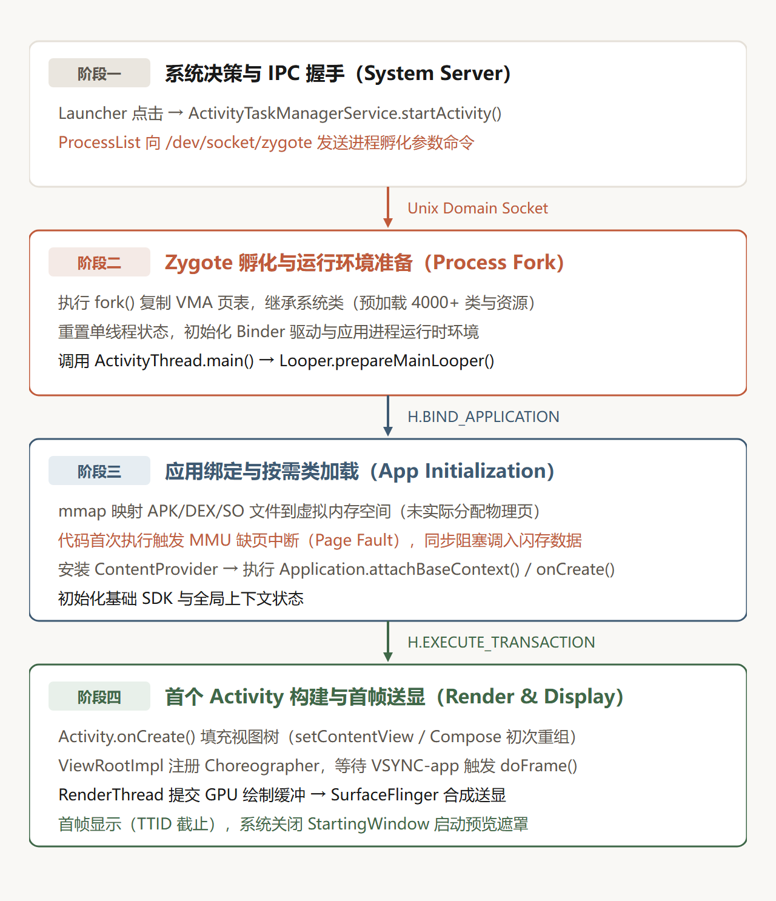
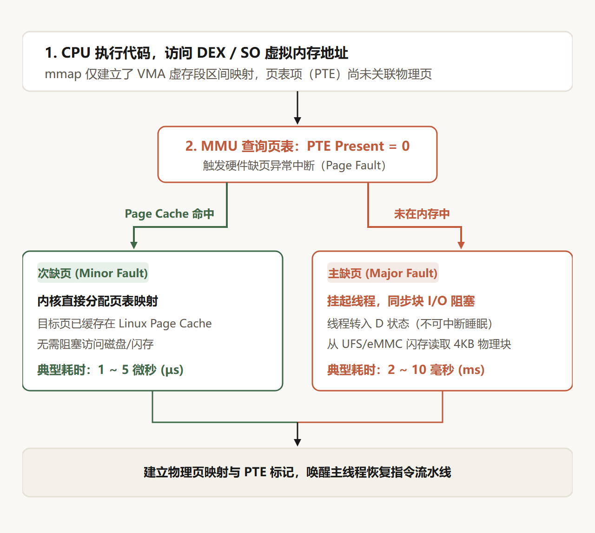
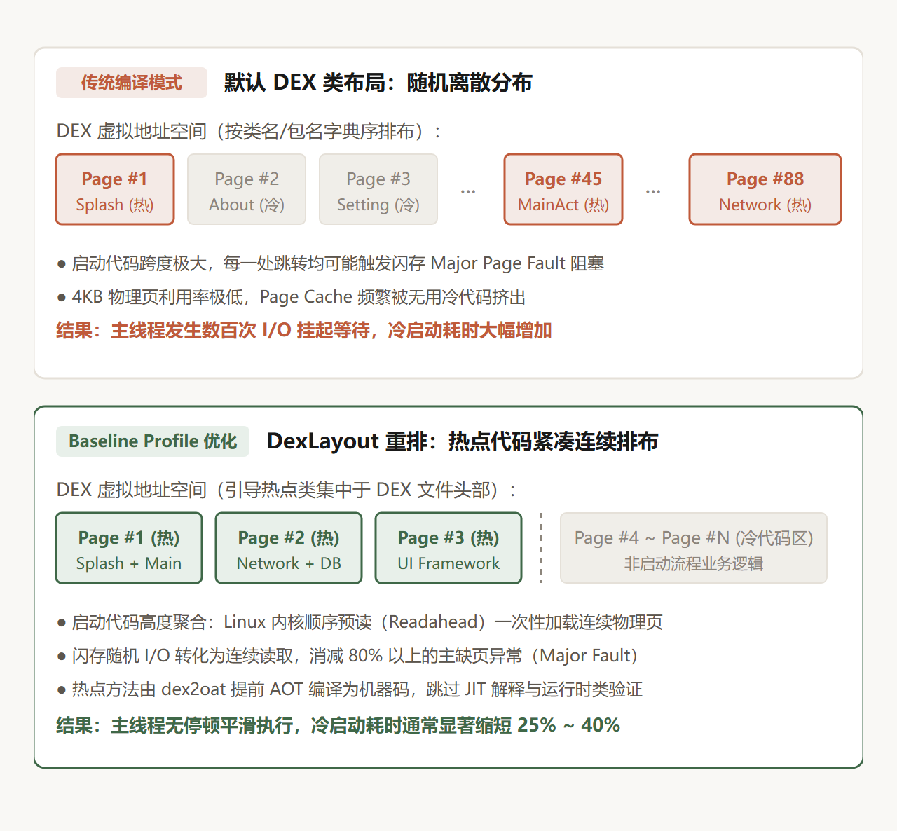
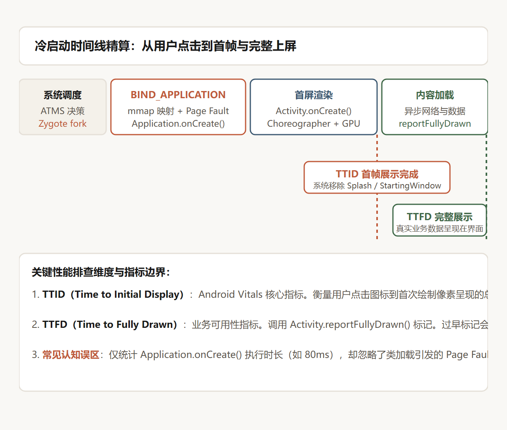

# 冷启动底层剖析：Zygote 孵化、Page Fault 与 Baseline Profile

在移动端体验治理中，冷启动速度直接决定了用户对应用性能的第一印象。

不少工程团队在启动优化上投入了大量精力：

- 重构 `Application.onCreate()`，将非核心 SDK 剥离并推迟初始化；
- 使用并行任务图将耗时操作拆分至工作线程池；
- 精简首页 Activity 的布局层级与组件初始化逻辑。

经过这些改造后，主线程追踪日志显示 `Application` 和首屏 `Activity` 的方法执行耗时已经从 800ms 降到了 120ms 以内。

**但在中低端真实设备、或在系统重启后的首次冷启动中，用户从点击桌面图标到看到首屏界面的实际耗时（Time to Initial Display，TTID），依然高达 800ms 到 1.5 秒。**

为什么主线程的 CPU 方法耗时已经大幅压降，冷启动的总耗时却依然居高不下？

很多开发者在分析性能时，习惯把“应用进程内主线程的 Java/Kotlin 代码执行时间”等同于“冷启动耗时”。这种视角忽略了从用户点击图标到首帧呈现在屏幕上所经历的完整底层链路：在这条流水线上，进程孵化、内核虚拟内存映射、闪存 I/O 缺页异常（Page Fault）、运行时类校验以及多进程 Binder 通信，共同瓜分了启动初期的关键时间窗口。

本文结合 AOSP 系统源码、Linux 内核内存机制与 ART 运行时实现，深入拆解冷启动全链路，揭示隐藏在 CPU 睡眠背后的真实耗时瓶颈。



---

## 1. 进程诞生：从桌面点击到 Zygote 孵化

冷启动的第一步并非直接运行应用代码，而是系统服务与操作系统内核协作完成目标进程的创建与初始化。

### 1.1 系统服务跨进程决策：ATMS 与 ProcessList 的协作

当用户在桌面 Launcher 点击应用图标时，Launcher 进程会调用 `startActivitySafely()`，通过 Binder IPC 将 Intent 请求发送给运行在 `system_server` 进程中的 **ActivityTaskManagerService（ATMS）**。

ATMS 在接收到启动请求后，执行一系列核心校验：

1. 校验目标 Activity 的权限、启动模式（LaunchMode）与任务栈（TaskRecord）状态；
2. 查询目标应用所在的进程是否已经存活；
3. 若目标进程尚未运行，ATMS 将启动决策下发给 `ActivityManagerService`（AMS）内部的 `ProcessList` 组件；
4. `ProcessList.startProcessLocked()` 组装进程创建参数，包括进程 UID、GID、数据隔离组、seinfo 安全上下文以及入口类 `android.app.ActivityThread`。

现代 Android 并不通过常规的 `execve()` 系统调用直接从磁盘加载二进制程序，而是向 **Zygote** 发起进程孵化请求。

### 1.2 Zygote 的设计初衷：预加载与写时复制（Copy-on-Write）

Android 在 Linux 基础之上设计了 Zygote（孵化器进程）。Zygote 随 `init` 进程启动，在系统开机阶段完成了两项重要准备：

- 启动并初始化通用的 ART 运行时（`libart.so`）；
- 预先加载系统的核心类库（如 `framework.jar` 中的 4000 多个常用 Java 类）和通用的系统主题资源（如 `android.R`）。

当 `system_server` 需要创建新应用时，`ProcessList` 并不使用 Binder，而是通过本地 Unix Domain Socket（`/dev/socket/zygote`）向 Zygote 发送孵化指令：

```java
// frameworks/base/core/java/com/android/internal/os/ZygoteConnection.java
private Runnable handleChildProc(ZygoteArguments parsedArgs,
                                 FileDescriptor[] fds,
                                 FileDescriptor pipeFd,
                                 PrintStream newStderr) {
    // 关闭来自 Zygote 的 Socket 套接字连接
    closeSocket();

    // 初始化应用进程内的 Binder 驱动驱动接口与线程池
    ZygoteInit.nativeZygoteInit();

    // 调用 ActivityThread.main() 进入应用主循环
    return RuntimeInit.applicationInit(parsedArgs.targetSdkVersion,
                                       parsedArgs.disabledCompatChanges,
                                       parsedArgs.remainingArgs,
                                       null /* classLoader */);
}
```

Zygote 收到请求后调用 Linux 系统的 `fork()` 原语复制自身。借助 Linux 内存管理单元（MMU）的 **写时复制（Copy-on-Write, COW）** 机制，子进程在创建之初直接共享 Zygote 的物理内存页：

- 预加载的 4000 多个系统类以及 ART 核心数据结构，物理内存中只保留一份；
- 只有当应用进程向这些静态数据写入新内容或分配对象时，操作系统内核才会按需为应用复制出独立的物理页。

### 1.3 为什么 fork 依然存在可观耗时

尽管有写时复制的支持，`fork()` 操作本身并非零开销：

1. **虚拟内存区间（VMA）复制**：`fork()` 虽然不需要拷贝物理内存中的数据，但必须完整复制父进程的所有虚拟内存区域结构（`vm_area_struct`）与页表项（Page Table Entries, PTE）。随着系统预加载库的增多以及堆空间的增长，遍历并复制页表结构在低端芯片上通常需要消耗 **15ms 到 40ms**；
2. **多线程约束**：在 POSIX 标准中，`fork()` 仅能复制发起调用的当前线程，父进程中的其他所有并发线程在子进程中都会直接消失。因此，Zygote 必须严格保持单线程轮询状态，一旦有其他并发任务占用 CPU，孵化流程就会产生额外的调度等待。

当 `fork()` 返回后，子进程通过 `nativeZygoteInit()` 打开 `/dev/binder` 驱动，并最终执行 `ActivityThread.main()`，标志着应用进程主线程的正式就绪。

---

## 2. 内存与 I/O 迷雾：Page Fault 与代码按需加载机理

进程创建完成后，`ActivityThread` 会接收到 `H.BIND_APPLICATION` 消息。此时许多团队会发现，即便 `Application.onCreate()` 内部几乎没有业务逻辑，主线程在执行过程中依然频现卡顿。

这背后的主要诱因，是操作系统在内存映射与类加载阶段产生的**缺页中断（Page Fault）**。



### 2.1 虚拟内存映射：DEX 与 SO 文件并非一次性读入

当应用启动并初始化 `PathClassLoader` 时，ART 运行时并不会将几十兆乃至上百兆的 APK、DEX 以及 `.so` 动态链接库完整拷贝进物理内存。

ART 底层通过 `mmap()` 系统调用建立虚拟内存映射：

```cpp
// art/runtime/dex/dex_file_loader.cc
std::unique_ptr<const DexFile> DexFileLoader::Open(
    const uint8_t* base, size_t size, const std::string& location, ...) {
    // 通过 PROT_READ 与 MAP_PRIVATE 建立虚拟内存段映射
    // 此时仅占用进程虚拟地址空间（VSS），物理内存（RSS）占用为 0
    return OpenCommon(base, size, location, verify, verify_checksum, error_msg);
}
```

执行 `mmap()` 之后，内核仅仅在进程的虚拟内存空间中开辟了一段地址范围，并建立对应的虚拟内存区域（VMA）。此时没有任何 DEX 文件的实际字节被读入内存，物理内存消耗几乎为零。

### 2.2 缺页异常剖析：Minor Fault 与 Major Fault 的性能鸿沟

当 CPU 尝试读取 DEX 头部、加载某个类的定义或执行第一行字节码时，硬件 MMU 查询页表，发现该虚拟地址对应的页表项标记为“未加载”（Present = 0），硬件立即向 CPU 抛出缺页异常中断（Vector 14）。

Linux 内核接管中断并调用 `do_page_fault()`，根据数据在内存中的留存状态分流为两种完全不同的情况：

1. **次缺页异常（Minor Page Fault）**：
   - 目标数据页已经缓存在 Linux 的 Page Cache 中（例如系统后台刚刚预加载过，或同机应用已经打开并共享了该文件段）；
   - 内核仅需为应用进程分配页表项（PTE），将虚拟地址直接指向现有的物理内存页；
   - 单次次缺页异常的耗时极短，通常在 **1 到 5 微秒（μs）** 之间，主线程几乎感受不到停顿。

2. **主缺页异常（Major Page Fault）**：
   - 目标数据页完全不在 RAM 中，需要从持久化闪存（UFS 或 eMMC）中读取；
   - 内核将当前主线程的状态置为不可中断睡眠（`TASK_UNINTERRUPTIBLE`，即 Linux 下的 D 状态），并向块设备驱动提交 I/O 请求；
   - 闪存控制器完成数据扇区寻道与 DMA 传输后，触发硬件中断唤醒内核，内核将数据写入物理内存页并补全页表项；
   - 单次主缺页异常在 UFS 3.1 设备上通常耗时 **1ms 到 3ms**，在低端 eMMC 设备或系统 I/O 负载较高时，耗时甚至可达 **5ms 到 10ms**。

在未经针对性优化的中大型 App 中，冷启动路径涉及成百上千个类的引用与加载。如果这些类在 DEX 文件内部是分散排布的，每次加载新类都会触发一次跨页访问，引发密集的主缺页异常。

从 Perfetto 时间线上看，主线程处于大量的 Sleeping / I/O Wait 状态，这就是**“主线程代码明明没做多少运算，耗时却很长”**的底层根源。

### 2.3 类的解析与验证：ClassLinker 的级联依赖

除了读取字节码触发的缺页异常，ART 运行时的类链接机制还会带来隐式开销。

当调用 `ClassLoader.loadClass()` 时，ART 内部的 `ClassLinker` 执行三项核心操作：

1. **DefineClass**：从 DEX 映射区读取 ClassDef 数据结构，构建内存中的 `mirror::Class` 对象；
2. **VerifyClass**：校验字节码的合法性。ART 会遍历类中的每一个方法指令，确保寄存器使用合法、没有非法类型转换、分支跳转在有效范围内；
3. **LinkClass**：构建虚方法表（vtable）与接口方法表（iftable），确定字段在对象内存中的内存偏移。

如果一个类依赖了数十个其他业务类，且该类未经过提前编译验证，`VerifyClass` 会触发级联加载，顺次解析所有依赖项，并持有 `ClassLinker::dex_lock_` 全局锁。这一过程不仅加剧了 Page Fault 的密集触发，还会造成工作线程与主线程的锁争用。

---

## 3. 运行时的进化：从 JIT/AOT 到 Baseline Profile 编译机理

既然类加载与运行时验证是启动性能的重要瓶颈，Android 系统是如何从编译器和运行时层面进行优化的？

### 3.1 Android 编译架构的历史演化

Android 运行时的演进经历了一个经典的工程探索过程：

- **Android 4.4 之前（Dalvik 纯 JIT）**：应用安装包体积小、安装快，但每次启动应用时，代码全靠解释器逐行解释执行，只有反复运行的热点代码才会被 JIT 编译器即时编译为机器码，冷启动极其缓慢；
- **Android 5.0 ~ 6.0（ART 全量 AOT）**：Google 走向了另一个极端。在应用安装阶段，系统调用 `dex2oat` 将 APK 内的所有字节码全量预编译为本地机器码（`.oat` 文件）。这彻底消除了运行时 JIT 与验证开销，冷启动大幅提速；但代价是极其沉重的——应用安装极慢，系统空间占用成倍增加，系统 OTA 升级时需要经历漫长的“正在优化应用”弹窗；
- **Android 7.0+（JIT + AOT 混合编译）**：引入 Profile-Guided Optimization（PGO）。应用安装时不做全量编译，运行时依靠解释器与 JIT 搜集高频执行的方法与类，写入本地 Profile 文件（`/data/misc/profiles/cur/0/<package>`）。当设备处于夜间空闲且充电状态时，系统服务 `JobScheduler` 触发后台编译任务，将 Profile 记录的热点代码预编译为机器码。

这种混合编译机制平衡了安装速度与系统占用，但在实践中带来了一个严重短板：**新用户首次安装、或每次应用发布版本更新后，设备上的本地 Profile 文件会被清空。** 用户在更新后的前几次启动中，系统回退到未经优化的纯 JIT/解释执行模式，冷启动再度变慢。

### 3.2 Baseline Profile 的核心机理：将 PGO 提前至发布前

为了打破“新安装必然慢”的困境，Google 与 Android 架构团队推出了 **Baseline Profile（基线配置文件）**。

Baseline Profile 的核心理念是：**将原来依赖用户设备在后台收集的 Profile 过程，提前到应用打包构建阶段完成。**

开发者在本地或 CI 环境中通过自动化测试用例（Jetpack Macrobenchmark），模拟应用的冷启动与首屏浏览路径。测试工具收集启动全过程所执行的全部类和方法，生成一份文本形式的 Profile 规则：

```kotlin
// baseline-prof.txt 片段
HSPLcom/example/app/MainActivity;->onCreate(Landroid/os/Bundle;)V
HSPLcom/example/app/data/UserRepository;-><init>()V
HPLcom/example/app/ui/HomeScreenKt;->HomeScreen(Lcom/example/app/ui/HomeViewModel;)V
Lcom/example/app/SplashActivity;
```

规则中的前缀标记表明了执行频率：

- `HSPL`（Hot Startup Profiled Method）：启动核心热点方法，必须优先编译；
- `HPL`（Hot Profiled Method）：普通热点方法；
- `L`（Class Definition）：启动路径依赖的类，需要提前加入预加载。

Android Gradle 插件（AGP）与 R8 编译器在打包时将这份规则编译为二进制格式，内嵌在 APK 的 `assets/dexopt/baseline.prof` 中。

当用户通过 Google Play 安装，或通过现代 Package Manager 安装该 APK 时，系统安装器会立即提取并应用这份 Profile，调用 `dex2oat` 将启动关键路径的代码直接编译为机器码，使应用在第一次安装启动时就能享受 AOT 编译带来的性能优势。

### 3.3 DexLayout 重排：消除随机 I/O 的关键一步

除了生成本地机器码，Baseline Profile 还驱动了一项更为底层的优化机制——**DexLayout（DEX 字节码布局重排）**。



在默认编译配置下，DEX 文件内的类和数据结构是按照类名包名的字典序排布的。这就导致：

- 启动类 `SplashActivity` 可能位于 DEX 的前 4KB；
- 紧接着调用的网络核心类 `NetworkClient` 可能排布在 DEX 的第 2MB 区域；
- 随后调用的首页组件 `MainFeed` 又跳跃到了第 5MB 区域。

这种跳跃式分布直接导致了前面分析的 Page Fault 问题：每个 4KB 物理内存页被读入后，可能只执行了其中一个 20 字节的小方法，剩余的 4000 多字节都是完全无关的代码。

**DexLayout 会根据 Baseline Profile 的标记，对 DEX 文件的二进制物理结构进行重新排序：**

1. **聚合热点类与代码段**：将所有在冷启动阶段会被调用的类定义、方法体字节码（`code_item`）以及字符串常量，物理集中移动到 DEX 文件的头部；
2. **分离冷代码**：将未在启动阶段调用的类推移到 DEX 文件的后半部分；
3. **利用内核预读机制（Readahead）**：Linux 内核在检测到文件顺序读取时，会自动将后续的连续物理页批量载入 Page Cache。通过将启动代码集中在连续的几个物理页中，系统一次顺序 I/O 即可将全部启动所需的字节码读入内存，将原本数百次的主缺页异常削减 80% 以上。

---

## 4. 主线程调度与首帧送显：从 ActivityThread 到 TTID

当应用与类加载基础准备就绪后，控制权交由 `ActivityThread` 驱动生命周期与图形系统，直至首帧呈现在屏幕上。



### 4.1 ActivityThread 调度时序：从 BIND 到 EXECUTE_TRANSACTION

应用主线程的消息循环由 `ActivityThread` 维护，其核心调度步骤如下：

1. **`H.BIND_APPLICATION`**：
   - 构造 `LoadedApk` 对象，创建应用的全局上下文 `ContextImpl`；
   - 实例化 `Instrumentation`；
   - 调用 `installContentProviders()` 初始化应用声明的 ContentProvider（注意：若 ContentProvider 内部执行复杂逻辑，会直接推迟后续流程）；
   - 调用 `Application.attachBaseContext()` 与 `Application.onCreate()`。

2. **`H.EXECUTE_TRANSACTION`**：
   - Android 9.0 引入了事务机制 `ClientTransaction`，将以往分散的生命周期消息合并为一个批处理事务；
   - 事务包含 `LaunchActivityItem` 与 `ResumeActivityItem`；
   - 触发首屏 Activity 的 `performCreate()`、`performStart()` 与 `performResume()`。

3. **视图树遍历与首帧录制**：
   - 在 `Activity.onResume()` 之后，`WindowManagerGlobal.addView()` 将顶级视图 `DecorView` 与 `ViewRootImpl` 绑定；
   - `ViewRootImpl` 向底层的 `Choreographer` 注册下一次 VSYNC 唤醒回调；
   - 当 `VSYNC-app` 信号到达时，主线程执行 `performTraversals()`，完成整个 View 树的 `measure`、`layout` 与 `draw`，并向 `RecordingCanvas` 录制 GPU 绘制指令流（DisplayList）。

### 4.2 首帧送显的判定边界：TTID 与 TTFD

很多开发者容易混淆冷启动的两个关键衡量指标：

- **Time to Initial Display（TTID，首帧显示耗时）**：
  从用户点击图标开始，到屏幕上首次渲染出应用窗口的第一帧内容。此时，系统服务确认第一帧已经由 SurfaceFlinger 合成并由屏幕硬件扫描输出，随后系统自动移除启动遮罩（StartingWindow / SplashScreen）。该指标直接纳入 Google Play Vitals 的性能考量；
- **Time to Fully Drawn（TTFD，完整内容展示耗时）**：
  首帧显示并不代表页面核心数据已经呈现（首帧往往只是一个框架或加载骨架屏）。应用需要异步拉取网络数据、读取数据库，并在数据真正装载完成时，显式调用 `Activity.reportFullyDrawn()`。

如果应用仅将任务简单地抛到后台异步线程，虽然主线程的 `Application.onCreate()` 耗时压降了，但后台并发线程如果争抢 CPU 资源、或触发频繁的内存垃圾回收（GC），主线程的 `measure`/`layout` 仍然会被频繁抢占，导致 TTID 出现显著延迟。

---

## 5. 诊断与工程落地：冷启动排查与治理实践

结合上述机制分析，我们在面对启动慢的问题时，应当如何建立科学的排查与治理路径？

### 5.1 使用 Perfetto 定位 Page Fault 与调度瓶颈

传统的 CPU Profiler（如 Traceview / Simpleperf 方法采样）只能统计代码执行时的 CPU 时钟周期，**无法统计线程处于不可中断睡眠（D 状态）等待闪存 I/O 的时长**。

要看清真实的启动耗时分布，需要使用 **Perfetto** 抓取完整的系统跟踪事件：

```bash
# 启动 Perfetto 追踪会话，记录调度、I/O 与缺页异常
adb shell perfetto \
  -c - --txt \
  -o /data/misc/perfetto-traces/startup.perfetto-trace <<EOF
buffers: {
    size_kb: 65536
    fill_policy: RING_BUFFER
}
data_sources: {
    config {
        name: "linux.ftrace"
        ftrace_config {
            ftrace_events: "sched/sched_switch"
            ftrace_events: "sched/sched_waking"
            ftrace_events: "mm_filemap_fault"
            ftrace_events: "block/block_rq_issue"
            ftrace_events: "block/block_rq_complete"
            atrace_categories: "am"
            atrace_categories: "dalvik"
            atrace_categories: "view"
        }
    }
}
duration_ms: 10000
EOF
```

在导出的 Trace 中重点观察两项数据：

1. **主线程的线程状态条（Thread State）**：若存在大段青绿色的 `Sleeping` 或深蓝色的 `Uninterruptible Sleep (I/O)`，点击查看下方切片，排查是否密集出现了 `mm_filemap_fault`（文件页缺页中断）；
2. **DEX 与 SO 映射切片**：观察 `OpenDexFilesFromOat` 与 `VerifyClass` 的出现频次。如果启动阶段密集充斥着未预编译类的校验耗时，说明当前编译模式存在优化空间。

### 5.2 异步初始化的任务编排与空闲调度

简单地在 `Application.onCreate()` 里用 `thread { ... }` 启动数十个异步任务，往往会适得其反。启动阶段 CPU 核心资源极其宝贵，过多的并发线程会导致频繁的上下文切换（Context Switch）与 L1/L2 缓存行失效。

合理的工程实践包括：

1. **严格区分关键路径**：仅保留首屏渲染不可或缺的基础设施（如崩溃捕获、主线程热点配置），其余 SDK 一律推迟；
2. **利用 IdleHandler 错峰初始化**：在主线程渲染完成首帧、消息队列处于空闲状态时，再执行次级 SDK 的初始化；
3. **基于有向无环图（DAG）的任务编排**：管理任务之间的依赖关系，控制后台工作线程的最大并发数（通常不超过 3 个）。

```kotlin
// 利用 MessageQueue 的 IdleHandler 将非核心任务推迟至首帧渲染完成之后
class DelayedInitializer(private val nonCriticalTask: () -> Unit) : MessageQueue.IdleHandler {
    override fun queueIdle(): Boolean {
        // 当主线程处理完所有现存绘制与输入消息后触发执行
        nonCriticalTask()
        // 返回 false 表示该处理器仅执行一次，自动从队列中注销
        return false
    }
}

fun scheduleIdleInit() {
    Looper.myQueue().addIdleHandler(DelayedInitializer {
        // 初始化次要上报模块、分享 SDK、预加载缓存数据等
        AnalyticsSdk.initDeferred()
    })
}
```

### 5.3 生产级 Baseline Profile 接入与验证

在工程项目中落地 Baseline Profile，可以通过 Jetpack Macrobenchmark 模块实现自动化收集：

```kotlin
// benchmark 模块下的 Macrobenchmark 测试用例
@RunWith(AndroidJUnit4::class)
class BaselineProfileGenerator {
    @get:Rule
    val baselineProfileRule = BaselineProfileRule()

    @Test
    fun generateBaselineProfile() = baselineProfileRule.collect(
        packageName = "com.example.app",
        // 包含启动与首屏列表滑动场景
        includeInStartupProfile = true
    ) {
        // 启动主 Activity
        pressHome()
        startActivityAndWait()

        // 模拟首屏内容浏览交互，将首页关键类加入热点集
        device.waitForIdle()
    }
}
```

生成规则文件后，将其放入应用主模块的 `src/main/baseline-prof.txt`。

发布前，可以通过 ADB 命令在真实设备上验证编译效果：

```bash
# 强制触发 Profile 编译优化
adb shell cmd package compile -m speed-profile -f com.example.app

# 检查应用的当前编译状态与优化过滤器
adb shell dumpsys package com.example.app | grep -A 3 "dexopt"
```

如果输出中的 `status` 显示为 `speed-profile` 或 `speed`，且相关 DEX 文件的优化过滤器已正确生效，即可确认 Baseline Profile 规则已被系统运行时正常加载。

## 参考资料

- [App startup time & TTID/TTFD](https://developer.android.com/topic/performance/vitals/launch-time)（Android Developers Official Guide · 2024-03）
- [Baseline Profiles documentation & architecture](https://developer.android.com/topic/performance/baselineprofiles/overview)（Android Jetpack Official Documentation · 2024-02）
- [ART and Dalvik runtime execution modes](https://source.android.com/docs/core/runtime)（Android Open Source Project (AOSP) · 2023-10）
- [Linux Kernel Memory Management & do_page_fault](https://www.kernel.org/doc/html/latest/admin-guide/mm/index.html)（The Linux Kernel Archives · 2023-08）
- [Zygote and app startup internals](https://source.android.com/docs/core/architecture/components)（Android Open Source Project Architecture · 2024-01）
