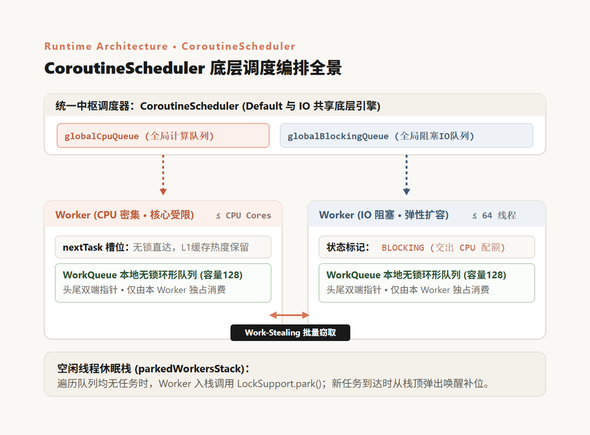
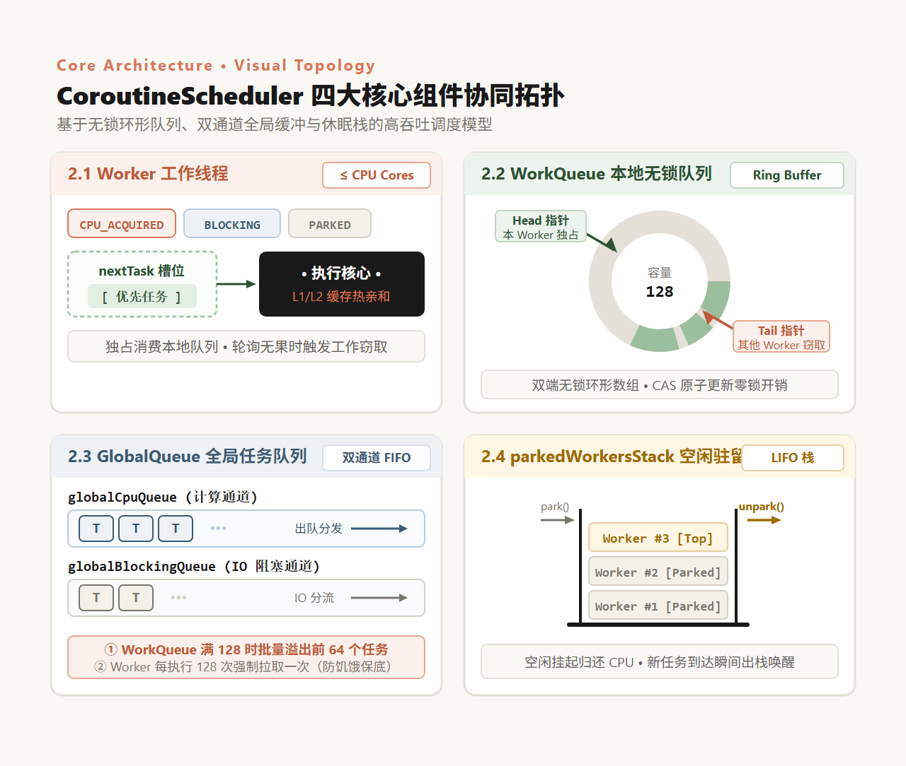
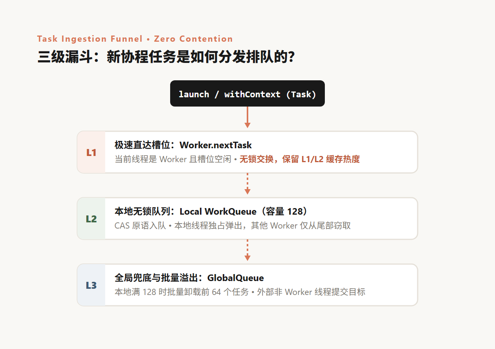
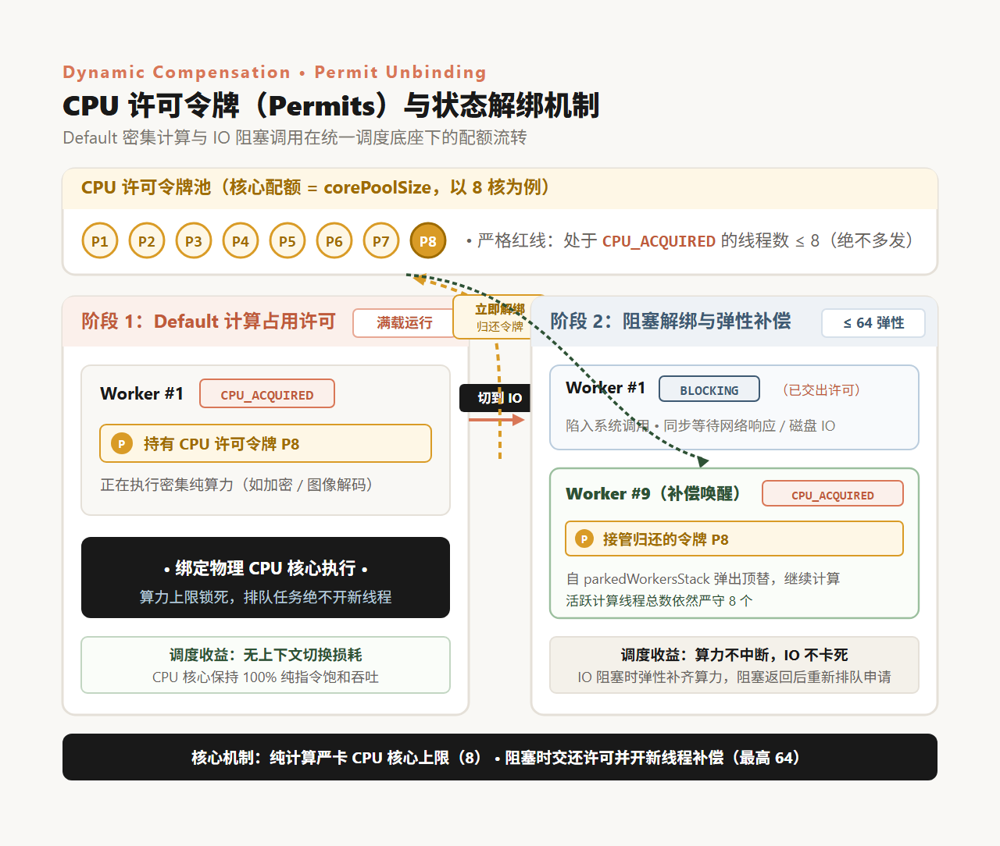

# 拆解 CoroutineScheduler：少量 CPU 线程如何支撑十万协程

很多人在初学 Kotlin 协程时，都听过这样一句宣传语：**“协程是轻量级线程，一台设备能轻松并发运行数十万个协程。”**

然而只要稍加探究源码，就会发现一个令人困惑的矛盾事实：

在 `Dispatchers.Default` 调度器底层，**线程池的线程数其实默认就等于设备的 CPU 核心数**。在一台 8 核手机上，物理工作的线程仅仅只有 8 个。

这就引出了一个非常尖锐的技术疑问：

**“底层的物理工作线程只有 8 个，凭什么能支撑 10 万个并发协程？如果这 10 万个协程同时需要 CPU 计算资源，调度器是如何调度它们的？”**

这背后是调度器基于协程生命周期特征与无锁队列的高吞吐编排设计。`kotlinx.coroutines` 并没有直接沿用 JDK 原生的 `ThreadPoolExecutor` 或 `ForkJoinPool`，而是在底层实现了一套专门针对协程调度的核心组件：**`CoroutineScheduler`**。

本文将从硬件物理约束出发，逐层拆解这套高吞吐无锁编排体系，看清成千上万个任务是如何在极小的线程池中高效流转的。



---

## 1. 概念澄清：10 万个并发究竟指的是什么

在讨论调度器怎么调度之前，首先需要厘清两个在并发认知中极其容易混淆的概念。

### 1.1 为什么 10 万个线程会瞬间崩溃

如果尝试在 Java / Android 中直接创建 10 万个普通的 `Thread`：

```kotlin
// 这样运行，任何手机或服务器都会瞬间 OOM 或崩溃
repeat(100_000) {
    thread {
        Thread.sleep(10_000L)
    }
}
```

系统会瞬间崩溃，原因有两个硬性物理壁垒：

1. **内存耗尽（Stack Memory）**：操作系统的每个内核线程都有独立的调用栈，在 Android/Linux 上一个线程默认占用 1MB 左右栈空间。10 万个线程光栈内存就需要 **100 GB**，没有任何一台普通设备能够承受；
2. **内核调度开销过大（Context Switch）**：10 万个线程在操作系统调度器（如 Linux CFS）中争抢 CPU，CPU 绝大部分算力都将被寄存器现场保存恢复、内核态与用户态频繁切换的开销消耗殆尽。

### 1.2 10 万个协程本质只是堆内存中的轻量对象

而当我们创建 10 万个协程时：

```kotlin
// 这样运行，内存占用不过几十兆，轻轻松松
val scope = CoroutineScope(Dispatchers.Default)
repeat(100_000) {
    scope.launch {
        delay(10_000L)
    }
}
```

协程在挂起时，并不占用任何物理工作线程。在 JVM 堆内存中，它本质上是一个实现了 `Continuation` 接口的普通 Java 对象：

- 它只保存了当前函数执行到了第几个状态步骤、局部变量的值；
- 一个挂起的协程对象只占用 **几十到几百个字节**；
- 10 万个协程对象放在内存里，总体占用仅几十 MB。

因此，“支撑 10 万个协程”的第一层含义是：**在内存中维持大量并发任务上下文的代价极低**。

但这只是内存层面，真正核心的疑问在于：**当它们都要执行时，算力怎么给？**

---

## 2. 调度核心中枢：CoroutineScheduler 的四大协作组件

`kotlinx.coroutines` 没有直接套用 Java 现成的线程池，核心原因在于：普通线程池基于单一阻塞队列和全局重锁，当成千上万个极细粒度的任务高频进出时，互斥锁的竞争（Lock Contention）会导致严重的吞吐量暴跌。

为此，官方设计了 **`CoroutineScheduler`**，其内部构建了四大核心组件：



### 2.1 Worker（工作线程）

继承自 `java.lang.Thread`，是调度器中真正执行任务的物理线程。每个 Worker 内部维护了一个紧凑的状态机：

- `CPU_ACQUIRED`：正在占用 CPU 核心执行纯算力任务；
- `BLOCKING`：正在执行阻塞 IO 或系统调用；
- `PARKING` / `PARKED`：无任务可执行，正在准备或已经进入挂起休眠；
- `TERMINATED`：线程销毁退出。

### 2.2 WorkQueue（本地双端无锁环形队列）

每一个 Worker 线程内部都自带一个专属于自己的本地队列，**容量固定为 128**：

- 采用数组实现的环形缓冲区（Ring Buffer）；
- 内部读写全部采用 **CAS 原子原语**，完全没有 `synchronized` 或 `ReentrantLock`；
- 本 Worker 独占头部出队执行；仅当其他 Worker 触发工作窃取时才从尾部出队竞争。

### 2.3 GlobalQueue（全局溢出与跨线程队列）

调度器内部分离了两个全局队列：`globalCpuQueue` 与 `globalBlockingQueue`。

- 当 Worker 自身的本地队列装满（超过 128 个）发生溢出时，批量转移任务到全局队列；
- 当外部线程（例如 Android 主线程）直接派发协程任务时，优先投递到全局队列。

### 2.4 parkedWorkersStack（空闲线程驻留栈）

通过 CAS 操作维护的一组空闲 Worker 链表栈。当某个 Worker 遍历所有队列均未获取到任务时，会通过 `LockSupport.park()` 挂起休眠并压入栈顶；新任务到达时，调度器会从栈顶弹出并唤醒 Worker。

---

## 3. 任务是如何排队的：三级极速分发漏斗

当我们在代码中调用 `launch(Dispatchers.Default)` 时，这个协程会被封装成一个基础单元 `Task`。

为了在面对海量任务时彻底消除全局锁争抢，任务提交经历了一套精密的三级分发链路：



### 3.1 第一级：尾调用优化槽位（Worker.nextTask）

如果当前提交任务的代码本身就已经运行在某一个 Worker 线程中，调度器会优先检查当前 Worker 的 `nextTask` 引用槽位：

- 如果该槽位空闲，直接将新任务写入该槽位；
- **这个过程没有任何入队开销，没有 CAS，更没有锁**；
- 可直接衔接执行该任务，维持了 CPU L1/L2 缓存（指令与数据 Cache）的高命中率。

### 3.2 第二级：本地无锁队列（Local WorkQueue）

如果 `nextTask` 已经被占用了，Worker 会尝试将旧任务压入自己的本地环形队列：

- 每个 Worker 只对自己的本地队列有压入权限；
- 通过原子自增尾指针（tail）写入任务，开销极低。

### 3.3 第三级：批量卸载与全局队列（GlobalQueue）

如果本地队列已满（达到了 128 的上限），Worker 不会阻塞等待，而是触发**批量卸载（Offload）**：

- Worker 会将本地队列前半部的任务（约 64 个）一次性取出；
- 批量打包推送到全局队列 `globalCpuQueue`；
- 这样为本地队列留出了缓冲空间，兼顾了本地吞吐与全局负载均衡。

---

## 4. 任务获取与调度流转：Worker 的轮询与窃取机制

在 Worker 线程的执行主循环（`runWorker()`）中，遵循严格的获取优先级，确保即使存在大量积压任务，物理核心也能保持高效运转：

### 4.1 优先级 1：优先消费私有槽位与本地队列（nextTask ➔ WorkQueue）

Worker 优先从自身的 `nextTask` 和本地 `WorkQueue` 的头部提取任务执行。由于该操作发生在线程私有区域内，无跨线程竞争，执行延迟最低。

### 4.2 优先级 2：每 128 次轮询必查全局队列（防饥饿机制）

如果 Worker 持续只处理本地队列任务，全局队列中的任务可能会面临饥饿风险。
因此 `CoroutineScheduler` 设立了一条硬约束：
**Worker 内部维护一个迭代计数器，每消费 128 个任务，必须强制去全局队列扫描并拉取一次任务。** 这保证了多模块、外部线程提交的任务具有绝对的执行保底。

### 4.3 优先级 3：工作窃取机制（Work-Stealing：批量半数窃取）

当 Worker 本地队列与全局队列均为空时，并不会立即挂起，而是进入工作窃取流程：

1. 随机选取另一个 Worker 作为目标；
2. 检查其本地队列是否存在可执行任务；
3. **核心机制：批量窃取半数任务（Half-Stealing）**。Worker 通过 CAS 操作一次性将目标队列前半部的任务转移到自身本地队列；
4. 这种批量转移的设计，一方面分担了高负载 Worker 的积压任务，另一方面使当前 Worker 获取到连续的任务来源，避免频繁触发跨线程窃取开销。

### 4.4 优先级 4：进入休眠（LockSupport.park）

只有当遍历其他 Worker 队列均未窃取到任务时，该 Worker 才会向 `CoroutineScheduler` 登记，将其推入 `parkedWorkersStack` 栈顶，并调用 `LockSupport.park()` 挂起，释放 CPU 资源。

---

## 5. 负载边界分析：成千上万个任务同时请求 CPU 时会发生什么

现在，我们可以正面回答那个最核心的疑问：  
**“如果这成千上万个协程都处于活跃状态、没有人在等网络、全都需要 CPU 线程去计算调度，线程池怎么处理？”**

答案非常确定：**排队。任何上层抽象都无法违背硬件物理规律。**

计算机中物理 CPU 核心只有 8 个，同一时刻物理上**永远只能并行执行 8 个指令流**。协程机制本身并不可能将 8 核硬件变成 10 万核。

如果出现 10 万个协程同时需要 CPU 计算，实际运行状态如下：

1. **8 个 Worker 线程各自满载运转**：
   正在执行前 8 个协程的密集计算任务；
2. **其余 99,992 个协程在队列中排队**：
   一部分有序排列在各自 Worker 的 128 槽位本地无锁队列中，其余的大规模存储在 `globalCpuQueue` 中；
3. **协作式调度的特性与潜在饥饿风险**：
   **协程是非抢占式（Non-preemptive）调度的**。操作系统无法像调度线程那样用时间片强制打断一个正在运行纯 CPU 计算的协程。
   如果前 8 个协程存在死循环计算且没有调用任何挂起函数：
   **这 8 个 Worker 线程就会被持续占用，队列中积压的其余 99,992 个协程将无法获得调度执行的机会。**

这也是为什么 Kotlin 官方在高性能计算指南中反复强调一条原则：
在耗时密集型循环中，必须周期性地插入 `yield()` 或 `ensureActive()`。

`yield()` 的本质是当前协程主动让出底层执行线程，将自身重新排入调度队列末尾，使队列中其他等待的协程获得调度机会。

---

## 6. Default 与 IO 的底层共用：动态补偿与配额机制

很多开发者以为 `Dispatchers.Default` 和 `Dispatchers.IO` 是两个完全独立的线程池，但只要翻开源码就会发现：

**它们在底层其实共用着同一个 `CoroutineScheduler` 实例！**

那为什么 Default 严格限制为 CPU 核心数，而 IO 却允许膨胀到 64 甚至数百个线程？调度器在底层是如何区分二者的？

核心在于调度器的 **CPU 许可令牌（Permits）与状态解绑机制**：



```kotlin
// CoroutineScheduler 内部的核心属性定义
internal val corePoolSize: Int      // 默认等于 CPU 物理核心数
internal val maxPoolSize: Int       // 默认取 64 与 CPU 核心数中的较大值
```

1. **计算任务持有 CPU 许可**：
   当 Worker 执行 Default 任务时，它的状态被标记为 `CPU_ACQUIRED`。调度器内部维护着严格的上限：**处于 `CPU_ACQUIRED` 的 Worker 数量在任何时刻都绝不能超过 `corePoolSize`**。即便有大量计算协程排队，调度器也不会超出 `corePoolSize` 创建更多线程，避免产生多余的操作系统线程上下文切换开销；
2. **IO 阻塞任务剥离 CPU 许可**：
   当协程切换到 `Dispatchers.IO` 执行文件读写或同步请求时，代码可能会导致线程陷入系统调用而阻塞。
   此时 Worker 的状态被切换为 `BLOCKING`。
   **关键机制发生在这一瞬间**：当 Worker 进入阻塞状态不再消耗 CPU 算力时，调度器会**立即解绑并释放其持有的 CPU 许可令牌，将配额归还给公共池**；
3. **弹性动态补位（Compensation）**：
   由于 CPU 许可被归还，调度器会立刻检查是否还有任务排队。如果有，它会立刻从 `parkedWorkersStack` 唤醒或新创建一个 Worker 顶替上来继续计算；
   当阻塞结束，这个 Worker 想要重新执行计算代码时，必须重新向调度器申请 CPU 许可，如果配额已满，它就必须降级等待。

这种机制兼顾了计算密集型任务的高吞吐与 IO 阻塞任务的弹性补偿：**纯计算场景下严格控制线程数以避免上下文切换，IO 阻塞场景下则动态释放配额并补偿工作线程，防止调度饥饿。**

---

## 7. 小结

回顾整个调度体系，协程高并发运行的底层机制可归纳为四个核心要点：

1. **对象轻量与硬件物理约束**：协程在挂起时仅为堆内存中的轻量数据对象，内存开销极低；但硬件层面的并行能力始终受物理核心数限制；
2. **三级分发队列设计**：通过 `nextTask` 槽位、128 容量的本地 CAS 无锁环形队列以及全局队列，将多线程锁竞争开销降至最低；
3. **工作窃取与防饥饿机制**：Worker 按照“本地队列 ➔ 全局队列保底 ➔ 跨 Worker 半数窃取”的优先级轮询，确保物理核心负载均衡与高利用率；
4. **统一调度底座与许可配额**：Default 与 IO 共享同一套 `CoroutineScheduler`，通过 CPU 许可令牌的动态申请与释放，兼顾了密集计算的高吞吐与阻塞调用的弹性补偿。

## 参考资料

- [CoroutineScheduler.kt Source Code](https://github.com/Kotlin/kotlinx.coroutines/blob/master/kotlinx-coroutines-core/jvm/src/scheduling/CoroutineScheduler.kt)（JetBrains kotlinx.coroutines · 2024-03）
- [Work-stealing scheduling algorithms](https://gee.cs.oswego.edu/dl/papers/fj.pdf)（Doug Lea · 2000-10）
- [Coroutine Context and Dispatchers](https://kotlinlang.org/docs/coroutine-context-and-dispatchers.html)（Kotlin Official Documentation · 2024-05）
